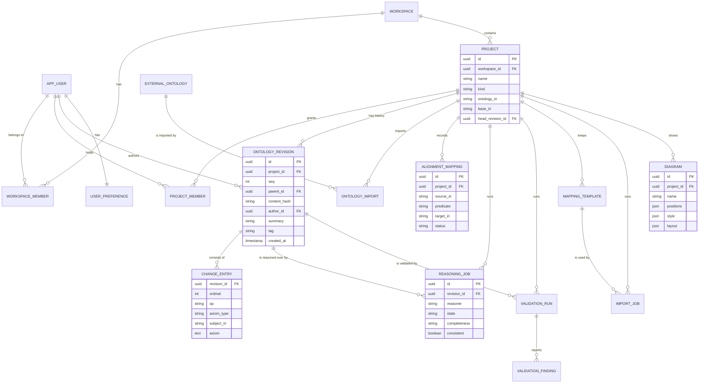
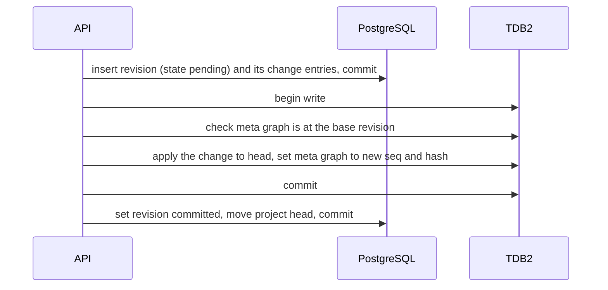
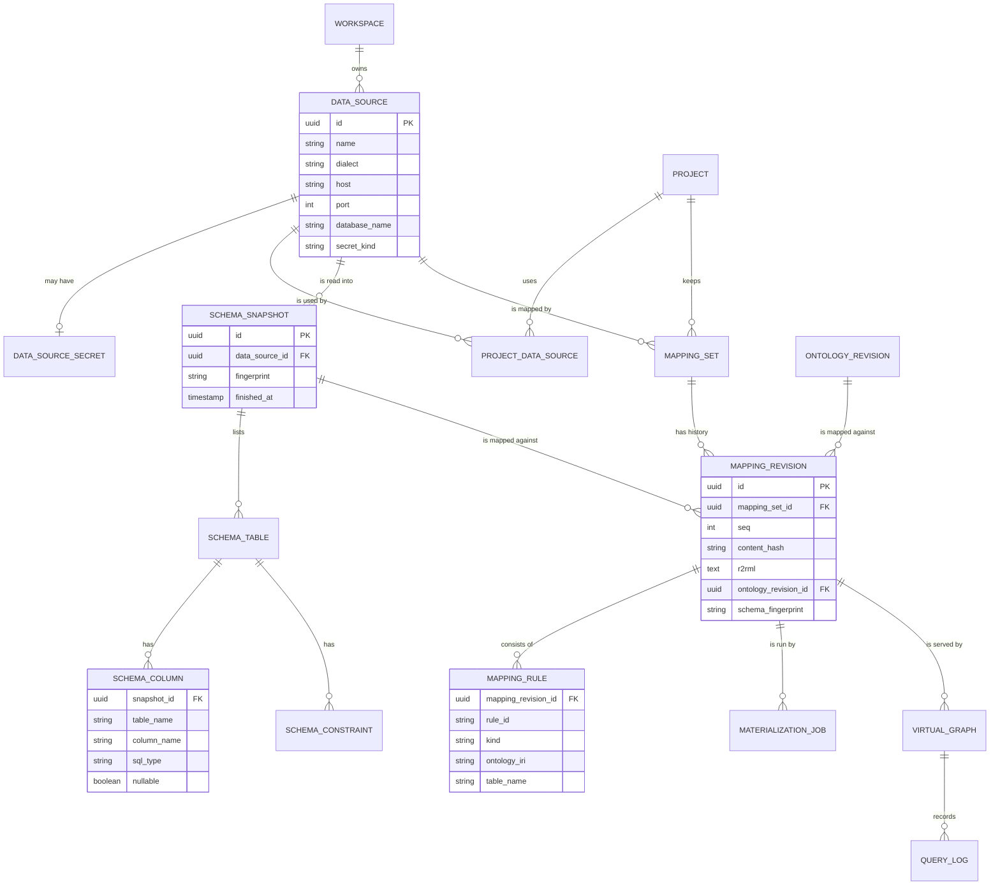
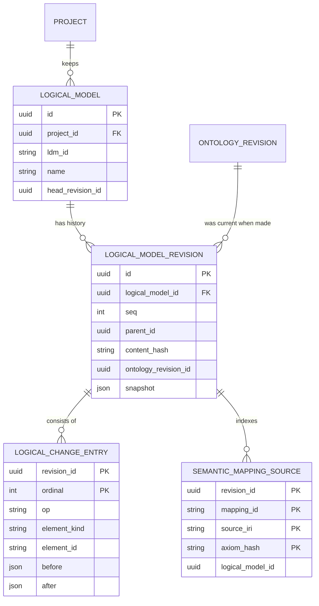

# Data Architecture

Current state assessed against the repository as of 2026-10-13 (commit `ce6419e`). Companion
documents: [SYSTEM_ARCHITECTURE.md](SYSTEM_ARCHITECTURE.md),
[TECHNICAL_DEBT.md](TECHNICAL_DEBT.md), [DEVELOPMENT_ROADMAP.md](DEVELOPMENT_ROADMAP.md).

Labels as in the architecture document: **Existing**, **Partially Implemented**,
**Recommended**, **Future**.

Sections 1 to 9 cover the ontology platform. **Section 11 adds logical data models** (2026-10-17):
LDM documents, their identities, logical change sets and revisions, semantic mappings to the
ontology, and where each is kept in every profile. **Section 10, the data of ontology-to-relational
integration** (connections, credentials, schema snapshots, R2RML mappings), is **deferred** with
that track ([DEVELOPMENT_ROADMAP.md](DEVELOPMENT_ROADMAP.md) §11): kept as the design of record,
not scheduled.

## 1. Principles

1. **OWL stays OWL.** Classes, properties, individuals, restrictions and axioms are stored as
   RDF, in the standard OWL 2 mapping to RDF graphs. They are never broken into relational
   tables such as `class`, `property` or `restriction`.
2. **Application metadata stays out of the ontology.** Who may edit a project, which job ran,
   where a box sits on a canvas: none of this is a statement of the ontology, and none of it is
   written to RDF. The application already holds this line for pictures (`Model.style`,
   `Model.layout`; "never written to RDF" in `src/model/types.ts`).
3. **Asserted and inferred never share a graph.** What a reasoner concluded is kept beside what
   was stated, labelled with the reasoner and the revision it reasoned over.
4. **A revision is immutable.** Editing produces a new revision; nothing rewrites history.
5. **One schema per store, whatever the deployment.** The companion on a laptop and a hosted
   server use the same graph layout and the same relational migrations.
6. **The browser is a full citizen.** A project can live entirely in IndexedDB; a server project
   can be worked on from a cached copy.
7. **Each artifact is stored as itself.** The ontology, its shape sets and its logical data
   models are stored apart, have revisions apart, and are never written into one another; only
   mappings refer to two of them (§11). The same held for a database's schema and its mapping in
   the deferred data-integration design (§10).
8. **A secret is not data.** A database credential is never stored with, exported with, or
   returned alongside anything else (§10.6).

## 2. What exists today (Existing)

| Store | Where in code | Contents | Limits |
| --- | --- | --- | --- |
| In-memory model | `Model` in `src/model/types.ts` | Everything: terms, relationships, object properties, annotation properties, shapes, mappings, external references, governance set-up, style, layout, enumerated datatypes. | Capped at 250,000 terms and 1,000,000 relationships (`MAX_TERMS`, `MAX_RELATIONS`; 50,000 and 100,000 until 2026-10-15). |
| `localStorage` | `src/model/state/storage.ts` | Theme, panel state, saved graph styles, the reasoner's address, the display language. Until 2026-10-15 also the working copy, as one JSON string (TD-11); one left there is moved to IndexedDB when the app starts. | About 5 MB per origin. |
| IndexedDB, database `conceptweaver` | `src/model/library.ts` | Object stores `models` (name, dates), `data` (the model JSON), `externals` (the Turtle of each added external ontology); `working` (database version 3, 2026-10-15): the working copy, as the model itself with which saved model it is, written 300 ms after each change; `datagraphs` (version 4): the content of data graphs; `versions` (version 5, 2026-10-16): named versions; `assistant` (version 6, 2026-10-16): the assistant's conversations and proposals, by ontology, never a key. | Per browser, as much as the browser gives the site; can be evicted (AR-09) unless the browser agrees to persistent storage, which is asked for once something has been edited. |
| Undo history | `past`, `future` of the document slice (`src/model/state/document.ts`, steps of `src/editing/local.ts`) | Steps, each the parts of the model an edit replaced, before and after; its axioms worked out when asked for. | In memory: lost on reload; named versions are what is kept (§6.4). Which artifact a step changed is worked out from the parts it replaced (`stepArtifacts`, TD-19). |
| Files | `src/model/files.ts`, `rdfFormats.ts`, `src/io/` | Read: own JSON, Turtle, N-Triples, N-Quads, TriG, RDF/XML, JSON-LD, and through the Java service OWL/XML, functional, Manchester, OBO. Write: own JSON, Turtle (OWL, SKOS, with inferred assertions), JSON-LD, RDF/XML, CSV, SVG, PNG, HTML, and through the Java service OWL/XML, functional and Manchester (2026-10-16). | — |
| Java service | `reasoner/ReasonerService.java` | Nothing. It keeps no state between requests. | — |

There is no relational database and no triple store. oxigraph is used as an in-memory SPARQL
engine built afresh from the exported Turtle (`src/model/sparql.ts`).

## 3. Where each kind of data belongs (Recommended)

### 3.1 By deployment profile

| Data | Local profile | Companion and server |
| --- | --- | --- |
| Asserted axioms | Model JSON in IndexedDB | Named graph in TDB2 |
| Inferred axioms | In memory, per session | Named graph in TDB2, per revision and reasoner |
| SHACL shape sets (from SH-1; one set until then) | In the model | A named graph in TDB2 for each set |
| External ontologies | Turtle in IndexedDB (`externals`) | Named graphs in TDB2, shared between projects |
| Versions and change sets | IndexedDB | Relational rows; snapshot graphs for releases |
| Projects, members, roles | — (one user) | Relational |
| Jobs (reasoning, validation, import) | In memory | Relational |
| Mapping metadata, import templates | In the model | Relational |
| Diagrams: positions, style, layout, line ends | In the model | Relational, as JSON documents |
| Logical data models, with their diagrams (from LM-1) | In the model (`Model.logicalModels`, model format 6) | Relational: LDM documents and logical change entries, each LDM a line of revisions (§11.7) |
| Semantic mappings between the ontology and an LDM (from LM-3, LM-4) | In their LDM; their status and impact are worked out against the ontology, never stored | Relational, with the LDM; an index of their source IRIs (§11.7) |
| Session: selection, viewport, open panels, display language | `localStorage` | `localStorage` (never sent) |
| Search index | Built in memory per revision (`src/entities/service.ts`) | Lucene index beside TDB2 |
| Database connection definitions (deferred, §10) | — | Relational (§10.2) |
| Database credentials (deferred) | Never | The backend's secret handling only (§10.6) |
| Relational schema snapshots (deferred) | A cached copy in IndexedDB, for offline mapping | Relational |
| R2RML mapping sets (deferred) | A draft in IndexedDB | Relational, as immutable revisions |
| Rows of an external database (deferred) | Never stored | Not stored, unless materialised on request into a data graph |

### 3.2 The current model, field by field

Each field of `Model` (`src/model/types.ts`) has exactly one home in the target. This table is
the migration map.

| Field of `Model` | What it is | Target home |
| --- | --- | --- |
| `name`, `description` | Title and description of the ontology | Annotations on the ontology in the asserted graph; `project.name` mirrors the title for listing |
| `ontologyIri`, `baseIri` | The ontology's IRI; the namespace new IRIs are made in | Ontology IRI in the graph; `project.base_iri` |
| `prefixes` | Namespace prefixes | `project.prefixes` (JSON). Prefixes are how IRIs are written, not statements |
| `mode` | OWL ontology or SKOS vocabulary | `project.kind` |
| `lang` | Default language of labels | `project.default_lang`; every literal carries its own language tag in the graph |
| `terms` (name, description, synonyms, type, `iri`, `fields`, `ranges`, `domains`, `values`, `oneOf`, `classAxioms`) | Classes, data properties, individuals and what is said of them | Axioms and annotation assertions in the asserted graph |
| `terms[].x`, `.y`, `.color` | Where a term is drawn and in which colour | `diagram.positions`, `diagram.style` |
| `props` | Object properties with characteristics, domains and ranges (an axiom for each statement, model format 3), hierarchy | Axioms in the asserted graph |
| `annProps` (model format 7, since 2026-10-17, roadmap 2.7) | Annotation properties as entities of their own, with a name and description in their own language, superproperties, domains, ranges and annotations | Axioms and annotation assertions in the asserted graph: `owl:AnnotationProperty` declarations, `rdfs:subPropertyOf`, `rdfs:domain`/`rdfs:range`, and the annotations on them |
| Further axioms (model format 8, since 2026-10-17, roadmap 2.8) | A property chain on its object property (`ObjProp.chains`, steps a property or its inverse); a key, a disjoint union and a negative property assertion on a term (`Term.keys`, `.disjointUnions`, `.negativeAssertions`); an annotation on a statement (`Model.axiomAnnotations`: its subject, property and target, and its annotation fields) | Axioms in the asserted graph: `owl:propertyChainAxiom`, `owl:hasKey`, `owl:disjointUnionOf`, `owl:NegativePropertyAssertion` (source, assertion property, one target individual or value), and `owl:Axiom` reification |
| `relations` | Subclass links, memberships, restrictions, facts, standard-property statements | Axioms in the asserted graph |
| `relations[].fromCard`, `.toCard` and plain relationships (SKOS mode) | Diagram cardinalities and non-OWL lines | In a vocabulary: SKOS statements in the graph. Cardinality text: diagram metadata |
| `vocab` | Which labels stand for which standard property | `project.settings` (an authoring convenience) |
| `shapes` | SHACL shapes (form-edited nodes and extra Turtle); from SH-1 (model format 5) several named shape sets | One shapes graph for each set |
| `quality` | Quality rules switched on or off | `project.settings` |
| `externals` | References to added ontologies | `external_ontology`, `ontology_import`; content in external graphs |
| `mappings`, `rejected` | Mapping metadata: method, score, status, author, comment; suggestions turned down | `alignment_mapping`, `rejected_suggestion`. The mapping *statement* itself (`owl:equivalentClass`, `skos:exactMatch`) is an axiom in the asserted graph |
| `governance` | How metadata fields are configured | `project.settings`. The metadata *values* are annotations in the graph |
| `style`, `layout` | Graph style, layout choice, line ends | `diagram.style`, `diagram.layout` |
| `datatypes` | Enumerated datatypes | Datatype definitions in the asserted graph |
| `logicalModels` (model format 6, since 2026-10-17, roadmap LM-1) | The project's logical data models, each with its entities, relationships, keys, generalizations, rules, domains, semantic mappings, transformation configuration and diagrams | `logical_model` and its revisions (§11.7). Never in a graph: an LDM is not ontology content (ADR-022) |

Two consequences worth stating:

- Governance values (owner, steward, lifecycle status, `owl:versionInfo`; the registry in
  `src/model/governance.ts` maps about forty fields to DCAT, DCTERMS, SKOS, PROV and ADMS
  properties) are **ontology content**: they are annotations and travel with every export. Only
  the *configuration* of the fields is application metadata.
- A mapping has two parts with two homes. That is already how the code treats it
  (`listMappings` in `src/model/alignment.ts` reads the statements from the axioms and joins the
  metadata from `Model.mappings`).

## 4. RDF triple store (Recommended, Phase 4)

### 4.1 One dataset, named graphs

One TDB2 dataset per installation. Every graph has a name; the default graph is left empty and
the union default graph is off, so a query always says which graphs it reads.

| Graph name | Contents | Lifetime |
| --- | --- | --- |
| `urn:conceptweaver:project:{projectId}:head` | The asserted axioms of the project's current revision, including the ontology header and all annotations. | Changed only by applying a change set. |
| `urn:conceptweaver:project:{projectId}:shapes:{setId}` | The shapes of one shape set of the project (a constraint model; DEVELOPMENT_ROADMAP.md §1.4). | Changed by change sets that name this graph. |
| `urn:conceptweaver:project:{projectId}:rev:{seq}` | A full copy of `head` as it was at revision `seq`. | Written once, when a revision is tagged as a release. Immutable. |
| `urn:conceptweaver:project:{projectId}:inferred:{seq}:{reasoner}` | Axioms inferred from revision `seq` by one reasoner: direct subclass links, equivalences, unsatisfiable classes, inferred types and property assertions. | Written by a reasoning job. Disposable: it can always be recomputed. |
| `urn:conceptweaver:project:{projectId}:data:{datasetId}` | Instance data: loaded for SHACL validation, or materialised from a relational source through a mapping (§10.8). | Until removed. |
| `urn:conceptweaver:project:{projectId}:meta` | Three triples: the revision sequence and content hash that `head` currently holds. | Updated in the same transaction as `head` (§7). |
| `urn:conceptweaver:external:{contentHash}` | One version of one external ontology, as fetched. | Immutable; shared by every project that imports it. |

### 4.2 Asserted, inferred, imported: which graphs a question reads

| View | Graphs |
| --- | --- |
| Asserted (what this ontology states) | `head` |
| Asserted with imports (what a reasoner is given) | `head` and the `external` graphs of its imports closure |
| Inferred (what follows) | The above, and the `inferred` graph of the current revision and chosen reasoner |
| A past release | `rev:{seq}` |

In SPARQL this is a `FROM` list built by the server from the project and the view; users of the
SPARQL view choose the view, not graph names.

```sparql
# Direct subclasses of a class, asserted, with labels (the server fills in the FROM clause)
SELECT ?sub ?label
FROM <urn:conceptweaver:project:7f3a…:head>
WHERE {
  ?sub rdfs:subClassOf <http://example.org/film#Film> .
  FILTER(isIRI(?sub))
  OPTIONAL { ?sub rdfs:label ?label }
}
ORDER BY ?label
```

### 4.3 How OWL is stored

- As triples, in the OWL 2 mapping to RDF graphs: a restriction is a blank node with
  `owl:onProperty` and `owl:someValuesFrom`; an axiom annotation is an `owl:Axiom` reification.
  This is what the OWL API writes and reads.
- **The server reads and writes the graph through the OWL API**, not triple by triple. A change
  set (see [SYSTEM_ARCHITECTURE.md](SYSTEM_ARCHITECTURE.md) §4.3) becomes OWL API changes; the
  resulting triples replace the affected ones in `head`. This keeps blank-node structures whole.
- **Differences are computed over axioms, not triples.** Two serializations of the same class
  expression differ in blank-node labels; the OWL API's structural equality does not.
- Statements with no typed form yet travel as `Unmapped` Turtle and are stored as the triples
  they are.

### 4.4 Text search

A Lucene index maintained by Jena's text module, covering `rdfs:label`, `skos:prefLabel`,
`skos:altLabel`, `skos:definition`, `rdfs:comment` and the local name of each IRI, with the
graph name as a field so that a search is scoped to a project. This is what the Entities
service searches today: the name, other labels, the IRI and the definition (`SearchText` in
`src/entities/contracts.ts`).

### 4.5 What the triple store is not used for

Users, roles, jobs, templates, diagrams and history metadata. Putting them in RDF is possible
and adds nothing: they need foreign keys, uniqueness and ordinary reporting queries.

## 5. Relational schema (Recommended; Server profile from Phase 4)

PostgreSQL in the Server profile; an embedded file database with the same migration scripts in
the companion (ADR-007). Identifiers are UUIDs; timestamps are UTC.

### 5.1 Entity relationship diagram



### 5.2 Tables

**Identity and access** (Phase 5; a single built-in user until then)

| Table | Columns | Keys and indexes |
| --- | --- | --- |
| `app_user` | `id`, `subject` (the identity provider's id), `email`, `display_name`, `created_at` | PK `id`; unique `subject` |
| `workspace` | `id`, `name`, `slug`, `created_at` | PK `id`; unique `slug` |
| `workspace_member` | `workspace_id`, `user_id`, `role` (`member`, `admin`) | PK (`workspace_id`, `user_id`); FKs to both |
| `project_member` | `project_id`, `user_id`, `role` (`viewer`, `commenter`, `editor`, `owner`) | PK (`project_id`, `user_id`); index `user_id` |
| `user_preference` | `user_id`, `theme`, `settings` (JSON), `updated_at` | PK and FK `user_id` |

**Projects and versions** (Phase 4)

| Table | Columns | Keys and indexes |
| --- | --- | --- |
| `project` | `id`, `workspace_id`, `name`, `kind` (`ontology`, `skos`), `ontology_iri`, `base_iri`, `default_lang`, `prefixes` (JSON), `settings` (JSON: quality rules, governance fields, label mappings), `head_revision_id`, `created_by`, `created_at`, `archived_at` | PK `id`; FK `workspace_id`; unique (`workspace_id`, `name`); index `ontology_iri` |
| `ontology_revision` | `id`, `project_id`, `seq`, `parent_id`, `content_hash`, `author_id`, `summary`, `state` (`pending`, `committed`), `axiom_count`, `added`, `removed`, `tag`, `version_iri`, `snapshot_graph`, `created_at` | PK `id`; unique (`project_id`, `seq`); unique (`project_id`, `tag`) where `tag` is set; index (`project_id`, `created_at` descending) |
| `change_entry` | `revision_id`, `ordinal`, `graph` (`head`, or `shapes:{setId}`), `op` (`add`, `remove`), `axiom_type`, `subject_iri`, `axiom` (OWL functional syntax, or Turtle for unmapped statements) | PK (`revision_id`, `ordinal`); index (`subject_iri`, `revision_id`) for "history of this entity" |
| `external_ontology` | `id`, `ontology_iri`, `version_iri`, `content_hash`, `name`, `namespace`, `source`, `source_kind`, `graph_name`, `class_count`, `object_property_count`, `data_property_count`, `individual_count`, `fetched_at` | PK `id`; unique `content_hash`; index `ontology_iri` |
| `ontology_import` | `project_id`, `external_ontology_id`, `declared` (whether `owl:imports` is written), `added_at` | PK (`project_id`, `external_ontology_id`) |

`external_ontology` mirrors `ExternalRef` in `src/model/types.ts`, which has the same fields
today.

**Alignment** (Phase 4)

| Table | Columns | Keys and indexes |
| --- | --- | --- |
| `alignment_mapping` | `id`, `project_id`, `source_iri`, `predicate`, `target_iri`, `method` (`manual`, `suggested`, `imported`), `score`, `status` (`proposed`, `approved`, `needs review`), `author_id`, `comment`, `created_at`, `updated_at` | PK `id`; unique (`project_id`, `source_iri`, `predicate`, `target_iri`); index (`project_id`, `status`) |
| `rejected_suggestion` | `project_id`, `source_iri`, `target_iri`, `rejected_at` | PK (`project_id`, `source_iri`, `target_iri`) |

These mirror `MappingMeta` and `Model.rejected`, with the same values.

**Jobs and results** (Phase 3 for reasoning, Phase 4 for the rest)

| Table | Columns | Keys and indexes |
| --- | --- | --- |
| `reasoning_job` | `id`, `project_id`, `revision_id`, `requested_engine`, `reasoner`, `reasoner_version`, `state` (`queued`, `running`, `done`, `failed`, `cancelled`), `completeness` (`complete`, `partial`, `failed`), `consistent`, `unsatisfiable_count`, `inferred_count`, `inferred_graph`, `time_limit_ms`, `duration_ms`, `report` (JSON: what was left out, profile violations, errors), `requested_by`, `created_at`, `started_at`, `finished_at` | PK `id`; index (`revision_id`, `reasoner`, `state`); index (`project_id`, `created_at` descending) |
| `validation_run` | `id`, `project_id`, `revision_id`, `scope` (`all`, `owl`, `shacl`, `quality`), `data_source`, `shape_set_id`, `shapes_hash`, `state`, `conforms`, `error_count`, `warning_count`, `info_count`, `engine`, `created_at`, `finished_at` | PK `id`; index (`project_id`, `revision_id`) |
| `validation_finding` | `run_id`, `ordinal`, `category` (`owl`, `shacl`, `quality`), `level` (`error`, `warning`, `info`), `rule`, `entity_iri`, `entity_type`, `message`, `detail` (JSON) | PK (`run_id`, `ordinal`); index (`run_id`, `level`); index (`run_id`, `entity_iri`) |
| `mapping_template` | `id`, `project_id`, `name`, `source_kind` (`csv`, `xlsx`), `definition` (JSON: which column becomes what), `created_by`, `created_at`, `updated_at` | PK `id`; unique (`project_id`, `name`) |
| `import_job` | `id`, `project_id`, `template_id`, `file_name`, `row_count`, `state`, `result_revision_id`, `report` (JSON: rows skipped and why), `created_by`, `created_at`, `finished_at` | PK `id`; index (`project_id`, `created_at` descending) |

The categories and levels of `validation_finding` are those of `Finding` in
`src/model/validation.ts`.

**Diagrams** (Phase 4)

| Table | Columns | Keys and indexes |
| --- | --- | --- |
| `diagram` | `id`, `project_id`, `name`, `is_default`, `positions` (JSON: IRI to x, y), `style` (JSON: `GraphStyle`, including line ends), `layout` (JSON: `GraphLayout`), `subgraph` (JSON: roots, depth, filters; empty for the full graph), `updated_by`, `updated_at` | PK `id`; unique (`project_id`, `name`) |
| `saved_style` | `id`, `owner_id`, `name`, `definition` (JSON) | PK `id`; unique (`owner_id`, `name`) |

A project may have several diagrams. Today it has exactly one, inside the model; allowing
several is a product gain that falls out of moving pictures out of the ontology.

**Collaboration** (Future, Phase 5; listed so the schema above does not need reshaping)

`discussion` (thread on an entity or a revision), `discussion_comment`, `review_request`
(a proposed change set awaiting approval), `audit_event` (membership and settings changes).

### 5.3 Example definitions

```sql
CREATE TABLE ontology_revision (
  id             uuid PRIMARY KEY,
  project_id     uuid NOT NULL REFERENCES project(id) ON DELETE CASCADE,
  seq            integer NOT NULL,
  parent_id      uuid REFERENCES ontology_revision(id),
  content_hash   char(64) NOT NULL,
  author_id      uuid NOT NULL REFERENCES app_user(id),
  summary        text NOT NULL,
  state          text NOT NULL CHECK (state IN ('pending', 'committed')),
  axiom_count    integer NOT NULL,
  added          integer NOT NULL DEFAULT 0,
  removed        integer NOT NULL DEFAULT 0,
  tag            text,
  version_iri    text,
  snapshot_graph text,
  created_at     timestamptz NOT NULL DEFAULT now(),
  UNIQUE (project_id, seq)
);
CREATE UNIQUE INDEX ontology_revision_tag ON ontology_revision (project_id, tag) WHERE tag IS NOT NULL;
CREATE INDEX ontology_revision_recent ON ontology_revision (project_id, created_at DESC);

CREATE TABLE change_entry (
  revision_id uuid NOT NULL REFERENCES ontology_revision(id) ON DELETE CASCADE,
  ordinal     integer NOT NULL,
  graph       text NOT NULL DEFAULT 'head' CHECK (graph = 'head' OR graph LIKE 'shapes:%'),
  op          text NOT NULL CHECK (op IN ('add', 'remove')),
  axiom_type  text NOT NULL,
  subject_iri text,
  axiom       text NOT NULL,
  PRIMARY KEY (revision_id, ordinal)
);
CREATE INDEX change_entry_subject ON change_entry (subject_iri, revision_id);

CREATE TABLE reasoning_job (
  id                 uuid PRIMARY KEY,
  project_id         uuid NOT NULL REFERENCES project(id) ON DELETE CASCADE,
  revision_id        uuid NOT NULL REFERENCES ontology_revision(id) ON DELETE CASCADE,
  requested_engine   text NOT NULL,
  reasoner           text,
  reasoner_version   text,
  state              text NOT NULL CHECK (state IN ('queued', 'running', 'done', 'failed', 'cancelled')),
  completeness       text CHECK (completeness IN ('complete', 'partial', 'failed')),
  consistent         boolean,
  unsatisfiable_count integer,
  inferred_count     integer,
  inferred_graph     text,
  time_limit_ms      integer NOT NULL,
  duration_ms        integer,
  report             jsonb,
  requested_by       uuid REFERENCES app_user(id),
  created_at         timestamptz NOT NULL DEFAULT now(),
  started_at         timestamptz,
  finished_at        timestamptz
);
CREATE INDEX reasoning_job_lookup ON reasoning_job (revision_id, reasoner, state);
```

`consistent` is nullable on purpose: *unknown* is a real answer (the service says "Unknown: the
reasoner gave no answer" today, and never reports that as consistent).

## 6. Versioning and change tracking (Recommended)

### 6.1 Model

- A **revision** is the state of a project's asserted axioms (and shapes) after one change set.
  Revisions of a project form a line: each has one parent. Branches are not part of this design
  (Future). Each logical data model has a line of revisions of its own beside the ontology's
  (§11.4): an LDM change does not make an ontology revision, nor an ontology change an LDM
  revision.
- A **change set** is an ordered list of axiom additions and removals with a one-line summary
  ("Made Documentary a subclass of Film"). It is the unit of saving, of undo, of history and of
  review.
- A revision has a sequence number (for people: "revision 42") and a content hash (for
  machines: equal hash, equal ontology). The application already computes a content
  fingerprint to mark results stale (`fingerprint`, `revisionOf` in
  `src/model/validation.ts`); the hash is that idea made durable.
- A **release** is a revision with a tag and, usually, an `owl:versionIRI` and
  `owl:versionInfo` written into the ontology header. Only releases keep a full snapshot graph.

### 6.2 What each question costs

| Question | How it is answered |
| --- | --- |
| What does the ontology say now? | The `head` graph. |
| What changed in revision 42? | Its `change_entry` rows. |
| What changed between two revisions? | The entries in between, net of additions later removed. Between two releases, also possible as a set difference of two snapshot graphs through the OWL API. |
| What is the history of this class? | `change_entry` by `subject_iri`. |
| What did the ontology say at revision 42? | The nearest release snapshot at or before 42, with the entries after it applied. |
| Who changed it, and when? | `ontology_revision.author_id`, `created_at`. |

### 6.3 Granularity and volume

- Interactive edits are small change sets: a handful of entries each.
- A bulk import or an imported file of 100,000 axioms is recorded as one revision. Above a
  threshold (a setting; 5,000 entries as a starting point) the entries are not stored row by
  row: the revision is given a snapshot instead and its summary carries the counts. History
  remains complete; "which axioms" for that revision is answered by comparing snapshots.
- Rapid edits by one person can be squashed on save: the unit a user thinks in is "what I did
  before pressing Save", not each keystroke. Undo within a session stays as fine-grained as it
  is now.

### 6.4 In the Local profile (Phase 2, before any server)

The same model, kept in IndexedDB (**Existing** since 2026-10-16, roadmap task 2.3):

- object store `versions` (database version 5, indexed by `project`): one record per saved
  version of a model in My Models, with its number, name, summary, time, content hash and the
  model JSON, gzip-compressed where the browser has `CompressionStream`; deleting the model
  deletes its versions;
- the diff between two versions is computed in the page by comparing what each states, statement
  by statement (`changesBetween` in `src/editing/local.ts`, over `toTurtle`), presented by entity
  (`src/projects/difference.ts`), with the shape sets' statements and the data graphs beside it;
- from LM-1, a version holds the project's logical data models and their mappings too (they are
  in the model it keeps), and the difference lists their changes element by element (§11.6).

This gives named versions and a readable diff to every user of the app long before Phase 4, and
its user interface is the one the server-backed history reuses.

## 7. Integrity and transaction boundaries

### 7.1 Within the relational store

Ordinary foreign keys and constraints, as in §5. Deleting a project cascades to its revisions,
jobs, mappings and diagrams.

### 7.2 Between the relational store and the triple store

A change set touches both stores, and there is no transaction spanning them. The sequence below
makes every failure recoverable without a distributed transaction.



| Failure | State left behind | Recovery |
| --- | --- | --- |
| Before the TDB2 commit | A `pending` revision; `head` unchanged | The pending row is deleted. The edit did not happen; the user is told. |
| After the TDB2 commit, before the last step | `head` and its `meta` graph are at the new revision; the row is still `pending` | On the next request or at start-up the `meta` graph is compared with the row: they agree, so the row is marked committed. |
| Two writers at once | The second finds the `meta` graph is no longer at its base revision | Refused as `stale-revision`; nothing written. |

The `meta` graph is the reason this works: the triple store itself records which revision it
holds, inside the same transaction as the data.

### 7.3 Referential integrity inside the ontology

RDF has no foreign keys, and OWL does not want them: an axiom may mention an entity declared in
an import, or not declared at all. The rules the application enforces are checks, not
constraints:

- at edit time, the existing rule functions (`src/model/props.ts`, `relating.ts`, `axioms.ts`,
  `reconnect.ts`) accept or refuse a change;
- at validation time, quality rules report dangling references and undeclared entities;
- deleting an entity removes the axioms that mention it in the same change set, as `remove` in
  the store does today, and the change set lists them so the history shows what went.

### 7.4 Derived data

Inferred graphs, validation runs, the text index and cached counts are all derived from a
revision. Each is keyed by the revision it was computed for and is safe to delete. Nothing
derived is ever the only copy of anything.

## 8. Browser storage beside server storage

### 8.1 What the browser keeps, in every profile

| IndexedDB object store | Contents | Status |
| --- | --- | --- |
| `models`, `data` | Local projects: listing and content | **Existing** |
| `externals` | Fetched external ontologies, as Turtle | **Existing** |
| `working` | The working copy of the open project (replacing the `localStorage` string) | **Existing** (2026-10-15, TD-11) |
| `datagraphs` | The content of data graphs, by the id their reference has in a model | **Existing** (2026-10-16, SH-2) |
| `versions` | Saved versions of local projects | **Existing** (2026-10-16, task 2.3) |
| `assistant` | The assistant's conversation and proposals about each ontology, never a key | **Existing** (2026-10-16) |
| `drafts` | For a server project: change sets made but not yet pushed, with the revision they are based on | Recommended, Phase 4 |
| `cache` | Answers from the server keyed by revision (a page of entities, a branch of the hierarchy) | Recommended, Phase 4 |

### 8.2 Local projects and server projects

A project is one or the other, and says which:

- A **local project** lives in IndexedDB and in files. It can be **published** to a server: the
  server creates a project from its content and the local copy becomes a draft of it.
- A **server project** lives on the server. Opening it downloads what the views ask for, not
  the ontology. *Work offline* downloads the current revision into IndexedDB; edits made
  offline accumulate in `drafts`.

### 8.3 Push and pull

No live synchronisation (AR-04). Two explicit operations:

- **Push** sends the draft change sets with their base revision. If the server is still at that
  revision they are applied in order. If not, the push is refused with `stale-revision`.
- **Pull** fetches the change sets since the base revision and replays the drafts on top. A
  draft that no longer applies (it removes an axiom someone else already removed, or adds one
  that now breaks a rule) is shown to the user with both sides; it is not resolved silently.

Because a change set is a list of axiom additions and removals, most concurrent edits to
different entities replay without conflict.

### 8.4 What never leaves the browser

Selection, viewport, which panels are open, the theme, and unsaved text in a field. A server
never needs them and they make no sense on another machine.

## 9. Backup and retention

- **Backup unit**: the TDB2 directory and the relational database together, taken while no
  write is in flight (TDB2 supports a consistent backup of a live dataset). One without the
  other is not a version.
- **Releases are the long-term record**: each can also be written out as a file in a standard
  syntax, which is the most durable form an ontology has.
- **Retention**: inferred graphs and validation runs for revisions older than the last few can
  be dropped at any time. Change entries are kept: they are the audit trail.

## 10. Relational sources, schema metadata and mappings (Deferred)

**Deferred on 2026-10-17** with the data-integration track (ADR-027,
[DEVELOPMENT_ROADMAP.md](DEVELOPMENT_ROADMAP.md) §11): kept as the design of record, not
scheduled. Section 11 is the active design.

Nothing in this section exists today. It is the data side of
[SYSTEM_ARCHITECTURE.md](SYSTEM_ARCHITECTURE.md) §12.

### 10.1 Five kinds of content, kept apart

| Content | Example | Owner | Store | Versioned as |
| --- | --- | --- | --- | --- |
| **Ontology axioms** | `Film SubClassOf Work` | The modeller | Asserted graph (§4) | Ontology revisions (§6) |
| **Relational schema metadata** | Table `film` has column `released_on DATE NOT NULL`; `film.director_id` references `person.person_id` | The database's owner; read by the application | Schema snapshots, relational | Snapshots with fingerprints (§10.4) |
| **Mapping definitions** | Rows of `film` are instances of `Film`, with IRI `…/film/{film_id}` | The data integrator | Mapping revisions, as R2RML text | Mapping revisions (§10.5) |
| **Credentials** | The password of the read-only account | An administrator | Secret handling (§10.6) | Not versioned |
| **Row data** | The films themselves | The database | The source database; optionally a materialised data graph | By materialisation run |

Rules that follow:

- An ontology revision contains no table or column name. A schema snapshot contains no IRI of
  the ontology. Only a mapping names both.
- Exporting an ontology never includes a mapping, and exporting a mapping (R2RML) never
  includes a connection or a credential.
- Relational schema metadata is *not* stored as RDF in the triple store. It is not a statement
  of the ontology, it is read and searched as tables and columns, and keeping it relational
  makes it impossible to confuse a column with a property.

### 10.2 Tables

In the metadata store (PostgreSQL in the Server profile, the embedded database in the
companion; ADR-007). Tables of §5 are referred to by name.

**Connections**

| Table | Columns | Keys and indexes |
| --- | --- | --- |
| `data_source` | `id`, `workspace_id`, `name`, `dialect` (`postgresql`, `sqlserver`, `mysql`), `host`, `port`, `database_name`, `tls_mode`, `username`, `secret_kind` (`session`, `reference`, `stored`), `secret_ref`, `selected_schemas` (JSON), `statement_timeout_ms`, `row_limit`, `max_connections`, `created_by`, `created_at`, `last_connected_at` | PK `id`; FK `workspace_id`; unique (`workspace_id`, `name`) |
| `data_source_secret` | `data_source_id`, `ciphertext`, `nonce`, `key_id`, `updated_at` | PK and FK `data_source_id`. Present only when `secret_kind` is `stored`. Readable by the data source module alone. |
| `project_data_source` | `project_id`, `data_source_id`, `added_at` | PK (`project_id`, `data_source_id`) |
| `data_source_grant` | `data_source_id`, `user_id`, `may` (`use`, `sample`, `administer`) | PK (`data_source_id`, `user_id`) (Phase 5) |

`data_source` has no column for a password and no JDBC URL: the URL is built by the backend from
the structured columns.

**Schema snapshots**

| Table | Columns | Keys and indexes |
| --- | --- | --- |
| `schema_snapshot` | `id`, `data_source_id`, `fingerprint`, `server_version`, `schemas` (JSON list read), `table_count`, `column_count`, `state` (`running`, `complete`, `failed`), `taken_by`, `started_at`, `finished_at` | PK `id`; index (`data_source_id`, `finished_at` descending); index `fingerprint` |
| `schema_table` | `snapshot_id`, `schema_name`, `table_name`, `kind` (`table`, `view`, `materialized view`), `comment`, `estimated_rows`, `fingerprint` | PK (`snapshot_id`, `schema_name`, `table_name`); search index on `table_name` |
| `schema_column` | `snapshot_id`, `schema_name`, `table_name`, `column_name`, `position`, `sql_type`, `type_family`, `length`, `numeric_precision`, `numeric_scale`, `nullable`, `default_expr`, `comment` | PK (`snapshot_id`, `schema_name`, `table_name`, `column_name`); search index on `column_name` |
| `schema_constraint` | `snapshot_id`, `schema_name`, `table_name`, `constraint_name`, `kind` (`primary key`, `foreign key`, `unique`), `columns` (ordered JSON), `ref_schema`, `ref_table`, `ref_columns` (ordered JSON) | PK (`snapshot_id`, `schema_name`, `table_name`, `constraint_name`); index (`snapshot_id`, `ref_schema`, `ref_table`) for "what refers to this table" |

`type_family` is the dialect-independent reading of `sql_type` (integer, decimal, floating,
boolean, character, date, time, timestamp, binary, other), which is what a datatype conversion
is chosen from.

**Mappings**

| Table | Columns | Keys and indexes |
| --- | --- | --- |
| `mapping_set` | `id`, `project_id`, `data_source_id`, `name`, `instance_namespace`, `head_revision_id`, `created_by`, `created_at` | PK `id`; unique (`project_id`, `name`) |
| `mapping_revision` | `id`, `mapping_set_id`, `seq`, `parent_id`, `content_hash`, `r2rml` (the mapping as Turtle, immutable), `workbench` (JSON: notes, status per rule, how a condition was built), `ontology_revision_id`, `schema_snapshot_id`, `schema_fingerprint`, `author_id`, `summary`, `tag`, `created_at` | PK `id`; unique (`mapping_set_id`, `seq`); index `ontology_revision_id`; index `schema_fingerprint` |
| `mapping_rule` | `mapping_revision_id`, `rule_id` (the triples map or predicate-object map), `kind` (`class`, `data property`, `object property`), `ontology_iri`, `schema_name`, `table_name`, `column_names` (JSON), `uses_sql_query`, `status` (`proposed`, `approved`, `needs review`) | PK (`mapping_revision_id`, `rule_id`); index (`mapping_revision_id`, `ontology_iri`); index (`mapping_revision_id`, `schema_name`, `table_name`) |

`mapping_rule` is derived from `r2rml` when a revision is written. It exists so that three
questions are index lookups: which entities of the ontology are not mapped, which columns of
the chosen tables are not used, and which rules a changed table affects.

**Runs**

| Table | Columns | Keys and indexes |
| --- | --- | --- |
| `validation_run` (§5.2), extended | add `mapping_revision_id`, `schema_snapshot_id`; `scope` gains `mapping` | index (`mapping_revision_id`) |
| `materialization_job` | `id`, `mapping_revision_id`, `ontology_revision_id`, `schema_fingerprint`, `state`, `graph_name`, `triple_count`, `row_count`, `engine`, `engine_version`, `requested_by`, `started_at`, `finished_at`, `report` (JSON) | PK `id`; index (`mapping_revision_id`, `finished_at` descending) |
| `virtual_graph` | `id`, `project_id`, `mapping_revision_id`, `ontology_revision_id`, `state` (`stopped`, `starting`, `running`, `failed`), `engine`, `engine_version`, `started_at` | PK `id`; unique (`project_id`, `mapping_revision_id`) |
| `query_log` | `id`, `virtual_graph_id`, `user_id`, `sparql_hash`, `sparql`, `sql` (as generated), `duration_ms`, `row_count`, `outcome` (`ok`, `timeout`, `limit`, `error`), `at` | PK `id`; index (`virtual_graph_id`, `at` descending) |

`query_log` holds queries and timings, never result rows.

### 10.3 Entity relationship diagram



### 10.4 Schema snapshots and fingerprints

- A **snapshot** is what discovery read at one moment. It is immutable. A refresh makes a new
  one; the old ones stay while a mapping revision refers to them, and can be pruned otherwise.
- A **fingerprint** is a hash of the structural content in a canonical order: for each chosen
  schema, each table and view with its kind; each column with its position, type, length,
  precision, scale and nullability; each primary key, foreign key and unique constraint with
  its columns. Comments and row estimates are not part of it: a changed comment is not a
  changed schema.
- Each table has its **own fingerprint** as well, so that a difference is found without
  comparing every column, and so that only mappings on changed tables are flagged.
- The **difference** of two snapshots is computed from the rows: tables and columns added,
  removed, retyped, made nullable or not; keys added or dropped. A renamed column is reported
  as a removal and an addition, with the pair offered as a probable rename when type and
  position agree. The application does not guess silently.
- Where a database offers a schema version of its own (a migration table, for instance), it can
  be recorded beside the fingerprint; the fingerprint remains the test.

### 10.5 Mapping sets, R2RML and revisions

**Representation.** A mapping revision *is* an R2RML document (ADR-013). For the example of
§10.1, with illustrative IRIs:

```turtle
@prefix rr:  <http://www.w3.org/ns/r2rml#> .
@prefix ex:  <http://example.org/film#> .
@prefix xsd: <http://www.w3.org/2001/XMLSchema#> .

<#FilmMap> a rr:TriplesMap ;
  rr:logicalTable [ rr:tableName "film" ] ;
  rr:subjectMap [ rr:template "http://example.org/data/film/{film_id}" ; rr:class ex:Film ] ;
  rr:predicateObjectMap [
    rr:predicate ex:releaseDate ;
    rr:objectMap [ rr:column "released_on" ; rr:datatype xsd:date ] ] ;
  rr:predicateObjectMap [
    rr:predicate ex:directedBy ;
    rr:objectMap [ rr:parentTriplesMap <#PersonMap> ;   # defined likewise; not shown
                   rr:joinCondition [ rr:child "director_id" ; rr:parent "person_id" ] ] ] .

# A second class from the same table, by a condition. R2RML has no condition construct:
# the condition is a query.
<#DocumentaryMap> a rr:TriplesMap ;
  rr:logicalTable [ rr:sqlQuery "SELECT film_id FROM film WHERE kind = 'documentary'" ] ;
  rr:subjectMap [ rr:template "http://example.org/data/film/{film_id}" ; rr:class ex:Documentary ] .
```

- **Lossless.** An imported R2RML document is stored as it came. Constructs the workbench has
  no editor for (a graph map, a constant-valued subject, an inverse expression) are kept, shown
  read-only and exported unchanged. Importing and exporting without editing yields an
  equivalent RDF graph.
- **What R2RML does not hold** goes beside it in `workbench`: a note on a rule, its review
  status, and how a condition was built in the form (so that it can be edited as a form again
  instead of as SQL). Losing `workbench` loses convenience, never meaning.
- **A revision is immutable** and has a sequence number and a content hash, exactly as an
  ontology revision does (§6). Mappings are small (kilobytes to a few megabytes), so every
  revision keeps its full text; there are no change sets and no snapshots to manage.

**Independent versioning.** A mapping set has its own line of revisions. It does not advance
when the ontology does, and the ontology does not advance when a mapping changes. Each mapping
revision records the two things it was written against: `ontology_revision_id` and
`schema_snapshot_id` with its `schema_fingerprint`.

### 10.6 Credential management

Principles, in order of importance:

1. **The browser never holds a credential.** Not in memory beyond the form field in which it is
   typed, not in `localStorage`, IndexedDB, a model file, a project export or an R2RML file.
   No endpoint returns one; the API reports only that a secret is set.
2. **Prefer not storing.** Three kinds, chosen per data source (`secret_kind`):
   - `reference`: the name of a secret the environment provides (an environment variable, a
     mounted file, a secret manager entry). The application stores the name. This is the
     recommended form for a server.
   - `session`: typed when connecting and kept in the backend's memory until it stops. Nothing
     is written. This is the recommended form for the companion.
   - `stored`: encrypted with an authenticated cipher under a key that is not in the database
     (from the environment or a key service), with the key's id recorded so that keys can be
     rotated. Only where the other two are impractical.
3. **Least privilege, verified where possible.** The account is meant to be read-only. On
   connecting, the product checks what the dialect lets it check and warns when the account can
   write. It opens every connection read-only regardless.
4. **One module, one path.** Only the data source module reads a secret, and only to open a
   connection. The OBDA engine receives the credential from that module when it is started, by
   environment or by a file readable by its process alone, deleted when it stops.
5. **Never in output.** Secrets are excluded from logs, error messages, job reports, audit
   entries and backups of anything but the secret table itself. A connection error reports the
   host and the database's message, not the connection string.
6. **Removal is real.** Deleting a data source deletes its stored secret and closes its pool.
   Snapshots and mappings may be kept; they contain no secret.

### 10.7 Lineage: which mapping, which ontology, which schema

A mapping is valid only against a particular ontology and a particular schema. Three
identifiers are therefore recorded together wherever a mapping is used:

| Where | Records |
| --- | --- |
| `mapping_revision` | The ontology revision and schema snapshot (with fingerprint) it was written against. |
| `validation_run` | The mapping revision, ontology revision and schema snapshot it checked. A result is stale when any of the three is no longer current, by the rule the application already applies to reasoning results. |
| `materialization_job`, and a provenance statement in the data graph's own description | Mapping revision, ontology revision, schema fingerprint, source, engine and time. |
| `virtual_graph` | The mapping and ontology revisions it is serving. A newer revision is served only after an explicit redeploy. |

This answers the governance questions without further machinery:

- *Where does this class's data come from?* The `mapping_rule` rows for its IRI in the current
  mapping revision: tables and columns.
- *What uses this column?* The `mapping_rule` rows for it: properties and classes.
- *What does a schema change break?* Rules on tables whose fingerprint changed between the
  mapped snapshot and the newest.
- *What does deleting this property break?* Rules whose `ontology_iri` it is.

The governance fields that exist today as free text (`database`, `schema`, `table`, `column`
in `src/model/governance.ts`) are filled from these rows once a mapping exists, and stay
editable where there is none.

### 10.8 Materialised and virtual data

- **Materialised** triples go into a data graph of the project,
  `urn:conceptweaver:project:{projectId}:data:{datasetId}` (§4.1), one per materialisation run,
  never into `head`. A data graph is replaced by the next run or removed; it is derived data
  (§7.4) and nothing else depends on it being there.
- Queries choose whether to read data graphs, as they choose whether to read inferred graphs
  (§4.2). The asserted ontology and the data made from a database are never one graph.
- **Virtual** graphs store nothing in the triple store. What is stored is that one is deployed,
  for which revisions, and the log of queries.

### 10.9 In the browser

| May be cached in IndexedDB | Never in browser storage |
| --- | --- |
| A schema snapshot (structure only), so that a mapping can be edited offline. | Any credential. |
| A draft mapping set, with the ontology revision and snapshot it is based on. | Sample rows, preview triples, query results. They are held in memory while shown. |
| The name and dialect of a data source, to label things. | Host names and account names, unless the user chose to keep them for a companion on the same machine. |

A cached snapshot may be missing on another machine. The existing treatment of external
ontologies applies ("the content is not on this machine; add it again"; `externals` in
`src/model/library.ts`): the mapping opens, and what needs the snapshot says so.

## 11. Logical data models, semantic mappings and their revisions

Added on 2026-10-17. The local profile exists (LM-1 to LM-4, 2026-10-17): LDMs in the project
document, each with its diagrams and semantic mappings, saved, versioned and carried in the
project's file; mappings' status, impact and synchronization are worked out against the ontology
and kept only as the mappings' baselines. The server profile (LM-5) is still design. This section
is the data side of
[SYSTEM_ARCHITECTURE.md](SYSTEM_ARCHITECTURE.md) §13 and of the roadmap's logical data modelling
track, LM-1 to LM-5 ([DEVELOPMENT_ROADMAP.md](DEVELOPMENT_ROADMAP.md) §1.3).

### 11.1 What is kept, and where

| Content | Example | Owner | Local profile | Server profile |
| --- | --- | --- | --- | --- |
| **A logical data model** | The *Film catalogue* LDM: entities `Film`, `Person`, `Award`; `Film.release_date` a mandatory date | The data architect | `Model.logicalModels` in the project document: working copy, My Models, versions | `logical_model`, its revisions and logical change entries (§11.7) |
| **Its diagrams** | Where `Film` sits on the ER diagram | The same | In the LDM, apart from its meaning | In the LDM document, apart from its meaning |
| **Its semantic mappings** | `Film` comes from the class `:Film`; `release_date` from `:releaseDate` and `:Film SubClassOf :releaseDate some xsd:date` | The data architect | In the LDM | In the LDM document; an index of source IRIs (§11.7) |
| **Its transformation configuration** | Names in snake case from English labels; hierarchies as specializations | The data architect | In the LDM | In the LDM document |
| **Proposals under review** | The 140 proposals of a transformation not yet decided | The user reviewing | In memory, for the session | A job's result, kept until applied or discarded |

An LDM is not ontology content (ADR-022): it is in no graph, in no ontology export, and the
ontology's revision does not follow it. It is project content all the same: saved, versioned and
backed up with the project.

### 11.2 Identity

- **An LDM** has an id unique in its project and never reused (`ldm-` and a random suffix).
  Duplicating an LDM gives a new id; deleting one never frees its id for another.
- **An element** (entity, attribute, relationship, key, generalization, rule, domain, mapping)
  has an id unique and stable within its LDM. Renaming changes a name, never an id; a
  relationship end is named by its relationship and its position (0 or 1).
- **Names are not identity** in an LDM, as labels are not in the ontology (ADR-012). A mapping
  names an LDM element by id and an ontology entity by IRI.
- On the server, an element is named by (LDM id, element id); an LDM revision by (LDM id,
  sequence number), and by its content hash for machines.

### 11.3 The document

An LDM is a JSON document, in the project file as in the exchange format of one LDM
(`conceptweaver-ldm`, versioned like the model format):

```json
{
  "format": "conceptweaver-ldm",
  "version": 1,
  "model": {
    "id": "ldm-7f3c",
    "name": "Film catalogue",
    "purpose": "The catalogue application",
    "revision": "r-12",
    "domains": [{ "id": "d1", "name": "rating", "base": { "base": "text", "maxLength": 5 }, "constraints": { "values": [{ "code": "PG", "label": "Parental guidance" }] } }],
    "entities": [{
      "id": "e1", "name": "film", "definition": "A story recorded as moving images.",
      "attributes": [
        { "id": "a1", "name": "film_code", "type": { "base": "identifier" }, "optional": false },
        { "id": "a2", "name": "release_date", "type": { "base": "date" }, "optional": false },
        { "id": "a3", "name": "rating", "type": { "domain": "d1" }, "optional": true }
      ],
      "keys": [{ "id": "k1", "kind": "primary", "name": "film_pk", "members": [{ "attribute": "a1" }] }]
    }],
    "relationships": [{ "id": "r1", "name": "directed_by", "identifying": false,
      "ends": [{ "entity": "e1", "role": "film", "min": 0, "max": "many" }, { "entity": "e2", "role": "director", "min": 0, "max": 1 }] }],
    "generalizations": [],
    "rules": [{ "id": "b1", "name": "release after founding", "statement": "A film's release date is not before 1888.", "kind": "constraint", "appliesTo": [{ "attribute": "a2" }], "status": "accepted" }],
    "mappings": [{
      "id": "m1",
      "sources": [{ "iri": "http://example.org/film-knowledge-graph#Film", "axioms": ["Declaration(Class(<http://example.org/film-knowledge-graph#Film>))"] }],
      "targets": [{ "entity": "e1" }],
      "strategy": "class-to-entity",
      "rationale": "Film is a class in the chosen scope.",
      "origin": { "ontology": "http://example.org/film-knowledge-graph", "revision": "sha256:…", "version": "Version 3" },
      "baseline": { "name": "film" },
      "made": { "by": "transformation", "at": 1792000000000 }
    }],
    "derivation": { "ontology": "http://example.org/film-knowledge-graph", "config": { "naming": "snake_case", "hierarchy": "specialization" } },
    "diagrams": [{ "id": "g1", "name": "All", "positions": { "e1": { "x": 120, "y": 80 } } }]
  }
}
```

`status` of a mapping is not stored: it is worked out against the ontology as it is (§11.5).
`revision` is stored, so that a reopened project knows the revision its proposals and caches
were for.

### 11.4 Logical change sets and revisions

- **A logical change set** is the unit of an LDM edit (ADR-023): the LDM, the revision it was
  made against, typed changes (add or remove a whole element, update fields before and after),
  and a summary ([SYSTEM_ARCHITECTURE.md](SYSTEM_ARCHITECTURE.md) §13.5). It is never expressed as
  axioms, and an axiom change set never touches an LDM.
- **An LDM's revision** moves with every change to that LDM and only then. The ontology's
  revision is worked out from the ontology's parts only (TD-20), so an LDM edit leaves reasoning,
  validation and every proposal about the ontology current.
- **In the Local profile** the document's history keeps each LDM edit as a step (the parts of the
  model it replaced), undone and redone with the rest, and records which artifact the step changed
  (TD-19). The working copy keeps the LDMs as part of the model.
- **On the server** (LM-5) an LDM revision is a row with its parent, made of logical change
  entries, beside, not inside, the ontology's revisions (§11.7). A change set against a moved base
  is refused as `stale-revision`, as for the ontology.

### 11.5 Semantic mappings: storage and provenance

A mapping is kept in its LDM, with its sources (ontology IRIs and the axioms used, in OWL
functional syntax with full IRIs, as SH-3 keeps `cw:fromAxiom`), its targets (element ids), its
strategy and rationale, its origin (the ontology's IRI, the content hash of the revision it was
made or last synchronized from, and the name of a version where there is one), its baseline (what
it last made of its targets) and how and when it was made.

- **Status is derived, never stored**: *current* while the ontology states every source axiom;
  *stale* when one changed; *broken* when a source entity or a target element is gone. It is
  worked out per pair of revisions (ontology, LDM) and cached by them, like every derived result
  here (§7.4).
- **Customisation is derived**: a target differs from the mapping's baseline.
- **Integrity across artifacts is checked, not enforced** (§7.3): deleting an LDM element breaks
  the mappings to it; removing an ontology entity breaks the mappings from it; neither deletes
  anything in the other artifact.

### 11.6 Versions and differences

A version of a project (roadmap 2.3) holds its LDMs, so restoring a version restores them with the
ontology, as one step. The difference between two versions gains, beside the ontology's
entities, the shape sets and the data graphs:

```ts
interface LogicalModelDifference {
  id: string;                    // the LDM
  name: string;
  status: 'added' | 'removed' | 'changed';
  changes: { op: 'add' | 'remove' | 'update'; element: ElementRef; name: string; fields?: { field: string; before: unknown; after: unknown }[] }[];
}
```

A change to an LDM's diagram alone is reported as *drawing*, as for the ontology's.

### 11.7 Tables (Server profile, roadmap LM-5)

In the metadata store (PostgreSQL in the Server profile, the embedded database in the companion;
ADR-007), created by task 4.2 and filled by LM-5. The tables of §5 are referred to by name.

| Table | Columns | Keys and indexes |
| --- | --- | --- |
| `logical_model` | `id`, `project_id`, `ldm_id` (the document's id), `name`, `purpose`, `head_revision_id`, `created_by`, `created_at`, `deleted_at` | PK `id`; unique (`project_id`, `ldm_id`); unique (`project_id`, `name`) where `deleted_at` is null |
| `logical_model_revision` | `id`, `logical_model_id`, `seq`, `parent_id`, `content_hash`, `summary`, `author_id`, `state` (`pending`, `committed`), `ontology_revision_id` (the ontology's head when it was made, for reference only), `tag`, `snapshot` (the whole document, JSON, for tagged revisions and every Nth), `created_at` | PK `id`; unique (`logical_model_id`, `seq`); index (`logical_model_id`, `created_at` descending) |
| `logical_change_entry` | `revision_id`, `ordinal`, `op` (`add`, `remove`, `update`), `element_kind`, `element_id`, `before` (JSON), `after` (JSON) | PK (`revision_id`, `ordinal`); index (`element_id`, `revision_id`) for "history of this element" |
| `semantic_mapping_source` | `logical_model_id`, `revision_id`, `mapping_id`, `source_iri`, `axiom_hash` | PK (`revision_id`, `mapping_id`, `source_iri`, `axiom_hash`); index (`source_iri`, `logical_model_id`) for "which LDMs depend on this entity" |

`semantic_mapping_source` is derived from the mappings when a revision is written, so that the
impact of an ontology change across every LDM of a project is an index lookup.



**Writing an LDM revision** touches the relational store only, in one transaction: no sequence
across two stores is needed (§7.2 is for the ontology). **Backup** of a project includes its LDM
tables with the rest (§9).

### 11.8 Compatibility

- Model format 8 adds `ObjProp.chains`, `Term.keys`, `.disjointUnions` and
  `.negativeAssertions`, and `Model.axiomAnnotations`, for the axioms OWL states with a list or
  a blank node (roadmap 2.8). A model of format 7 or earlier opens with none of them and is
  otherwise unchanged; the statements it kept as text stay as they were read.
- Model format 7 adds `annProps`, an empty list by default, for annotation properties as entities
  (roadmap 2.7); the labels, definitions and notes of an entity in other languages stay the
  annotation fields they were. A model of format 6 or earlier opens with no annotation
  properties of its own and is otherwise unchanged; the fields it has are read as before.
- Model format 6 adds `logicalModels`, an empty list by default. A model of format 5 or earlier
  opens with none and is otherwise unchanged; a fixture written by the format-5 code is frozen in
  CI before the change, as for every earlier format (NFR-9).
- The LDM exchange format is versioned on its own (`conceptweaver-ldm`, version 1); a later
  version reads every earlier one.
- A project published to a server keeps its LDMs: each becomes a `logical_model` whose first
  revision is the document as it was.
