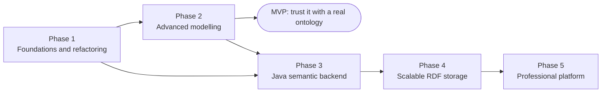
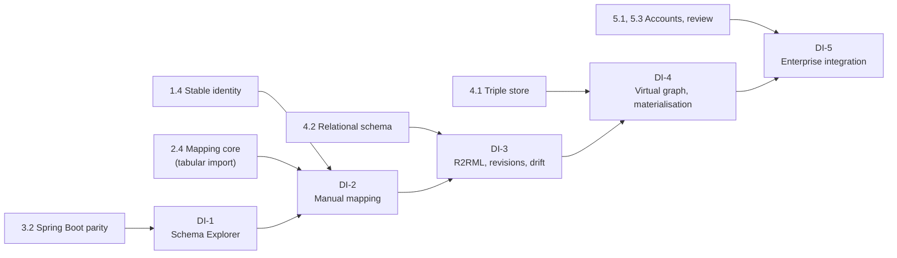
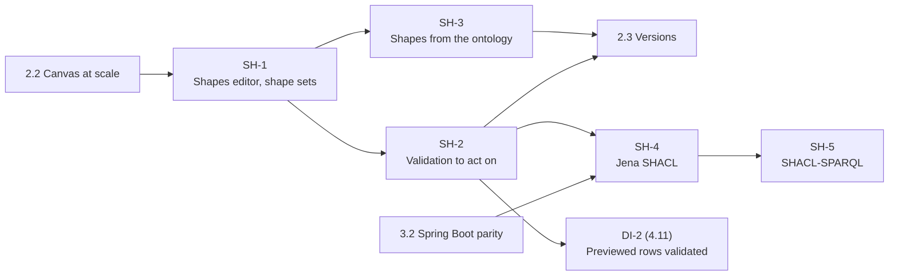

# Development Roadmap

Written against the repository as of 2026-10-13 (commit `ce6419e`). Companion documents:
[PRODUCT_REQUIREMENTS.md](PRODUCT_REQUIREMENTS.md) (what, and why),
[SYSTEM_ARCHITECTURE.md](SYSTEM_ARCHITECTURE.md) and
[DATA_ARCHITECTURE.md](DATA_ARCHITECTURE.md) (how), [TECHNICAL_DEBT.md](TECHNICAL_DEBT.md)
(what stands in the way).

Ontology-to-relational data integration (database schema exploration, semantic mapping,
virtual knowledge graphs) was added to this roadmap on 2026-10-13 as a track of five stages,
DI-1 to DI-5, placed inside the existing phases. §1.3 shows where; the tasks are in Phases 3, 4
and 5.

A SHACL editor as a first-class constraint model beside the ontology was added on 2026-10-15
as a second track, SH-1 to SH-5. §1.4 sets out what of it the product already has, what is
new, and where each stage goes: the three that need no server come next, before task 2.3.

## 1. Shape of the roadmap

Five phases, in the order given in the brief. Three rules hold throughout:

1. **Every task leaves the application working.** No phase needs a period in which the product
   is broken. A user who never starts a server loses nothing at any point (ADR-001).
2. **A capability is built locally first, behind an interface, and moved to the server second.**
   The interface is the migration; the server is an implementation of it.
3. **Nothing in a later phase is started to unblock an earlier one.** If a Phase 2 feature seems
   to need the backend, it is redesigned or deferred.

Rule 2 has one exception, by necessity: connecting to a relational database cannot be built in
the browser first, because a browser cannot open a database connection and must not hold a
credential (ADR-014). The data-integration track therefore starts where the backend does.

Phase 3 depends on the interfaces of Phase 1, not on every feature of Phase 2: once the MVP
tasks are done, backend work and the remaining Phase 2 tasks can be interleaved.

### 1.1 Overview

Sizes are relative: **S** a few days, **M** one to two weeks, **L** three to five weeks, **XL**
more than that, for one developer who knows the codebase. The ranges per phase are orders of
magnitude for planning, not commitments.

| Phase | Outcome in one sentence | Indicative effort | Priority served |
| --- | --- | --- | --- |
| 1 Foundations | The same application, with a safety net, stable identity, no data loss and no frozen page. | 2–3 months | P0 |
| 2 Advanced modelling | An editor an ontology engineer can use for real work: expressions, a constraint model of SHACL shapes beside the ontology, versions, tabular import, 10,000 classes. | 6–8 months | P0, some P1 |
| 3 Semantic backend | One Java application replaces the single-file service and answers the existing service interfaces, validation with Jena SHACL among them. Then: connect a database and explore its schema (DI-1). | 2.5–3.5 months, and 1–1.5 for DI-1 | P1 |
| 4 Scalable storage | Ontologies live on a server in a triple store; the browser asks instead of loading. In parallel: the mapping workbench and standard mappings (DI-2, DI-3). | 3–5 months, and 3.5–5.5 for DI-2 and DI-3 | P1, P2 |
| 5 Platform | Teams, review, publishing, assistance; virtual knowledge graphs and enterprise data integration (DI-4, DI-5). | Open-ended; DI-4 alone 2–3 months | P2, P3 |

### 1.2 Milestones

| Id | Milestone | Reached when | Phase |
| --- | --- | --- | --- |
| MS-1 | **Safety net** | One command and one pipeline run every check; baselines are recorded. | 1 |
| MS-2 | **Nothing lost** | Every entity has a stable IRI; an ontology from the test corpus round-trips with no axiom lost. | 1 |
| MS-3 | **Never frozen** | No edit, reasoning run or validation blocks the page for more than 100 ms. | 1 |
| MS-4 | **MVP** | Class expressions are authored; versions and differences exist; a spreadsheet is imported with a mapping; the Graph view works with 10,000 classes loaded. | 2 |
| MS-5 | **Companion** | The Spring Boot application replaces `pnpm reasoner`, offers ELK, exports every syntax, and answers the Structure and Entities interfaces. | 3 |
| MS-6 | **Server-side ontology** | A 100,000-class ontology is opened, searched, explored and edited without being loaded into the browser; every change is a revision. | 4 |
| MS-7 | **Team** | Two people with different roles work on one project with review. | 5 |
| MS-8 | **Schema in view** | A PostgreSQL database is connected read-only through the companion and its schema is browsed and searched beside the ontology; no credential is anywhere but the backend. | 3 (DI-1) |
| MS-9 | **Data-integration MVP** | Classes, properties and keys of one database are mapped in the three-area editor, previewed on real rows, checked in the Validation view and exported as R2RML. | 4 (DI-2) |
| MS-10 | **Standard, durable mappings** | R2RML is imported without loss; mappings have their own revisions; a schema change lists the rules it breaks; a second dialect works. | 4 (DI-3) |
| MS-11 | **Ask the data** | A SPARQL query in the ontology's terms is answered from the live database, with its SQL and timings shown. | 5 (DI-4) |
| MS-12 | **Constraint model** | Shapes are edited in a view of their own, in shape sets beside the ontology; the W3C SHACL Core tests read and write back without loss and validate to their expected reports; a finding opens the property shape and constraint it failed; shapes are proposed from the ontology and accepted one by one. | 2 (SH-1 to SH-3) |

Milestones MS-8 to MS-12 are numbered in the order they were added, not the order they are
reached: MS-12 comes before MS-4, MS-8 follows MS-5, and MS-9 and MS-10 fall within Phase 4
beside MS-6.

### 1.3 The data-integration track

The brief for this capability sets out five stages. They are kept as stages and placed where
their prerequisites are met.

| Stage | Contents | Needs | Placed in | Tasks |
| --- | --- | --- | --- | --- |
| **DI-1** Database Schema Explorer | Secure connections; schema metadata; browsing tables and relationships. | The Java backend (3.2); a small metadata store. | End of Phase 3 | 3.8, 3.9 |
| **DI-2** Manual semantic mapping | Class to table, property to column, key to object property, IRI templates, preview, validation. | DI-1; stable entity identity (1.4); the mapping core built for tabular import (2.4). | Phase 4, beside the storage work | 4.10, 4.11 |
| **DI-3** Standards-based mapping | R2RML import and export; reusable patterns; schema change detection; mapping revisions; further dialects. | DI-2; the relational schema of 4.2. | Phase 4, after DI-2 | 4.12, 4.13 |
| **DI-4** Virtual knowledge graph | Ontop; SPARQL to SQL; diagnostics; materialisation. | DI-3; the triple store (4.1) for materialisation. | Phase 5, before or after collaboration by demand | 5.10, 5.11 |
| **DI-5** Enterprise data integration | Several sources; mapping governance; lineage; transformations; assisted mapping. | DI-4; accounts and review (5.1, 5.3). | Phase 5 | 5.12 |

Three consequences of this placement:

- **The editor MVP (MS-4) is unchanged.** Data integration cannot be part of it, and should
  not delay it: everything it needs first (identity, the mapping core, the backend) is on the
  existing path anyway.
- **One thing changes in Phase 2.** Task 2.4 builds the mapping core (IRI templates,
  column-to-property rules, value conversion, preview with reasons) as modules that do not
  assume a file, so that DI-2 uses them unchanged (ADR-019). This costs little then and saves a
  second implementation later.
- **DI-2 and DI-3 do not wait for the hard parts of Phase 4.** They need the backend and a
  place to keep snapshots and mappings, not server-side ontologies. They can be developed
  beside tasks 4.3 to 4.8, or ahead of them if data integration is the more urgent goal.

Writing back to a database is not a stage of this track. It is a separate future capability
that needs its own design for transactions, authorisation and integrity (ADR-018).

### 1.4 The SHACL track: a constraint model beside the ontology

Added 2026-10-15, from a proposal to make SHACL an editor of its own, parallel to the OWL editor,
rather than a few settings on each class. Its central idea is three models, related by mappings
and not one-to-one:

| Model | Says | Written in | Owned by |
| --- | --- | --- | --- |
| **Conceptual** | What the domain is: classes, properties, what follows from what. | OWL (the ontology) | The modeller |
| **Constraint** | What data an application accepts: which values must be there, of what kind, how many. Several per ontology, one for each application or source. | SHACL shape sets | The data steward, the application's owner |
| **Physical** | How data is stored: tables, columns, types, keys. | A relational schema | The database's owner |

The planes of [SYSTEM_ARCHITECTURE.md](SYSTEM_ARCHITECTURE.md) §12.1 kept the conceptual and
the physical apart and joined them by a mapping; the constraint plane is added there. SHACL
validates an RDF data graph, never a database directly: relational data is validated through a
mapping that presents it as RDF (stage DI-2 on), so the workflow is ontology → shapes →
mapping → validation of the mapped data.

**What the product already has, and what is new.** Most of the proposal overlaps what exists or
is planned. The overlaps stay where they are; what is new is the track below.

| The proposal | Already there, or already planned | New |
| --- | --- | --- |
| Node and property shapes edited visually; Turtle import and export (P0) | **Existing** (FR-M4-2): a form for targets and 19 SHACL Core constraints (`Shapes.tsx`, `shapes.ts`); the shapes graph imported and exported as Turtle; any other Core construct kept as written and validated. Shapes are their own graph, never in the ontology's export. | Shapes as a view of their own, not a tab of *Validation*; **shape sets**, several constraint models per ontology; the constructs now kept as text made editable; a class's or property's editor listing the shapes about it. (SH-1) |
| Validation with Jena SHACL, and where each error is (P0) | **Existing** in the browser (FR-M4-1, FR-M4-4): SHACL Core by `rdf-validate-shacl`, a cancellable job in a worker; a finding names its focus node, path, value and shape, and opens the shape. **Planned:** Jena SHACL as the server's validation module (SYSTEM_ARCHITECTURE §3.3, ADR-006), with no task yet. | A finding located to the property shape and the constraint it failed, and to where the data came from; data graphs kept with the project, not for one session; a validation run of a chosen shape set on a chosen data graph. (SH-2) Jena SHACL behind the same interface, given a task. (SH-4) |
| Shapes generated from the OWL model, reviewed (P1) | **Principle only:** `shapes.ts` turns no restriction into a shape; for database constraints, ADR-017 makes proposals default to SHACL, reviewed (FR-M15-16, DI-3). | Shapes proposed from the ontology, each with what the axiom means and what the shape would check, accepted one by one, with its origin kept. (SH-3, ADR-020) |
| Database mapping, then SHACL data checks (P1) | **Planned** as the data-integration track: mapping and preview at DI-2 (4.10, 4.11), validation of mapped data against shapes at DI-4 (5.11, FR-M4-11, P2). Needs the backend (ADR-014), so it cannot come before 2.3. | Priority raised: rows previewed through a mapping are validated against a chosen shape set at DI-2 (4.11); materialised data stays at DI-4. |
| SHACL-SPARQL, further constraints, custom rules (P2) | **Planned:** SHACL-SPARQL with a server engine (FR-M4-9, P3); custom quality rules as SPARQL (FR-M4-7, task 2.12). | FR-M4-9 raised to P2 and given a task with the Jena validator. (SH-5) The further Core constraints are SH-1's. |
| An OWL restriction is not a SHACL constraint; a domain or range is no data rule | **Existing** as a principle: `shapes.ts`; SYSTEM_ARCHITECTURE §12.7 for database constraints (ADR-017). | Stated for shapes drawn from the ontology (ADR-020). |
| SHACL 1.0 Core first, 1.2 later | **Existing** in effect: the engine in use, and the one planned for the server, implement SHACL 1.0. | Made a decision (ADR-021). |

**The stages.**

| Stage | Contents | Needs | Placed in |
| --- | --- | --- | --- |
| **SH-1** Shapes as a first-class editor | A *Shapes* view; shape sets; every SHACL Core construct in the form; lossless Turtle per set; links with classes and properties. | 1.4, 1.8, 1.9 | Phase 2: done 2026-10-16 |
| **SH-2** Validation one can act on | Data graphs kept with the project; a shape set validated against a data graph; findings to the constraint and the data's source; the W3C SHACL Core tests as the conformance suite. | SH-1 | Phase 2: done 2026-10-16 |
| **SH-3** Shapes proposed from the ontology | Proposals from axioms, reviewed one by one, with their meaning stated; origin kept; stale when the axiom changes. | SH-1; 2.1 (structured expressions) | Phase 2: done 2026-10-16 |
| **SH-4** Jena SHACL on the server | `ValidationService` answered by the companion; the same reports as the browser on the conformance suite; data graphs too large for the page. | SH-2; 3.2 | Phase 3, after 3.2 |
| **SH-5** SHACL-SPARQL and the inferred graph | SPARQL-based constraints and constraint components; validation against the inferred graph; the browser naming what it cannot run. | SH-4 | Phase 3, after SH-4 |

**Rules the track keeps.**

- **No restriction becomes a shape by itself, nor a shape a restriction** (ADR-020). An OWL
  axiom says what is true of the domain and licenses inferences; a shape says what an
  application accepts. `p exactly 1 C` and `sh:minCount 1 ; sh:maxCount 1` are not the same: in
  OWL, with no unique-name assumption, two names may be the same individual and an unstated
  value is unknown, not missing; SHACL counts the value nodes the data graph has. A domain or
  range infers a type; it requires nothing of a record. Shapes drawn from the ontology are
  therefore proposals, each saying where it differs, accepted one by one.
- **SHACL 1.0 Core, then the rest** (ADR-021). What is built rests on the W3C Recommendation
  of 2017 and its test suite; SHACL 1.2 is followed, and built on once it is a Recommendation.
- **A class may have any number of shapes**, in one set or several; a shape set is a
  constraint model of its own, validated, exported and, from 2.3, versioned with the project.
- **Local first.** SH-1 to SH-3 run in the browser, like everything else in Phase 2; the
  server validates the same shapes with the same results from SH-4 (rule 2 above).

Consequences: task 2.3 and the MVP milestone (MS-4) move back by the size of SH-1 to SH-3,
about two months; 2.3's versions and differences include the shape sets; DI-2 gains the
validation of previewed rows; nothing else moves.

## 2. Phase 1 — Architecture assessment and refactoring

### Objectives

- Finish the assessment (these documents) and agree on it.
- Put a safety net under the existing behaviour before changing structure.
- Fix identity and data loss, which every later phase builds on.
- Separate the ontology document from the session and from the views, behind interfaces.
- Remove main-thread stalls.

### Tasks, in sequence

| # | Task | Resolves | Size |
| --- | --- | --- | --- |
| 1.1 | **Continuous integration.** A `verify` script and a pipeline that run type-check, unit tests, build, all browser scripts and the UI audit. Add a linter matching the existing `eslint-disable` comments. Give every browser script the base-URL argument (8 lack it). Fix or bound the one timing-sensitive check in `e2e/sidebar-tree.mjs`. | TD-15 | S |
| 1.2 | **Baselines.** Run `src/model/bench.test.ts` and `src/structure/bench.test.ts` on a schedule and keep the numbers. Add a browser measurement of the longest main-thread task for: an edit, a reasoner run and a validation run on the 2,600-class generated model. | NFR-3, NFR-4 | S |
| 1.3 | **Round-trip corpus.** A test that opens each ontology of a fixed public corpus, exports it, and compares axioms with the original through the OWL service. Record today's losses as the expected result, so that each fix shows as a change. | NFR-1 | M |
| 1.4 | **Stable identity.** Give object properties an id; make every reference use it; give every entity an IRI at creation. Model format version 2 with a migration from version 1, and a version 1 fixture opened in CI. | TD-03, TD-18, FR-M1-2, FR-M1-3, ADR-012 | L |
| 1.5 | **Keep what is not understood.** Statements the reader has no place for are kept as an unmapped block and written back unchanged. The "left out" message becomes "kept, not editable here". | TD-01 (step 1), FR-M1-8 | M |
| 1.6 | **Split the store** into document, session and job slices, with no change in behaviour. | TD-04 | M |
| 1.7 | **One function per rule.** Remove the duplicated checks; decide one rule for moving the end of a relationship and apply it to the canvas, the panel and the table. | TD-06, FR-M2-7 | S |
| 1.8 | **The change-set contract.** Define `ChangeSet` and `OntologyEditService`; implement it locally over the existing rule functions; route the document slice's edits through it. Undo becomes "apply the inverse change set". | ADR-002, AR-01 | L |
| 1.9 | **Reasoning and validation as jobs.** `ReasoningService` and `ValidationService` with local implementations in Web Workers; results keyed by revision; cancel. The HermiT path adopts the same interface. | TD-08, TD-09, FR-M3-1, FR-M4-4 | M |
| 1.10 | **Working copy in IndexedDB**, with a request for persistent storage. | TD-11 | S |

### Dependencies

1.1 before everything. 1.4 before 1.5 and 1.8. 1.6 before 1.8. 1.8 before 1.9 only in that both
need the revision id to be the document slice's.

### Technical complexity

Moderate. The hard part is 1.4 and 1.8, which touch most of `src/model`; the 603 existing tests
are what make them safe, which is why 1.1 comes first.

### Risks

| Risk | Mitigation |
| --- | --- |
| The identity migration breaks saved models. | A fixture per format version in CI; the migration is a pure function with its own tests; version 1 files stay readable indefinitely. |
| Routing every edit through change sets slows interactive editing. | Measure with the 1.2 baseline; translate only at the document boundary, not per keystroke. |
| Refactoring without visible features loses momentum. | 1.5, 1.9 and 1.10 each have a user-visible result: nothing lost on import, no frozen page, no size warning. |

### Deliverables

A pipeline; a baseline report; model format 2; three new service modules beside the existing
`src/structure` and `src/entities` (for editing, reasoning and validation), each with a
`contracts.ts`, a local implementation and a boundary test; an updated README section on the
service interfaces.

### Acceptance criteria

- All existing unit tests and browser scripts pass in the pipeline.
- A model saved before Phase 1 opens with identical terms, relationships, properties and
  picture.
- The round-trip corpus reports no axiom lost; statements without an editor are present in the
  export.
- With the 2,600-class model, no main-thread task exceeds 100 ms for an edit, and reasoning and
  validation can be cancelled.
- No file under `src/components` imports the reasoner or the validation engine directly.
- The working copy of a 5,200-class model is kept without a warning.

## 3. Phase 2 — Advanced modelling capabilities

### Objectives

- Close the OWL authoring gap.
- Reach the stated scale in the browser.
- Make the constraint model (SHACL shape sets) a first-class part of a project, beside the
  ontology (§1.4).
- Add versions, tabular import and the missing export syntaxes.
- Bring every remaining ontology operation behind a service interface.

### Tasks, in sequence

The first six numbered tasks make the MVP (MS-4). The three stages of the SHACL track that need
no server (§1.4) come after 2.2 and before 2.3, and make milestone MS-12.

| # | Task | Resolves | Size |
| --- | --- | --- | --- |
| 2.1 | **Structured class expressions.** A typed expression model; a parser from and writer to Turtle; existing text expressions parsed on load, with text as the fallback. A Manchester-syntax editor with completion, error marking and a reading in words. Defined classes. | TD-02, FR-M2-2, FR-M2-3 | XL |
| 2.2 | **Canvas at scale.** Viewport culling; level of detail by zoom; above a threshold, open on a subgraph and never build the full graph. | TD-10, FR-M5-4, FR-M5-5 | L |
| SH-1 | **Shapes as a first-class editor.** A *Shapes* view beside Graph, Entities and Structure, no longer a tab of *Validation*: shapes listed, searched and grouped by what they target. **Shape sets**: several named constraint models in one project, each with its own purpose (an application, a source), shapes graph and file (model format 5; a model of format 4 opens with its shapes as one set). Every SHACL 1.0 Core construct in the form: logical constraints (`sh:and`, `sh:or`, `sh:not`, `sh:xone`), qualified value shapes, property pair constraints (`sh:equals`, `sh:disjoint`, `sh:lessThan`, `sh:lessThanOrEquals`), property paths (sequence, alternative, inverse, zero or more, one or more, zero or one), nested and referenced shapes, `sh:closed` with its ignored properties. A shape set imported and exported as Turtle with nothing lost; SHACL-SPARQL kept as written and written back. A class's and a property's editor list the shapes that target or constrain them, with *Add a shape for this class*; one class, any number of shapes. Shape edits are change sets, undone like any other. | FR-M4-2, FR-M4-12, FR-M4-13 | L |
| SH-2 | **Validation one can act on.** Data graphs kept with the project in IndexedDB, not for one session: several, each named and replaced on demand. A run validates a chosen shape set against a chosen data graph (or the model's own individuals). A finding opens the property shape at the constraint it failed (`sh:sourceConstraintComponent`), shows the value and the path, and for data read from a file the line its focus node is on. The W3C SHACL 1.0 Core test suite as a conformance suite, run in CI: each test's expected report. | FR-M4-1, FR-M4-14 | M |
| SH-3 | **Shapes proposed from the ontology.** *Propose shapes* for a class, a set of classes or the ontology: from restrictions, domains and ranges, functional properties, datatypes, enumerations and keys. Each proposal says what the axiom means in OWL, what the shape would check, and where the two differ (ADR-020); none is selected to begin with. Accepted, edited or dismissed one by one or by kind, into a chosen shape set, as one change set; an accepted shape keeps its origin and is marked stale when that axiom changes or goes. | FR-M4-15, ADR-020 | M |
| 2.3 | **Versions and differences, locally.** Named versions in IndexedDB; an axiom-level difference shown by entity, the shape sets' changes with it; restore as a new version. `ProjectService`. Done 2026-10-16. | TD-12, FR-M10-1 to FR-M10-3 | L |
| 2.4 | **Tabular import.** CSV, TSV and Excel upload; a mapping screen; preview with row-level errors; commit as one change set; saved templates. Built on a mapping core (IRI templates, column rules, value conversion, preview with reasons) that does not assume the source is a file, for reuse by the database mapping of stage DI-2. Done 2026-10-16. | TD-17, FR-M7-2 to FR-M7-5, ADR-019 | L |
| 2.5 | **Export in every OWL syntax** through the conversion the service already performs in the other direction. `ImportExportService`. Done 2026-10-16. | TD-13, FR-M11-2 | S |
| 2.6 | **ELK in the companion**, and automatic choice of reasoner by profile. The libraries are already in the bundle. | FR-M3-5 | M |
| 2.7 | Annotation properties as entities; labels in several languages with a display language. | FR-M1-4, FR-M1-5 | M |
| 2.8 | Further axioms: property chains, keys, disjoint unions, negative assertions, annotations on axioms, moved out of the unmapped block one kind at a time. | FR-M2-4, FR-M2-5 | L |
| 2.9 | Imports: `owl:imports` declared on export; the closure resolved transitively; missing imports reported. `AlignmentService`. | FR-M8-5 | M |
| 2.10 | Structure: property hierarchies; comparison of two versions or two ontologies, reusing the difference from 2.3. | FR-M6-5, FR-M6-6 | M |
| 2.11 | Remaining interfaces: `GraphService` over `extractSubgraph`, `SparqlService` with a choice of asserted or inferred graph. Views moved off direct model reads as each is touched. | TD-05, FR-M9-4 | M |
| 2.12 | Update mode for tabular import; several diagrams per ontology; custom quality rules as SPARQL. | FR-M7-6, FR-M5-7, FR-M4-7 | M each |

### Dependencies

2.1 needs 1.4 and 1.8. SH-1 needs 1.4 (shapes name entities by IRI), 1.8 (shape edits as
change sets) and 1.9 (validation as a job); SH-2 and SH-3 need SH-1, and SH-3 also 2.1 (it reads
structured expressions). 2.3 comes after SH-3, so that versions cover shape sets from the start.
2.3 needs 1.8 (a version is a sequence of change sets). 2.4 needs 1.4
(IRIs from rows) and 1.8 (commit as a change set). 2.5 and 2.6 need only the present service.
2.8 needs 1.5 and 2.1. 2.10 needs 2.3.

### Technical complexity

High for 2.1 (a parser, an editor with completion, and every consumer of `Term.axioms`).
Moderate elsewhere. 2.2 is contained in the canvas component.

### Risks

| Risk | Mitigation |
| --- | --- |
| The expression editor grows into a Protégé clone. | Scope by the corpus: every expression in the test ontologies must open and save. Nothing beyond that in the MVP. |
| Excel parsing brings a large dependency. | Load it on demand, as oxigraph and Dagre are; CSV works without it. |
| Culling breaks picture export, which reads the drawn SVG. | Export renders the full picture off screen on request; covered by the existing export checks. |
| The shapes editor grows into a second product. | Scope by SHACL 1.0 Core and its W3C test suite: every test's shapes open in the form and write back unchanged. SHACL-SPARQL is the server's (SH-5); SHACL 1.2 waits for its Recommendation (ADR-021). |
| Proposed shapes are taken for what the ontology means, and the difference is lost. | Nothing proposed is selected by default; each proposal states where OWL and SHACL differ; accepted shapes keep their origin and go stale with it (ADR-020). |
| Local versions fill browser storage. | Compress; keep change sets between snapshots; show usage and offer export. |

### Deliverables

The MVP: lossless files, expression editing, versions, tabular import, all syntaxes, a graph
view at scale, two server-grade reasoners in the companion. Before it, the constraint model:
shape sets edited in a view of their own, validated with findings one can act on, and shapes
proposed from the ontology.

### Acceptance criteria

- Every class expression in the test corpus opens as structure and survives an edit of its
  class unchanged (FR-M2-2).
- A defined class authored in the editor is classified by HermiT as the same class written in
  Protégé would be.
- With 10,000 terms loaded and 300 in view, panning holds 30 frames per second (FR-M5-4).
- The shapes of every W3C SHACL 1.0 Core test open in the form and are written back statement
  for statement; validating each test's data gives its expected report (FR-M4-13, FR-M4-14).
- Two shape sets of one ontology, one class with a different shape in each, validate the same
  data graph to different results; each set exports as a Turtle file of its own (FR-M4-12).
- Shapes proposed for the Pizza ontology change nothing until accepted; an accepted shape names
  the axiom it came from, and goes stale when that axiom is removed (FR-M4-15).
- The difference between two versions that differ by a rename, a move and a removed
  restriction shows exactly those three changes (FR-M10-2).
- A 2,000-row spreadsheet with a parent column becomes the right hierarchy; one undo removes it
  (FR-M7-3, FR-M7-4).
- An ontology exported as RDF/XML opens in Protégé with the same axiom count (FR-M11-2).
- Automatic reasoner choice uses ELK for an OWL 2 EL ontology and says so (FR-M3-5).

## 4. Phase 3 — Java semantic backend

### Objectives

- Replace the single-file service with a maintainable application, with no change visible to
  the frontend.
- Make the OWL API the place where ontologies are loaded, changed, compared and serialized.
- Offer reasoning as managed jobs.
- Prove the interface design by passing the frontend's existing HTTP tests.

### Tasks, in sequence

| # | Task | Resolves | Size |
| --- | --- | --- | --- |
| 3.1 | **Dependency spike.** A build with declared versions of the OWL API, HermiT, ELK and Spring Boot on JDK 21; the present service's behaviour reproduced in a test. Decide OWL API 4 or 5 on evidence. | AR-03, ADR-011 | S |
| 3.2 | **Parity.** `/health`, `/reason` and `/convert` in Spring Boot with the same requests and responses. `src/model/dlReasoning.test.ts`, `src/model/owlSyntaxes.test.ts`, `e2e/dl-reasoning.mjs` and `e2e/open-owl.mjs` pass unchanged against it. Java unit tests for what those do not reach. | TD-14, ADR-003 | M |
| SH-4 | **Jena SHACL on the server.** `ValidationService` answered by the companion with Jena SHACL, with the requests and reports of the local engine; the W3C SHACL Core conformance suite of SH-2 run through both and the reports compared; data graphs too large for the page validated there, as a job. | FR-M4-16 | M |
| SH-5 | **SHACL-SPARQL and the inferred graph.** SPARQL-based constraints and constraint components, and validation against the inferred graph, by the server; the browser engine names what it cannot run instead of passing it over. | FR-M4-9 | M |
| 3.3 | **Reasoning jobs.** Start, status, cancel; a bounded executor; profile check and reasoner choice; results cached by content hash and reasoner. | ADR-005, FR-M3-4, FR-M3-8 | M |
| 3.4 | **Ontology sessions.** An ontology is uploaded once and held by content hash; `StructureService` and `EntityQueryService` are answered from it over the OWL API. The frontend's `http.test.ts` suites pass against the server. | FR-M6-7 | L |
| 3.5 | **Change sets on the server.** Apply a change set to a held ontology atomically; return the new content hash. A conformance suite runs every fixture change set through the local and the server implementation and compares the results as axioms. | AR-01, ADR-004 | L |
| 3.6 | **Difference and export.** A difference between two ontologies by OWL API structural comparison; export in every syntax. | FR-M6-6, FR-M11-2 | S |
| 3.7 | **Packaging.** One runnable artefact; one command to start it; the frontend detects it. Release note: the companion now needs JDK 21. | ADR-011 | S |
| 3.8 | **Data sources (DI-1).** Connection definitions from structured fields; secret handling (session and environment reference); connection test with a write-privilege warning; a pool per source; the read-only guard with time and row limits; the PostgreSQL adapter. The data-source tables of [DATA_ARCHITECTURE.md](DATA_ARCHITECTURE.md) §10.2 in the companion's embedded database, brought forward from task 4.2. Security tests: the test password in no storage, response, export or log. | FR-M14-1 to FR-M14-3, FR-M14-9, ADR-014, ADR-015, AR-11, AR-16 | M |
| 3.9 | **Schema discovery and the Schema Explorer (DI-1).** Discovery as a job into a snapshot with fingerprints; `SchemaService` with paged search; the explorer view (tree, search, table detail with keys and related tables); bounded row samples; refresh. | FR-M14-4 to FR-M14-8 | L |

### Dependencies

Phase 1 (1.8, 1.9) for the contracts. 3.1 before all. SH-4 needs 3.2 and SH-2, SH-5 needs
SH-4; neither depends on 3.3 to 3.6. 3.4 and 3.5 are independent of each
other. 3.8 and 3.9 need only 3.2 and can follow it directly if data integration is the
priority; they do not depend on 3.4 to 3.6.

### Technical complexity

Moderate. Spring Boot and the OWL API are well trodden. The subtle part is 3.5: making two
implementations of the editing rules agree (AR-01).

### Risks

| Risk | Mitigation |
| --- | --- |
| Library versions do not combine. | 3.1 is a spike with a clear exit: if OWL API 5 with the needed reasoners is not clean, stay on the 4.5 line that works today. |
| The two rule implementations diverge. | The conformance suite is a deliverable, not a later hardening task; a rule added on one side without the other fails the build. |
| Start-up time and memory of the companion annoy single users. | Keep the Local profile fully functional without it; start the companion lazily. |
| Holding uploaded ontologies in memory does not scale. | It is not meant to; it is the bridge to Phase 4, bounded by a small cache. |
| The first feature with secrets is built without the discipline secrets need (AR-11). | The security tests are part of task 3.8's definition of done, and the connection form accepts no free-form connection string from its first version. |
| Dialect differences are underestimated. | One dialect only (ADR-015); the adapter interface is extracted from the PostgreSQL case, not designed ahead of it. |

### Deliverables

The companion application, replacing `reasoner/ReasonerService.java`; server implementations of
four interfaces (reasoning, structure, entities, edit); the conformance suite. With DI-1: data
sources and the Schema Explorer for PostgreSQL (MS-8).

### Acceptance criteria

- The frontend runs against the new service with no code change beyond the address.
- The four existing test suites named in 3.2 pass unchanged.
- A classification can be cancelled; two concurrent requests do not exceed the configured heap.
- An OWL 2 EL ontology of 100,000 classes is classified by ELK; the time is recorded as the
  baseline for Phase 4.
- The conformance suite passes for every change-set fixture.
- DI-1: a PostgreSQL database is connected with a read-only account; its schemas are discovered
  as a job and browsed; a search over a 200,000-column snapshot answers within 200 ms; an
  attempted write through any path fails; the test password is found nowhere outside the
  backend's memory (NFR-12, NFR-13).

## 5. Phase 4 — Scalable RDF storage

### Objectives

- Ontologies persist on a server, as RDF named graphs.
- Queries, search and exploration are answered by the server, a page at a time.
- Every change is a revision; history, releases and differences are server-backed.
- Large imports run as jobs.

### Tasks, in sequence

| # | Task | Resolves | Size |
| --- | --- | --- | --- |
| 4.1 | **Triple store.** TDB2 embedded; the named-graph layout and the `meta` graph of [DATA_ARCHITECTURE.md](DATA_ARCHITECTURE.md) §4. | ADR-006 | M |
| 4.2 | **Relational schema.** Projects, revisions, change entries, jobs, mappings, diagrams, with migrations; an embedded database for the companion. | ADR-007 | M |
| 4.3 | **Server projects.** Create from an upload; apply change sets with the two-store sequence of §7.2; recovery tested by killing the process between steps. | ADR-009, FR-M10-5 | L |
| 4.4 | **Server-side questions.** `EntityQueryService`, `StructureService`, `GraphService` and `SparqlService` over TDB2 and a text index, replacing the in-memory sessions of 3.4. | FR-M5-10, FR-M9-4 | L |
| 4.5 | **The frontend's server mode.** A project that is opened without being loaded: views ask; the graph shows a neighbourhood; answers are cached in IndexedDB by revision. | TD-05 (completion), NFR-5 | L |
| 4.6 | **History and releases.** Revision list, entity history, tagged releases with version IRI and snapshot; the Phase 2 difference view on server data. | FR-M10-4 to FR-M10-6 | M |
| 4.7 | **Import jobs.** Tabular and RDF imports beyond browser size, with progress and a report. | FR-M7-7 | M |
| 4.8 | **Offline drafts.** *Work offline*, *push* and *pull* with refusal on a stale base and a visible replay. | AR-04 | L |
| 4.9 | **Operations.** Backup and restore of both stores together; health endpoints; a container image; an operations page in the documentation. | — | S |
| 4.10 | **Mapping model and workbench (DI-2).** The mapping model over the shared core; `MappingService`; the three-area editor with coverage on both sides and a non-drag way for every action; class, data-property and object-property rules; IRI templates; conditions. Mappings saved with the project. | FR-M15-1 to FR-M15-5, FR-M15-8, FR-M15-11 | XL |
| 4.11 | **Preview and mapping checks (DI-2).** The preview evaluator on bounded rows, with reasons; the previewed rows validated against a chosen shape set, with no new engine (§1.4); the static mapping checks as a category of the Validation view, stale on a change of mapping, ontology or schema; R2RML export. | FR-M15-7, FR-M15-9, FR-M4-10, the preview half of FR-M4-11, the export half of FR-M15-10, AR-12 | L |
| 4.12 | **Standard and durable mappings (DI-3).** R2RML import with lossless round trip; mapping revisions and their difference; schema change detection against fingerprints; reusable patterns; a SQL query as a logical table, guarded; lexical suggestions; constraint-derived proposals; an offered draft mapping. | FR-M15-6, FR-M15-10, FR-M15-12 to FR-M15-17, ADR-013, ADR-017, AR-14 | L |
| 4.13 | **Further dialects and the table diagram (DI-3).** SQL Server and MySQL adapters, each with its own integration tests; relationships between tables as a diagram on the existing layouts. | FR-M14-10, FR-M14-11 | M each |

### Dependencies

Phase 3 (3.3, 3.5). 4.1 and 4.2 before 4.3; 4.3 before the rest. The data-integration tasks
4.10 to 4.13 need 3.8, 3.9 and, for mapping revisions, 4.2; they do not need 4.3 to 4.8. 4.5 needs every view to be
behind an interface: any view still reading the model directly (TD-05) is finished here.

### Technical complexity

High. 4.3 (consistency across two stores) and 4.5 (a frontend that no longer has the model) are
the two hardest tasks of the whole roadmap.

### Risks

| Risk | Mitigation |
| --- | --- |
| Views that assumed the whole model cannot be converted. | The canvas is the hard case and is served by subgraphs, which already exist. Convert the others during Phase 2, not here. |
| Reading and writing OWL through the OWL API over a triple store is slow for large ontologies. | Apply changes as triple deltas computed from the change set; load the whole ontology into the OWL API only for reasoning and export. Measure at 100,000 classes before building further. |
| Version snapshots multiply storage. | Snapshots for releases only (AR-06). |
| An embedded store makes the server a single point of failure. | Accepted for this scale; backup and restore are part of the phase. |
| The mapping editor becomes a diagramming exercise that hides what a rule means. | Every rule is read back in words and previewed on rows; the list of rules, not the lines, is the model (PRD, M15, *Interaction design*). |
| Phase 4 now carries two large efforts. | They are independent tracks with their own milestones (MS-6; MS-9, MS-10). Do one at a time, in the order the first users need. |

### Deliverables

Server projects with persistent storage and history; the Server profile as a container image;
the frontend's server mode. With DI-2 and DI-3: the Semantic Mapping Workbench, mapping checks,
R2RML import and export, mapping revisions, schema change detection, three dialects.

### Acceptance criteria

- A 100,000-class, million-triple ontology is imported as a job; afterwards entity search,
  hierarchy browsing and a neighbourhood each answer within 200 ms, and the browser's memory
  does not grow with ontology size (NFR-5).
- Killing the server at any point of a commit leaves the project at the old or the new
  revision, never between, after restart.
- Two clients committing against the same base: one succeeds, the other is refused as stale and
  succeeds after a pull.
- A release can be exported and compared with another release.
- Backup and restore reproduce a project with its history.
- DI-2: for a reference database, `Film` and `Documentary` are mapped to one table by a
  condition, a data property to a column and an object property to a foreign key, entirely by
  keyboard; the preview equals the output of an independent R2RML processor on the exported
  mapping for the same rows; the ontology revision is unchanged throughout (NFR-14).
- DI-3: the W3C R2RML test-case mappings import and export as equivalent graphs (NFR-16);
  dropping a mapped column and refreshing lists exactly the rule that used it; the reference
  mapping works unchanged in meaning on SQL Server and MySQL.

## 6. Phase 5 — Professional semantic modelling platform

### Objectives

Teams, governance, publishing, assistance and integration, each optional and each built on
revisions and change sets.

### Work packages

Not sequenced strictly; ordered by what users of a team product ask for first.

| # | Work package | Resolves | Size |
| --- | --- | --- | --- |
| 5.1 | **Accounts and roles.** Sign-in through an identity provider; workspaces; project roles. | FR-M13-3 | M |
| 5.2 | **Discussions.** Comments on entities and on changes. | FR-M13-4 | M |
| 5.3 | **Review.** A change set is proposed, reviewed, approved or returned. Lifecycle status (Existing) becomes enforceable: an *Approved* entity changes only through review. | FR-M13-5 | L |
| 5.4 | **Audit and notifications.** | FR-M13-6, FR-M13-7 | M |
| 5.5 | **Publishing.** Generated documentation; release pages; stable IRIs with content negotiation. | FR-M11-5, FR-M11-6 | L |
| 5.6 | **Alignment at depth.** SSSOM; catalogue search; module extraction. | FR-M8-6 to FR-M8-8 | M |
| 5.7 | **Assistance.** An embedding matcher behind `MATCHERS`; drafting of definitions; question to query. Each a proposal, each behind an explicit provider setting. | M12, ADR-010 | L |
| 5.8 | **Integration.** A documented public API; webhooks on revisions and releases; export of releases to a Git repository; a read-only SPARQL endpoint. | FR-M9-7 | M |
| 5.9 | **Editing together in real time.** | FR-M13-8 | XL |
| 5.10 | **Virtual knowledge graph (DI-4).** A spike on Ontop against the three dialects and the SPARQL features that matter; the virtual graph module managing one engine process per deployed mapping revision; SPARQL through the API with limits; the source and reasoning shown with every answer; the SQL trace; refusal of unsupported features by name. | FR-M16-2 to FR-M16-7, ADR-016, AR-13 | L |
| 5.11 | **Materialisation and data validation (DI-4).** Materialise a mapping set into a data graph as a sized, confirmed job with provenance; validate materialised data against a shape set (previewed rows are validated from DI-2, task 4.11); a cross-check suite comparing preview and engine. | FR-M16-1, the materialisation half of FR-M4-11, AR-12 | M |
| 5.12 | **Enterprise data integration (DI-5).** Several data sources per project; permissions on a data source; mapping changes through review; lineage in both directions and in governance metadata; stored encrypted secrets and key rotation; value transformations; assisted mapping suggestions. | FR-M14-12, FR-M13-9, FR-M13-10, FR-M15-18, FR-M12-7 | L, then open-ended |

### Dependencies

Phase 4 throughout. 5.3 needs 5.1. 5.5 needs releases (4.6). 5.9 last, and only if asked for:
review-based collaboration (5.3) covers most governance needs without it. 5.10 and 5.11 need
4.12 and the triple store, not accounts: they can come first in this phase. 5.12 needs 5.1 and
5.3.

### Technical complexity

Varied. 5.1 to 5.4 are conventional application work. 5.9 is a research-grade problem for
axiom-level data and should not be started without a specific demand.

### Risks

| Risk | Mitigation |
| --- | --- |
| Security work is underestimated (AR-07). | Do [SYSTEM_ARCHITECTURE.md](SYSTEM_ARCHITECTURE.md) §9 before the first shared deployment, not after. |
| Assistance produces plausible, wrong axioms (AR-10). | Proposals only; validated by the rule service; reasoner check before acceptance. |
| Scope becomes "everything PoolParty does". | Text mining and enterprise search are out of scope by decision (PRD §2.7). |
| The OBDA engine does not support a needed database or query feature (AR-13). | Task 5.10 begins with a spike whose result decides; nothing before DI-4 depends on the engine. |
| Users take live answers for entailments (AR-15). | Every answer names its source and the reasoning applied; unsupported features are refused, not approximated. |

### Deliverables and acceptance

Specified per work package when it is scheduled. Fixed now: with all of Phase 5 in place, the
Local profile still works with no server and no account.

## 7. Feature priorities by phase

| Priority | Requirements | Phase |
| --- | --- | --- |
| **P0** | FR-M1-2, FR-M1-3, FR-M1-8, FR-M2-7, FR-M3-1, FR-M4-4 | 1 |
| **P0** | FR-M2-2, FR-M2-3, FR-M5-4, FR-M5-5, FR-M4-12 to FR-M4-14, FR-M7-2 to FR-M7-4, FR-M10-1 to FR-M10-3, FR-M11-2 | 2 |
| **P1** | FR-M1-4, FR-M1-5, FR-M1-7, FR-M2-4, FR-M2-5, FR-M3-5, FR-M4-15, FR-M6-5, FR-M6-6, FR-M7-5, FR-M7-6, FR-M8-5, FR-M9-4, FR-M5-7 | 2 |
| **P1** | FR-M3-4, FR-M3-6, FR-M3-8, FR-M4-16, FR-M6-7 | 3 |
| **P2** | FR-M4-9 | 3, stage SH-5 |
| **P1** | FR-M5-10, FR-M10-4 to FR-M10-6 | 4 |
| **P2** | FR-M4-6 to FR-M4-8, FR-M5-9, FR-M9-5, FR-M9-6, FR-M1-6, FR-M2-6, FR-M3-7 | 2–4, as capacity allows |
| **P2** | FR-M7-7, FR-M8-6, FR-M11-5, FR-M11-6, FR-M12-1, FR-M12-2, FR-M12-6, FR-M13-3 to FR-M13-6 | 4–5 |
| **P3** | FR-M2-8, FR-M7-8, FR-M8-7 to FR-M8-9, FR-M9-7, FR-M10-7, FR-M11-7, FR-M12-3 to FR-M12-5, FR-M13-7, FR-M13-8 | 5 and later |
| **P1** | FR-M14-1 to FR-M14-9 | 3, stage DI-1 |
| **P1** | FR-M15-1 to FR-M15-5, FR-M15-7 to FR-M15-9, FR-M15-11, FR-M4-10, FR-M4-11 (previewed rows) | 4, stage DI-2 |
| **P2** | FR-M15-6, FR-M15-10, FR-M15-12 to FR-M15-17, FR-M14-10, FR-M14-11 | 4, stage DI-3 |
| **P2** | FR-M16-1 to FR-M16-7, FR-M4-11 (materialised data) | 5, stage DI-4 |
| **P2** | FR-M14-12, FR-M13-9, FR-M13-10 | 5, stage DI-5 |
| **P3** | FR-M14-13, FR-M15-18, FR-M16-8, FR-M16-9, FR-M12-7 | later |

## 8. Performance targets by phase

Measured by the benchmarks of task 1.2; the first column is today's measurement from
[SYSTEM_ARCHITECTURE.md](SYSTEM_ARCHITECTURE.md) §1.3.

| Measure | Today | After Phase 1 | After Phase 2 | After Phase 4 |
| --- | --- | --- | --- | --- |
| Longest main-thread task on an edit, 2,600 classes | about 570 ms (reasoner) | under 100 ms | under 100 ms | under 100 ms |
| Largest ontology with a kept working copy | about 5,000 classes | 50,000 terms (the model's cap) | same | not limited by the browser |
| Graph view, comfortable | about 2,000 terms | same | 10,000 loaded, a few hundred in view | any size, by neighbourhood |
| Structure Explorer | 200,000 classes in 0.65 s (in memory) | same | same | 200,000 classes without loading them |
| Complete DL reasoning | 60 s limit, blocking request | job in the page's terms | ELK or HermiT, chosen | job on the server, result stored per revision |
| Lossless round trip of the corpus | no: losses counted and reported | yes: kept as unmapped | yes: increasingly typed | yes |

For the data-integration track, measured against a reference PostgreSQL database seeded for the
purpose:

| Measure | Target | Stage |
| --- | --- | --- |
| Discovery of a schema of 1,000 tables | A job that completes in under a minute and can be cancelled; the page is never blocked | DI-1 |
| Browsing and search over a snapshot of 200,000 columns | Under 200 ms a page | DI-1 |
| Preview of one rule on fifty rows | Under one second on an indexed source | DI-2 |
| Static mapping checks on 500 rules | Under 200 ms, in the page | DI-2 |
| Longest statement the product may run against a source | The source's time limit, never exceeded | DI-1 onwards |
| Rows held in the browser | At most one page; none in storage | DI-1 onwards |
| A virtual query touching indexed keys | Dominated by the database; the overhead of rewriting is reported with each answer | DI-4 |

## 9. What this roadmap deliberately does not do

- **Replace the canvas with a graph library.** See ADR-008.
- **Introduce microservices, a message broker or a second database before there are users who
  need them.** See ADR-003, ADR-007.
- **Start the backend before identity and the change-set contract are settled.** A backend
  built on name-keyed properties would have to be redone.
- **Promise complete OWL 2 DL reasoning at any size.** See AR-02.
- **Add AI features before versions exist.** An accepted suggestion with no history cannot be
  audited or undone later.
- **Build real-time co-editing before review-based collaboration has been tried.**
- **Turn database constraints into OWL axioms automatically, or a table into a class by
  default.** See ADR-017.
- **Turn an OWL restriction, domain or range into a SHACL constraint, or a shape into an
  axiom, without the user's review.** See ADR-020.
- **Build on SHACL 1.2 before it is a W3C Recommendation.** See ADR-021.
- **Write a SPARQL-to-SQL engine.** An existing one is adopted at stage DI-4 (ADR-016).
- **Write to an external database.** See ADR-018.
- **Support three database dialects in the first release.** See ADR-015.
- **Let data integration displace the editor MVP.** It starts where the backend does, and
  everything it needs before that is already on the path.

## 10. The next concrete development task

Phase 1 is done, and 2.1 and 2.2 with it (see [BASELINES.md](BASELINES.md) and
[TECHNICAL_DEBT.md](TECHNICAL_DEBT.md) for what each measured and left).

**2026-10-16: SH-1, SH-2 and SH-3 are done, and milestone MS-12 with them; then 2.3 and 2.4,
and with them milestone MS-4, the MVP; then 2.5** (each with its status below). The next task is
2.6, ELK in the companion; this section gives its scope when it starts. What follows is SH-1 as
it was set out, and the status of each stage and task.

**Stage SH-1: shapes as a first-class editor.** It comes before 2.3 so that versions cover shape
sets from the start, and SH-2 and SH-3 build on it.

**Scope.**

1. **Shape sets.** The model holds several named shape sets instead of one shapes graph (model
   format 5); each has a name, a description of what it is for, its own namespace for new shapes,
   and its shapes. A model of format 4 opens with its shapes as one set, unchanged.
2. **The *Shapes* view**, a tab beside Graph, Entities and Structure: the sets; within a set the
   shapes, searched and grouped by target; a shape's form, the one in *Validation* today, moved
   here. *Validation* links to it.
3. **Every SHACL 1.0 Core construct in the form**: logical constraints, qualified value shapes,
   property pair constraints, every kind of property path, nested and referenced shapes, closed
   shapes with ignored properties. What the form still cannot hold (SHACL-SPARQL) is kept as
   written, shown, and written back.
4. **Import and export per set**: a Turtle file in, a set out; nothing lost, checked statement for
   statement as the ontology's round trip is.
5. **Shapes from the entities' side**: a class's and a property's editor list the shapes that
   target or constrain them, in every set, and offer *Add a shape for this class*.
6. Shape edits are change sets: undone, redone and kept in the working copy like any other edit.

**Out of scope.** Validation changes (SH-2), proposals from the ontology (SH-3), SHACL-SPARQL
(SH-5), and anything of SHACL 1.2.

**Acceptance.**

- The shapes of the W3C SHACL 1.0 Core test suite open in the form and are written back
  statement for statement.
- Two shape sets with a different shape for one class are kept apart, exported apart, and
  survive a reload and an undo.
- A model saved before SH-1 opens with the same shapes, now as one set, and validates to the
  same findings.

**Then.** SH-2 and SH-3, and with them milestone MS-12; then 2.3.

**Status, 2026-10-16: SH-1 done.** Model format 5 holds the shape sets (`src/model/shacl.ts`); a
format-4 model opens as one set, "Shapes", with the same statements and findings
(`migration.test.ts`, `fixtures/v4`). The 105 shapes graphs of the W3C SHACL 1.0 Core suite's 113
tests (`corpus/shacl.mjs`, at a fixed commit) read into the form and write back statement for
statement, every Core construct as structure; only `sh:sparql` and the two paths the suite makes
ill-formed on purpose are kept as text (`shacl.test.ts`). `e2e/shapes.mjs` checks two sets with a
shape for one class each, exported apart, across a reload, an undo and a redo, and validated
together. What it left: every set is still validated at once, and a finding opens its shape, not
the constraint (both SH-2). A shape edit is a step of the document's history like any other,
undone, redone and kept in the working copy; the edit contract's `ChangeSet` lists ontology axioms
only, so a step that changes shapes says so in its summary and has no axioms. Giving change sets a
graph per shape set is with the server's change entries (DATA_ARCHITECTURE.md), when versions need
it (2.3).

**Status, 2026-10-16: SH-2 done.** A run validates the shape set chosen, or every set, against the
model's own data or one of its data graphs (`src/model/dataGraphs.ts`): RDF read from a file, kept
with the model by what it is, its content in IndexedDB, renamed, replaced, deleted and undone like
any edit (`Model.dataGraphs`, no new format: a field with a default). A finding gives the line of
its file its focus node is on (`dataLines.ts`, for Turtle), a path as SPARQL writes it, and opens
the property shape itself at the constraint it failed, by `sh:sourceConstraintComponent`. All 98
tests of the W3C SHACL 1.0 Core suite give their expected report through the app's own path,
shapes read into a set and validated as the workbench does (`shaclConformance.test.ts`, in CI;
what would differ is listed in `corpus/expected/shacl-core.txt`). Running it found a model without
a base IRI could not be validated at all (the report writer was given an undefined prefix), and
the worker dropped the chosen set; both are fixed. `e2e/data-graphs.mjs` checks two sets giving
one graph two results, the line, the constraint, a reload, a replacement, an undo, and a graph
whose content the browser does not have. What it left: a data graph's content is in one browser (a
project's data graphs on the server are 3.x), no line for a blank node or a file converted to
Turtle, and the content of a deleted graph stays in IndexedDB so that undo finds it.

**Status, 2026-10-16: SH-3 done, and with it milestone MS-12.** *Propose from the ontology* (in
the Shapes view, and *Propose from its axioms* in a class's editor) reads the ontology as it is
written, so a restriction drawn on the canvas and one typed as a class axiom are proposed alike
(`src/model/proposals.ts`): restrictions, also inside an intersection or a definition (some, only,
min, max, exactly, value; a filler that is a named class, several joined by and or or, a datatype,
an enumerated datatype or facets), domains and ranges, functional and inverse functional
properties, and enumerations. Each proposal shows its axiom in Manchester syntax, the shape it
would add, what the axiom means in OWL, what the shape checks and where the two differ; none is
chosen to begin with; they are chosen or dismissed one by one or by kind, for a class, a few or
the whole ontology, and added to a chosen set, or a new one, as one step of the history. An
accepted shape keeps its axiom in OWL functional syntax as `cw:fromAxiom`, which travels with its
Turtle and follows a change of IRI; once the ontology no longer states that axiom the shape is
marked stale, in its form and in the list, and can be kept as a shape of its own. Keys, an
`ObjectHasSelf`, and fillers that are nested expressions are listed as not proposed, each with
why. For Pizza: 198 proposals and 2 not proposed, worked out in about 20 ms (`proposals.test.ts`;
`e2e/proposals.mjs` in the browser). What it left: dismissals last while the proposals are open; a
stale axiom is shown in functional syntax, as it is no longer in the ontology to be read out in
Manchester syntax.

**Status, 2026-10-16: 2.3 done** (TD-12, FR-M10-1 to FR-M10-3). *File → Versions…* keeps named
versions of a model in My Models, in IndexedDB (`versions`, database version 5): each the whole
model, gzip-compressed, with a name, a line about it, its number and a content hash, listed newest
first and deleted with the model (`src/projects/local.ts`, the `ProjectService` contract in
`src/projects/contracts.ts`). Two versions, or a version and the model now, are compared over what
each states, statement by statement (`changesBetween`), and told entity by entity, the axioms
added and removed under each in Manchester syntax, with the shape sets' statements, the data
graphs, the settings that are no part of the ontology, and whether the drawing changed
(`src/projects/difference.ts`). A version is restored as a new version, never by taking one away;
restoring is one edit, which undo takes back. `src/projects/local.test.ts` checks the three
acceptance criteria (a term moved is no change to the ontology; a superclass added and a
restriction removed are two changes under the class; of five, the sixth after restoring the third
is the third), and `e2e/versions.mjs` the same in the browser, across a reload. What it left: the
history of one entity (FR-M10-4), list, open and save still going to `library.ts` directly rather
than through `ProjectService`, and versions kept whole rather than as change sets.

**Status, 2026-10-16: 2.4 done** (TD-17, FR-M7-2 to FR-M7-5, ADR-019), and with it MS-4: class
expressions are authored (2.1), the Graph view works with 10,000 classes (2.2), versions and
differences exist (2.3), and a spreadsheet is imported with a mapping. *File → Import a table…*
reads CSV and TSV in an encoding and Excel workbooks (.xlsx, unzipped in the page with no library,
`src/import/`), with sheet, separator and header row chosen; each column is given a use on a
mapping screen, with a first guess from its name; IRIs are made by templates over the columns. The
mapping core (`src/mapping/`: `template.ts`, `values.ts`, `plan.ts`) takes a `Table` of named
columns and knows nothing of files, for DI-2 to use as it is. Before anything is made, the preview
says what each row becomes, or why it is skipped (its IRI cannot be made, another row has it, what
it is under is neither a row nor in the model, or is skipped), and which values are left out and
why; the import is one edit, which one undo takes back; mappings are kept as templates.
`mapping.test.ts` checks the acceptance (2,000 rows with parent references become that hierarchy;
the row whose parent is missing is reported by its row number and nothing is made of it; 20,000
rows planned in about 60 ms), `import.test.ts` the readers on a workbook written by openpyxl, and
`e2e/import-table.mjs` the dialog, undo, an Excel sheet as individuals with values converted, a
template, and the same file again making nothing. What it left: updating entities from a table
(FR-M7-6), files too large for the browser (FR-M7-7), the older .xls format.

**Status, 2026-10-16: 2.5 done** (TD-13, FR-M11-2). *File → Export* writes RDF/XML in the page,
from the Turtle, statement for statement and with literals as written (`src/model/rdfxml.ts`; the
RDF engine's store would have rewritten 9.50 as 9.5), and OWL/XML, functional and Manchester
syntax through the OWL service, whose `/convert` now takes the syntax to write and whose `/health`
says which it writes. `ImportExportService` (`src/io/`) reads and writes every syntax for the
editor. `owlSyntaxes.test.ts` has the OWL API compare each export of the example ontology and of
Pizza with the Turtle export: RDF/XML states exactly the same axioms (FR-M11-2's acceptance);
OWL/XML, functional and Manchester syntax add only the declarations of standard entities the
Turtle uses undeclared, which those syntaxes need. Reading a Manchester export back showed a
declaration of `owl:Thing` made into a class of the model; the reader now keeps such a declaration
as written (PROV-O and FOAF keep one more statement each). `e2e/open-owl.mjs` exports the four
from the menu and opens two of them again. What it left: a Protégé check by hand, and imports
still not followed.

**The data-integration track does not change this.** Its first task is 3.8, after the backend
exists; from SH-2 it can validate what a mapping previews against a chosen shape set (4.11).
