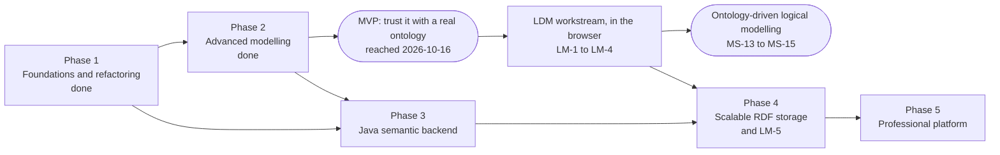
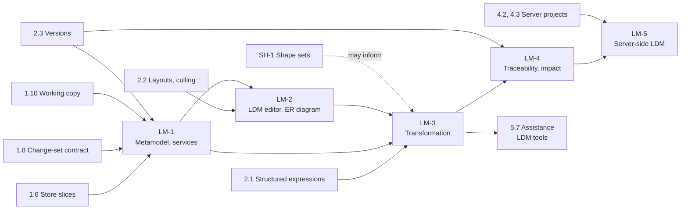
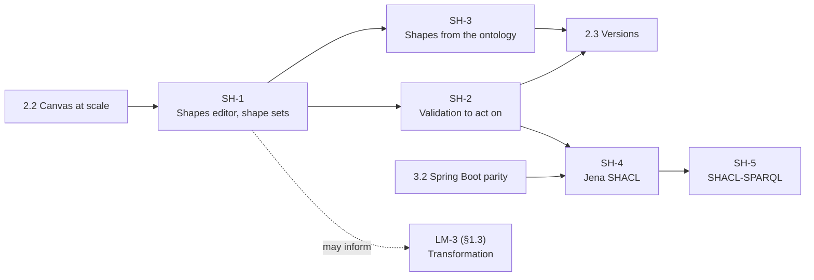
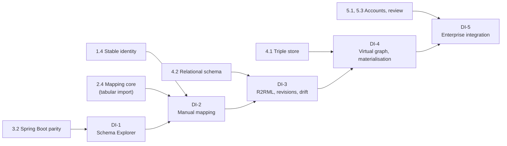

# Development Roadmap

Written against the repository as of 2026-10-13 (commit `ce6419e`); realigned on 2026-10-17
(commit `22f39d4`). Companion documents:
[PRODUCT_REQUIREMENTS.md](PRODUCT_REQUIREMENTS.md) (what, and why),
[SYSTEM_ARCHITECTURE.md](SYSTEM_ARCHITECTURE.md) and
[DATA_ARCHITECTURE.md](DATA_ARCHITECTURE.md) (how), [TECHNICAL_DEBT.md](TECHNICAL_DEBT.md)
(what stands in the way).

**The direction, as of 2026-10-17.** ConceptWeaver is an ontology-driven logical data modelling
platform. An OWL ontology is the semantic foundation from which relational logical data models
(LDMs) are designed:

> OWL ontology → semantic-to-logical transformation → editable logical data model → semantic
> traceability and change impact analysis

The roadmap keeps its five phases, its rules, and everything done in them. The **logical data
modelling track, LM-1 to LM-5** (§1.3), is the active product track: LM-1 to LM-4 are built in
the browser (2026-10-17), in a workstream beside Phase 2 (complete 2026-10-20); LM-5 moves their
services to the server in Phase 4. Physical data models, database schema generation, SQL DDL and deployment are
not part of it.

The **ontology-to-relational data-integration track, DI-1 to DI-5** (database connections, schema
exploration, R2RML mapping, virtual knowledge graphs), added on 2026-10-13, is **deferred**. Its
stages, tasks, milestones and requirements keep their identifiers and their descriptions in §11;
none is scheduled, and no identifier of it is reused.

A SHACL editor as a first-class constraint model beside the ontology was added on 2026-10-15
as a second track, SH-1 to SH-5. §1.4 sets out what of it the product already had, what was
new, and where each stage goes: the three that need no server, SH-1 to SH-3, are done
(2026-10-16).

## 1. Shape of the roadmap

Five phases, in the order given in the brief. Six rules hold throughout:

1. **Every task leaves the application working.** No phase needs a period in which the product
   is broken. A user who never starts a server loses nothing at any point (ADR-001).
2. **A capability is built locally first, behind an interface, and moved to the server second.**
   The interface is the migration; the server is an implementation of it. A feature that can
   run in the page is given no backend dependency.
3. **Nothing in a later phase is started to unblock an earlier one.** If a Phase 2 feature seems
   to need the backend, it is redesigned or deferred.
4. **Saved projects stay readable.** A model of any earlier format opens in every later version,
   with a frozen fixture per format in CI (NFR-9).
5. **Ontology, shape sets and logical data models are separate artifacts.** Each has its own
   structure, identity, revisions and editor; they are related by mappings, never by one being
   written into another (§1.3, ADR-022).
6. **Proposals, not conversions.** Nothing crosses from one artifact to another by itself: a
   shape from an axiom (ADR-020), an LDM element or constraint from an axiom or a shape
   (ADR-024), an update of an LDM after an ontology change (ADR-025) are each proposed, with
   their reason, and accepted by the user.

Rule 2 had one exception: connecting to a relational database cannot be built in the browser,
because a browser cannot open a database connection and must not hold a credential (ADR-014).
That capability belongs to the data-integration track, which is deferred (§11). No active task
needs the backend before it is built.

Phase 3 depends on the interfaces of Phase 1, not on every feature of Phase 2: backend work and
Phase 2 tasks could be interleaved, and Phase 2 is now complete. The LDM workstream depends on
Phase 1's contracts and on task 2.3, all done; it needs nothing of Phase 3. LM-5 needs the
contracts of LM-1 to LM-4 and the server projects of Phase 4.

### 1.1 Overview

Sizes are relative: **S** a few days, **M** one to two weeks, **L** three to five weeks, **XL**
more than that, for one developer who knows the codebase. The ranges per phase are orders of
magnitude for planning, not commitments.

| Phase | Outcome in one sentence | Indicative effort | Priority served |
| --- | --- | --- | --- |
| 1 Foundations | The same application, with a safety net, stable identity, no data loss and no frozen page. **Done** (2026-10-15). | 2–3 months | P0 |
| 2 Advanced modelling | An editor an ontology engineer can use for real work: expressions, a constraint model of SHACL shapes beside the ontology, versions, tabular import, 10,000 classes (**MVP reached** 2026-10-16; **done** 2026-10-18, with 2.13 following 2026-10-20). Beside it, the LDM workstream: logical models authored, derived from the ontology by reviewed transformation, and traced to it (LM-1 to LM-4). | 6–8 months; the LDM workstream 4–6 months | P0, P1 |
| 3 Semantic backend | One Java application replaces the single-file service and answers the existing service interfaces, validation with Jena SHACL among them. Nothing of the LDM workstream waits for it. | 2.5–3.5 months | P1 |
| 4 Scalable storage | Ontologies live on a server in a triple store; the browser asks instead of loading. Logical models and their semantic mappings live there too, with revisions of their own (LM-5). | 3–5 months, and 1–1.5 for LM-5 | P1 |
| 5 Platform | Teams, review, publishing, assistance, the assistant extended to logical models, and a read-only MCP server over the same semantic services. Data integration is not part of it: deferred (§11). | Open-ended | P2, P3 |

### 1.2 Milestones

| Id | Milestone | Reached when | Phase | Status |
| --- | --- | --- | --- | --- |
| MS-1 | **Safety net** | One command and one pipeline run every check; baselines are recorded. | 1 | Reached |
| MS-2 | **Nothing lost** | Every entity has a stable IRI; an ontology from the test corpus round-trips with no axiom lost. | 1 | Reached |
| MS-3 | **Never frozen** | No edit, reasoning run or validation blocks the page for more than 100 ms. | 1 | Reached |
| MS-4 | **MVP** | Class expressions are authored; versions and differences exist; a spreadsheet is imported with a mapping; the Graph view works with 10,000 classes loaded. | 2 | Reached 2026-10-16 |
| MS-5 | **Companion** | The Spring Boot application replaces `pnpm reasoner`, offers ELK, exports every syntax, and answers the Structure and Entities interfaces. | 3 | |
| MS-6 | **Server-side ontology** | A 100,000-class ontology is opened, searched, explored and edited without being loaded into the browser; every change is a revision. | 4 | |
| MS-7 | **Team** | Two people with different roles work on one project with review. | 5 | |
| MS-8 | **Schema in view** | (Data integration, DI-1.) As specified in §11. | Was 3 | **Deferred** |
| MS-9 | **Data-integration MVP** | (DI-2.) As specified in §11. | Was 4 | **Deferred** |
| MS-10 | **Standard, durable mappings** | (DI-3.) As specified in §11. | Was 4 | **Deferred** |
| MS-11 | **Ask the data** | (DI-4.) As specified in §11. | Was 5 | **Deferred** |
| MS-12 | **Constraint model** | Shapes are edited in a view of their own, in shape sets beside the ontology; the W3C SHACL Core tests read and write back without loss and validate to their expected reports; a finding opens the property shape and constraint it failed; shapes are proposed from the ontology and accepted one by one. | 2 (SH-1 to SH-3) | Reached 2026-10-16 |
| MS-13 | **Independent logical models** | Two LDMs in one project are authored by hand: entities, attributes with logical types and domains, relationships with cardinality and optionality, keys, a specialization and business rules; edited in the LDM workspace and on its ER diagram; validated; undone and redone; saved, versioned and compared element by element. No LDM edit changes the ontology's revision, and no ontology edit an LDM's. | 2 (LM-1, LM-2) | Reached 2026-10-17 |
| MS-14 | **Reviewed transformation** | An LDM is proposed from a chosen part of the ontology under a chosen configuration; every proposal names its source axioms, strategy and rationale; nothing is created until accepted; no mandatory attribute or end, no key and no rule comes from an axiom or a shape unless the user chose it; running it again proposes nothing over what the user edited. | 2 (LM-3) | Reached 2026-10-17 |
| MS-15 | **Traceable and impact-aware** | Every element made from the ontology names its sources and the ontology version it came from; after an ontology change, an impact report lists the affected elements of every LDM derived from it; synchronization proposals are reviewed, applied as LDM changes, and never overwrite an element the user edited. | 2 (LM-4) | Reached 2026-10-17 |
| MS-16 | **Server-side logical models** | LDMs and their semantic mappings live on the server with revisions of their own; a 2,000-entity LDM is opened, searched and edited without being loaded whole; the local services and the server pass the same contract fixtures. | 4 (LM-5) | |
| MS-17 | **Semantic model over MCP** | An external MCP client (Claude Desktop, Cursor) discovers a read-only tool catalog and reads a project's summary, entities and hierarchy, and — once their services exist — graph neighbourhoods, LDM elements, semantic mappings and impact; a project the caller may not read is refused, and no tool changes a model, applies a mapping or returns a credential. The local prototype is off by default and bound to loopback. | 5 (5.8a, 5.8b) | |

Milestones are numbered in the order they were added, not the order they are reached. MS-8 to
MS-11 keep their numbers while deferred; none is reused. MS-13 to MS-15 fall within Phase 2's
LDM workstream, after MS-4 and MS-12; MS-16 within Phase 4, beside MS-6; MS-17 within Phase 5,
though its local stage can be built in Phase 3 once 3.4 lands.

### 1.3 The logical data modelling track

Added on 2026-10-17, as the active product track in place of data integration (§11). Its purpose
is the product's objective: relational logical data models designed from the ontology, by
decisions the user reviews, and kept traceable to it as both change.

**Three artifacts, related by mappings.**

| Artifact | Says | Written in | Owned by |
| --- | --- | --- | --- |
| **Ontology** | What the domain is: classes, properties, individuals, and what follows from them, under the open world and with no unique names. | OWL 2 | The modeller |
| **Shape sets** | What RDF data an application accepts. Several per ontology. | SHACL 1.0 Core | The data steward, the application's owner |
| **Logical data models** | How an application organises its data: entities, attributes with logical types, relationships with cardinality and optionality, identifiers, specializations, business rules, under the closed world of a data store. Several per ontology. | The LDM metamodel ([SYSTEM_ARCHITECTURE.md](SYSTEM_ARCHITECTURE.md) §13.3) | The data architect |

None is generated from another by itself, and none is stored in another. **Semantic mappings**
(LM-4) relate the ontology to each LDM, many to many: one class may become several entities, or
several classes one entity; a property may become an attribute, a relationship or an associative
entity; an entity may have no semantic source at all. A physical data model (tables, columns,
SQL types, indexes, DDL) is none of the three, and is not on this roadmap.

**Stages.**

| Stage | Contents | Needs | Placed in | Size |
| --- | --- | --- | --- | --- |
| **LM-1** Logical data model metamodel | A typed metamodel of its own (entities, attributes, logical types and domains, relationships and their ends, cardinality and optionality, identifiers and candidate keys, generalization, business rules); LDM documents with their own identity, several per project; `LogicalModelQueryService` and `LogicalModelEditService`; logical change sets; persistence, undo and redo, versions and differences. | 1.6, 1.8, 1.10, 2.3 (all done) | Phase 2 workstream, first; done 2026-10-17 | L |
| **LM-2** Logical data model editor | An LDM workspace of its own: entity, attribute, relationship, key, specialization and rule editing; an ER diagram; validation of the LDM; several LDMs in a project. | LM-1 (done); the layouts, geometry and culling of 2.2 | Phase 2 workstream, second; done 2026-10-17 | XL |
| **LM-3** Ontology-to-LDM transformation | Proposals of LDM elements from a chosen scope of the ontology, under a configuration, each with its source axioms, strategy and rationale; reviewable and non-destructive; open-world axioms and shapes offered as candidate constraints only. | LM-1; 2.1 (structured class expressions); LM-2's workspace to review in | Phase 2 workstream, third; done 2026-10-17 | L |
| **LM-4** Semantic traceability and change impact | The semantic mapping model (sources, targets, strategy, rationale, origin version, status, customisation); traceability both ways; stale detection; impact reports; reviewed synchronization proposals; several LDMs from one ontology. | LM-3; 2.3 | Phase 2 workstream, fourth; done 2026-10-17 | L |
| **LM-5** Server-side LDM services | The LM-1 to LM-4 interfaces answered by the Java application for server projects: LDM revisions, paged queries, transformation and impact as jobs. | LM-1 to LM-4's contracts; 4.2, 4.3 | Phase 4 | L |

**Rules the track keeps.**

- **Separate artifacts** (ADR-022). An LDM is never kept in OWL entity structures, written into
  the ontology's RDF or exported with it; a class is never an entity because it is a class. The
  metamodel has no OWL construct in it, and the ontology no LDM construct.
- **Its own changes and revisions** (ADR-023). An LDM edit is a *logical change set* of typed
  operations on LDM elements, never an axiom change set: the change-set contract of task 1.8
  stays the ontology's. Each LDM has a revision of its own. An LDM edit does not move the
  ontology's revision, so reasoning and validation results, shape proposals and assistant
  proposals stay current across it (NFR-17).
- **Proposals, never conversions** (ADR-024). The open world and the closed world differ. `Film
  SubClassOf directedBy some Director` says every film has a director, known or not; it does not
  say a film record must name one. A transformation proposes the structure (an entity for a
  class, an attribute for a datatype property, a relationship for an object property) and offers
  restrictions, domains, ranges, keys and shapes only as *candidate* constraints, never chosen
  to begin with, each saying what the axiom means and what the constraint would require.
- **Traced, not synchronized** (ADR-025). A mapping records where an element came from and from
  which version of the ontology. An ontology change makes mappings stale and produces an impact
  report and proposals; it never changes an LDM by itself, and never an element the user edited
  without the user accepting it.
- **Logical, not physical** (ADR-026). Logical data types are technology-neutral (text, integer,
  decimal, date, …, and named domains). No database dialect, physical type, index, storage
  parameter or DDL appears in the metamodel.
- **Local first.** LM-1 to LM-4 run in the page, behind service interfaces whose questions and
  answers are plain data, so that LM-5 is an implementation of them and not a redesign.

**Reconciling what is done.** Nothing completed changes; each is used as it is.

| Done | What the LDM track does with it |
| --- | --- |
| **1.8** The change-set contract | Stays the contract for ontology axioms. LDM edits get their own contract of the same shape (`LogicalChangeSet`: a base revision, typed changes, a summary; atomic; refusals typed), applied by `LogicalModelEditService`. The document's history already undoes any change to the model as a step; a step is made to say which artifacts it changed (TD-19), so that history and versions can tell an LDM change from an ontology change. |
| **2.3** Versions and differences | A version already keeps the whole project document, so LDMs and their mappings are in every version from LM-1 on, with no change to what versions are. The difference gains LDM changes, element by element, beside the ontology's axioms and the shape sets' statements. Independent LDM revisions are the server's (LM-5); locally an LDM's revision is an id that moves when it changes. |
| **2.4** Tabular import and the mapping core | Not used for transformation. The mapping core turns *rows* into entities and values (ADR-019); LM-3 turns *axioms* into logical *structure*. They share only small utilities: making a name from a label (`localName` in `src/model/iri.ts`) and checking a literal against a datatype (`src/model/literals.ts`). |
| **SH-1 to SH-3** Shape sets | Stay a constraint model of their own. A shape set may be chosen as a further input to a transformation, where its constraints are offered as candidate constraints naming the shape (FR-M18-7), never imposed. SH-3's design is the pattern for LM-3 and LM-4: proposals with their meaning stated, none chosen by default, accepted one by one, origin kept as the axiom in functional syntax, stale when the axiom goes. |
| **5.7** The assistant | Extended, not duplicated: LDM read tools, explanations of mappings and impact, transformation suggestions, and typed LDM changes proposed through the same tool-driven assistant, with its providers, key handling and review, and compiled to logical change sets (FR-M12-8 to FR-M12-11). |

**Consequences of this placement.**

- **2.6, ELK in the companion, came first** (done 2026-10-17). LM-1 followed it (done
  2026-10-17), then LM-2, LM-3 and LM-4 (all done 2026-10-17), and the rest of the workstream
  proceeded beside 2.7 to 2.13, ordered by demand (§3).
- **Phase 3 has no prerequisite of the LDM work**: database connection and schema discovery
  (3.8, 3.9) are deferred with data integration.
- **Phase 4 gains LM-5** and no longer carries the mapping workbench (4.10 to 4.13, deferred).
- **Phase 5 no longer carries** virtual knowledge graphs, materialisation or enterprise data
  integration (5.10 to 5.12, deferred); its assistance package gains LDM tools.

### 1.4 The SHACL track: a constraint model beside the ontology

Added 2026-10-15, from a proposal to make SHACL an editor of its own, parallel to the OWL editor,
rather than a few settings on each class. Its central idea is three models, related by mappings
and not one-to-one. (Since 2026-10-17 the physical model belongs to the deferred data-integration
track, §11; the logical data model of §1.3 is the third artifact the active roadmap builds.)

| Model | Says | Written in | Owned by |
| --- | --- | --- | --- |
| **Conceptual** | What the domain is: classes, properties, what follows from what. | OWL (the ontology) | The modeller |
| **Constraint** | What data an application accepts: which values must be there, of what kind, how many. Several per ontology, one for each application or source. | SHACL shape sets | The data steward, the application's owner |
| **Physical** (deferred, §11) | How data is stored: tables, columns, types, keys. | A relational schema | The database's owner |

The planes of [SYSTEM_ARCHITECTURE.md](SYSTEM_ARCHITECTURE.md) §12.1 kept the conceptual and
the physical apart and joined them by a mapping; the constraint plane is added there. SHACL
validates an RDF data graph, never a database directly: relational data would be validated
through a mapping that presents it as RDF (stage DI-2 on, deferred), so the workflow was
ontology → shapes → mapping → validation of the mapped data. Shape sets also relate to logical
data models: they may inform a transformation's proposals, never become LDM requirements by
themselves ([SYSTEM_ARCHITECTURE.md](SYSTEM_ARCHITECTURE.md) §13.1).

**What the product already has, and what is new.** Most of the proposal overlaps what exists or
is planned. The overlaps stay where they are; what is new is the track below.

| The proposal | Already there, or already planned | New |
| --- | --- | --- |
| Node and property shapes edited visually; Turtle import and export (P0) | **Existing** (FR-M4-2): a form for targets and 19 SHACL Core constraints (`Shapes.tsx`, `shapes.ts`); the shapes graph imported and exported as Turtle; any other Core construct kept as written and validated. Shapes are their own graph, never in the ontology's export. | Shapes as a view of their own, not a tab of *Validation*; **shape sets**, several constraint models per ontology; the constructs now kept as text made editable; a class's or property's editor listing the shapes about it. (SH-1) |
| Validation with Jena SHACL, and where each error is (P0) | **Existing** in the browser (FR-M4-1, FR-M4-4): SHACL Core by `rdf-validate-shacl`, a cancellable job in a worker; a finding names its focus node, path, value and shape, and opens the shape. **Planned:** Jena SHACL as the server's validation module (SYSTEM_ARCHITECTURE §3.3, ADR-006), with no task yet. | A finding located to the property shape and the constraint it failed, and to where the data came from; data graphs kept with the project, not for one session; a validation run of a chosen shape set on a chosen data graph. (SH-2) Jena SHACL behind the same interface, given a task. (SH-4) |
| Shapes generated from the OWL model, reviewed (P1) | **Principle only:** `shapes.ts` turns no restriction into a shape; for database constraints, ADR-017 makes proposals default to SHACL, reviewed (FR-M15-16, DI-3). | Shapes proposed from the ontology, each with what the axiom means and what the shape would check, accepted one by one, with its origin kept. (SH-3, ADR-020) |
| Database mapping, then SHACL data checks (P1) | **Deferred** with the data-integration track since 2026-10-17 (§11). Was **planned** as that track: mapping and preview at DI-2 (4.10, 4.11), validation of mapped data against shapes at DI-4 (5.11, FR-M4-11, P2). Needs the backend (ADR-014), so it cannot come before 2.3. | Priority raised: rows previewed through a mapping are validated against a chosen shape set at DI-2 (4.11); materialised data stays at DI-4. |
| SHACL-SPARQL, further constraints, custom rules (P2) | **Planned:** SHACL-SPARQL with a server engine (FR-M4-9, P3). **Existing:** custom quality rules as SPARQL (FR-M4-7, task 2.12). | FR-M4-9 raised to P2 and given a task with the Jena validator. (SH-5) The further Core constraints are SH-1's. |
| An OWL restriction is not a SHACL constraint; a domain or range is no data rule | **Existing** as a principle: `shapes.ts`; SYSTEM_ARCHITECTURE §12.7 for database constraints (ADR-017). | Stated for shapes drawn from the ontology (ADR-020). |
| SHACL 1.0 Core first, 1.2 later | **Existing** in effect: the engine in use, and the one planned for the server, implement SHACL 1.0. | Made a decision (ADR-021). |

**The stages.**

| Stage | Contents | Needs | Placed in |
| --- | --- | --- | --- |
| **SH-1** Shapes as a first-class editor | A *Shapes* view; shape sets; every SHACL Core construct in the form; lossless Turtle per set; links with classes and properties. | 1.4, 1.8, 1.9 | Phase 2: done 2026-10-16 |
| **SH-2** Validation one can act on | Data graphs kept with the project; a shape set validated against a data graph; findings to the constraint and the data's source; the W3C SHACL Core tests as the conformance suite. | SH-1 | Phase 2: done 2026-10-16 |
| **SH-3** Shapes proposed from the ontology | Proposals from axioms, reviewed one by one, with their meaning stated; origin kept; stale when the axiom changes. | SH-1; 2.1 (structured expressions) | Phase 2: done 2026-10-16 |
| **SH-4** Jena SHACL on the server | `ValidationService` answered by the companion; the same reports as the browser on the conformance suite; data graphs too large for the page. | SH-2; 3.2 | Phase 3, after 3.2 |
| **SH-5** SHACL-SPARQL and the inferred graph | SPARQL-based constraints and constraint components; validation against the inferred graph; the browser naming what it cannot run. | SH-4 | Phase 3, after SH-4 |

**Rules the track keeps.**

- **No restriction becomes a shape by itself, nor a shape a restriction** (ADR-020). An OWL
  axiom says what is true of the domain and licenses inferences; a shape says what an
  application accepts. `p exactly 1 C` and `sh:minCount 1 ; sh:maxCount 1` are not the same: in
  OWL, with no unique-name assumption, two names may be the same individual and an unstated
  value is unknown, not missing; SHACL counts the value nodes the data graph has. A domain or
  range infers a type; it requires nothing of a record. Shapes drawn from the ontology are
  therefore proposals, each saying where it differs, accepted one by one.
- **SHACL 1.0 Core, then the rest** (ADR-021). What is built rests on the W3C Recommendation
  of 2017 and its test suite; SHACL 1.2 is followed, and built on once it is a Recommendation.
- **A class may have any number of shapes**, in one set or several; a shape set is a
  constraint model of its own, validated, exported and, from 2.3, versioned with the project.
- **Local first.** SH-1 to SH-3 run in the browser, like everything else in Phase 2; the
  server validates the same shapes with the same results from SH-4 (rule 2 above).

Consequences: task 2.3 and the MVP milestone (MS-4) move back by the size of SH-1 to SH-3,
about two months; 2.3's versions and differences include the shape sets; DI-2 gains the
validation of previewed rows (deferred with it since 2026-10-17); nothing else moves.

### 1.5 Deferred: the data-integration track

DI-1 to DI-5, with their tasks (3.8, 3.9, 4.10 to 4.13, 5.10 to 5.12), milestones (MS-8 to MS-11),
requirements (M14 to M16 and the few elsewhere that serve them) and performance targets, are kept
as they were specified, under the same identifiers, in §11. They are deferred by a product
decision (ADR-027), not rejected; nothing active depends on them.

## 2. Phase 1 — Architecture assessment and refactoring

### Objectives

- Finish the assessment (these documents) and agree on it.
- Put a safety net under the existing behaviour before changing structure.
- Fix identity and data loss, which every later phase builds on.
- Separate the ontology document from the session and from the views, behind interfaces.
- Remove main-thread stalls.

### Tasks, in sequence

| # | Task | Resolves | Size |
| --- | --- | --- | --- |
| 1.1 | **Continuous integration.** A `verify` script and a pipeline that run type-check, unit tests, build, all browser scripts and the UI audit. Add a linter matching the existing `eslint-disable` comments. Give every browser script the base-URL argument (8 lack it). Fix or bound the one timing-sensitive check in `e2e/sidebar-tree.mjs`. | TD-15 | S |
| 1.2 | **Baselines.** Run `src/model/bench.test.ts` and `src/structure/bench.test.ts` on a schedule and keep the numbers. Add a browser measurement of the longest main-thread task for: an edit, a reasoner run and a validation run on the 2,600-class generated model. | NFR-3, NFR-4 | S |
| 1.3 | **Round-trip corpus.** A test that opens each ontology of a fixed public corpus, exports it, and compares axioms with the original through the OWL service. Record today's losses as the expected result, so that each fix shows as a change. | NFR-1 | M |
| 1.4 | **Stable identity.** Give object properties an id; make every reference use it; give every entity an IRI at creation. Model format version 2 with a migration from version 1, and a version 1 fixture opened in CI. | TD-03, TD-18, FR-M1-2, FR-M1-3, ADR-012 | L |
| 1.5 | **Keep what is not understood.** Statements the reader has no place for are kept as an unmapped block and written back unchanged. The "left out" message becomes "kept, not editable here". | TD-01 (step 1), FR-M1-8 | M |
| 1.6 | **Split the store** into document, session and job slices, with no change in behaviour. | TD-04 | M |
| 1.7 | **One function per rule.** Remove the duplicated checks; decide one rule for moving the end of a relationship and apply it to the canvas, the panel and the table. | TD-06, FR-M2-7 | S |
| 1.8 | **The change-set contract.** Define `ChangeSet` and `OntologyEditService`; implement it locally over the existing rule functions; route the document slice's edits through it. Undo becomes "apply the inverse change set". | ADR-002, AR-01 | L |
| 1.9 | **Reasoning and validation as jobs.** `ReasoningService` and `ValidationService` with local implementations in Web Workers; results keyed by revision; cancel. The HermiT path adopts the same interface. | TD-08, TD-09, FR-M3-1, FR-M4-4 | M |
| 1.10 | **Working copy in IndexedDB**, with a request for persistent storage. | TD-11 | S |

### Dependencies

1.1 before everything. 1.4 before 1.5 and 1.8. 1.6 before 1.8. 1.8 before 1.9 only in that both
need the revision id to be the document slice's.

### Technical complexity

Moderate. The hard part is 1.4 and 1.8, which touch most of `src/model`; the 603 existing tests
are what make them safe, which is why 1.1 comes first.

### Risks

| Risk | Mitigation |
| --- | --- |
| The identity migration breaks saved models. | A fixture per format version in CI; the migration is a pure function with its own tests; version 1 files stay readable indefinitely. |
| Routing every edit through change sets slows interactive editing. | Measure with the 1.2 baseline; translate only at the document boundary, not per keystroke. |
| Refactoring without visible features loses momentum. | 1.5, 1.9 and 1.10 each have a user-visible result: nothing lost on import, no frozen page, no size warning. |

### Deliverables

A pipeline; a baseline report; model format 2; three new service modules beside the existing
`src/structure` and `src/entities` (for editing, reasoning and validation), each with a
`contracts.ts`, a local implementation and a boundary test; an updated README section on the
service interfaces.

### Acceptance criteria

- All existing unit tests and browser scripts pass in the pipeline.
- A model saved before Phase 1 opens with identical terms, relationships, properties and
  picture.
- The round-trip corpus reports no axiom lost; statements without an editor are present in the
  export.
- With the 2,600-class model, no main-thread task exceeds 100 ms for an edit, and reasoning and
  validation can be cancelled.
- No file under `src/components` imports the reasoner or the validation engine directly.
- The working copy of a 5,200-class model is kept without a warning.

## 3. Phase 2 — Advanced modelling capabilities

### Objectives

- Close the OWL authoring gap.
- Reach the stated scale in the browser.
- Make the constraint model (SHACL shape sets) a first-class part of a project, beside the
  ontology (§1.4).
- Add versions, tabular import and the missing export syntaxes.
- Bring every remaining ontology operation behind a service interface.
- From the MVP on, build the logical data modelling track in the page: LDMs as an artifact of
  their own, derived from the ontology by reviewed transformation and traced to it (LM-1 to
  LM-4, §1.3), beside the remaining tasks.

### Tasks, in sequence

The first six numbered tasks make the MVP (MS-4). The three stages of the SHACL track that need
no server (§1.4) come after 2.2 and before 2.3, and make milestone MS-12.

| # | Task | Resolves | Size |
| --- | --- | --- | --- |
| 2.1 | **Structured class expressions.** A typed expression model; a parser from and writer to Turtle; existing text expressions parsed on load, with text as the fallback. A Manchester-syntax editor with completion, error marking and a reading in words. Defined classes. | TD-02, FR-M2-2, FR-M2-3 | XL |
| 2.2 | **Canvas at scale.** Viewport culling; level of detail by zoom; above a threshold, open on a subgraph and never build the full graph. | TD-10, FR-M5-4, FR-M5-5 | L |
| SH-1 | **Shapes as a first-class editor.** A *Shapes* view beside Graph, Entities and Structure, no longer a tab of *Validation*: shapes listed, searched and grouped by what they target. **Shape sets**: several named constraint models in one project, each with its own purpose (an application, a source), shapes graph and file (model format 5; a model of format 4 opens with its shapes as one set). Every SHACL 1.0 Core construct in the form: logical constraints (`sh:and`, `sh:or`, `sh:not`, `sh:xone`), qualified value shapes, property pair constraints (`sh:equals`, `sh:disjoint`, `sh:lessThan`, `sh:lessThanOrEquals`), property paths (sequence, alternative, inverse, zero or more, one or more, zero or one), nested and referenced shapes, `sh:closed` with its ignored properties. A shape set imported and exported as Turtle with nothing lost; SHACL-SPARQL kept as written and written back. A class's and a property's editor list the shapes that target or constrain them, with *Add a shape for this class*; one class, any number of shapes. Shape edits are change sets, undone like any other. | FR-M4-2, FR-M4-12, FR-M4-13 | L |
| SH-2 | **Validation one can act on.** Data graphs kept with the project in IndexedDB, not for one session: several, each named and replaced on demand. A run validates a chosen shape set against a chosen data graph (or the model's own individuals). A finding opens the property shape at the constraint it failed (`sh:sourceConstraintComponent`), shows the value and the path, and for data read from a file the line its focus node is on. The W3C SHACL 1.0 Core test suite as a conformance suite, run in CI: each test's expected report. | FR-M4-1, FR-M4-14 | M |
| SH-3 | **Shapes proposed from the ontology.** *Propose shapes* for a class, a set of classes or the ontology: from restrictions, domains and ranges, functional properties, datatypes, enumerations and keys. Each proposal says what the axiom means in OWL, what the shape would check, and where the two differ (ADR-020); none is selected to begin with. Accepted, edited or dismissed one by one or by kind, into a chosen shape set, as one change set; an accepted shape keeps its origin and is marked stale when that axiom changes or goes. | FR-M4-15, ADR-020 | M |
| 2.3 | **Versions and differences, locally.** Named versions in IndexedDB; an axiom-level difference shown by entity, the shape sets' changes with it; restore as a new version. `ProjectService`. Done 2026-10-16. | TD-12, FR-M10-1 to FR-M10-3 | L |
| 2.4 | **Tabular import.** CSV, TSV and Excel upload; a mapping screen; preview with row-level errors; commit as one change set; saved templates. Built on a mapping core (IRI templates, column rules, value conversion, preview with reasons) that does not assume the source is a file, for reuse by the database mapping of stage DI-2 (deferred, §11). Done 2026-10-16. | TD-17, FR-M7-2 to FR-M7-5, ADR-019 | L |
| 2.5 | **Export in every OWL syntax** through the conversion the service already performs in the other direction. `ImportExportService`. Done 2026-10-16. | TD-13, FR-M11-2 | S |
| 2.6 | **ELK in the companion**, and automatic choice of reasoner by profile. The libraries are already in the bundle. Done 2026-10-17. | FR-M3-5 | M |
| 2.7 | Annotation properties as entities; labels in several languages with a display language. Done 2026-10-17. | FR-M1-4, FR-M1-5 | M |
| 2.8 | Further axioms: property chains, keys, disjoint unions, negative assertions, annotations on axioms, moved out of the unmapped block one kind at a time. Done 2026-10-17. | FR-M2-4, FR-M2-5 | L |
| 2.9 | Imports: `owl:imports` declared on export; the closure resolved transitively; missing imports reported. `AlignmentService`. Done 2026-10-18. | FR-M8-5 | M |
| 2.10 | Structure: property hierarchies; comparison of two versions or two ontologies, reusing the difference from 2.3. Done 2026-10-18. | FR-M6-5, FR-M6-6 | M |
| 2.11 | Remaining interfaces: `GraphService` over `extractSubgraph`, `SparqlService` with a choice of asserted, imported or inferred graph. Views moved off direct model reads as each is touched. Done 2026-10-18. | TD-05, FR-M9-4 | M |
| 2.12 | Update mode for tabular import, matching rows to existing entities by IRI or a key column and showing the changes before they are applied; several named diagrams per ontology, each with its own contents, layout and style; quality rules of one's own, a SPARQL `SELECT` returning `?entity` and `?message` shown with its own severity and switched off and on like the built-in ones. Done 2026-10-18. | FR-M7-6, FR-M5-7, FR-M4-7 | M each |
| 2.13 | **Element types in the LDM Entities workspace.** Entity, reference entity and domain first-class: a visible type and its description, a reviewed preview of every change, structural transformations between a domain and an entity, mappings that follow or are kept for review, one atomic undoable change, and type labels in the list, editor, diagram and search. Done 2026-10-20. | FR-M17-18, FR-M18-16 | L |

### The logical data modelling workstream (LM-1 to LM-4)

After the 2.5 baseline, in the page, beside 2.6 to 2.13 where dependencies permit (§1.3). The
order within it is fixed; its place among 2.6 to 2.13 is by demand, with 2.6 first.

| # | Task | Resolves | Size |
| --- | --- | --- | --- |
| LM-1 | **Logical data model metamodel.** A typed metamodel in a service area of its own (`src/logical/`): LDM documents with their own identity, several per project, each with entities, attributes, logical data types and named domains, relationships with two ends (role, minimum and maximum cardinality, optionality), identifying relationships, primary identifiers and candidate keys, generalizations (complete or not, exclusive or overlapping, with a discriminator), and business rules stated in words. `LogicalModelQueryService` (models, summary, entities, describe, relationships, search, paged) and `LogicalModelEditService` (`validate`, `apply` of a `LogicalChangeSet`), with local implementations, typed refusals, a boundary test and a JSON round-trip test of every question. Kept in the project document beside the ontology and the shape sets (model format 6; a format-5 model opens with none, from a frozen fixture), so in the working copy, My Models and versions; each LDM edit one undoable step that says it changed that LDM (TD-19); each LDM a revision of its own, which the ontology's revision does not follow, nor it the ontology's (TD-20, NFR-17). Differences between versions list LDM changes element by element. An LDM exported and imported as a documented JSON format. A small dialog to create, rename, duplicate, delete, import and export LDMs; the editor is LM-2. Done 2026-10-17. | FR-M17-1 to FR-M17-8, FR-M17-14 to FR-M17-16, NFR-17, NFR-20, TD-19, TD-20, ADR-022, ADR-023, ADR-026 | L |
| LM-2 | **Logical data model editor.** An *LDM* view beside Graph, Entities, Structure and Shapes: the project's LDMs; an entity list with search; an entity editor (attributes, types and domains, optionality, keys (a subtype is identified by the keys it inherits), specialization, rules); a relationship editor (the two ends, cardinality, optionality, identifying; resolving a many-to-many into an associative entity); an ER diagram in one notation (Information Engineering), drawn with the existing layouts, line geometry and culling as a view of its own, not the ontology's canvas, its relationships in crow's foot and its subtypes by their line, symbol and label, its positions kept apart from the LDM's meaning; edits on the diagram the same operations as in the forms. LDM validation as a category of the Validation view, each finding opening its element. Every action by keyboard. Done 2026-10-17. | FR-M17-10 to FR-M17-12 | XL |
| LM-3 | **Ontology-to-LDM transformation.** `TransformationService`: for a chosen scope of the ontology (all, a branch, chosen classes) and a configuration saved with the LDM (naming, the datatype table, the hierarchy and object-property strategies, definitions from annotations), proposals of LDM elements, new or into an existing LDM: entities from classes; attributes from datatype properties; relationships, or associative entities, from object properties; specializations from subclass hierarchies, or roll-up and roll-down; domains from enumerations; candidate keys from `owl:hasKey`, over inherited properties too; complete and exclusive specializations from stated disjointness, pair by pair or as a disjoint union. Restrictions, domains, ranges and cardinalities (and, once FR-M18-7 is built, a chosen shape set's constraints) are offered only as candidate constraints, never chosen to begin with. Each proposal shows its source axioms, the elements it would make or change, its strategy and rationale, and where OWL and the LDM differ; accepted, edited or dismissed one by one or by kind; applied as one logical change set with the semantic mappings it implies. Runs in a worker. Never changes the ontology; run again, it proposes nothing over what the user edited. Built in `src/traceability/` (`contracts.ts`, the pure engine `transform.ts`, `local.ts` over `LogicalModelEditService`, `worker.ts`), with a boundary test, a test of the proposals and their application, and `e2e/transformation.mjs`; reviewed in the *Derive from the ontology…* dialog of the LDM view. Existing mappings are read back so that a second run leaves hand edits alone. FR-M18-7 is not built. Done 2026-10-17. | FR-M18-1 to FR-M18-6, NFR-18, ADR-024 | L |
| LM-4 | **Semantic traceability and change impact.** `TraceabilityService` and the semantic mapping model in full: ontology sources (entity IRIs, and the axioms used in functional syntax, as SH-3 keeps a shape's origin), LDM targets (element ids), strategy, rationale, the ontology revision and version it was made from, status (current, stale, broken), whether its targets were customised since, and how it was made (transformation, by hand, synchronization, assistant). Traceability from an LDM element to its sources and from an ontology entity to every element made from it, in every LDM; coverage on both sides; mappings made and edited by hand; stale detection against the ontology as it is; an impact report for the ontology now against each mapping's origin, or between two versions; synchronization proposals from it, reviewed as transformation proposals are, never changing a customised element without acceptance, a dismissed one not offered again until its source changes again. Built in `src/traceability/`: `contracts.ts` the `TraceabilityService` and what a mapping, a report and a proposal are; `impact.ts` the pure engine (status, customisation, coverage, impact items, synchronization proposals); `local.ts` over `LogicalModelEditService` and the project's versions; `impactWorker.ts` the run off the page. Reviewed in the LDM view's *Traceability* part (`src/components/Traceability.tsx`: every mapping with its status, coverage both ways, tracing from an element or an IRI, mappings made and edited by hand) and the *Impact…* dialog (`src/components/ImpactDialog.tsx`: the report against each mapping's origin or between two saved versions, synchronization, dismissals kept in this browser). Tests: `traceability.test.ts`, `conversions.test.ts`, `strategies.test.ts`, the boundary tests and `e2e/traceability.mjs`, `e2e/mapping-strategies.mjs`. Done 2026-10-17; typed strategies and the reviewed conversions they ask for done 2026-10-18: one catalogue (`src/logical/strategies.ts`) naming each strategy's words, source kinds and target kind; a `strategyId` on every mapping the engine writes, with older words read against the catalogue and unknown words kept as needing classification; a `mismatched` status when a mapping's strategy expects another kind than its target's; and a pure planner (`src/traceability/conversions.ts`) turning a kind-changing strategy into one `LogicalModelEditService` change set, previewed, refused when unsafe, undone in one step. Element types followed on 2026-10-20 (task 2.13, FR-M17-18 and FR-M18-16): the same planner serves the Entities workspace's *Element type* field; an entity is an ordinary entity or a reference entity, a domain stays structurally separate, and changing between them is a reviewed structural transformation whose mapping follows when the catalogue has a counterpart or is kept and computed as mismatched otherwise. | FR-M18-8 to FR-M18-14, FR-M18-16, ADR-025 | L |

### Dependencies

2.1 needs 1.4 and 1.8. SH-1 needs 1.4 (shapes name entities by IRI), 1.8 (shape edits as
change sets) and 1.9 (validation as a job); SH-2 and SH-3 need SH-1, and SH-3 also 2.1 (it reads
structured expressions). 2.3 comes after SH-3, so that versions cover shape sets from the start.
2.3 needs 1.8 (a version is a sequence of change sets). 2.4 needs 1.4
(IRIs from rows) and 1.8 (commit as a change set). 2.5 and 2.6 need only the present service.
2.8 needs 1.5 and 2.1. 2.10 needs 2.3.

The LDM workstream: LM-1 needs 1.6, 1.8, 1.10 and 2.3, all done. LM-2 needs LM-1, and reuses
2.2's layouts and culling. LM-3 needs LM-1 and 2.1 (it reads structured class expressions), and
LM-2's workspace to review its proposals in context (its diagram can come after). LM-4 needs
LM-3, whose accepted proposals make the first mappings, and 2.3, for the versions an impact is
reported between. The workstream needs nothing of 2.6 to 2.13, nor they of it; 2.8 (keys,
disjoint unions and chains as typed axioms) widens what LM-3 can read, but LM-3 reads
`owl:hasKey` and `owl:disjointUnionOf` from the ontology's statements whether or not 2.8 has
typed them. 2.7 (labels in several languages) gives the interface its display language; the
derivation's naming still takes the ontology's own label.

### Technical complexity

High for 2.1 (a parser, an editor with completion, and every consumer of `Term.axioms`).
Moderate elsewhere. 2.2 is contained in the canvas component.

### Risks

| Risk | Mitigation |
| --- | --- |
| The expression editor grows into a Protégé clone. | Scope by the corpus: every expression in the test ontologies must open and save. Nothing beyond that in the MVP. |
| Excel parsing brings a large dependency. | Load it on demand, as oxigraph and Dagre are; CSV works without it. |
| Culling breaks picture export, which reads the drawn SVG. | Export renders the full picture off screen on request; covered by the existing export checks. |
| The shapes editor grows into a second product. | Scope by SHACL 1.0 Core and its W3C test suite: every test's shapes open in the form and write back unchanged. SHACL-SPARQL is the server's (SH-5); SHACL 1.2 waits for its Recommendation (ADR-021). |
| Proposed shapes are taken for what the ontology means, and the difference is lost. | Nothing proposed is selected by default; each proposal states where OWL and SHACL differ; accepted shapes keep their origin and go stale with it (ADR-020). |
| Local versions fill browser storage. | Compress; keep change sets between snapshots; show usage and offer export. |
| The LDM becomes a copy of the ontology, or a second ontology editor (AR-17). | The metamodel has no OWL construct (ADR-022, ADR-026); transformation is many to many, every element editable, and elements with no semantic source are normal. |
| Open-world axioms become closed-world constraints by default (AR-18). | Candidate constraints are never chosen to begin with; each says what the axiom means and what the constraint would require; NFR-18 is a test. |
| LDM edits invalidate what was worked out for the ontology, or read a stale model (AR-20, TD-20). | Revisions per artifact from LM-1; a test that an LDM edit leaves reasoning results, shape proposals and assistant proposals current. |
| The ER diagram grows into a diagramming product (AR-21). | One notation; the existing layouts; no free drawing; the forms are the model, the diagram a view of it. |
| Synchronization overwrites what the user decided (AR-19). | Customisation is detected against what the mapping last produced; such elements are only ever proposed for, never changed. |

### Deliverables

The MVP: lossless files, expression editing, versions, tabular import, all syntaxes, a graph
view at scale, two server-grade reasoners in the companion. Before it, the constraint model:
shape sets edited in a view of their own, validated with findings one can act on, and shapes
proposed from the ontology. After it, the LDM workstream: logical models authored in a
workspace and on an ER diagram (MS-13), derived from the ontology by reviewed transformation
(MS-14), and traced to it with impact reports and reviewed synchronization (MS-15).

### Acceptance criteria

- Every class expression in the test corpus opens as structure and survives an edit of its
  class unchanged (FR-M2-2).
- A defined class authored in the editor is classified by HermiT as the same class written in
  Protégé would be.
- With 10,000 terms loaded and 300 in view, panning holds 30 frames per second (FR-M5-4).
- The shapes of every W3C SHACL 1.0 Core test open in the form and are written back statement
  for statement; validating each test's data gives its expected report (FR-M4-13, FR-M4-14).
- Two shape sets of one ontology, one class with a different shape in each, validate the same
  data graph to different results; each set exports as a Turtle file of its own (FR-M4-12).
- Shapes proposed for the Pizza ontology change nothing until accepted; an accepted shape names
  the axiom it came from, and goes stale when that axiom is removed (FR-M4-15).
- The difference between two versions that differ by a rename, a move and a removed
  restriction shows exactly those three changes (FR-M10-2).
- A 2,000-row spreadsheet with a parent column becomes the right hierarchy; one undo removes it
  (FR-M7-3, FR-M7-4).
- An ontology exported as RDF/XML opens in Protégé with the same axiom count (FR-M11-2).
- Automatic reasoner choice uses ELK for an OWL 2 EL ontology and says so (FR-M3-5).

For the LDM workstream:

- LM-1: an LDM with every kind of element is created through the edit service and read back
  through the query service element for element, and again after a JSON export and import, a
  reload, a save and a restored version (NFR-20); every invalid change of a listed set is refused
  with its code and changes nothing; an LDM edit leaves the ontology's revision and its reasoning
  results as they were (NFR-17); a format-5 model opens unchanged with no LDM (NFR-9).
- LM-2: in an LDM of 2,000 entities, search answers within 200 ms and the diagram pans at 30
  frames per second with 300 entities in view (NFR-19); every editing action can be done with the
  keyboard alone; validation of a fixture LDM finds exactly the problems seeded in it.
- LM-3: for the example ontology, with every proposal accepted as it is offered, the LDM has an
  entity per class in scope, an attribute per datatype property, a relationship per object
  property, and no mandatory attribute or end, no key and no rule (NFR-18); with nothing
  accepted, neither the LDM nor the ontology changes; for Pizza the proposals are worked out in
  a worker without blocking the page; run again after the user renamed an entity and made an
  attribute mandatory, it proposes no change to either.
- LM-4: after a datatype property is removed from the ontology, the impact report of each of two
  LDMs derived from it lists exactly the attributes mapped from it; their mappings are broken;
  synchronization proposes removing them; a customised one is proposed, never changed, and
  accepting a proposal is one undoable LDM change.

## 4. Phase 3 — Java semantic backend

### Objectives

- Replace the single-file service with a maintainable application, with no change visible to
  the frontend.
- Make the OWL API the place where ontologies are loaded, changed, compared and serialized.
- Offer reasoning as managed jobs.
- Prove the interface design by passing the frontend's existing HTTP tests.

### Tasks, in sequence

| # | Task | Resolves | Size |
| --- | --- | --- | --- |
| 3.1 | **Dependency spike.** A build with declared versions of the OWL API, HermiT, ELK and Spring Boot on JDK 21; the present service's behaviour reproduced in a test. Decide OWL API 4 or 5 on evidence. Done 2026-10-20: OWL API 5.5.1 with HermiT 1.4.5.519, ELK 0.6.0, owlexplanation 5.0.1 and Spring Boot 4.1.1 on JDK 21; the OWL API 4.5.29 profile passes the same 10 tests. | AR-03, ADR-011 | S |
| 3.2 | **Parity.** `/health`, `/reason` and `/convert` in Spring Boot with the same requests and responses. `src/model/dlReasoning.test.ts`, `src/model/owlSyntaxes.test.ts`, `e2e/dl-reasoning.mjs` and `e2e/open-owl.mjs` pass unchanged against it. Java unit tests for what those do not reach. Done 2026-10-20: the companion also answers `/compare` (the suites call it), with the single-file service's fields, statuses, origin check, body limit and error shapes; all four suites pass unchanged against the `owlapi4` build whose version strings they assert, and 16 Java tests cover the rest. `reasoner/run.mjs` starts the companion in place of the single file when `CONCEPTWEAVER_COMPANION_JAR` is set. | TD-14, ADR-003 | M |
| SH-4 | **Jena SHACL on the server.** `ValidationService` answered by the companion with Jena SHACL, with the requests and reports of the local engine; the W3C SHACL Core conformance suite of SH-2 run through both and the reports compared; data graphs too large for the page validated there, as a job. | FR-M4-16 | M |
| SH-5 | **SHACL-SPARQL and the inferred graph.** SPARQL-based constraints and constraint components, and validation against the inferred graph, by the server; the browser engine names what it cannot run instead of passing it over. | FR-M4-9 | M |
| 3.3 | **Reasoning jobs.** Start, status, cancel; a bounded executor; profile check and reasoner choice; results cached by content hash and reasoner. | ADR-005, FR-M3-4, FR-M3-8 | M |
| 3.4 | **Ontology sessions.** An ontology is uploaded once and held by content hash; `StructureService` and `EntityQueryService` are answered from it over the OWL API. The frontend's `http.test.ts` suites pass against the server. | FR-M6-7 | L |
| 3.5 | **Change sets on the server.** Apply a change set to a held ontology atomically; return the new content hash. A conformance suite runs every fixture change set through the local and the server implementation and compares the results as axioms. | AR-01, ADR-004 | L |
| 3.6 | **Difference and export.** A difference between two ontologies by OWL API structural comparison; export in every syntax. | FR-M6-6, FR-M11-2 | S |
| 3.7 | **Packaging.** One runnable artefact; one command to start it; the frontend detects it. Release note: the companion now needs JDK 21. | ADR-011 | S |

### Dependencies

Phase 1 (1.8, 1.9) for the contracts. 3.1 and 3.2 are done, and with SH-2 done, SH-4 can
follow. SH-5 needs SH-4; neither depends on 3.3 to 3.6. 3.4 and 3.5 are independent of each
other. 3.4 also unblocks 5.8a, the local MCP prototype, which can be built in this phase without
Phase 5 accounts. Nothing in this phase is a prerequisite of the LDM workstream (§1.3): database
connection and schema discovery (3.8, 3.9, stage DI-1) are deferred with data integration (§11).

### Technical complexity

Moderate. Spring Boot and the OWL API are well trodden. The subtle part is 3.5: making two
implementations of the editing rules agree (AR-01).

### Risks

| Risk | Mitigation |
| --- | --- |
| Library versions do not combine. | 3.1 settled it: OWL API 5.5.1 with HermiT 1.4.5.519, ELK 0.6.0, owlexplanation 5.0.1 and Spring Boot 4.1.1 passes the same tests as the 4.5.29 line on JDK 21. Jena joins the classpath in Phase 4, and AR-03 stays open for that half. |
| The two rule implementations diverge. | The conformance suite is a deliverable, not a later hardening task; a rule added on one side without the other fails the build. |
| Start-up time and memory of the companion annoy single users. | Keep the Local profile fully functional without it; start the companion lazily. |
| Holding uploaded ontologies in memory does not scale. | It is not meant to; it is the bridge to Phase 4, bounded by a small cache. |

### Deliverables

The companion application, replacing `reasoner/ReasonerService.java`; server implementations of
four interfaces (reasoning, structure, entities, edit); the conformance suite.

### Acceptance criteria

- The frontend runs against the new service with no code change beyond the address.
- The four existing test suites named in 3.2 pass unchanged.
- A classification can be cancelled; two concurrent requests do not exceed the configured heap.
- An OWL 2 EL ontology of 100,000 classes is classified by ELK; the time is recorded as the
  baseline for Phase 4.
- The conformance suite passes for every change-set fixture.

## 5. Phase 4 — Scalable RDF storage

### Objectives

- Ontologies persist on a server, as RDF named graphs.
- Queries, search and exploration are answered by the server, a page at a time.
- Every change is a revision; history, releases and differences are server-backed.
- Large imports run as jobs.
- Logical data models and their semantic mappings persist on the server too, each LDM with a line
  of revisions of its own (LM-5).

### Tasks, in sequence

| # | Task | Resolves | Size |
| --- | --- | --- | --- |
| 4.1 | **Triple store.** TDB2 embedded; the named-graph layout and the `meta` graph of [DATA_ARCHITECTURE.md](DATA_ARCHITECTURE.md) §4. | ADR-006 | M |
| 4.2 | **Relational schema.** Projects, revisions, change entries, jobs, mappings, diagrams, with migrations; an embedded database for the companion. The tables of logical models, their revisions and change entries, and their semantic mappings ([DATA_ARCHITECTURE.md](DATA_ARCHITECTURE.md) §11.7) are created here and filled by LM-5. | ADR-007 | M |
| 4.3 | **Server projects.** Create from an upload; apply change sets with the two-store sequence of [DATA_ARCHITECTURE.md](DATA_ARCHITECTURE.md) §7.2; recovery tested by killing the process between steps. | ADR-009, FR-M10-5 | L |
| 4.4 | **Server-side questions.** `EntityQueryService`, `StructureService`, `GraphService` and `SparqlService` over TDB2 and a text index, replacing the in-memory sessions of 3.4. | FR-M5-10, FR-M9-4 | L |
| 4.5 | **The frontend's server mode.** A project that is opened without being loaded: views ask; the graph shows a neighbourhood; answers are cached in IndexedDB by revision. | TD-05 (completion), NFR-5 | L |
| 4.6 | **History and releases.** Revision list, entity history, tagged releases with version IRI and snapshot; the Phase 2 difference view on server data. | FR-M10-4 to FR-M10-6 | M |
| 4.7 | **Import jobs.** Tabular and RDF imports beyond browser size, with progress and a report. | FR-M7-7 | M |
| 4.8 | **Offline drafts.** *Work offline*, *push* and *pull* with refusal on a stale base and a visible replay. | AR-04 | L |
| 4.9 | **Operations.** Backup and restore of both stores together; health endpoints; a container image; an operations page in the documentation. | — | S |
| LM-5 | **Server-side LDM services.** `LogicalModelQueryService`, `LogicalModelEditService`, `TransformationService` and `TraceabilityService` answered by the Java application for server projects, with the requests, answers and refusals of the local implementations and the contract fixtures of LM-1 to LM-4: LDM documents, logical change entries and semantic mappings in the relational store; each LDM a line of revisions beside the ontology's, refused as stale on a moved base; paged queries over large LDMs; transformation and impact reports as jobs over the server's ontology; an index from ontology IRIs to the mappings that use them, for impact across every LDM of a project. The local implementations stay for the Local profile; a local project published to a server keeps its LDMs. | FR-M17-17, NFR-19 (server), ADR-022, ADR-023 | L |

### Dependencies

Phase 3 (3.3, 3.5). 4.1 and 4.2 before 4.3; 4.3 before the rest. LM-5 needs 4.2 and 4.3 and the
contracts of LM-1 to LM-4; it does not need 4.4 to 4.8. 4.5 needs every view to be
behind an interface: any view still reading the model directly (TD-05) is finished here.

### Technical complexity

High. 4.3 (consistency across two stores) and 4.5 (a frontend that no longer has the model) are
the two hardest tasks of the whole roadmap.

### Risks

| Risk | Mitigation |
| --- | --- |
| Views that assumed the whole model cannot be converted. | The canvas is the hard case and is served by subgraphs, which already exist. Convert the others during Phase 2, not here. |
| Reading and writing OWL through the OWL API over a triple store is slow for large ontologies. | Apply changes as triple deltas computed from the change set; load the whole ontology into the OWL API only for reasoning and export. Measure at 100,000 classes before building further. |
| Version snapshots multiply storage. | Snapshots for releases only (AR-06). |
| An embedded store makes the server a single point of failure. | Accepted for this scale; backup and restore are part of the phase. |
| LM-5 and the storage work compete for the same months. | LM-5 is small once LM-1 to LM-4 have contract fixtures; it can follow 4.3 directly, or wait for 4.8 if storage is the priority. |

### Deliverables

Server projects with persistent storage and history; the Server profile as a container image;
the frontend's server mode. With LM-5: logical models and their semantic mappings on the server,
with revisions of their own (MS-16).

### Acceptance criteria

- A 100,000-class, million-triple ontology is imported as a job; afterwards entity search,
  hierarchy browsing and a neighbourhood each answer within 200 ms, and the browser's memory
  does not grow with ontology size (NFR-5).
- Killing the server at any point of a commit leaves the project at the old or the new
  revision, never between, after restart.
- Two clients committing against the same base: one succeeds, the other is refused as stale and
  succeeds after a pull.
- A release can be exported and compared with another release.
- Backup and restore reproduce a project with its history.
- LM-5: the contract fixtures of LM-1 to LM-4 pass against the local and the server
  implementation alike; an LDM of 2,000 entities in a server project is opened, searched and
  edited without being loaded whole; two clients editing one LDM from the same revision: one
  succeeds, the other is refused as stale; an ontology commit does not move an LDM's revision.

## 6. Phase 5 — Professional semantic modelling platform

### Objectives

Teams, governance, publishing, assistance and integration, each optional and each built on
revisions and change sets.

### Work packages

Not sequenced strictly; ordered by what users of a team product ask for first.

| # | Work package | Resolves | Size |
| --- | --- | --- | --- |
| 5.1 | **Accounts and roles.** Sign-in through an identity provider; workspaces; project roles. | FR-M13-3 | M |
| 5.2 | **Discussions.** Comments on entities and on changes. | FR-M13-4 | M |
| 5.3 | **Review.** A change set is proposed, reviewed, approved or returned. Lifecycle status (Existing) becomes enforceable: an *Approved* entity changes only through review. | FR-M13-5 | L |
| 5.4 | **Audit and notifications.** | FR-M13-6, FR-M13-7 | M |
| 5.5 | **Publishing.** Generated documentation; release pages; stable IRIs with content negotiation. | FR-M11-5, FR-M11-6 | L |
| 5.6 | **Alignment at depth.** SSSOM; catalogue search; module extraction. | FR-M8-6 to FR-M8-8 | M |
| 5.7 | **Assistance.** An embedding matcher behind `MATCHERS`; drafting of definitions; question to query. Each a proposal, each behind an explicit provider setting. Begun 2026-10-16, ahead of its phase: the assistant (bring your own key; read-only tools; typed proposals compiled to change sets, reviewed and accepted; README, *The assistant*). **For logical models**, with LM-1 to LM-4 existing: LDM read tools (a project's LDMs, an LDM's summary, an element's details, its mappings, an impact report), explanations of a mapping or an impact in words, transformation suggestions as transformation proposals, and typed LDM changes proposed through the same tool, compiled to logical change sets and reviewed and accepted as ontology proposals are. The same assistant, providers, key handling and review: no second architecture. Left: the matcher, drafting and SPARQL, the LDM tools, and the server side (the key kept per user, encrypted). | M12 (FR-M12-8 to FR-M12-11 for LDMs), ADR-010, AR-10, AR-18 | L, and M for the LDM tools |
| 5.8 | **Integration.** A documented public API; webhooks on revisions and releases; export of releases to a Git repository; a read-only SPARQL endpoint; a read-only MCP server over the same services and boundaries (5.8a, 5.8b). | FR-M9-7, FR-M9-8, ADR-028 | L |
| 5.8a | **Local MCP prototype.** A Model Context Protocol adapter in the companion, disabled by default and bound to loopback, exposing a fixed read-only tool catalog over what the companion answers after 3.4: project summary, entity search, entity and property details, class and property hierarchy. A bearer token generated per start, checked `Host` and `Origin`, and a project allow-list guard it. It needs no Phase 5 accounts, never opens an unauthenticated remote endpoint, and does not pull `GraphService` or the LDM services forward: a tool whose service is not implemented is absent from the catalog, never simulated in the adapter. Eligible once 3.4 lands; may be built in Phase 3 or 4. | FR-M9-8, ADR-028 | S |
| 5.8b | **Production MCP integration.** The same adapter behind the Server profile's identity and project authorisation, with the caller's role checked on every tool call. Tools are added only as their companion service stabilises: graph neighbourhood (after 4.4); LDM summaries and elements, relationships and the element types they name, semantic mappings with provenance, and impact reports (after LM-5). Read-only throughout: no tool proposes, applies, synchronizes or deletes, and none returns provider keys or credentials. Answers are bounded, paged, project- and revision-scoped, rate-limited and timed. | FR-M9-8, ADR-028 | M |
| 5.9 | **Editing together in real time.** | FR-M13-8 | XL |

### Dependencies

Phase 4 throughout. 5.3 needs 5.1. 5.5 needs releases (4.6). 5.9 last, and only if asked for:
review-based collaboration (5.3) covers most governance needs without it. The LDM part of 5.7 needs LM-1
to LM-4; like the assistant itself, it can be built in the page ahead of this phase. **5.8a needs
3.4 and can be built as soon as it lands**: it needs neither 5.1 nor anything else of Phase 5.
**5.8b needs 5.8a, 5.1 (identity and project roles), the documented public API of 5.8, 4.4
(`GraphService` on the server) and LM-5** (the LDM, mapping and impact services), and each tool
waits for its own service. Neither MCP stage needs an AI provider, a provider key or 5.7: the
server serves external clients that bring their own model.

### Technical complexity

Varied. 5.1 to 5.4 are conventional application work. 5.8a is small: a protocol adapter over
services that already answer, with no new query logic. 5.8b is conventional API work once identity
exists, and grows one tool at a time with the services behind it. 5.9 is a research-grade problem
for axiom-level data and should not be started without a specific demand.

### Risks

| Risk | Mitigation |
| --- | --- |
| Security work is underestimated (AR-07). | Do [SYSTEM_ARCHITECTURE.md](SYSTEM_ARCHITECTURE.md) §9 before the first shared deployment, not after. |
| Assistance produces plausible, wrong axioms (AR-10). | Proposals only; validated by the rule service; reasoner check before acceptance. |
| Scope becomes "everything PoolParty does". | Text mining and enterprise search are out of scope by decision (PRD §2.7). |
| The assistant proposes LDM constraints from open-world axioms (AR-18). | Its LDM proposals follow LM-3's rules: candidate constraints never chosen to begin with, the difference stated, applied only on acceptance. |
| MCP becomes a second API with query logic of its own. | ADR-028: the adapter calls the companion's read services only. Its handlers hold no ontology or LDM rule; a boundary test refuses a dependency on any edit, project-write or data-source module. Tool descriptions and answer shapes follow `src/ai/tools.ts`; they are adapted, not copied. |
| Read-only rests on the MCP tool annotation. | Annotations are hints for clients, not enforcement. The boundary is server-side: a fixed allow-list of tool names, and a module graph with no path to a mutating service or an AI key. The acceptance tests ask both the catalog and the module graph. |
| The local MCP endpoint is reachable from the network, or from a hostile page on the same machine. | Disabled unless explicitly enabled; bound to loopback only; a bearer token generated per start; `Host` and `Origin` checked; a project allow-list refuses every other project. No remote listener in Stage A. |
| Protocol or SDK drift; an MCP SDK pulls a conflicting Spring line. | 5.8a evaluates the MCP revision named by the requirement (2026-07-28) and the target clients, and records the chosen revision and SDK in ADR-028 with a compatibility test. If no Java SDK supports it on Spring Boot 4.1.1 and JDK 21, the adapter speaks JSON-RPC on Spring Web rather than adding a runtime. |
| One project's data leaks into another's answer, or into the next call. | Every call names its project and revision; there is no server-side "current project"; an unauthorised project answers `not-found`; cursors are bound to the project, revision and query that issued them and refused elsewhere; a concurrency test interleaves two projects. |

### Deliverables and acceptance

Specified per work package when it is scheduled. Fixed now: with all of Phase 5 in place, the
Local profile still works with no server and no account, and the MCP server is optional in every
profile.

**For 5.8's MCP stages.** The tool catalog, its JSON input and output schemas and the allow-list
([SYSTEM_ARCHITECTURE.md](SYSTEM_ARCHITECTURE.md) §4.5); the adapter in the companion; a
compatibility test for the chosen MCP revision; a boundary test of the adapter's module
dependencies. Accepted when, against the target clients:

- `tools/list` (or the chosen revision's discovery call) returns the fixed catalog with a JSON
  schema per tool and lists no mutating tool.
- A project summary, a search and an entity's details match what the companion's own services
  answer for the same project and revision.
- Every answer names its project and the ontology or LDM revision it was read at; asserted facts
  and inferred conclusions are labelled apart.
- A large ontology is answered in bounded pages: search pages, and a hierarchy or neighbourhood
  stops at its stated depth and node cap with `more` or `truncated` set.
- A project the caller cannot read is refused as `not-found` (the same answer as a project that
  does not exist), with no partial data.
- No tool in the catalog applies an ontology or LDM change, applies or synchronizes a mapping,
  deletes a project, or returns an AI provider key or a database credential. A `tools/call` naming
  an unknown tool is refused with `invalid`, not routed.
- A tool whose service is not implemented in the running build is absent from the catalog; a
  service that is present but temporarily cannot answer produces `unavailable`, never a
  best-effort page-side computation.
- Two concurrent clients on two projects receive only their own project's data.
- Stage A is off by default, listens on loopback only, and refuses a call without its bearer
  token, from a foreign `Host` or `Origin`, or for a project outside the allow-list.
- Stage B checks the caller's project role on every call and refuses what the UI would refuse.
- The selected MCP revision is negotiated as that revision and works with at least one external
  client (Claude Desktop or Cursor); the evaluation and the version are recorded in ADR-028.

## 7. Feature priorities by phase

| Priority | Requirements | Phase |
| --- | --- | --- |
| **P0** | FR-M1-2, FR-M1-3, FR-M1-8, FR-M2-7, FR-M3-1, FR-M4-4 | 1 |
| **P0** | FR-M2-2, FR-M2-3, FR-M5-4, FR-M5-5, FR-M4-12 to FR-M4-14, FR-M7-2 to FR-M7-4, FR-M10-1 to FR-M10-3, FR-M11-2 | 2 |
| **P1** | FR-M1-4, FR-M1-5, FR-M1-7, FR-M2-4, FR-M2-5, FR-M3-5, FR-M4-15, FR-M6-5, FR-M6-6, FR-M7-5, FR-M7-6, FR-M8-5, FR-M9-4, FR-M5-7 | 2 |
| **P1** | FR-M3-4, FR-M3-6, FR-M3-8, FR-M4-16, FR-M6-7 | 3 |
| **P2** | FR-M4-9 | 3, stage SH-5 |
| **P1** | FR-M5-10, FR-M10-4 to FR-M10-6 | 4 |
| **P2** | FR-M4-6 to FR-M4-8, FR-M5-9, FR-M9-5, FR-M9-6, FR-M1-6, FR-M2-6, FR-M3-7 | 2–4, as capacity allows |
| **P2** | FR-M7-7, FR-M8-6, FR-M9-8, FR-M11-5, FR-M11-6, FR-M12-1, FR-M12-2, FR-M12-6, FR-M12-12, FR-M13-3 to FR-M13-6 | 4–5 |
| **P3** | FR-M2-8, FR-M7-8, FR-M8-7 to FR-M8-9, FR-M9-7, FR-M10-7, FR-M11-7, FR-M12-3 to FR-M12-5, FR-M13-7, FR-M13-8 | 5 and later |
| **P1** | FR-M17-1 to FR-M17-8, FR-M17-10 to FR-M17-12, FR-M17-14 to FR-M17-16, FR-M17-18 | 2, stages LM-1 and LM-2 |
| **P1** | FR-M18-1 to FR-M18-6 | 2, stage LM-3 |
| **P1** | FR-M18-8 to FR-M18-14, FR-M18-16 | 2, stage LM-4 |
| **P2** | FR-M17-9, FR-M17-13, FR-M18-7 | 2, with LM-2 and LM-3, as capacity allows |
| **P1** | FR-M17-17 | 4, stage LM-5 |
| **P2** | FR-M12-8 to FR-M12-11 | 5.7, after LM-3; can come earlier, in the page |
| **P3** | FR-M18-15 | later |
| **Deferred** | FR-M14-1 to FR-M14-13, FR-M15-1 to FR-M15-18, FR-M16-1 to FR-M16-9, FR-M4-10, FR-M4-11, FR-M12-7, FR-M13-9, FR-M13-10; NFR-12 to NFR-16 | not scheduled (§11) |

## 8. Performance targets by phase

Measured by the benchmarks of task 1.2; the first column is today's measurement from
[SYSTEM_ARCHITECTURE.md](SYSTEM_ARCHITECTURE.md) §1.3.

| Measure | Today | After Phase 1 | After Phase 2 | After Phase 4 |
| --- | --- | --- | --- | --- |
| Longest main-thread task on an edit, 2,600 classes | about 570 ms (reasoner) | under 100 ms | under 100 ms | under 100 ms |
| Largest ontology with a kept working copy | about 5,000 classes | 50,000 terms (the model's cap) | same | not limited by the browser |
| Graph view, comfortable | about 2,000 terms | same | 10,000 loaded, a few hundred in view | any size, by neighbourhood |
| Structure Explorer | 200,000 classes in 0.65 s (in memory) | same | same | 200,000 classes without loading them |
| Complete DL reasoning | 60 s limit, blocking request | job in the page's terms | ELK or HermiT, chosen | job on the server, result stored per revision |
| Lossless round trip of the corpus | no: losses counted and reported | yes: kept as unmapped | yes: increasingly typed | yes |

For the logical data modelling track, on the reference machine of [BASELINES.md](BASELINES.md),
with generated LDMs and the generated ontologies of task 1.2:

| Measure | Target | Stage |
| --- | --- | --- |
| Longest main-thread task on an LDM edit, LDM of 2,000 entities and 30,000 attributes | Under 100 ms | LM-1 |
| Search over the elements of that LDM | Under 200 ms | LM-2 |
| ER diagram of that LDM, 300 entities in view | Pans and zooms at 30 frames per second | LM-2 |
| Transformation proposals for a 10,000-class ontology | In a worker, cancellable; under 30 seconds; the page never blocked | LM-3 |
| Impact report, 10,000-class ontology, three LDMs of 2,000 entities | In a worker; under 5 seconds | LM-4 |
| A page of an LDM's elements from the server, LDM of 2,000 entities | Under 200 ms | LM-5 |

## 9. What this roadmap deliberately does not do

- **Replace the canvas with a graph library.** See ADR-008.
- **Introduce microservices, a message broker or a second database before there are users who
  need them.** See ADR-003, ADR-007.
- **Start the backend before identity and the change-set contract are settled.** A backend
  built on name-keyed properties would have to be redone.
- **Promise complete OWL 2 DL reasoning at any size.** See AR-02.
- **Add AI features before versions exist.** An accepted suggestion with no history cannot be
  audited or undone later.
- **Build real-time co-editing before review-based collaboration has been tried.**
- **Turn an OWL restriction, domain or range into a SHACL constraint, or a shape into an
  axiom, without the user's review.** See ADR-020.
- **Build on SHACL 1.2 before it is a W3C Recommendation.** See ADR-021.
- **Model physical data.** No physical data model, database-specific type, index, storage
  parameter, SQL DDL, schema generation or deployment. The LDM is logical (ADR-026).
- **Turn an OWL axiom, domain, range, restriction or SHACL shape into a mandatory LDM
  constraint without the user's choice.** See ADR-024.
- **Overwrite an LDM element the user edited because the ontology changed.** See ADR-025.
- **Keep LDM concepts in OWL entity structures, or write an LDM into the ontology's RDF.** See
  ADR-022.
- **Build a second AI assistant for logical models.** The assistant of 5.7 gains LDM tools.
- **Expose a second ontology query path through MCP.** The MCP adapter is a protocol adapter over
  the companion's read services ([SYSTEM_ARCHITECTURE.md](SYSTEM_ARCHITECTURE.md) §3.4, ADR-028);
  no tool holds a query rule of its own.
- **Let MCP change anything, or reach a key or a credential.** Read-only by construction — the
  allow-list and the module graph — not by the protocol's read-only annotation.
- **Resume data integration without a decision to.** It is deferred (§11, ADR-027); what it
  would keep when resumed is listed there.

## 10. The next concrete development task

Phase 1 is done, and 2.1 and 2.2 with it (see [BASELINES.md](BASELINES.md) and
[TECHNICAL_DEBT.md](TECHNICAL_DEBT.md) for what each measured and left).

**2026-10-16: SH-1, SH-2 and SH-3 are done, and milestone MS-12 with them; then 2.3 and 2.4,
and with them milestone MS-4, the MVP; then 2.5** (each with its status below). The assistant
(5.7) was begun ahead of its phase the same day.

**2026-10-17: the roadmap realigned** with ontology-driven logical data modelling (§1.3); data
integration deferred (§11). Nothing completed changed.

**2026-10-17: 2.6 done, then LM-1, LM-2, LM-3 and LM-4** (each with its status below). **The
logical data modelling workstream's browser stages are done, and milestone MS-15 with them; LM-5
waits for Phase 4. 2.7 is done too**: annotation properties are entities and labels, definitions
and notes may be in several languages, with a display language (FR-M1-4, FR-M1-5). **2.8 is done
as well**: property chains, keys, disjoint unions, negative property assertions and annotations
on axioms are typed axioms (model format 8), edited in the property, class and individual
editors, and no longer kept as text (FR-M2-4, FR-M2-5). **2.9 is done too**: `owl:imports` is
declared on export, both reasoners follow the imports closure transitively, and an import whose
content is not in the browser is reported as a finding naming it (FR-M8-5), behind an
`AlignmentService`. **2.10 is done too**: object and data properties are browsed in one tree
under the properties they are stated to be subproperties of, and a version is compared with
another version, the model now or a model in My Models, a renamed class and a moved class each
told as one change (FR-M6-5, FR-M6-6). **2.11 is done too**: the subgraph the canvas draws and
the SPARQL view ask `GraphService` and `SparqlService`, and a query can read the asserted graph,
that graph with what the ontology imports, or the graph with what a reasoner infers, the result
header saying which; an answer names the ontology revision it is about and is retried after an
edit (TD-05, FR-M9-4). **2.12 is done as well**: a re-import can match its rows to the entities
already there by IRI or a key column, show the changes and apply none of them twice, so importing
the same file again changes nothing and says so (FR-M7-6); an ontology keeps several named
diagrams, each with its own contents, layout and style (FR-M5-7); and a quality rule can be
written as a SPARQL `SELECT` returning `?entity` and `?message`, which appears in the results
with its own severity and is switched off and on like the built-in rules (FR-M4-7). **2.13 is
done too**: an element in the Entities workspace has a visible type — entity, reference entity
or domain — and changing it is a reviewed preview, applied as one change set with the mappings
that follow it, or kept for review where no strategy makes the same element for the new type
(FR-M17-18, FR-M18-16, model format 11, LDM format 2). **Phase 2 is complete.**

**2026-10-20: 3.1 is done**, the dependency spike for the Java companion. Spring Boot 4.1.1,
OWL API 5.5.1, HermiT 1.4.5.519, ELK 0.6.0 and owlexplanation 5.0.1 share a classpath on JDK 21
and do what the single-file service does in 10 tests; the OWL API 4.5.29 profile passes the same
tests, so the fallback was not needed. OWL API 5 is chosen: the current line, with every reasoner
build made for it (AR-03, ADR-011). **The next task is 3.2**, parity of `/health`, `/reason` and
`/convert` in Spring Boot.

**2026-10-20: 3.2 is done**, parity of the OWL service in the companion. `/health`, `/reason`,
`/convert` and `/compare` answer with the single-file service's requests, responses and statuses,
including the origin check before the method, the 64 MB body limit and the 422 answer shape.
`dlReasoning.test.ts`, `owlSyntaxes.test.ts`, `e2e/dl-reasoning.mjs` and `e2e/open-owl.mjs` pass
unchanged against the companion built with `-Powlapi4`, the library line whose versions they
assert; 16 Java tests cover the HTTP behaviour they do not reach. `reasoner/run.mjs` starts the
companion in place of the single file when `CONCEPTWEAVER_COMPANION_JAR` is set. **The next task
is 3.3**, reasoning jobs.

**2026-10-20: a read-only MCP server is scheduled** under 5.8, split into 5.8a (local prototype)
and 5.8b (production integration), with FR-M9-8, ADR-028 and milestone MS-17. It follows a review
of OpenBKN's BKN Foundry, whose Context Loader exposes knowledge-network retrieval to MCP clients
through an adapter over its own services. What is borrowed is the shape, not the code: a fixed,
read-only tool catalog over the services that already answer the browser, project- and
revision-scoped, bounded and paged. **5.8a is eligible after 3.4** and may be built in Phase 3;
**5.8b waits for 5.1, the public API of 5.8, 4.4 and LM-5**. Nothing in 3.2 onwards changes, and
nothing MCP-related is implemented yet.

**Task 2.6: ELK in the companion, and the reasoner chosen by profile** (FR-M3-5).

*Scope.* The OWL service offers ELK beside HermiT (both are in `robot.jar` already); `/reason`
takes an engine, or `auto`; `auto` checks the ontology's OWL 2 profile with the OWL API and uses
ELK for OWL 2 EL, HermiT otherwise; the report names the engine, why it was chosen and, for ELK,
that it covers OWL 2 EL only (status *partial* where the ontology goes beyond it, never
*complete*). The Validation view's engine choice gains *automatic*. *Out of scope:* the reasoning
jobs and caching of 3.3, the Spring Boot service of 3.2.

*Acceptance.* An OWL 2 EL ontology, generated for the test as the benchmarks' ontologies are, is
classified by ELK under *automatic*, and the report says ELK and why; Pizza goes to HermiT; an
ontology outside EL asked of ELK directly is reported *partial*, with what it left out; the
existing DL tests (`dlReasoning.test.ts`, `e2e/dl-reasoning.mjs`) pass unchanged.

**Task LM-1: the logical data model metamodel** (FR-M17-1 to FR-M17-8, FR-M17-14 to FR-M17-16,
NFR-17, NFR-20, TD-19, TD-20; ADR-022, ADR-023, ADR-026). The metamodel and its contracts are in
[SYSTEM_ARCHITECTURE.md](SYSTEM_ARCHITECTURE.md) §13.3 and §13.4, its storage in
[DATA_ARCHITECTURE.md](DATA_ARCHITECTURE.md) §11.

*Scope.*

1. **The metamodel**, in `src/logical/contracts.ts`: logical models, entities, attributes,
   logical data types and named domains, relationships and their two ends (role, minimum,
   maximum), identifying relationships, keys (one primary, any number of candidate, of attributes
   and of identifying relationship ends), generalizations (complete or not, exclusive or
   overlapping, an optional discriminator), business rules in words. Every element has an id
   unique and stable within its LDM; an LDM's id is unique in its project and never reused.
   Names are not identity.
2. **Kept in the project**, beside the ontology and the shape sets: `Model.logicalModels`, model
   format 6. A model of format 5 opens with none and is otherwise unchanged; a fixture written by
   the format-5 code (`src/model/fixtures/v5`) is frozen before the change, as for every format.
3. **Revisions per artifact.** Each LDM has a revision id that moves when it changes, and only
   then. The ontology's revision is made to follow only the ontology's parts (TD-20: today
   `sameMeaning` in `src/model/stable.ts` lists the fields by hand), so that an LDM edit leaves
   reasoning and validation results, shape proposals and assistant proposals current; nothing of
   an LDM is read through `stable()`.
4. **`LogicalModelEditService`**: `validate` and `apply` of a `LogicalChangeSet` (the LDM, its
   base revision, typed add, remove and update operations, a summary); atomic; refused with
   typed codes (`invalid`, `refused`, `stale-revision`, `not-found`) for a name not unique in its
   scope, a reference that does not resolve, a key member that is not there, a generalization
   cycle, a second primary identifier, a moved base revision.
5. **`LogicalModelQueryService`**: models, summary, entities (searched, paged), describe an
   element, the relationships of an entity, keys and generalizations; questions by element id of
   a named LDM revision; the conventions of SYSTEM_ARCHITECTURE.md §4.2.
6. **History.** Each LDM edit is one step of the document's history, undone and redone, kept in
   the working copy; a step records which artifacts it changed (TD-19).
7. **Versions.** Versions hold the LDMs as they hold the shape sets; the difference gains a list
   of LDM changes, element by element, field by field, beside the ontology's.
8. **Exchange.** One LDM exported to and imported from a documented JSON format
   (`conceptweaver-ldm`, versioned); a project's own file carries its LDMs.
9. **A minimal surface**: *File → Logical models…* to create, rename, duplicate, delete, import and
   export LDMs and to see each one's counts. The workspace and the diagram are LM-2.

*Out of scope.* The editor and the diagram (LM-2), transformation (LM-3), semantic mappings
beyond the empty list each LDM has (LM-4), the server (LM-5), formal rule expressions
(FR-M17-9), and anything physical.

*Acceptance.*

- A fixture LDM with every kind of element (entities; an attribute of each logical type; a
  domain with enumerated values; a one-to-many, a many-to-many and an identifying relationship;
  a primary and a candidate key, one with a relationship end; a complete, exclusive
  specialization with a discriminator; two business rules) is created through
  `LogicalModelEditService` and read back through `LogicalModelQueryService` element for element;
  and again after a JSON export and import, a reload, a save to My Models and a restored version
  (NFR-20).
- Each invalid change of the set listed in scope item 4 is refused with its code, and nothing
  changes.
- Each operation is one step: undo gives back the LDM exactly, redo the change.
- An LDM edit leaves the ontology's revision unchanged, with its reasoning and validation results
  current and a pending assistant proposal still acceptable; an ontology edit leaves every LDM's
  revision unchanged; an edit of one LDM leaves the other's unchanged (NFR-17).
- The format-5 fixture opens with the same ontology, shape sets, data graphs and drawing and no
  LDM; saved, it is format 6 and opens the same again (NFR-9).
- Between two versions that differ by an attribute's type, a relationship end's maximum and a
  removed candidate key, the difference lists exactly those three LDM changes and no ontology
  change.
- Both services pass a boundary test (no imports of views or the store) and a JSON round trip of
  every question, answer and refusal, as `src/structure/http.test.ts` does, so that LM-5 can
  answer them over HTTP.
- An LDM of 2,000 entities and 30,000 attributes is edited with no main-thread task over 100 ms
  (NFR-19).

*Then.* LM-2, the editor and its ER diagram, and with it milestone MS-13.

**Task LM-2: the logical data model editor** (FR-M17-5's associative entity, FR-M17-10 to
FR-M17-12, NFR-7, NFR-19; ADR-022, ADR-026). It works through the services of LM-1 and nothing
else.

*Scope.*

1. **An LDM view**, a tab beside Graph, Entities, Structure and Shapes: the LDM chosen from the
   project's; its entities listed and searched through `LogicalModelQueryService.entities`, a page
   at a time.
2. **Editors** for an entity (name, definition, abstract), its attributes (name, definition, a
   logical type or a domain, optional or mandatory, derived; inherited ones shown with where they
   come from), its keys (primary or candidate, members chosen from its attributes, inherited ones
   and identifying ends), a relationship (its two ends with role, minimum and maximum;
   identifying), a generalization (supertype, subtypes, complete, exclusive, discriminator),
   business rules and domains. Every edit is a logical change set, its refusal shown where it was
   made.
3. **Resolving a many-to-many**: one command that makes an associative entity, two identifying
   relationships and a primary key of their ends, as one change set.
4. **An ER diagram** in Information Engineering notation (crow's foot), drawn with the existing
   layouts, line geometry and culling in a view of its own, never on the ontology's canvas; its
   positions kept in the LDM's `diagrams`, the picture and not the meaning; adding an entity,
   drawing a relationship and deleting on the diagram are the same change sets as in the forms.
5. **LDM validation** as a category of the Validation view: the findings of FR-M17-10, each
   opening its element.
6. **The keyboard**: every action has a keyboard path, and the view passes the UI audit (NFR-7).

*Out of scope.* Transformation (LM-3), mappings (LM-4), several diagrams per LDM (FR-M17-13),
formal rule expressions (FR-M17-9), and anything physical.

*Acceptance.*

- An entity, two attributes, a relationship with its cardinalities and a key are made with the
  keyboard alone (FR-M17-11).
- In an LDM of 2,000 entities, search answers within 200 ms and the diagram pans at 30 frames per
  second with 300 entities in view (NFR-19).
- Validation of a fixture LDM reports exactly the problems seeded in it, and each finding opens
  its element (FR-M17-10).
- Resolving a many-to-many is one step: an associative entity, two identifying relationships and
  a primary key of their ends; one undo gives the relationship back.
- An entity moved on the diagram changes no element of the LDM; the difference of two versions
  says only that the drawing changed.
- Two LDMs authored by hand in one project are saved, versioned and compared, the ontology's
  revision unchanged throughout (milestone MS-13).

*Then.* LM-3, the transformation.

**Status, 2026-10-17: 2.6 done** (FR-M3-5). The OWL service reasons with ELK 0.6.0 beside HermiT
(both in `robot.jar`); `/reason` takes `reasoner` (`hermit`, the default for the API; `elk`;
`auto`), and `/health` lists both. *auto* checks the ontology against the OWL 2 EL profile with
the OWL API (`OWL2ELProfile`) and uses ELK for an ontology in it, HermiT otherwise; the answer
says which and why, naming the first axiom outside OWL 2 EL where there is one. ELK's answer is
*complete* only where none of the incompleteness monitors ELK returns with each result reports an
unsupported feature; otherwise it is *partial*, and what ELK reports (captured from its own
account, its logging being off) is listed, tidied: "26 occurrences of ObjectAllValuesFrom found
in the current ontology". Sameness of individuals, relations between them and justifications stay
HermiT's, and ELK's answer says so. In the app, the OWL card has a *Reasoner* list beside the
service's address (automatic by default, remembered), shows why an automatic choice was made,
and credits entailments to the reasoner and what it covers ("according to ELK 0.6.0 (OWL 2 EL)");
choosing another reasoner drops the last one's answer. `src/model/dlReasoning.test.ts` checks the
acceptance: a generated OWL 2 EL ontology of 500 classes goes to ELK under automatic, complete,
with exactly HermiT's hierarchy, unsatisfiable class and memberships; the PartyLocalProfile
ontology goes to HermiT, and asked of ELK is *partial*, names `ObjectAllValuesFrom`, and misses
the two classes HermiT finds unsatisfiable; the existing DL tests and `e2e/dl-reasoning.mjs`
pass unchanged. `e2e/reasoner-choice.mjs` checks the same in the browser, with the choice
remembered across a reload.

Doing it found a fidelity bug: a property read from a file that states no domain or range was
given, on the way out, the union of the classes using it as its domain and range, axioms the
ontology never had (Pizza's `hasSpiciness`, Wine's `hasMaker`, recorded in the corpus as accepted
additions). That took any such ontology out of OWL 2 EL, and gave HermiT inferences the source did
not license. A domain or range a file does not state is now none (`src/model/rdf.ts`); the corpus
records lost those three additions and nothing else; a test in `domains.test.ts` keeps it so.
What it left: the size budget, ELK on the EL part of a larger ontology, and results cached by
reasoner on the server (3.3); a model saved before this from a file keeps the domains and ranges
it was given then.

**Status, 2026-10-17: LM-1 done** (FR-M17-1 to FR-M17-8, FR-M17-14 to FR-M17-16, NFR-17,
NFR-20, TD-19, TD-20). The metamodel is in `src/logical/contracts.ts`: logical models; entities;
attributes with one of ten technology-neutral types or a named domain; relationships of two ends
(role, minimum, maximum), identifying or not; keys of attributes and of identifying ends;
generalizations; business rules in words; semantic mappings and diagrams, empty lists until LM-4
and LM-2. A logical change set adds or removes whole elements and updates fields with what they
were (`before`), so that a change made against what is no longer there is refused.
`src/logical/rules.ts` holds the LDM's rules (unique ids; names unique in their scope, inherited
attributes included; types and domains that resolve; one primary key; key members that resolve,
an end only of an identifying relationship whose child the entity is; cardinalities; the
references, cycles and discriminators of generalizations; what rules, mappings and diagrams name)
and the removal of an element with everything that names it. `src/logical/local.ts` answers
`LogicalModelQueryService` (the models with their counts, a model, entities searched and paged,
an element described with what is related to it, an entity's relationships) and
`LogicalModelEditService` (create, duplicate with new ids throughout, remove, import, validate,
apply) over the project document, refusing a stale revision. The project keeps its LDMs in
`Model.logicalModels` (format 6); the format-5 project frozen in `fixtures/v5` before the change
opens with none and says what it said (`migration.test.ts`). `MODEL_PARTS` (`src/model/types.ts`)
says of every field of the model whether it is the ontology's, the picture's, a logical model's or
the file's, and the compiler holds it to every field; the ontology's revision follows the
ontology's parts and nothing else (`stable.test.ts`, TD-20). Each LDM change is one step of the
history, named for its LDM, and `artifactsOf` says which artifacts a step changed, a drag being
the picture's (TD-19). The difference of two versions lists each LDM's changes element by element
and field by field ("~ attribute work.released: type date → dateTime"), and a version's content
hash includes them. One LDM is exported and imported as `conceptweaver-ldm`, version 1
(`src/logical/exchange.ts`). *File → Logical models…* makes, renames, duplicates, exports,
imports and deletes them.

`src/logical/logical.test.ts` checks the acceptance: the fixture with every kind of element made
through the edit service and read back through the query service, and again after an export and
import, the project's file, My Models and a restored version; each invalid change of the listed
set, and more (an attribute named as one it inherits, a maximum below its minimum, a field that is
not as the change says), refused with its code and reason, with nothing changed; undo and redo of
each operation; an LDM edit leaving the ontology's revision as it was and an assistant proposal
made before it applicable, an ontology edit leaving every LDM's revision as it was, an edit of one
LDM the other's (NFR-17); the difference of exactly the three changes; JSON round trips of every
question, answer and refusal; an edit of a 2,000-entity, 30,000-attribute LDM in about 25 ms.
`src/logical/boundaries.test.ts` keeps the area free of the interface, the store and the
ontology's editing; `e2e/logical-models.mjs` checks the dialog in the browser, across an undo, a
version and a reload.

Doing it found that an ontology change set applied from elsewhere, such as an accepted assistant
proposal, dropped every LDM: the model it is read back into keeps the parts that are not the
ontology by a list, which LDMs were not on (`carriedOver` in `src/editing/local.ts`). They are on
it now, and the NFR-17 test applies such a proposal. What it left: the editor and the diagram
(LM-2); an LDM's revision is a local id that moves with each change, not a line of revisions
(LM-5); diagrams, kept with the LDM, move its revision like any change until LM-2 says otherwise.

**Status, 2026-10-17: LM-2 done** (FR-M17-10 to FR-M17-12, FR-M17-5's associative entity, NFR-7,
NFR-17). The workspace is `src/components/LogicalData.tsx`, a tab of its own (*LDM*). It lists the
project's models (a select when there are several), the counts of what each holds, and *Logical
models…* to make, rename, duplicate, import, export and delete them; each model's row in that
dialog also opens the workspace. Its sections are entities (a list with search; arrow keys choose,
`n` makes one, Delete removes one with what is only its own, each one undoable step); an entity
editor (name, definition, abstract; attributes with a definition, one of the ten logical types or
a named domain, a text length or a decimal precision and scale, optional and derived, and
inherited attributes shown with where they come from; primary and candidate keys whose members
are its attributes or the identity borrowed at an identifying end; specialization with supertypes,
subtypes, completeness, exclusivity and a discriminator, an edge that would close a circle never
offered; and the rules about it); relationships (both ends with entity, role, minimum and maximum,
identifying, and a command that resolves a many-to-many into an associative entity with two
identifying relationships and a key borrowing both ends, carrying what named the relationship
over, as one change set); domains (base type, length, range, pattern and values, with what uses
them, a domain in use not deletable); and business rules in words (kind, status, and what they are
about). Every edit goes through `LogicalModelEditService`, one step of the history, and no LDM
edit moves the ontology's revision (NFR-17).

The ER diagram (`src/components/LdmDiagram.tsx`) is Information Engineering / crow's foot: each
end drawn with its own cardinality (a foot for many, a stroke for exactly one, a ring for
optional), solid for an identifying relationship and dashed otherwise, a recursive relationship as
a loop. A box marks the attributes of a primary key `PK` and of a candidate key `AK`, and writes a
key its attribute rows cannot show on a line of their own: the identity it borrows from an
identifying relationship (`identity of Customer`), an attribute past the rows drawn, and every
inherited key, with the supertype it comes from. An attribute typed by a domain — the LDM's form of
an enumeration — writes the domain's name, marked apart from the built-in types. It is drawn from the same model in
a view of its own: the built-in hierarchy layout places the entities, but where they sit is stored
only once someone moves one (`LogicalModel.diagrams[0].positions`), apart from what the model
means, and a name or attribute edit does not move the picture. Choosing an entity (click, Enter or
Space) opens its editor; arrow keys nudge it (Shift for more), `+`, `-` and `0` zoom and fit; a
drag is one undoable step. Its tools make an entity or a relationship with the same change sets as
the sections.

Validation (`src/logical/findings.ts`, shown in *Validation*) is a category of its own, worked out
from the document as it stands rather than from the last validation run, so its findings are never
stale: every rule of the LDM (duplicate names, keys and relationship ends that resolve, a second
primary key, cycles, types, discriminators and what rules name), an entity without a primary key
(warning) and a many-to-many (information). Each names the model and the element; the row's entity
and *Open in the LDM* open it where it is edited.

`src/logical/edits.test.ts` checks every change the workspace builds (names free whatever their
case, defaults, keys, domains and types, ends, many-to-many resolution, cycles, rules, diagrams and
cascade removal); `src/logical/findings.test.ts` the findings and their stable ids; and
`e2e/logical-workspace.mjs` the workspace in the browser, by keyboard and by form, through the
diagram and the validation view to a reload. Doing it found and fixed two things: the view's
keyboard handler had captured the first render's apply, which was the empty state, so `n` did
nothing once a model was made; and *Add value* on a domain made a value with no code, which the
LDM's own rules refused, so the button did nothing (it now makes a `Value`, `Value 2`… code to
change). What it left: drawing a relationship by dragging from one entity to another is not
offered — relationships are made in their section or by the diagram's tool, then edited in their
editor; several diagrams per LDM (FR-M17-13) and formal rule expressions (FR-M17-9) remain out of
scope.

**Status, 2026-10-17: LM-3 done** (FR-M18-1 to FR-M18-6, NFR-18, ADR-024). The transformation is
`src/traceability/`: `contracts.ts` the `TransformationService` (propose, apply) and what a
proposal is; `transform.ts` the pure engine, reading the ontology and the LDM as plain data;
`local.ts` the service over the project in the editor, applying accepted proposals through
`LogicalModelEditService`; `worker.ts` the run off the page. *Derive from the ontology…* in the
LDM view reviews them. The configuration sits at the top: the scope (the whole ontology, a branch
and what is under it, or chosen classes; with or without imported classes); names from labels or
from the last part of each IRI, as written or lower, upper, Pascal or camel case, joined by a
space, nothing, an underscore or a hyphen, entity names optionally singular; the datatype table,
each XSD type's logical type changeable and kept with the model; hierarchies as a specialization,
one entity per hierarchy, or attributes copied into each subtype; object properties as
relationships, as associative entities where both ends are many, or as an attribute of the class at
one end typed by the domain an enumerated class became; definitions read from the
ontology or not. Below it the proposals are grouped by what they would make, chosen one by one or
by kind, each with the axioms it was read from, the elements it would make or change, its
strategy, why, and where OWL and the LDM differ; structure comes chosen, while a candidate
constraint (a mandatory attribute or end, a maximum, a key, a rule) is never chosen to begin with.
Accepting applies the chosen proposals, with the semantic mappings they imply, as one logical
change set of that LDM — one undo takes it back — and saves the configuration with it; *Apply
and edit* opens the element it made. A result worked out against an LDM that has moved on is
refused, and so is a proposal whose requirement is not accepted. Running it again reads the
mappings back and proposes nothing over what the user changed; what it leaves alone it lists with
why. The ontology is never written.

`src/traceability/transform.test.ts` checks the proposals for the example ontology — a structure
proposal per class, datatype property, object property and subclass edge; nothing mandatory; one
relationship for an inverse pair; roll-up and roll-down; associative entities; functionality as a
reason; restrictions and keys as candidates only; enumerations as domains, and an object property
to an enumerated class as an attribute typed by its domain; scopes and naming —
and the service: one change set with the configuration, refusals for a moved base or a missing
requirement, and the ontology untouched. `e2e/transformation.mjs` checks the dialog in the
browser, from the configuration through the review, by kind and one by one, to the worker, the
undo and the redo, and a second run that proposes nothing over a rename and a hand-made
constraint. What it left: shape sets as a further input (FR-M18-7), a choice of label language in
the derivation's naming (2.7 gives the interface one), the assistant's LDM tools (5.7), and LDMs
on a server (LM-5).

**Status, 2026-10-17: LM-4 done** (FR-M18-8 to FR-M18-14, ADR-025), and milestone MS-15 with it.
The mapping model is `SemanticMapping` in `src/logical/contracts.ts`: sources with the axioms they
were read from, targets, strategy, rationale, origin (ontology, revision, named version),
baseline, and how and when it was made. `src/traceability/impact.ts` works out, against the
ontology as it is or against two saved versions, each mapping's status (*current*, *stale*,
*broken*), whether its targets differ from what it last made (*customised*), coverage both ways,
the impact items and the synchronization proposals; `local.ts` is the service over the project
and its versions, applying accepted proposals through `LogicalModelEditService`; and
`impactWorker.ts` runs impact and synchronization off the page. The LDM view's *Traceability*
part lists every mapping with its status and what changed; the derivation's coverage (classes in
scope without an element, elements without a source); a trace from the chosen element to its
sources and from an ontology IRI to every element made from it in every LDM; and mappings made,
edited and removed by hand. The *Impact…* dialog shows the report against each mapping's origin
or between two saved versions, every item with its kind (not represented, source gone, element
deleted, type, cardinality, hierarchy or restriction changed, renamed, another axiom changed),
the axioms no longer or newly stated, the element it concerns and whether the user changed it, and
opens the element. Synchronization is offered for the present only, as additions, updates,
removals and records: nothing about an element the user changed is chosen to begin with, a
proposal turned down is remembered in this browser and not offered again until what the ontology
says of its sources changes, and the accepted proposals are applied as one undoable step of that
LDM. Two LDMs from one ontology each read their own configuration, mappings, coverage and impact
report; mappings travel in their LDM, in the project's versions and in the difference between
them. The ontology is never written, and an LDM never moves by itself.

`src/traceability/traceability.test.ts` checks status and customisation, impact kinds (a removed
property, a renamed class, a changed datatype), two LDMs from one ontology, version-to-version
reports with no synchronization for the past, dismissed proposals, the apply as one commit, hand
mappings and tracing both ways; the boundary test keeps the area to its own files, the ontology
read-only and the contracts free of runtime imports. `e2e/traceability.mjs` drives the
acceptance in the browser: two models from one ontology, one of them changed by hand, a datatype
property removed, each impact report — worked out in a worker — naming exactly its attribute as
source gone and its mapping broken; the removal offered and applied as one change set that one
undo takes back; a customised attribute offered but never chosen, and changed only when the user
chooses it; a dismissal that is not offered again; the two saved versions compared; and the
ontology's Turtle identical after every synchronization. What it left: mappings exported as RDF
with PROV-O (FR-M18-15), shape sets as a further input to transformation (FR-M18-7), the
assistant's LDM tools (5.7), and LDMs and their mappings on a server (LM-5).

**Status, 2026-10-17: 2.7 done** (FR-M1-4, FR-M1-5). Annotation properties are entities of their
own in `Model.annProps` (`src/model/types.ts`): a name, an IRI, a description, superproperties,
domain and range axioms, annotations of their own, and whether they are declared in another
vocabulary. A model saved in the format of today (7) keeps them; one of format 6 or earlier
opens with none and the fields it has as they were. *Entities* lists them in a tab of their own, searched, ordered and filtered by
whether they have a domain, a range, a superproperty or a child, and by how many annotations are
made with them; the editor declares, renames and deletes one, arranges it under another (and
refuses a cycle), gives it domain and range axioms in the expression editor, and lists the
entities that use it, each one a link. `src/model/annotationProps.ts` finds the property a
metadata field is an annotation with — by its name in any case, its IRI in full, in angle
brackets or as a prefixed name — counts its uses across terms, object properties and other
annotation properties, and walks the hierarchy. A field that names no declared property is still
kept as written. Export writes each one as `owl:AnnotationProperty`, with `rdfs:label`, its
description, `rdfs:subPropertyOf`, `rdfs:domain`, `rdfs:range` and its annotations; import reads
one declared elsewhere as an external entity found by its IRI, and keeps the statements it did
not make.

Labels, definitions and notes may be in several languages. An entity's own name and description
carry the language they were read in, and any number of `rdfs:label`, `skos:prefLabel`,
`dcterms:title`, `skos:definition`, `rdfs:comment` or `dcterms:description` fields may be added,
each with its language; every other annotation field carries one too. `src/model/labels.ts` gives
an entity's name and description in a language, the languages a model has, and a language tag's
name. With more than one language in the model, the header offers a display language (or the
model's own); the choice is remembered in the browser and reaches the tables, the tree, the
canvas labels, the inspector and the search, while each language's hierarchy is kept apart in the
structure service's cache. A search in the model language still finds an entity that has another
language's name too.

`src/model/labels.test.ts` and `src/model/annotationProps.test.ts` check the two helper modules;
`src/entities/local.test.ts` the annotation property list, its filters, counts and display-language
names; `src/structure/local.test.ts` the separate hierarchies; `src/model/model.test.ts` the RDF
round trip, including a property declared in another vocabulary and the statements a field makes.
`e2e/annotations.mjs` drives the same in the browser: a property declared, arranged, given a
domain and a range, used on a class, counted and traced back, named in German, the display
language switched and remembered across a reload.

What it left: an
entity's own name is edited in the model language (a name in another language is added as a
field), and the language a file gave the primary label is not itself editable; a few auxiliary
screens (the import mapping and the logical model editor) still name entities in the model
language. The derivation's naming uses the ontology's own label, not the display language.

**Status, 2026-10-17: 2.8 done** (FR-M2-4, FR-M2-5). Property chains are on the object property
they make (`ObjProp.chains`), keys and disjoint unions on the class (`Term.keys`,
`Term.disjointUnions`), negative property assertions on the individual (`Term.negativeAssertions`,
an object target or a data value with its language), and annotations on axioms on the model
(`Model.axiomAnnotations`: the statement's subject, property and target, and the fields added to
it), all model format 8. `src/model/rdf.ts` reads each where every entity it names is declared
and writes it as OWL states it — a list, a blank node, an `owl:Axiom` reification — and follows
an entity given another IRI; `withoutEntities` in `src/model/domains.ts` takes an axiom with an
entity it names. `src/components/AxiomParts.tsx` edits them: *Property chains* on an object
property (each step a property, with *inverse*), *Keys and disjoint unions* on a class, *Negative
assertions* on an individual, and *Annotations on axioms* on the editor of the entity a statement
is about. `src/editing/axioms.ts` types the statements as `SubPropertyChainOf`, `HasKey`,
`DisjointUnion`, `NegativeObjectPropertyAssertion` and `NegativeDataPropertyAssertion`, so a
change set states or removes them; an annotation on an axiom is still the reification statement
it is. A model saved in the format of today (8) keeps them; one of format 7 or earlier opens
with none, and the statements it kept as text stay so. The round-trip corpus loses nothing more
and keeps 28 statements fewer as text (BASELINES.md).

`src/model/typedAxioms.test.ts` checks reading, writing, partial typing, formats, deletion and
IRI renaming; `src/editing/axioms.test.ts` the contract's typed forms; `src/editing/local.test.ts`
that a change set made elsewhere keeps each axiom's id; `src/model/corpus.test.ts` the corpus.
`e2e/axioms.mjs` drives the editors and the RDF in the browser. What it left: general class
axioms have no editor, and a statement that names an entity the ontology does not declare stays
as it was read, as before.

**Stage SH-1: shapes as a first-class editor.** It comes before 2.3 so that versions cover shape
sets from the start, and SH-2 and SH-3 build on it.

**Scope.**

1. **Shape sets.** The model holds several named shape sets instead of one shapes graph (model
   format 5); each has a name, a description of what it is for, its own namespace for new shapes,
   and its shapes. A model of format 4 opens with its shapes as one set, unchanged.
2. **The *Shapes* view**, a tab beside Graph, Entities and Structure: the sets; within a set the
   shapes, searched and grouped by target; a shape's form, the one in *Validation* today, moved
   here. *Validation* links to it.
3. **Every SHACL 1.0 Core construct in the form**: logical constraints, qualified value shapes,
   property pair constraints, every kind of property path, nested and referenced shapes, closed
   shapes with ignored properties. What the form still cannot hold (SHACL-SPARQL) is kept as
   written, shown, and written back.
4. **Import and export per set**: a Turtle file in, a set out; nothing lost, checked statement for
   statement as the ontology's round trip is.
5. **Shapes from the entities' side**: a class's and a property's editor list the shapes that
   target or constrain them, in every set, and offer *Add a shape for this class*.
6. Shape edits are change sets: undone, redone and kept in the working copy like any other edit.

**Out of scope.** Validation changes (SH-2), proposals from the ontology (SH-3), SHACL-SPARQL
(SH-5), and anything of SHACL 1.2.

**Acceptance.**

- The shapes of the W3C SHACL 1.0 Core test suite open in the form and are written back
  statement for statement.
- Two shape sets with a different shape for one class are kept apart, exported apart, and
  survive a reload and an undo.
- A model saved before SH-1 opens with the same shapes, now as one set, and validates to the
  same findings.

**Then.** SH-2 and SH-3, and with them milestone MS-12; then 2.3.

**Status, 2026-10-16: SH-1 done.** Model format 5 holds the shape sets (`src/model/shacl.ts`); a
format-4 model opens as one set, "Shapes", with the same statements and findings
(`migration.test.ts`, `fixtures/v4`). The 105 shapes graphs of the W3C SHACL 1.0 Core suite's 113
tests (`corpus/shacl.mjs`, at a fixed commit) read into the form and write back statement for
statement, every Core construct as structure; only `sh:sparql` and the two paths the suite makes
ill-formed on purpose are kept as text (`shacl.test.ts`). `e2e/shapes.mjs` checks two sets with a
shape for one class each, exported apart, across a reload, an undo and a redo, and validated
together. What it left: every set is still validated at once, and a finding opens its shape, not
the constraint (both SH-2). A shape edit is a step of the document's history like any other,
undone, redone and kept in the working copy; the edit contract's `ChangeSet` lists ontology axioms
only, so a step that changes shapes says so in its summary and has no axioms. Giving change sets a
graph per shape set is with the server's change entries (DATA_ARCHITECTURE.md), when versions need
it (2.3).

**Status, 2026-10-16: SH-2 done.** A run validates the shape set chosen, or every set, against the
model's own data or one of its data graphs (`src/model/dataGraphs.ts`): RDF read from a file, kept
with the model by what it is, its content in IndexedDB, renamed, replaced, deleted and undone like
any edit (`Model.dataGraphs`, no new format: a field with a default). A finding gives the line of
its file its focus node is on (`dataLines.ts`, for Turtle), a path as SPARQL writes it, and opens
the property shape itself at the constraint it failed, by `sh:sourceConstraintComponent`. All 98
tests of the W3C SHACL 1.0 Core suite give their expected report through the app's own path,
shapes read into a set and validated as the workbench does (`shaclConformance.test.ts`, in CI;
what would differ is listed in `corpus/expected/shacl-core.txt`). Running it found a model without
a base IRI could not be validated at all (the report writer was given an undefined prefix), and
the worker dropped the chosen set; both are fixed. `e2e/data-graphs.mjs` checks two sets giving
one graph two results, the line, the constraint, a reload, a replacement, an undo, and a graph
whose content the browser does not have. What it left: a data graph's content is in one browser (a
project's data graphs on the server are 3.x), no line for a blank node or a file converted to
Turtle, and the content of a deleted graph stays in IndexedDB so that undo finds it.

**Status, 2026-10-16: SH-3 done, and with it milestone MS-12.** *Propose from the ontology* (in
the Shapes view, and *Propose from its axioms* in a class's editor) reads the ontology as it is
written, so a restriction drawn on the canvas and one typed as a class axiom are proposed alike
(`src/model/proposals.ts`): restrictions, also inside an intersection or a definition (some, only,
min, max, exactly, value; a filler that is a named class, several joined by and or or, a datatype,
an enumerated datatype or facets), domains and ranges, functional and inverse functional
properties, and enumerations. Each proposal shows its axiom in Manchester syntax, the shape it
would add, what the axiom means in OWL, what the shape checks and where the two differ; none is
chosen to begin with; they are chosen or dismissed one by one or by kind, for a class, a few or
the whole ontology, and added to a chosen set, or a new one, as one step of the history. An
accepted shape keeps its axiom in OWL functional syntax as `cw:fromAxiom`, which travels with its
Turtle and follows a change of IRI; once the ontology no longer states that axiom the shape is
marked stale, in its form and in the list, and can be kept as a shape of its own. Keys, an
`ObjectHasSelf`, and fillers that are nested expressions are listed as not proposed, each with
why. For Pizza: 198 proposals and 2 not proposed, worked out in about 20 ms (`proposals.test.ts`;
`e2e/proposals.mjs` in the browser). What it left: dismissals last while the proposals are open; a
stale axiom is shown in functional syntax, as it is no longer in the ontology to be read out in
Manchester syntax.

**Status, 2026-10-16: 2.3 done** (TD-12, FR-M10-1 to FR-M10-3). *File → Versions…* keeps named
versions of a model in My Models, in IndexedDB (`versions`, database version 5): each the whole
model, gzip-compressed, with a name, a line about it, its number and a content hash, listed newest
first and deleted with the model (`src/projects/local.ts`, the `ProjectService` contract in
`src/projects/contracts.ts`). Two versions, or a version and the model now, are compared over what
each states, statement by statement (`changesBetween`), and told entity by entity, the axioms
added and removed under each in Manchester syntax, with the shape sets' statements, the data
graphs, the settings that are no part of the ontology, and whether the drawing changed
(`src/projects/difference.ts`). A version is restored as a new version, never by taking one away;
restoring is one edit, which undo takes back. `src/projects/local.test.ts` checks the three
acceptance criteria (a term moved is no change to the ontology; a superclass added and a
restriction removed are two changes under the class; of five, the sixth after restoring the third
is the third), and `e2e/versions.mjs` the same in the browser, across a reload. What it left: the
history of one entity (FR-M10-4), list, open and save still going to `library.ts` directly rather
than through `ProjectService`, and versions kept whole rather than as change sets.

**Status, 2026-10-16: 2.4 done** (TD-17, FR-M7-2 to FR-M7-5, ADR-019), and with it MS-4: class
expressions are authored (2.1), the Graph view works with 10,000 classes (2.2), versions and
differences exist (2.3), and a spreadsheet is imported with a mapping. *File → Import a table…*
reads CSV and TSV in an encoding and Excel workbooks (.xlsx, unzipped in the page with no library,
`src/import/`), with sheet, separator and header row chosen; each column is given a use on a
mapping screen, with a first guess from its name; IRIs are made by templates over the columns. The
mapping core (`src/mapping/`: `template.ts`, `values.ts`, `plan.ts`) takes a `Table` of named
columns and knows nothing of files, for DI-2 to use as it is. Before anything is made, the preview
says what each row becomes, or why it is skipped (its IRI cannot be made, another row has it, what
it is under is neither a row nor in the model, or is skipped), and which values are left out and
why; the import is one edit, which one undo takes back; mappings are kept as templates.
`mapping.test.ts` checks the acceptance (2,000 rows with parent references become that hierarchy;
the row whose parent is missing is reported by its row number and nothing is made of it; 20,000
rows planned in about 60 ms), `import.test.ts` the readers on a workbook written by openpyxl, and
`e2e/import-table.mjs` the dialog, undo, an Excel sheet as individuals with values converted, a
template, and the same file again making nothing. Update mode came in task 2.12 (2026-10-18,
FR-M7-6). What it left: files too large for the browser (FR-M7-7), the older .xls format.

**Status, 2026-10-16: 2.5 done** (TD-13, FR-M11-2). *File → Export* writes RDF/XML in the page,
from the Turtle, statement for statement and with literals as written (`src/model/rdfxml.ts`; the
RDF engine's store would have rewritten 9.50 as 9.5), and OWL/XML, functional and Manchester
syntax through the OWL service, whose `/convert` now takes the syntax to write and whose `/health`
says which it writes. `ImportExportService` (`src/io/`) reads and writes every syntax for the
editor. `owlSyntaxes.test.ts` has the OWL API compare each export of the example ontology and of
Pizza with the Turtle export: RDF/XML states exactly the same axioms (FR-M11-2's acceptance);
OWL/XML, functional and Manchester syntax add only the declarations of standard entities the
Turtle uses undeclared, which those syntaxes need. Reading a Manchester export back showed a
declaration of `owl:Thing` made into a class of the model; the reader now keeps such a declaration
as written (PROV-O and FOAF keep one more statement each). `e2e/open-owl.mjs` exports the four
from the menu and opens two of them again. What it left: a Protégé check by hand, and imports
still not followed.

**The deferred data-integration track does not change this.** Were it resumed, its first task
would be 3.8, after the backend exists (§11).

## 11. Deferred capabilities

### 11.1 The data-integration track (DI-1 to DI-5)

**Deferred on 2026-10-17** by a product decision (ADR-027): the product's objective is designing
logical data models from the ontology (§1.3), not reading, mapping or querying existing
databases. What follows is the track as it was specified on 2026-10-13, under the same
identifiers, so that it can be resumed without being designed again. None of it is scheduled;
no active task depends on it; none of its identifiers is reused.

Two things it asked of earlier phases were built and stay: the mapping core of task 2.4, which
serves tabular import and could serve a database mapping unchanged (ADR-019), and the constraint
model of SH-1 to SH-3. Its decisions (ADR-013 to ADR-018), requirements (M14 to M16, FR-M4-10,
FR-M4-11, FR-M12-7, FR-M13-9, FR-M13-10, NFR-12 to NFR-16), journeys (J10 to J12) and risks (AR-11 to
AR-16) are kept in their documents, marked deferred. How a resumed track would relate to logical
data models (a database schema is physical, an LDM logical) is not designed here.

**The track as it was placed** (formerly §1.3):

The brief for this capability sets out five stages. They are kept as stages and placed where
their prerequisites are met.

| Stage | Contents | Needs | Placed in | Tasks |
| --- | --- | --- | --- | --- |
| **DI-1** Database Schema Explorer | Secure connections; schema metadata; browsing tables and relationships. | The Java backend (3.2); a small metadata store. | End of Phase 3 | 3.8, 3.9 |
| **DI-2** Manual semantic mapping | Class to table, property to column, key to object property, IRI templates, preview, validation. | DI-1; stable entity identity (1.4); the mapping core built for tabular import (2.4). | Phase 4, beside the storage work | 4.10, 4.11 |
| **DI-3** Standards-based mapping | R2RML import and export; reusable patterns; schema change detection; mapping revisions; further dialects. | DI-2; the relational schema of 4.2. | Phase 4, after DI-2 | 4.12, 4.13 |
| **DI-4** Virtual knowledge graph | Ontop; SPARQL to SQL; diagnostics; materialisation. | DI-3; the triple store (4.1) for materialisation. | Phase 5, before or after collaboration by demand | 5.10, 5.11 |
| **DI-5** Enterprise data integration | Several sources; mapping governance; lineage; transformations; assisted mapping. | DI-4; accounts and review (5.1, 5.3). | Phase 5 | 5.12 |

Three consequences of this placement:

- **The editor MVP (MS-4) is unchanged.** Data integration cannot be part of it, and should
  not delay it: everything it needs first (identity, the mapping core, the backend) is on the
  existing path anyway.
- **One thing changes in Phase 2.** Task 2.4 builds the mapping core (IRI templates,
  column-to-property rules, value conversion, preview with reasons) as modules that do not
  assume a file, so that DI-2 uses them unchanged (ADR-019). This costs little then and saves a
  second implementation later.
- **DI-2 and DI-3 do not wait for the hard parts of Phase 4.** They need the backend and a
  place to keep snapshots and mappings, not server-side ontologies. They can be developed
  beside tasks 4.3 to 4.8, or ahead of them if data integration is the more urgent goal.

Writing back to a database is not a stage of this track. It is a separate future capability
that needs its own design for transactions, authorisation and integrity (ADR-018).

**Its tasks, as specified.**

| # | Task | Resolves | Size |
| --- | --- | --- | --- |
| 3.8 | **Data sources (DI-1).** Connection definitions from structured fields; secret handling (session and environment reference); connection test with a write-privilege warning; a pool per source; the read-only guard with time and row limits; the PostgreSQL adapter. The data-source tables of [DATA_ARCHITECTURE.md](DATA_ARCHITECTURE.md) §10.2 in the companion's embedded database, brought forward from task 4.2. Security tests: the test password in no storage, response, export or log. | FR-M14-1 to FR-M14-3, FR-M14-9, ADR-014, ADR-015, AR-11, AR-16 | M |
| 3.9 | **Schema discovery and the Schema Explorer (DI-1).** Discovery as a job into a snapshot with fingerprints; `SchemaService` with paged search; the explorer view (tree, search, table detail with keys and related tables); bounded row samples; refresh. | FR-M14-4 to FR-M14-8 | L |
| 4.10 | **Mapping model and workbench (DI-2).** The mapping model over the shared core; `MappingService`; the three-area editor with coverage on both sides and a non-drag way for every action; class, data-property and object-property rules; IRI templates; conditions. Mappings saved with the project. | FR-M15-1 to FR-M15-5, FR-M15-8, FR-M15-11 | XL |
| 4.11 | **Preview and mapping checks (DI-2).** The preview evaluator on bounded rows, with reasons; the previewed rows validated against a chosen shape set, with no new engine (§1.4); the static mapping checks as a category of the Validation view, stale on a change of mapping, ontology or schema; R2RML export. | FR-M15-7, FR-M15-9, FR-M4-10, the preview half of FR-M4-11, the export half of FR-M15-10, AR-12 | L |
| 4.12 | **Standard and durable mappings (DI-3).** R2RML import with lossless round trip; mapping revisions and their difference; schema change detection against fingerprints; reusable patterns; a SQL query as a logical table, guarded; lexical suggestions; constraint-derived proposals; an offered draft mapping. | FR-M15-6, FR-M15-10, FR-M15-12 to FR-M15-17, ADR-013, ADR-017, AR-14 | L |
| 4.13 | **Further dialects and the table diagram (DI-3).** SQL Server and MySQL adapters, each with its own integration tests; relationships between tables as a diagram on the existing layouts. | FR-M14-10, FR-M14-11 | M each |
| 5.10 | **Virtual knowledge graph (DI-4).** A spike on Ontop against the three dialects and the SPARQL features that matter; the virtual graph module managing one engine process per deployed mapping revision; SPARQL through the API with limits; the source and reasoning shown with every answer; the SQL trace; refusal of unsupported features by name. | FR-M16-2 to FR-M16-7, ADR-016, AR-13 | L |
| 5.11 | **Materialisation and data validation (DI-4).** Materialise a mapping set into a data graph as a sized, confirmed job with provenance; validate materialised data against a shape set (previewed rows are validated from DI-2, task 4.11); a cross-check suite comparing preview and engine. | FR-M16-1, the materialisation half of FR-M4-11, AR-12 | M |
| 5.12 | **Enterprise data integration (DI-5).** Several data sources per project; permissions on a data source; mapping changes through review; lineage in both directions and in governance metadata; stored encrypted secrets and key rotation; value transformations; assisted mapping suggestions. | FR-M14-12, FR-M13-9, FR-M13-10, FR-M15-18, FR-M12-7 | L, then open-ended |

**Its dependencies.** 3.8 and 3.9 need only 3.2 and could follow it directly if data integration
were the priority; they do not depend on 3.4 to 3.6. The data-integration tasks 4.10 to 4.13 need
3.8, 3.9 and, for mapping revisions, 4.2; they do not need 4.3 to 4.8. 5.10 and 5.11 need 4.12 and
the triple store, not accounts. 5.12 needs 5.1 and 5.3.

**Its risks.**

| Risk | Mitigation |
| --- | --- |
| The first feature with secrets is built without the discipline secrets need (AR-11). | The security tests are part of task 3.8's definition of done, and the connection form accepts no free-form connection string from its first version. |
| Dialect differences are underestimated. | One dialect only (ADR-015); the adapter interface is extracted from the PostgreSQL case, not designed ahead of it. |
| The mapping editor becomes a diagramming exercise that hides what a rule means. | Every rule is read back in words and previewed on rows; the list of rules, not the lines, is the model (PRD, M15, *Interaction design*). |
| The OBDA engine does not support a needed database or query feature (AR-13). | Task 5.10 begins with a spike whose result decides; nothing before DI-4 depends on the engine. |
| Users take live answers for entailments (AR-15). | Every answer names its source and the reasoning applied; unsupported features are refused, not approximated. |
| Phase 4 now carries two large efforts. | They are independent tracks with their own milestones (MS-6; MS-9, MS-10). Do one at a time, in the order the first users need. |

**Its deliverables.** With DI-1: data sources and the Schema Explorer for PostgreSQL (MS-8). With
DI-2 and DI-3: the Semantic Mapping Workbench, mapping checks, R2RML import and export, mapping
revisions, schema change detection, three dialects. With DI-4 and DI-5: virtual knowledge graphs,
materialisation, and enterprise integration.

**Its acceptance criteria.**

- DI-1: a PostgreSQL database is connected with a read-only account; its schemas are discovered
  as a job and browsed; a search over a 200,000-column snapshot answers within 200 ms; an
  attempted write through any path fails; the test password is found nowhere outside the
  backend's memory (NFR-12, NFR-13).
- DI-2: for a reference database, `Film` and `Documentary` are mapped to one table by a
  condition, a data property to a column and an object property to a foreign key, entirely by
  keyboard; the preview equals the output of an independent R2RML processor on the exported
  mapping for the same rows; the ontology revision is unchanged throughout (NFR-14).
- DI-3: the W3C R2RML test-case mappings import and export as equivalent graphs (NFR-16);
  dropping a mapped column and refreshing lists exactly the rule that used it; the reference
  mapping works unchanged in meaning on SQL Server and MySQL.

**Its milestones.**

| Id | Milestone | Reached when | Was placed in |
| --- | --- | --- | --- |
| MS-8 | **Schema in view** | A PostgreSQL database is connected read-only through the companion and its schema is browsed and searched beside the ontology; no credential is anywhere but the backend. | 3 (DI-1) |
| MS-9 | **Data-integration MVP** | Classes, properties and keys of one database are mapped in the three-area editor, previewed on real rows, checked in the Validation view and exported as R2RML. | 4 (DI-2) |
| MS-10 | **Standard, durable mappings** | R2RML is imported without loss; mappings have their own revisions; a schema change lists the rules it breaks; a second dialect works. | 4 (DI-3) |
| MS-11 | **Ask the data** | A SPARQL query in the ontology's terms is answered from the live database, with its SQL and timings shown. | 5 (DI-4) |

**Its priorities, as they were.**

| Priority | Requirements | Phase |
| --- | --- | --- |
| **P1** | FR-M14-1 to FR-M14-9 | 3, stage DI-1 |
| **P1** | FR-M15-1 to FR-M15-5, FR-M15-7 to FR-M15-9, FR-M15-11, FR-M4-10, FR-M4-11 (previewed rows) | 4, stage DI-2 |
| **P2** | FR-M15-6, FR-M15-10, FR-M15-12 to FR-M15-17, FR-M14-10, FR-M14-11 | 4, stage DI-3 |
| **P2** | FR-M16-1 to FR-M16-7, FR-M4-11 (materialised data) | 5, stage DI-4 |
| **P2** | FR-M14-12, FR-M13-9, FR-M13-10 | 5, stage DI-5 |
| **P3** | FR-M14-13, FR-M15-18, FR-M16-8, FR-M16-9, FR-M12-7 | later |

**Its performance targets.** For the data-integration track, measured against a reference PostgreSQL database seeded for the
purpose:

| Measure | Target | Stage |
| --- | --- | --- |
| Discovery of a schema of 1,000 tables | A job that completes in under a minute and can be cancelled; the page is never blocked | DI-1 |
| Browsing and search over a snapshot of 200,000 columns | Under 200 ms a page | DI-1 |
| Preview of one rule on fifty rows | Under one second on an indexed source | DI-2 |
| Static mapping checks on 500 rules | Under 200 ms, in the page | DI-2 |
| Longest statement the product may run against a source | The source's time limit, never exceeded | DI-1 onwards |
| Rows held in the browser | At most one page; none in storage | DI-1 onwards |
| A virtual query touching indexed keys | Dominated by the database; the overhead of rewriting is reported with each answer | DI-4 |

**What it would not do, when resumed.**

- **Turn database constraints into OWL axioms automatically, or a table into a class by
  default.** See ADR-017.
- **Write a SPARQL-to-SQL engine.** An existing one is adopted at stage DI-4 (ADR-016).
- **Write to an external database.** See ADR-018.
- **Support three database dialects in the first release.** See ADR-015.
- **Let data integration displace the editor MVP.** It starts where the backend does, and
  everything it needs before that is already on the path.

**What resuming would take.** A decision of the product owner, recorded by revising ADR-027;
then DI-1 after 3.2, as before. Its security measures ([SYSTEM_ARCHITECTURE.md](SYSTEM_ARCHITECTURE.md)
§12.9) remain requirements of its first stage, not later hardening.
