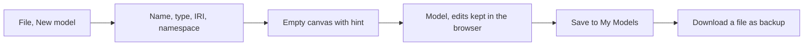
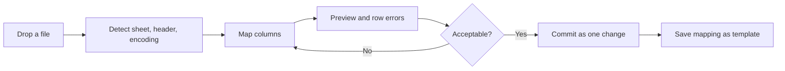
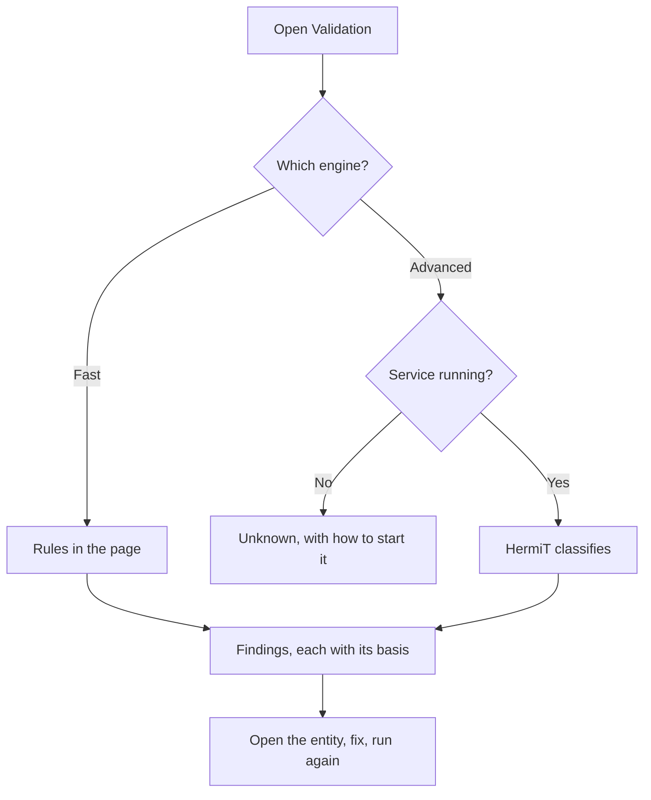
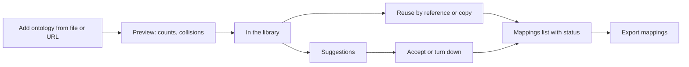
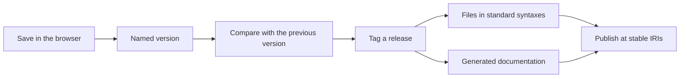
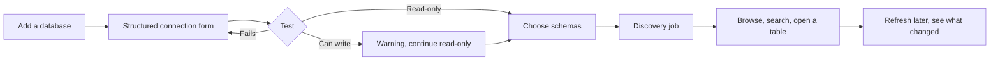
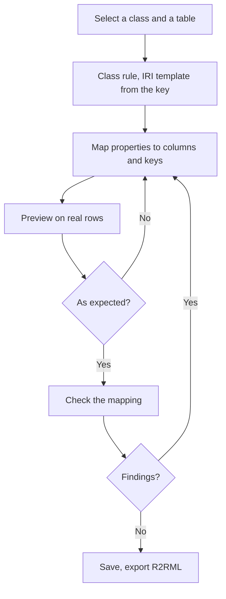

# Product Requirements Document

ConceptWeaver: from a browser-based ontology editor to a platform for semantic modelling,
ontology management and ontology-to-relational data integration.

The data-integration scope (modules M14 to M16, journeys J10 to J12, and the parts of sections
2 to 4 that mention relational databases) was added on 2026-10-13 as an extension of the first
version of this document.

Current state assessed against the repository as of 2026-10-13 (commit `ce6419e`). Companion
documents: [EXECUTIVE_SUMMARY.md](EXECUTIVE_SUMMARY.md),
[SYSTEM_ARCHITECTURE.md](SYSTEM_ARCHITECTURE.md), [DATA_ARCHITECTURE.md](DATA_ARCHITECTURE.md),
[DEVELOPMENT_ROADMAP.md](DEVELOPMENT_ROADMAP.md), [TECHNICAL_DEBT.md](TECHNICAL_DEBT.md).

## 1. How to read this document

**Status labels.** Every capability is marked with what the code shows, not with what was
intended:

| Label | Meaning |
| --- | --- |
| **Existing** | Confirmed in the current codebase. |
| **Partially Implemented** | Present but incomplete; the gap is stated. |
| **Recommended** | Proposed; not in the code. |
| **Future** | Long-term; scoped but not specified in detail. |

**Priorities.**

| Priority | Meaning | Roadmap |
| --- | --- | --- |
| **P0** | Needed for the MVP: a single-user editor an ontology engineer can trust with a real ontology. | Phases 1–2 |
| **P1** | Needed for the platform: server-side storage, scale, history. | Phases 3–4 |
| **P2** | Team and enterprise use. | Phase 5 |
| **P3** | Long-term. | After Phase 5 |

**Identifiers.** Modules are `M1`–`M16`; functional requirements `FR-Mx-n`; non-functional
requirements `NFR-n`; journeys `J1`–`J12`. Debt items (`TD-n`), risks (`AR-n`) and decisions
(`ADR-n`) are defined in the companion documents.

## 2. Product vision and positioning

### 2.1 Vision

Ontology engineering that starts in a browser tab and grows into a managed platform, without
changing tools on the way: the same application for sketching a first model on a laptop and for
maintaining a governed, versioned, reasoned-over ontology in a team.

And an ontology that does not stop at the diagram. The same tool connects the conceptual model
to the relational databases where the organisation's data is: it reads their schemas, lets a
person say how tables and columns correspond to classes and properties, and lets the data be
asked for in the ontology's terms. Conceptual model, physical schema and the mapping between
them are three things, each visible, each owned, none inferred from another.

### 2.2 Mission

Make formal ontologies approachable without making them informal. Every picture the product
draws is a faithful view of OWL axioms, every limit of a reasoner or an import is stated to the
user, and nothing is lost between opening a file and saving it. The same holds across the
bridge to data: a database constraint is never passed off as an ontological fact, and an answer
from a database says by what mapping and with what reasoning it was obtained.

### 2.3 Core value proposition

| For | The product offers | Unlike |
| --- | --- | --- |
| People who model | A visual, immediate editor where a line between two boxes is a precise OWL statement, checked as it is drawn. | Form-based editors, where the picture is an afterthought. |
| People who must be right | Two reasoners, SHACL and quality rules in one place, each result saying what it covers and for which revision. | Tools that report "consistent" without saying by what standard. |
| People who start small | No installation, no account; a file or a URL is enough. | Desktop installs and enterprise server deployments. |
| People who end up large | The same interface over a server-side store, with history, review and publishing. | Outgrowing a lightweight tool and migrating to another. |
| People who have the data elsewhere | The ontology and its mapping to relational databases in one place: schema, mapping and preview side by side, exchanged as standard R2RML. | Authoring an ontology in one tool and hand-writing mapping files for another. |

### 2.4 Target users

| User | What they do | What they need most | Served today |
| --- | --- | --- | --- |
| **Ontology engineer** | Authors and maintains OWL ontologies; uses restrictions, defined classes, reasoning. | Complete OWL 2 editing, lossless files, reliable reasoning, explanations. | Partly: authoring of class expressions and lossless round trips are missing (TD-01, TD-02). |
| **Knowledge engineer / taxonomist** | Builds vocabularies, taxonomies, thesauri. | Fast hierarchy editing, labels in several languages, SKOS export, bulk import. | Well, for one language and pasted input. |
| **Data architect** | Aligns a domain model with data assets and standards. | Reuse of standard ontologies, mappings, tabular import, SHACL for data. | Well for reuse and SHACL; import is basic. |
| **Semantic modeller / analyst** | Reads and reviews models more than writes them. | Clear pictures, hierarchy exploration, search, comparison. | Well. |
| **Data governance professional** | Owns definitions, status, stewardship. | Metadata, lifecycle status, change history, approval. | Metadata yes; history and approval no. |
| **Data engineer / integration specialist** | Makes data from operational databases available in shared terms. | To see a schema, map it to an ontology without guesswork, check the result on real rows, and hand the mapping to a standard engine. | Not at all. |
| **Database architect** | Owns physical schemas. | Assurance of read-only, bounded access; to see which columns a semantic layer depends on before changing them. | Not at all. |

### 2.5 Primary use cases

1. Sketch a domain model visually and export it as valid OWL.
2. Open an existing ontology, understand its structure, and extend it.
3. Check a model: consistency, unsatisfiable classes, data against shapes, modelling quality.
4. Build a vocabulary or taxonomy from a spreadsheet.
5. Reuse terms from standard ontologies and record mappings to them.
6. Maintain an ontology over time: versions, differences, releases.
7. Share a model with people who do not have the tool.
8. (Later) Curate an ontology as a team, with review and governance.
9. (Later) Inspect a relational database's schema beside the ontology.
10. (Later) Map tables, columns and keys to classes and properties, and check the mapping on
    real rows.
11. (Later) Ask for relational data in the ontology's terms, without copying it.

### 2.6 Competitive positioning

Characterisations of other products are from their public documentation and general knowledge
as of October 2026. PoolParty and WebProtégé were checked against their documentation while
writing; the others were not re-verified. Check before quoting externally.

| Capability | Protégé (desktop) | WebProtégé | PoolParty | VocBench | ConceptWeaver today | ConceptWeaver target |
| --- | --- | --- | --- | --- | --- | --- |
| Runs without installing | No (Java desktop) | Yes (hosted or self-hosted) | Yes (server product) | Yes (server product) | **Yes, no server at all** | Yes |
| Complete OWL 2 authoring | Yes | Configurable; lightweight by default | Ontology management alongside SKOS | Yes | Partial (TD-02) | Yes |
| Diagram-first editing | Plugins, read-mostly | No | Visualisation | No | **Yes: the canvas is the editor** | Yes |
| DL reasoning | Yes, several reasoners | — | Not its focus | Rule-based, from its triple store | HermiT via local service; rule reasoner in the page | HermiT and ELK, as jobs |
| SHACL validation | Plugin | — | — | — | **Yes, with a shape form** | Yes |
| Tabular import with mapping | Plugin (Cellfie) | — | Yes | Yes (Sheet2RDF) | Pasted rows only | Yes |
| Versions and change history | No (files) | **Yes, full revision history** | Yes | Yes | **No** | Yes |
| Collaboration, roles, review | No | **Yes** | **Yes, with approval workflow** | **Yes** | No | Phase 5 |
| Taxonomy and thesaurus focus | No | No | **Core strength** | **Core strength** | A SKOS model type | Yes |
| Text mining, entity extraction | No | No | **Yes** | No | No | Not planned |
| Cost and openness | Free, open source | Free, open source | Commercial | Free, open source | No licence file in the repository | To be decided |

A dash means the point was not established from the sources consulted; it is not a claim that
the product lacks the capability.

Sources consulted on 2026-10-13:
[PoolParty overview](https://help.poolparty.biz/en/poolparty-overview.html) and
[system architecture](https://help.poolparty.biz/en/poolparty-overview/poolparty-system-architecture.html);
[Protégé and WebProtégé product page](https://protege.stanford.edu/software),
[WebProtégé backend repository](https://github.com/protegeproject/webprotege-backend-service) and
[the 2014 WebProtégé paper](https://pmc.ncbi.nlm.nih.gov/articles/PMC4176057).

### 2.7 Differentiation opportunities

1. **Zero-install, local-first.** No comparable tool with this breadth runs with no server.
   This must survive every phase (ADR-001).
2. **The diagram is the ontology.** Drawing a line creates the right axiom or is refused with a
   reason (`src/model/relating.ts`, `reconnect.ts`). Competitors visualise; this product edits
   visually.
3. **Honest results.** Reasoner status as *complete*, *partial* or *failed*; imports that say
   what they could not read; results marked stale. This is a trust feature and is rare.
4. **One tool across sizes.** The Structure Explorer already handles 200,000 classes through a
   service interface; the same design applied everywhere removes the usual reason to switch
   tools.
5. **Explanations in words.** The in-page reasoner derives each inference from stated facts and
   says so in sentences; HermiT findings carry justifications.

6. **Model and map in one place.** The tools that author ontologies and the tools that map
   them to databases are mostly different tools. Here the mapping is made against the live
   ontology and a real schema, checked by the same validation workbench, and exported as
   R2RML for any standard engine.

Where the product should *not* compete: enterprise text mining and search (PoolParty's
middleware), plug-in ecosystems (Protégé's), and query engines. The virtual knowledge graph is
provided by an existing open-source engine (Ontop), not rebuilt; the product's contribution is
making the mapping easy to author, check and govern.

**Positioning in data integration.** From general knowledge, with Ontop's facts checked against
its documentation (see [SYSTEM_ARCHITECTURE.md](SYSTEM_ARCHITECTURE.md) §13): Ontop is the
leading open-source virtual-knowledge-graph engine, with mapping authoring available as text in
a Protégé plug-in; commercial knowledge-graph platforms offer virtual graphs and visual mapping
as part of a server product. No lightweight, standards-first tool combines visual ontology
authoring with visual, validated R2RML mapping. That gap is the opportunity; verify the
competitive claims before using them externally.

### 2.8 Scope: MVP and beyond

**MVP (P0): "trust it with a real ontology".** A single user, in the browser, optionally with
the local companion.

| In the MVP | Why |
| --- | --- |
| Lossless open and save of OWL 2 ontologies (FR-M1-8, FR-M11-2) | Without it no professional can adopt the tool. |
| Structured class expressions with a Manchester-syntax editor (FR-M2-2, FR-M2-3) | The core of OWL authoring. |
| Stable identity for every entity (FR-M1-2, FR-M1-3) | Everything else depends on it. |
| Reasoning and validation that do not block the page (FR-M3-1, FR-M4-4) | Usability at a few thousand classes. |
| Graph view usable at 10,000 classes (FR-M5-5, FR-M5-6) | Stated scale target. |
| Named versions with a diff (FR-M10-1 to FR-M10-3) | Minimum change tracking. |
| CSV and Excel import with column mapping (FR-M7-2 to FR-M7-4) | Most common way real vocabularies arrive. |
| Continuous integration and performance baselines | Keeps the above true. |

**Not in the MVP, deliberately:** accounts, sharing, server storage, review workflows,
publishing portals, AI assistance, SWRL, branches.

**Long-term scope** is the remainder of this document: server-side storage and scale (P1),
collaboration and governance (P2), AI assistance and publishing infrastructure (P2–P3).

**A second MVP, for data integration: "map one database, and trust the mapping".** It does not
change the first one, and cannot precede the backend, because a browser cannot connect to a
database.

| In the data-integration MVP | Why |
| --- | --- |
| Connect one PostgreSQL database, read-only, through the local companion (FR-M14-1 to FR-M14-3, FR-M14-9) | One dialect done properly before three done thinly (ADR-015). |
| Discover and browse its schema, with keys and relationships (FR-M14-4 to FR-M14-7) | The physical side has to be seen before it can be mapped. |
| Map classes to tables or views, data properties to columns, object properties to foreign keys, with IRI templates (FR-M15-1 to FR-M15-5) | The core of every mapping. |
| Preview the triples from real rows; check the mapping in the Validation view (FR-M15-7, FR-M15-9) | A mapping nobody has seen run is a guess. |
| The three-area mapping editor (FR-M15-8) | The differentiator. |
| Export as R2RML (the export half of FR-M15-10) | What makes it useful beyond this product on day one. |

**Not in it, deliberately:** other dialects, SQL written by hand, stored credentials, R2RML
import, materialisation, virtual knowledge graphs, several databases, writing to a database.

## 3. Current capability at a glance

| Module | Status | Strongest evidence | Largest gap |
| --- | --- | --- | --- |
| M1 Modelling and entity management | **Existing** | `src/components/Entities.tsx`, `EntityEditor.tsx`, `src/model/iri.ts`, `src/model/identity.ts` | Lossless round trip (property identity done 2026-10-14) |
| M2 Axiom and restriction editing | **Partially Implemented** | `src/model/axioms.ts`, `props.ts` | Class expressions are text |
| M3 Reasoning | **Existing**, job handling partial | `src/model/reasoner.ts`, `reasoning.ts`, `reasoner/ReasonerService.java` | Blocks the page; no ELK; no jobs |
| M4 SHACL and quality | **Existing** | `src/model/validation.ts`, `shapes.ts`, `quality.ts` | Main thread; no cancel |
| M5 Graph and subgraph | **Existing** | `src/components/Canvas.tsx`, `src/layout/`, `src/model/subgraph.ts` | About 2,000 terms |
| M6 Structure exploration | **Existing** | `src/structure/` | No ontology-level comparison |
| M7 Bulk import and mapping | **Partially Implemented** | `src/model/bulk.ts` | No files, no mapping screen |
| M8 Reuse and alignment | **Existing** | `src/model/external.ts`, `alignment.ts`, `matcher.ts` | Imports not transitive or declared |
| M9 Search and SPARQL | **Existing** | `src/entities/`, `src/model/sparql.ts` | Asserted graph only |
| M10 Versioning | **Not implemented** | Undo only: since 2026-10-15 a history of change sets, each of which can be given as axioms (`src/editing/local.ts`); no named versions yet | Everything |
| M11 Publishing and export | **Partially Implemented** | `src/model/files.ts`, `htmlExport.ts` | No RDF/XML export; no publishing |
| M12 AI assistance | **Not implemented** | Matcher seam in `matcher.ts` | Everything |
| M13 Collaboration and governance | **Partially Implemented** | `src/model/governance.ts` | No users, review or audit |
| M14 Database connectivity and schema exploration | **Not implemented** | Free-text `database`, `schema`, `table`, `column` fields in `src/model/governance.ts` | Everything; needs the backend |
| M15 Ontology-to-relational semantic mapping | **Not implemented** | Reusable parts only (entity lists, validation, matcher, IRI handling) | Everything |
| M16 Relational data access: materialisation and virtual knowledge graph | **Not implemented** | SPARQL view over the ontology (`src/model/sparql.ts`) | Everything |

## 4. Non-functional requirements (apply to every module)

| Id | Requirement | Measure |
| --- | --- | --- |
| NFR-1 | **Semantic fidelity.** Opening an OWL 2 ontology and saving it unchanged yields the same axioms. | Axiom-set equality (OWL API structural comparison) on a corpus of public ontologies; zero unreported loss. |
| NFR-2 | **Honesty.** Any result that is incomplete, stale or produced under a limit says so where it is shown. | Review checklist per feature; existing behaviour for reasoning is the reference. |
| NFR-3 | **Responsiveness.** No interaction blocks the page for more than 100 ms; longer work shows progress and can be cancelled. | Main-thread long-task measurement in the browser checks. |
| NFR-4 | **Scale, Local profile.** 10,000 classes: Entities, Structure and search answer within 200 ms; Graph view pans and zooms at 30 frames per second on a subgraph of 500 terms. | Benchmarks in CI. |
| NFR-5 | **Scale, with a server.** 100,000 classes and 1,000,000 triples: the same interaction targets, with the ontology never fully loaded into the browser. | Benchmarks against a seeded store. |
| NFR-6 | **Local-first.** Every P0 feature works with no network and no server. | Browser checks run offline. |
| NFR-7 | **Accessibility.** Text contrast of 4.5:1, pointer targets of 24 px, keyboard access to every function, no information by colour alone. | `e2e/ui-audit.mjs` (existing) extended with keyboard checks. |
| NFR-8 | **Undo.** Every change to an ontology is one undoable step and, once versions exist, one recorded change. | Unit tests per command. |
| NFR-9 | **Compatibility.** Model files written by earlier versions open in later ones. | A fixture file per format version, opened in CI. |
| NFR-10 | **Privacy.** No ontology content leaves the user's machine unless they chose a server or a provider. | Network assertions in browser checks. |
| NFR-11 | **Maintainability.** Views do not contain ontology rules; services do not import views. | Boundary tests, as `src/structure/boundaries.test.ts`. |
| NFR-12 | **Secrets stay on the backend.** No database credential reaches the browser's storage, a model file, an export, a log or an API response. | A browser check that inspects storage and every response after a connection is defined; a test that greps exports and logs for the test password. |
| NFR-13 | **External databases are read, never written, and never overloaded.** Every statement is read-only, time-limited and row-limited. | Integration tests against a database whose account can write: an attempted write fails; a slow query is cut off at the limit. |
| NFR-14 | **No silent semantics.** No OWL axiom is created from a database constraint without an explicit, undoable confirmation. | A test that maps a schema with keys and constraints and asserts the ontology revision is unchanged. |
| NFR-15 | **Rows stay out of the browser's storage** and cross to it only in bounded pages. | Storage inspection in browser checks; response size limits asserted. |
| NFR-16 | **Mapping fidelity.** An R2RML document imported and exported unchanged is an equivalent RDF graph. | Graph isomorphism over the W3C R2RML test-case mappings and a corpus of published mappings. |

## 5. Functional modules

Each module below gives: what it is, what exists, what is missing, user stories, functional
requirements with status and priority, the non-functional points specific to it, dependencies,
and acceptance criteria for the requirements that are not yet met.

### M1 Ontology modelling and entity management

**Description.** Creating and maintaining the entities of an ontology: classes, object
properties, data properties, annotation properties, individuals and datatypes, with their names,
IRIs and annotations.

**Status: Existing.** Classes, data properties and individuals are terms on the canvas and rows
in *Entities* (`src/components/Entities.tsx`), edited in a Protégé-style side panel
(`EntityEditor.tsx`, `Inspector.tsx`). Object properties have seven characteristics, domains,
ranges, and sub-, inverse, equivalent and disjoint links (`src/model/props.ts`). IRIs are made
once and kept through renames; the suffix is editable; prefixes and namespaces are managed
(`src/model/iri.ts`, `prefixes.ts`, `OntologySettings.tsx`). Two model types, OWL ontology and
SKOS vocabulary, decide which features are offered (`src/model/modelTypes.ts`).

**Gaps.** Statements the model has no place for are dropped on import (TD-01). Object
properties are identified by name (TD-03). Annotation properties are not entities. One language
per model. Refactoring is limited to moving a namespace.

**User stories.**

- As an ontology engineer I open my organisation's ontology, add three classes and save it, and
  nothing else in the file has changed.
- As a taxonomist I give each concept a preferred label in English, German and French and switch
  the display between them.
- As a modeller I rename a property and every place that uses it follows.

| Id | Requirement | Status | Priority |
| --- | --- | --- | --- |
| FR-M1-1 | Create, rename and delete classes, object properties, data properties and individuals from the canvas, the tables and the editor. | Existing | P0 |
| FR-M1-2 | Every entity has an IRI from the moment it is created; name and IRI are independent; renaming never changes an IRI. | Implemented 2026-10-14 (a stand-in IRI until the first name; `src/model/iri.ts`) | P0 |
| FR-M1-3 | Object properties have a stable identity independent of their name; two properties may share a label. | Implemented 2026-10-14 (model format 2; `src/model/identity.ts`) | P0 |
| FR-M1-4 | Annotation properties are entities: declared, listed, arranged in a hierarchy, with domain and range. | Recommended | P1 |
| FR-M1-5 | Labels, definitions and notes in several languages per entity; a display language for the whole interface. | Partially Implemented (annotation fields carry a language tag; one display language) | P1 |
| FR-M1-6 | Refactoring: merge two entities, move entities to another namespace, replace one entity by another everywhere, deprecate with a successor. | Partially Implemented (`moveNamespace`) | P2 |
| FR-M1-7 | For any entity, list every axiom that mentions it. | Partially Implemented (relationships and restrictions are listed) | P1 |
| FR-M1-8 | Statements with no editor are preserved and written back unchanged. | Implemented 2026-10-14 (kept whole as read, `src/model/unmapped.ts`; the corpus loses 24 statements of nine ontologies, n-ary axioms among them) | P0 |
| FR-M1-9 | Namespace prefixes and the ontology IRI are managed in one place and kept on import and export. | Existing | P0 |

**Module non-functional points.** NFR-1 is decided here. Identity changes need a file-format
migration (NFR-9).

**Dependencies.** None; this is the foundation. FR-M1-2 and FR-M1-3 precede M2, M7, M10.

**Acceptance criteria.**

- FR-M1-3: two object properties named `hasPart` with different IRIs coexist; renaming one
  leaves relationships using the other untouched; a model saved before the change opens with
  the same relationships.
- FR-M1-8: each ontology of a public test corpus (at least Pizza, Wine, Koala, PROV-O, SKOS,
  OWL-Time, FOAF, and two that use property chains and axiom annotations) is opened and
  exported, and an OWL API comparison of the original and the export reports no axiom added or
  removed.
- FR-M1-2: no entity in a saved model lacks an IRI; no code path outside the local model uses a
  term id.

### M2 Advanced OWL axiom and restriction editing

**Description.** Authoring the logical content of an ontology: restrictions, class expressions,
defined classes, property axioms, assertions about individuals.

**Status: Partially Implemented.** Existing: existential, universal, minimum, maximum and exact
qualified restrictions on one property with a named class or datatype, several on one line
(`restrictionSpecs` in `src/model/props.ts`); equivalent and disjoint classes and properties,
same and different individuals (`LINKS` in `src/model/axioms.ts`); enumerated classes and
datatypes; property characteristics; every edit checked by rule functions that refuse with a
reason. Class expressions from imported ontologies are shown read-only.

**Gaps.** No editor for unions, intersections, complements, nested restrictions, `hasValue`,
`hasSelf` (TD-02). No property chains, keys, disjoint unions, negative assertions, general class
axioms, annotations on axioms, datatype facets or rules.

**User stories.**

- As an ontology engineer I define `VegetarianPizza` as "Pizza and not (hasTopping some
  MeatTopping)" by typing it, with completion and immediate checking.
- As an ontology engineer I state that `hasGrandparent` is the chain of `hasParent` and
  `hasParent`.
- As a reviewer I read a class's definition in words and in Manchester syntax.

| Id | Requirement | Status | Priority |
| --- | --- | --- | --- |
| FR-M2-1 | Qualified restrictions (some, only, min, max, exactly) on a property, drawn as a line or edited in a form. | Existing | P0 |
| FR-M2-2 | Class expressions are structured data: named class, and, or, not, some, only, min, max, exactly, value, self, one-of, nested to any depth. | Implemented 2026-10-14: domains and ranges (model format 3) and superclasses, equivalent and disjoint classes (model format 4, `Term.classAxioms`), with inverse properties and data ranges; `src/model/expressions.ts` | P0 |
| FR-M2-3 | A Manchester-syntax editor for superclass and equivalent-class expressions, with completion of entity names, syntax errors shown in place, and a rendering in words. | Implemented 2026-10-14: a visual editor (nested blocks) and a Manchester-syntax editor (CodeMirror: completion, highlighting, bracket matching, formatting, errors in place) on one expression; checked against the OWL API's Manchester parser. A rendering in words is not done: the blocks name each operator | P0 |
| FR-M2-4 | Property chains, keys, disjoint unions, negative property assertions and general class axioms can be stated and edited. | Recommended | P1 |
| FR-M2-5 | Annotations on axioms are kept, shown and editable. | Recommended | P1 |
| FR-M2-6 | Datatype restrictions with facets (ranges, patterns, lengths). | Partly implemented 2026-10-14: in any data range of an expression or a range axiom (`xsd:integer[>= 0]`); not as a named datatype | P2 |
| FR-M2-7 | Every edit goes through one rule service that accepts it or refuses it with a reason, whichever control was used. | Partially Implemented (since 2026-10-15 one rule for moving an end from the canvas, the panel and the table, TD-06; every edit is a change set of `OntologyEditService`, and one made elsewhere is held to the editor's rule functions, with a reason for each refusal; the editor's own controls still call those functions directly) | P0 |
| FR-M2-8 | SWRL rules. | Future | P3 |

**Module non-functional points.** A class expression that fails to parse is never discarded: it
stays as text (NFR-1). Completion answers within 100 ms at 10,000 entities (NFR-4).

**Dependencies.** FR-M1-2, FR-M1-3 (expressions refer to entities by IRI). FR-M2-4 and FR-M2-5
need the axiom-level contract of [SYSTEM_ARCHITECTURE.md](SYSTEM_ARCHITECTURE.md) §4.3.

**Acceptance criteria.**

- FR-M2-2, FR-M2-3: every class expression in the Pizza ontology opens in the editor as
  structure, not text; editing one and saving produces the intended axiom, verified by HermiT
  classifying the result as the reference does.
- FR-M2-3: an expression with an unknown entity or unbalanced brackets cannot be saved and
  shows where the error is.
- FR-M2-7: moving the end of a relationship gives the same outcome from the canvas, the panel
  and the table.

### M3 Ontology reasoning and inference management

**Description.** Deriving what follows from an ontology, checking it for contradictions, and
showing and explaining the results without confusing them with what was asserted.

**Status: Existing; job handling Partially Implemented.** An in-page rule reasoner (RDFS and
part of OWL 2 RL; `src/model/reasoner.ts`, its coverage stated in `REASONER_PROFILE`) gives
inferred types, superclasses, facts and conflicts, each traced to stated facts. HermiT is
available through a local Java service (`reasoner/ReasonerService.java`), with a complete,
partial or failed status, OWL 2 DL profile violations and justifications
(`src/model/reasoning.ts`). Inferred memberships and relationships can be drawn dotted on the
canvas, listed per entity, browsed as an inferred hierarchy and exported separately.

**Gaps.** The in-page reasoner runs on the main thread after every edit (TD-08). HermiT runs
are a single blocking request with a timeout (TD-14). ELK is not offered although it is in the
service's library bundle. No progress, no cancel, no cache across sessions.

**User stories.**

- As an ontology engineer I start a classification of a large ontology and keep editing while
  it runs.
- As a modeller I ask why a class is unsatisfiable and get the axioms responsible.
- As a terminology maintainer with an OWL 2 EL ontology of 80,000 classes I get the inferred
  hierarchy in under a minute.

| Id | Requirement | Status | Priority |
| --- | --- | --- | --- |
| FR-M3-1 | Immediate rule-based feedback while editing, without blocking the page. | Partially Implemented (blocking) | P0 |
| FR-M3-2 | Complete OWL 2 DL reasoning with HermiT, reporting complete, partial or failed with reasons. | Existing | P0 |
| FR-M3-3 | Inferred statements are shown apart from asserted ones, never stored among them, and exportable on request. | Existing | P0 |
| FR-M3-4 | Reasoning is a job: started, followed, cancelled; one result per revision and reasoner, reused until the ontology changes. | Recommended | P1 |
| FR-M3-5 | ELK is offered for OWL 2 EL ontologies; "automatic" chooses a reasoner from the ontology's profile and says which it chose. | Recommended | P1 |
| FR-M3-6 | A justification can be asked for any inferred subclass relationship, type or inconsistency. | Partially Implemented (for HermiT findings; the hierarchy's `explain` has none for HermiT) | P1 |
| FR-M3-7 | An inferred statement can be made an asserted one by an explicit command, as a normal edit. | Recommended | P2 |
| FR-M3-8 | Time and memory limits are settings, shown with each result. | Partially Implemented (fixed defaults) | P1 |

**Module non-functional points.** NFR-2 is defined by this module's existing behaviour. A
reasoner never blocks editing (NFR-3). Complete OWL 2 DL reasoning is not guaranteed to finish
(AR-02); the requirement is to bound and report it.

**Dependencies.** FR-M3-4 needs the job model (Phase 1 locally, Phase 3 on the server).

**Acceptance criteria.**

- FR-M3-1: with a 2,600-class generated ontology open, an edit produces no main-thread task
  longer than 100 ms; inferences appear when the worker finishes.
- FR-M3-5: for an OWL 2 EL ontology, automatic selection uses ELK and the result says
  "complete for OWL 2 EL"; for one outside EL it uses HermiT or reports ELK's result as partial
  with the ignored axiom types listed.
- FR-M3-4: cancelling a running job returns control within two seconds and leaves no result.

### M4 SHACL validation and ontology quality assurance

**Description.** Checking data against shapes, and the ontology itself against modelling good
practice.

**Status: Existing.** SHACL Core through `rdf-validate-shacl` (`src/model/shaclEngine.ts`,
`shaclFindings` in `validation.ts`), on the model's own individuals or on imported data. A form
editor for common shapes, with anything else in Core written as Turtle (`src/model/shapes.ts`,
`Shapes.tsx`). 34 quality rules in seven groups, each switchable, some with a quick fix
(`src/model/quality.ts`). One results table across the three kinds of check, with reports in
JSON and RDF.

**Gaps.** Runs on the main thread and cannot be cancelled (TD-09). No SHACL-SPARQL. Imported
data lasts for the session only. No user-defined quality rules. No way to run checks outside
the application.

| Id | Requirement | Status | Priority |
| --- | --- | --- | --- |
| FR-M4-1 | Validate the model's individuals, or imported RDF data, against SHACL Core shapes. | Existing | P0 |
| FR-M4-2 | Author shapes in a form for common constraints and as Turtle for the rest. | Existing | P0 |
| FR-M4-3 | Quality rules with severity, switchable per model, with quick fixes where one is safe. | Existing | P0 |
| FR-M4-4 | Validation is a cancellable background job with progress. | Recommended | P0 |
| FR-M4-5 | Results state the revision they are of and are marked stale after an edit. | Existing | P0 |
| FR-M4-6 | Reports as JSON and RDF; additionally as CSV and a printable page. | Partially Implemented (JSON, RDF) | P2 |
| FR-M4-7 | Custom quality rules written as SPARQL queries. | Recommended | P2 |
| FR-M4-8 | The same checks run from a command line, for continuous integration of an ontology repository. | Recommended | P2 |
| FR-M4-9 | SHACL-SPARQL and validation against the inferred graph, with a server engine. | Future | P3 |
| FR-M4-10 | The workbench has a fourth kind of check, *Mapping*, beside OWL, SHACL and quality: same results table, same links to what a finding is about, stale when the mapping, the ontology or the schema changes. The checks themselves are FR-M15-9. | Recommended | P1 |
| FR-M4-11 | Data from a relational source, previewed or materialised through a mapping, can be validated against the project's shapes. | Recommended | P2 |

**Dependencies.** FR-M4-4 shares the job model with M3. FR-M4-9 needs Phase 4.

**Acceptance criteria.**

- FR-M4-4: a validation of a 3,000-term model can be cancelled; while it runs the page stays
  responsive (NFR-3).
- FR-M4-7: a rule given as a `SELECT` query returning `?entity ?message` appears in the results
  table with its own severity and can be switched off.

### M5 Graph and subgraph visualization

**Description.** The canvas: seeing and editing the ontology as a graph.

**Status: Existing.** The application's own SVG canvas (`src/components/Canvas.tsx`): direct
manipulation, seven layouts with routing options computed in a worker (`src/layout/`), per-kind
and per-element styling with themes (`src/model/graphStyle.ts`), subgraphs by starting terms,
depth, direction and relationship type (`src/model/subgraph.ts`), adjustable line ends and
drag-to-reconnect (`src/model/reconnect.ts`), spotlight and path finding, export as SVG, PNG and
an interactive HTML page.

**Gaps.** Every term is drawn (TD-10): about 2,000 terms is the comfortable limit. One diagram
per ontology. Lines do not route around other terms.

| Id | Requirement | Status | Priority |
| --- | --- | --- | --- |
| FR-M5-1 | Create and edit entities and relationships directly on the canvas, with rules enforced as they are drawn. | Existing | P0 |
| FR-M5-2 | Layouts: hierarchical, layered, orthogonal, radial, circular, force-directed, manual; routing straight, curved or right-angled. | Existing | P0 |
| FR-M5-3 | Subgraph by starting terms, depth, direction and relationship kinds, expandable in place. | Existing | P0 |
| FR-M5-4 | Only what is in view is drawn; detail is reduced when zoomed out. | Partially Implemented (labels only) | P0 |
| FR-M5-5 | Above a size threshold the graph opens on a subgraph; the full graph is never instantiated. | Recommended | P0 |
| FR-M5-6 | Styling by kind and by element, themes, saved styles. | Existing | P1 |
| FR-M5-7 | Several named diagrams per ontology, each with its own contents, layout and style. | Recommended | P1 |
| FR-M5-8 | Export the picture as SVG, PNG and an interactive page. | Existing | P1 |
| FR-M5-9 | Overview map and jump-to-entity. | Recommended | P2 |
| FR-M5-10 | Neighbourhoods are fetched from a server on demand. | Recommended | P1 |

**Module non-functional points.** NFR-4. Statement of limits: no rendering technique makes
10,000 nodes readable; the requirement is reachability, not totality.

**Dependencies.** FR-M5-10 needs `GraphService` and Phase 4.

**Acceptance criteria.**

- FR-M5-4: with 10,000 terms loaded and 300 in view, panning holds 30 frames per second; the
  number of SVG nodes follows what is in view.
- FR-M5-5: opening a 50,000-class ontology shows Entities or Structure first and offers the
  graph around a chosen class; memory use does not grow with ontology size.
- FR-M5-7: two diagrams of one ontology show different subsets; deleting a term from a diagram
  does not delete it from the ontology.

### M6 Ontology structure exploration and comparison

**Description.** Understanding an ontology's shape: its hierarchies, how classes relate, where
it is deep, wide or irregular; and comparing things.

**Status: Existing.** The Structure Explorer (`src/components/Structure*.tsx` over
`src/structure/`): *Explore* (asserted or inferred class hierarchy, paged, with a summary of the
class in focus), *Compare* (two classes: what each asserts and inherits), *Analyze* (metrics,
distributions, diagnostics, with the classes behind each number). All through `StructureService`
with an HTTP client ready.

**Gaps.** Classes only: no property hierarchies. Comparison is between two classes, not two
versions or two ontologies. The HTTP implementation has no server.

| Id | Requirement | Status | Priority |
| --- | --- | --- | --- |
| FR-M6-1 | Browse the asserted and the inferred class hierarchy, a branch at a time, at any size. | Existing | P0 |
| FR-M6-2 | Summary of a class: stated and inferred superclasses, equivalents, depth, descendants, ways down to it. | Existing | P0 |
| FR-M6-3 | Compare two classes: asserted and inherited restrictions side by side. | Existing | P1 |
| FR-M6-4 | Metrics and diagnostics of the hierarchy, each with the classes behind it. | Existing | P1 |
| FR-M6-5 | Object- and data-property hierarchies in the same explorer. | Recommended | P1 |
| FR-M6-6 | Compare two versions of an ontology, or two ontologies: entities and axioms added, removed and changed. | Recommended | P1 |
| FR-M6-7 | The explorer is answered by a server for server-side ontologies. | Partially Implemented (client only) | P1 |

**Dependencies.** FR-M6-6 needs M10. FR-M6-7 needs Phase 3.

**Acceptance criteria.**

- FR-M6-6: for two versions that differ by one renamed class, one moved class and one removed
  restriction, the comparison shows exactly those three changes, grouped by entity.
- FR-M6-7: the existing `http.test.ts` suite passes against the Java implementation.

### M7 Advanced bulk import and data mapping

**Description.** Bringing many entities in at once from tabular sources, with control over what
each column becomes.

**Status: Partially Implemented.** *Bulk add* (`src/model/bulk.ts`, dialog in
`src/components/views.tsx`) takes pasted text in two steps: terms with a type, description,
synonyms, datatype and further columns as annotations, with an optional header row; then
relationships in arrow notation. An indented outline is read as a hierarchy. Problems are
reported per line.

**Gaps.** No file upload; no CSV or Excel parsing; no mapping screen; no preview of the
resulting entities; no saved templates; no updating of existing entities; individuals with
property values cannot be imported from columns.

**User stories.**

- As a taxonomist I drop a spreadsheet with columns *Code, Label, Parent code, Definition* and
  say which is which; I see the resulting hierarchy before anything is created.
- As a data architect I import 5,000 product rows as individuals of a class, with three columns
  as data property values, and re-import next month to update them.
- As a team lead I save the mapping so that a colleague imports the next file the same way.

| Id | Requirement | Status | Priority |
| --- | --- | --- | --- |
| FR-M7-1 | Paste rows of terms and relationships. | Existing | P0 |
| FR-M7-2 | Upload CSV, TSV and Excel files; choose sheet, header row and encoding. | Recommended | P0 |
| FR-M7-3 | A mapping screen: each column becomes a name, an IRI or part of one, a type, a parent, an annotation (with language), a data property value, or a link to another entity by a chosen property. | Recommended | P0 |
| FR-M7-4 | Preview before commit: what will be created, what will be skipped and why, row by row; the import is one undoable change. | Partially Implemented (notes per line; one history step) | P0 |
| FR-M7-5 | Mappings are saved as named templates and reused. | Recommended | P1 |
| FR-M7-6 | Update mode: rows are matched to existing entities by IRI or a key column; changes are shown before they are applied. | Recommended | P1 |
| FR-M7-7 | Files too large for the browser are imported as a server job. | Future | P2 |
| FR-M7-8 | A mapping can be exported in a standard mapping language (RML). | Future | P3 |

**Module non-functional points.** 20,000 rows are mapped and previewed in the browser without
blocking it (NFR-3). Every created entity satisfies the same rules as one created by hand
(FR-M2-7).

**Dependencies.** FR-M1-2 (IRIs from rows). Excel parsing needs a library, loaded on demand as
oxigraph and Dagre are.

**Acceptance criteria.**

- FR-M7-2, FR-M7-3: a 2,000-row CSV with parent references becomes a hierarchy with the right
  2,000 classes and parents; a row whose parent is missing is reported with its row number and
  nothing is created for it.
- FR-M7-4: one undo removes the whole import.
- FR-M7-6: re-importing the same file changes nothing and says so.

### M8 Ontology reuse and semantic alignment

**Description.** Building on existing ontologies rather than beside them: adding them,
referring to their entities, and recording how local entities correspond to theirs.

**Status: Existing.** *Align* (`src/components/Alignment.tsx`): a library of external
ontologies added from a file or URL in any supported syntax, with a preview and collision
report (`src/model/external.ts`); reuse of an entity by reference or by copy; mappings with
thirteen OWL and SKOS predicates, a method, a score, a status (proposed, approved, needs
review), author and comment (`src/model/alignment.ts`); lexical suggestions that can be accepted
or turned down (`src/model/matcher.ts`); mappings exported and imported as Turtle.

**Gaps.** `owl:imports` is neither written nor followed transitively. External content is
cached per browser, not with the model. No SSSOM. Suggestions are lexical only. No catalogue
search.

| Id | Requirement | Status | Priority |
| --- | --- | --- | --- |
| FR-M8-1 | Add an external ontology from a file or a URL; see what it contains and what collides. | Existing | P0 |
| FR-M8-2 | Reuse an external entity by reference (its own IRI) or by copy. | Existing | P0 |
| FR-M8-3 | Record mappings with standard predicates, with status, author and comment; review them in one list. | Existing | P1 |
| FR-M8-4 | Suggest mappings; accept or turn down each; never suggest a rejected one again. | Existing (lexical) | P1 |
| FR-M8-5 | `owl:imports` is declared on export and the imports closure is resolved transitively, with missing imports reported. | Partially Implemented (one level, not declared) | P1 |
| FR-M8-6 | Import and export mappings as SSSOM. | Recommended | P2 |
| FR-M8-7 | Extract a module of an external ontology (the part needed for chosen terms) instead of the whole. | Future | P3 |
| FR-M8-8 | Search public catalogues for terms to reuse. | Future | P3 |
| FR-M8-9 | Semantic (embedding-based) suggestions. | Future | P3 |

**Dependencies.** FR-M8-5 shares the imports design with M3 (a reasoner needs the same
closure). FR-M8-9 is M12.

**Acceptance criteria.**

- FR-M8-5: an ontology that imports another which imports a third is reasoned over with all
  three; removing the third from the cache produces a "missing import" finding naming it.

### M9 Ontology search and SPARQL querying

**Description.** Finding things, by text and by query.

**Status: Existing.** Entity tables with search over names, other labels, IRIs and definitions,
sorting and filters, answered by a query service with matches highlighted (`src/entities/`). A
sidebar search and hierarchy. A SPARQL view over the asserted ontology using oxigraph in the
page, with example queries per model type, results as a table, CSV download, and the last query
remembered (`src/model/sparql.ts`, `SparqlView.tsx`).

**Gaps.** SPARQL sees the asserted graph only. One remembered query, no named ones. No search
across axioms and annotations as such.

| Id | Requirement | Status | Priority |
| --- | --- | --- | --- |
| FR-M9-1 | Search entities by name, label, IRI and definition, with matches highlighted. | Existing | P0 |
| FR-M9-2 | Sort and filter each list by what is said about its entities. | Existing | P0 |
| FR-M9-3 | SPARQL `SELECT`, `ASK` and `CONSTRUCT` over the ontology, with examples and CSV download. | Existing | P1 |
| FR-M9-4 | Choose what a query reads: asserted, asserted with imports, or with inferred statements. | Recommended | P1 |
| FR-M9-5 | Named, saved queries per project. | Recommended | P2 |
| FR-M9-6 | One search box across entities, annotations and axioms, with results grouped by kind. | Recommended | P2 |
| FR-M9-7 | A read-only SPARQL endpoint for a published ontology. | Future | P3 |

**Dependencies.** FR-M9-4 needs inferred results kept per revision (M3) and, at scale, Phase 4.

**Acceptance criteria.**

- FR-M9-4: the same query for instances of a class returns the asserted instances in one mode
  and the asserted and inferred ones in the other, and the result header says which.

### M10 Ontology versioning and change tracking

**Description.** Knowing what an ontology was, what it is, and what changed in between.

**Status: Not implemented.** There is an undo history of 100 steps in memory, lost on reload,
and a content fingerprint that marks results stale. There are no saved versions, no difference
view and no record of who changed what (TD-12).

**User stories.**

- As a maintainer I save "Before restructuring Person" and return to it if the restructuring
  fails.
- As a reviewer I see what changed since the last release, entity by entity.
- As a publisher I tag a release with a version number and a version IRI.

| Id | Requirement | Status | Priority |
| --- | --- | --- | --- |
| FR-M10-1 | Save a named version with a summary; list versions newest first. | Recommended | P0 |
| FR-M10-2 | Show the difference between any two versions, or a version and now: entities added, removed, changed; for each, the axioms added and removed. | Recommended | P0 |
| FR-M10-3 | Restore a version, as a new version, never by deleting history. | Recommended | P0 |
| FR-M10-4 | The history of one entity: every change that touched it. | Recommended | P1 |
| FR-M10-5 | On a server, every saved change is an immutable revision with its author and time. | Recommended | P1 |
| FR-M10-6 | A release: a tagged revision with `owl:versionIRI` and `owl:versionInfo`, exportable and comparable. | Recommended | P1 |
| FR-M10-7 | Branches and merging. | Future | P3 |

Mapping sets are versioned on a line of their own, independent of the ontology's: FR-M15-12.

**Module non-functional points.** Differences are computed over axioms, not text, so that
reordering a file is not a change (NFR-1). Picture-only changes are not ontology changes.

**Dependencies.** FR-M1-2, FR-M1-3. Design in [DATA_ARCHITECTURE.md](DATA_ARCHITECTURE.md) §6.

**Acceptance criteria.**

- FR-M10-2: moving terms on the canvas between two versions shows "no changes to the ontology".
- FR-M10-2: adding one superclass and removing one restriction shows exactly two changes under
  the right class.
- FR-M10-3: after restoring version 3 of 5, there are six versions and the sixth equals the
  third.

### M11 Ontology publishing and export

**Description.** Getting an ontology out: as files in standard syntaxes, as documentation, as a
published resource.

**Status: Partially Implemented.** Exports (`exportModel` in `src/model/files.ts`): the
application's JSON, Turtle (as OWL, as SKOS, and with inferred assertions), JSON-LD, CSV of
terms and relationships, SVG, PNG, and a self-contained interactive HTML page with search and a
draggable graph (`src/model/htmlExport.ts`, `src/export/`).

**Gaps.** No RDF/XML, OWL/XML, functional or Manchester export, although all are read (TD-13).
No generated documentation. No publishing to a stable address. No Excel or PDF.

| Id | Requirement | Status | Priority |
| --- | --- | --- | --- |
| FR-M11-1 | Export as Turtle, JSON-LD and the application's own format. | Existing | P0 |
| FR-M11-2 | Export as RDF/XML, OWL/XML, functional and Manchester syntax. | Recommended | P0 |
| FR-M11-3 | Export with inferred statements as a separate, clearly marked section. | Existing | P1 |
| FR-M11-4 | A self-contained interactive page of the model that opens anywhere. | Existing | P1 |
| FR-M11-5 | Generated documentation: a page per entity with its definition, hierarchy, restrictions and usage, and an index. | Recommended | P2 |
| FR-M11-6 | Publish a release at stable IRIs with content negotiation between documentation and RDF. | Future | P2 |
| FR-M11-7 | Excel and PDF exports. | Recommended | P3 |

**Dependencies.** FR-M11-2 uses the OWL service that already converts in the other direction;
without the service the export is offered as Turtle only, with that said. FR-M11-6 needs M10 and
the Server profile.

**Acceptance criteria.**

- FR-M11-2: an ontology exported as RDF/XML opens in Protégé with the same axiom count and no
  parse warning; an OWL API comparison with the Turtle export shows no difference.

### M12 AI-assisted ontology modelling

**Description.** Suggestions from language models and embeddings that a person accepts or
rejects.

**Status: Not implemented.** The README lists AI assistance under "Not there yet". One seam
exists: mapping suggestion is a list of matcher functions (`MATCHERS` in
`src/model/matcher.ts`), written so that another matcher can be added beside the lexical one.

| Id | Requirement | Status | Priority |
| --- | --- | --- | --- |
| FR-M12-1 | Every AI output is a proposal: shown, attributed to its source, and applied only on acceptance, as an ordinary change. | Future (required of every item below) | P2 |
| FR-M12-2 | Semantic mapping suggestions between local and external entities. | Future | P2 |
| FR-M12-3 | Draft a definition or labels for an entity from its position and neighbours. | Future | P3 |
| FR-M12-4 | Propose classes and relationships from a document or a list of terms. | Future | P3 |
| FR-M12-5 | Translate a question into SPARQL, or a description into a class expression, for the user to check. | Future | P3 |
| FR-M12-6 | A provider is configured explicitly; what would be sent is shown; nothing is sent otherwise. | Future (required) | P2 |
| FR-M12-7 | Suggest mappings between a schema and the ontology from names, comments, types and sample values. Schema names and sample values are sent to a provider only with explicit consent per data source. | Future | P3 |

**Module non-functional points.** NFR-10 and AR-10. A proposed axiom is validated by the same
rule service as a typed one (FR-M2-7) and can be checked by a reasoner before acceptance.

**Dependencies.** M10 (provenance of accepted suggestions), M2 (structured expressions to
propose into). Architecture: ADR-010.

**Acceptance criteria.** For any AI feature: with no provider configured there is no network
request; an accepted suggestion appears in the history as a change with its origin; a rejected
one is not offered again.

### M13 Collaboration and governance

**Description.** More than one person working on an ontology, under rules about who may change
what and how changes are approved.

**Status: Partially Implemented.** Governance *metadata* is Existing: a configurable registry
of about forty fields mapped to standard properties, including owner, steward, sensitivity,
lifecycle status and version, with required-field checks and a profile per entity kind
(`src/model/governance.ts`, `Governance.tsx`). Mappings carry a review status. There are no
users, roles, comments, approvals or audit trail; the application is single-user by
construction.

| Id | Requirement | Status | Priority |
| --- | --- | --- | --- |
| FR-M13-1 | Governance metadata per entity with configurable fields mapped to standard properties. | Existing | P1 |
| FR-M13-2 | Lifecycle status per entity, with required fields checked by validation. | Existing | P1 |
| FR-M13-3 | Accounts and roles per project: viewer, commenter, editor, owner. | Future | P2 |
| FR-M13-4 | Comments and discussions on an entity or a change. | Future | P2 |
| FR-M13-5 | Review: a change is proposed, reviewed and approved or returned before it becomes part of the ontology. | Future | P2 |
| FR-M13-6 | Audit trail: who changed what and when, for ontology and for settings. | Future | P2 |
| FR-M13-7 | Watches and notifications. | Future | P3 |
| FR-M13-8 | Several people editing at the same time see each other's changes. | Future | P3 |
| FR-M13-9 | Lineage: from an entity, the tables and columns it is mapped from; from a column, the entities that depend on it. The existing free-text database, schema, table and column fields are filled from mappings where one exists. | Recommended | P2 |
| FR-M13-10 | Permission on a data source is separate from permission on a project; mapping changes can be put through review like ontology changes. | Future | P2 |

**Dependencies.** M10 (a proposal is a change set; the audit trail is the revision history),
the Server profile, authentication.

**Acceptance criteria.** Deferred to the Phase 5 specification. One criterion is fixed now:
adding collaboration must not remove the ability to work alone with no server (ADR-001).

### M14 Database connectivity and schema exploration

**Description.** Connecting external relational databases, read-only, and making their
structure visible: schemas, tables, views, columns, types, keys and the relationships between
tables.

**Status: Not implemented.** The application has never connected to a database and has no
model of a relational schema. Two things point at the need: governance metadata already has
free-text fields for *database*, *schema*, *table*, *column* and *physical data type*, and an
entity kind *technical data asset* (`src/model/governance.ts`). They are typed by hand today.

**Why it needs the backend.** A browser cannot open a database connection, and a credential
must not be in one. This module exists only with the companion or a server (ADR-014).

**User stories.**

- As a data engineer I connect the reporting database with a read-only account, choose the two
  schemas that matter, and browse their tables and keys.
- As a database architect I am shown, before I agree to a connection, that the product cannot
  write and cannot run an unbounded query.
- As a modeller I search for every column called `customer_id` and see which tables are joined
  through it.
- As a data engineer I refresh the schema after a migration and see what changed.

| Id | Requirement | Status | Priority |
| --- | --- | --- | --- |
| FR-M14-1 | Define a data source from structured fields: dialect, host, port, database, TLS mode, account. A raw connection string is not accepted. | Recommended | P1 |
| FR-M14-2 | The credential is entered once and handled by the backend only: held for the session, or taken from a secret the environment provides, or stored encrypted. It is never shown again and never sent back. | Recommended | P1 |
| FR-M14-3 | Test a connection: reachable, authenticated, server version, and whether the account can write (a warning if so). | Recommended | P1 |
| FR-M14-4 | Discover schemas, tables, views, columns with type, length, precision, nullability, default and comment; primary keys, foreign keys and unique constraints. | Recommended | P1 |
| FR-M14-5 | Schema Explorer: a tree of schemas, tables and columns drawn a branch at a time; search and filter by name, type, kind and key role; a table's detail with its keys, the tables it refers to and the tables that refer to it. | Recommended | P1 |
| FR-M14-6 | Choose the schemas and tables to work with; everything else is left unread and out of sight. | Recommended | P1 |
| FR-M14-7 | Refresh metadata as a background job. Each read is a snapshot with a fingerprint; the explorer says when it was taken. | Recommended | P1 |
| FR-M14-8 | A bounded sample of a table's rows, read-only, with columns marked sensitive masked. | Recommended | P1 |
| FR-M14-9 | PostgreSQL is supported. | Recommended | P1 |
| FR-M14-10 | SQL Server and MySQL are supported through the same adapter interface. | Recommended | P2 |
| FR-M14-11 | Relationships between tables as a diagram, laid out by the existing layouts. | Recommended | P2 |
| FR-M14-12 | Several independent data sources per project. | Future | P2 |
| FR-M14-13 | A schema can be loaded from a DDL script, with no live connection. | Future | P3 |

**Module non-functional points.** NFR-12, NFR-13 and NFR-15 are decided here. Discovery of a
schema of 10,000 tables is a job that reports progress and can be cancelled; browsing it
afterwards answers within 200 ms a page (NFR-5). Nothing here touches the ontology (NFR-14).

**Dependencies.** The Java backend (Phase 3, task 3.2) and a metadata store for sources and
snapshots. Security measures of [SYSTEM_ARCHITECTURE.md](SYSTEM_ARCHITECTURE.md) §12.9 are part
of the first release, not a later one.

**Acceptance criteria.**

- FR-M14-2: after a data source is defined and used, the test password occurs in no browser
  storage, no API response, no export and no log line.
- FR-M14-3: with an account that can write, the test reports it; an attempted write through any
  path of the product fails regardless.
- FR-M14-4: for a reference database with composite keys, a self-referencing foreign key, a
  view and a table with no key, discovery reports each correctly.
- FR-M14-5: searching a snapshot of 200,000 columns answers within 200 ms; the tree never holds
  more lines than are in view.
- FR-M14-7: after a column is dropped and another retyped in the database, a refresh produces a
  new fingerprint and lists exactly those two changes.

### M15 Ontology-to-relational semantic mapping

**Description.** The Semantic Mapping Workbench: stating how rows of a relational database
correspond to instances of classes and values of properties, checking that statement, and
keeping it as a standard, versioned artefact.

**Status: Not implemented.** Parts it will be built from exist: entity lists with search and
filters (`src/entities/`), the hierarchy service (`src/structure/`), the validation results
model (`src/model/validation.ts`), datatype and literal checking (`src/model/literals.ts`), IRI
and prefix handling (`src/model/iri.ts`, `prefixes.ts`), and the suggestion model of the
alignment workbench (`src/model/matcher.ts`). The reuse map is in
[SYSTEM_ARCHITECTURE.md](SYSTEM_ARCHITECTURE.md) §12.5.

**What a mapping can say.**

| Ontology element | Relational source | In R2RML |
| --- | --- | --- |
| Class | A table, a view, or a query | A triples map with a logical table and a class on its subject map |
| Individual IRI | A template over one or more columns, usually the key | `rr:template` on the subject map |
| Class membership | Each row of the logical table is one individual of the class | The subject map's `rr:class` |
| Several classes from one table | A condition per class on a discriminating column | A triples map per class, each over a query with the condition |
| A class from several tables | A join, as a view or a query | A logical table that is a query |
| Data property | A column, or an expression | A predicate-object map with `rr:column` |
| Datatype | A conversion from the column's SQL type | `rr:datatype`, or the standard's natural mapping where none is given |
| Language-tagged text | A column with a fixed language | `rr:language` |
| Object property | A foreign key or a longer join path to another class's rows | A referencing object map with join conditions |
| A missing value | `NULL` | No triple |

Nothing in this table is one-to-one by assumption. A table is not a class until someone says
so, and a column is not a property until someone maps it.

**User stories.**

- As a data engineer I map the class `Film` to the table `film`, give its individuals IRIs from
  `film_id`, and see the first fifty films as triples.
- As a data engineer I map `Documentary` to the same table where `kind = 'documentary'`.
- As a modeller I see at a glance which classes and properties have no mapping, and which
  columns of the tables I chose are not used.
- As a data engineer I am told, after the schema was refreshed, that two of my rules refer to a
  column that no longer exists.
- As an integrator I export the mapping as R2RML and run it in another engine.

| Id | Requirement | Status | Priority |
| --- | --- | --- | --- |
| FR-M15-1 | Map a class to a table or a view. A class may have several such maps; a table may serve several classes. | Recommended | P1 |
| FR-M15-2 | IRI templates for individuals, from one or more columns, with values encoded for use in an IRI; a default instance namespace per mapping set; the template is checked as it is typed. | Recommended | P1 |
| FR-M15-3 | Map a data property to a column, with a datatype conversion chosen from those the column's type allows, or a language tag. A `NULL` yields no triple. | Recommended | P1 |
| FR-M15-4 | Map an object property to a foreign key between two mapped tables, or to a join path of several keys. | Recommended | P1 |
| FR-M15-5 | A condition on a class map, built from column, operator and value, so that several classes can be populated from one table. | Recommended | P1 |
| FR-M15-6 | A SQL query as a logical table, and a SQL expression as a value, written by the user: a single read-only `SELECT`, checked before it is saved. | Recommended | P2 |
| FR-M15-7 | Preview: the triples a rule generates from the first rows of its source, with, for each row that yields nothing, the reason. | Recommended | P1 |
| FR-M15-8 | The three-area mapping editor described under *Interaction design* below: ontology on the left, schema on the right, mappings between; coverage shown on both sides; every action possible without dragging. | Recommended | P1 |
| FR-M15-9 | Mapping checks, shown in the Validation view (FR-M4-10): the checks listed below. | Recommended | P1 |
| FR-M15-10 | R2RML: export a mapping set; import one; constructs with no editor are kept, shown read-only and exported unchanged. | Recommended | P2 |
| FR-M15-11 | A mapping set is saved with its project, edited, duplicated and reused against another data source of the same shape. | Recommended | P1 |
| FR-M15-12 | Mapping revisions on their own line, each recording the ontology revision and the schema fingerprint it was written against; differences between two revisions. | Recommended | P2 |
| FR-M15-13 | Schema change detection: after a refresh, the rules affected by each change are listed with what changed. | Recommended | P2 |
| FR-M15-14 | Reusable mapping patterns: a rule or group of rules saved as a template and applied to another table of the same shape. | Recommended | P2 |
| FR-M15-15 | Suggestions: candidate columns for a property and tables for a class, by name and type, each accepted or turned down, never applied by themselves. | Recommended | P2 |
| FR-M15-16 | Proposals derived from constraints (a shape from `NOT NULL`, a key from `UNIQUE`, an object-property mapping from a foreign key) are offered with what each would mean, default to SHACL, and change the ontology only on confirmation. | Recommended | P2 |
| FR-M15-17 | A draft mapping generated from a schema is available as a starting point, shown in full before anything is kept. | Recommended | P2 |
| FR-M15-18 | Value transformations beyond datatype conversion: lookups, string functions, unit conversion. | Future | P3 |

**Mapping checks (FR-M15-9).** Each is a finding with a level, the rule it concerns, and an
explanation in words, in the manner of the existing quality rules.

| Check | Finds | Needs a connection |
| --- | --- | --- |
| Unresolved source | A rule names a table or column that is not in the current snapshot. | No |
| Unknown entity | A rule names a class or property that is not in the current ontology, or names a class where a property is needed. | No |
| Incompatible datatype | A column's type cannot be converted to the datatype of the mapping, or the mapping's datatype contradicts the property's range. | No |
| Invalid IRI template | A template is not an IRI once filled, refers to a column the source lacks, or uses a nullable column, so that some rows would have no IRI. | No |
| Template not identifying | The template's columns are not a key of the source: two rows would become one individual. Reported as a warning, since that is sometimes intended. | No |
| Broken join | A join names columns that do not exist, differ in type, or are not backed by a key on the side that should be unique. | No |
| Incomplete rule | A class map with no template; a property map with no source; an object-property map whose target class has no map. | No |
| Duplicate or conflicting rules | Two rules generate the same triples; two rules give one property different datatypes; two class maps with different templates for the same class and table. | No |
| Schema changed | The mapping was written against a fingerprint that is no longer the newest. | No |
| Values do not convert | Sampled values that fail conversion to the mapped datatype, with examples. | Yes, bounded |

**Interaction design.** Three areas, as the brief specifies.

```
+----------------------+--------------------------------+----------------------+
| ONTOLOGY             | MAPPINGS                       | DATABASE SCHEMA      |
| search, filters:     |  Film   <-  film               | search, filters:     |
|  all | not mapped     |    IRI  .../film/{film_id}     |  all | not used      |
|                      |    releaseDate <- released_on  |                      |
| v Work               |    directedBy  <- director_id  | v public             |
|   v Film        [3]  |                    -> person   |   v film        [3/7]|
|       Documentary[1] |  Documentary <- film           |       film_id  PK    |
|   Person        [0]! |    where kind = 'documentary'  |       title          |
|                      |                                |       released_on    |
| Object properties    | [Preview]  [Check]  [R2RML]    |       director_id FK |
| Data properties      | 50 rows -> 148 triples, 2 skip |   > person      [0/4]|
+----------------------+--------------------------------+----------------------+
```

- **Left, the ontology explorer.** The class hierarchy and the lists of object and data
  properties, from the existing entity and structure services, with a count of rules on each
  entity and a filter for those with none.
- **Right, the schema explorer.** The tree of M14, with keys marked and, on each table, how
  many of its columns are used.
- **Centre, the mapping workspace.** The rules, grouped by class: for each, its source, its IRI
  template, its conditions, and its property rules. Selecting a rule highlights its two ends in
  the side areas. A panel edits the selected rule: source, join, filter, conversion, template.
  Below, the preview and the findings for that rule.

Principles, the first eight from the `ui-ux-pro-max` guidance consulted for this design:

1. **Dragging is never the only way.** A column can be dragged onto a property; the same is
   done by selecting one on each side and pressing *Map*, and from the keyboard (guideline:
   *Dragging Movements*, a single-pointer alternative is required).
2. **Status is not colour alone.** Mapped, not mapped and invalid each have an icon and a
   count as well as a colour (guideline: *Color Only*).
3. **Errors sit at the field** that caused them (the template, the condition), and a summary
   above the rule links to each (guidelines: *Error Placement*, *Focusable Error Summary*).
4. **Empty states say what to do**: no data source yet, nothing chosen yet, nothing mapped yet
   each offer the next action (guideline: *Empty States*).
5. **Long work shows progress** suited to its length, without the layout jumping or the focus
   moving: discovery, preview, validation (guideline: *Loading Indicators*).
6. **Removing asks first**: a mapping set, a data source (guideline: *Confirmation Dialogs*).
7. **Everything by keyboard**, in the order it is seen: left, centre, right (guideline:
   *Keyboard Navigation*).
8. **The connection form accepts paste and password managers** (guideline: *Accessible
   Authentication*).
9. **Lines between the sides are an aid, not the model.** Connecting lines are drawn for the
   selected class only; a full web of lines over two long lists is unreadable. This and the
   next point are from the application's own practice, not from the guidance, which had no
   matching entry.
10. **Long trees draw what is in view**, a branch at a time, as the Structure Explorer does.
11. **What a rule means is said in words** and in R2RML, side by side: "Each row of `film`
    where `kind` is `documentary` is a `Documentary`, identified by `…/film/{film_id}`."

**Module non-functional points.** NFR-14 and NFR-16. Editing a mapping never changes the
ontology and never touches the database. Static checks answer as the user types; anything that
reads rows is bounded (NFR-13). The mapping model and its checks contain no user-interface
code (NFR-11) and run in the page for offline editing against a cached snapshot.

**Dependencies.** M14 (a snapshot to map against). FR-M1-2 and FR-M1-3 (rules name entities by
IRI). The mapping core shared with tabular import (FR-M7-3; ADR-019). FR-M15-12 needs the
metadata store of Phase 4.

**Acceptance criteria.**

- FR-M15-1, FR-M15-5: `Film` and `Documentary` mapped to one table by a condition; the preview
  of each shows only its own rows; every documentary is also previewed as a film.
- FR-M15-2: a template over a nullable column is reported; a template whose value contains a
  space or a slash yields a valid, encoded IRI.
- FR-M15-3: a row whose mapped column is `NULL` yields no triple for that property and the
  preview says so; a `DATE` column mapped to `xsd:date` yields typed literals; mapping a text
  column to `xsd:integer` is flagged before any row is read.
- FR-M15-4: an object property mapped through a foreign key yields triples whose objects are
  the IRIs the target class's template generates for the referenced rows.
- FR-M15-7: the preview's triples equal those the reference engine produces from the exported
  R2RML for the same rows (AR-12).
- FR-M15-8: every mapping action in the editor can be completed with the keyboard alone and
  with single clicks alone.
- FR-M15-10: the exported R2RML of a mapping made in the workbench is executed by an
  independent R2RML processor without error; a published R2RML document is imported and
  exported as an equivalent graph (NFR-16).
- FR-M15-13: after a mapped column is dropped and the schema refreshed, the rule using it is
  listed with "column removed", and no other rule is.
- FR-M15-16: accepting no proposal leaves the ontology revision unchanged (NFR-14).

### M16 Relational data access: materialisation and virtual knowledge graph

**Description.** Using a mapping to get at the data: by generating RDF from it and storing the
result, or by answering SPARQL queries from the database directly with nothing stored.

**Status: Not implemented.** The SPARQL view queries the ontology in the page
(`src/model/sparql.ts`). There is no engine that reads a relational database.

**The three things, and why they are separate** are set out in
[SYSTEM_ARCHITECTURE.md](SYSTEM_ARCHITECTURE.md) §12.2. In short: a mapping is a description;
materialising runs it and keeps a copy; a virtual graph answers each query from the source at
the time it is asked.

**User stories.**

- As an analyst I ask, in SPARQL and the ontology's terms, for directors of documentaries
  released after 2020, and get the answer from the live database.
- As a data engineer I see the SQL my query became and how long each part took.
- As a data steward I materialise last night's data and validate it against our shapes.
- As a modeller I ask for instances of `Work` and get films too, because `Film` is a subclass,
  and I am told that this much reasoning, and no more, was applied.

| Id | Requirement | Status | Priority |
| --- | --- | --- | --- |
| FR-M16-1 | Materialise a mapping set into a data graph of the project, as a job, with an estimate of its size before it starts and a record of which mapping, ontology and schema it came from. | Recommended | P2 |
| FR-M16-2 | A virtual knowledge graph for a mapping revision: SPARQL in the ontology's terms is answered from the database, with nothing stored. | Recommended | P2 |
| FR-M16-3 | Every answer says how it was obtained: virtual or materialised, which mapping and ontology revisions, and which reasoning was applied (the OWL 2 QL part of the ontology for a virtual graph). | Recommended | P2 |
| FR-M16-4 | Trace: for a query, the SQL it was rewritten to, the time spent rewriting and executing, and the rows returned. | Recommended | P2 |
| FR-M16-5 | Limits: a time limit and a result cap on every query, set per data source; results reach the browser a page at a time. | Recommended | P2 |
| FR-M16-6 | The SPARQL view offers the virtual graph and the materialised data as sources beside the ontology, with the existing results table and CSV download. | Recommended | P2 |
| FR-M16-7 | Parts of a query the engine does not support are refused with a statement of what is not supported, not answered partially. | Recommended | P2 |
| FR-M16-8 | One query across several databases. | Future | P3 |
| FR-M16-9 | Writing changes back to a database. | Future | P3 |

**Module non-functional points.** NFR-13 and NFR-15 above all: a query from this product must
never be the reason a source database is slow. NFR-2 applies in a new form: an answer from a
virtual graph is complete with respect to the data and the OWL 2 QL part of the ontology, and
says so; it is not a claim about what is true in an open world
([SYSTEM_ARCHITECTURE.md](SYSTEM_ARCHITECTURE.md) §12.7).

**FR-M16-9 is not a later step of this module.** Writing to a database needs its own design for
transactions, authorisation and integrity, and is recorded here only so that nothing in the
read-only design is mistaken for a first half of it (ADR-018).

**Dependencies.** M15 (a valid mapping revision, as R2RML). The triple store of Phase 4 for
materialisation. An OBDA engine, adopted after a spike (ADR-016).

**Acceptance criteria.**

- FR-M16-2: for a reference database and mapping, a set of SPARQL queries returns the same
  answers from the virtual graph as from a materialisation of the same mapping queried in the
  triple store.
- FR-M16-3: a query for instances of a superclass returns instances mapped only to its
  subclasses, and the answer's header names the reasoning applied.
- FR-M16-4: the trace of a query shows SQL that runs unchanged in a database client and returns
  the same rows.
- FR-M16-5: a query that would run for minutes is stopped at the limit, the database session is
  released, and the user is told which limit was reached.
- FR-M16-7: a query using an unsupported feature is refused with that feature named.

## 6. User journeys

Each journey gives the user's objective, where it starts, what the user does and how the system
answers **today** (with the status of each step), where it is hard, and what would improve it.
Steps that do not exist yet are marked Recommended and describe the intended behaviour.

### J1 Creating a new ontology project

**Objective.** Start a new ontology with a name, a type and a namespace, and have it kept.

**Entry point.** *File → New model…* (`src/components/NewModel.tsx`).

| Step | User action | System response | Status |
| --- | --- | --- | --- |
| 1 | Chooses *New model…* | A dialog asks for a name, the type (OWL ontology or SKOS-like vocabulary, each described), the ontology IRI and the default namespace, the last two suggested from the name. | Existing |
| 2 | Confirms | An empty canvas with a hint: double-click to add a term, or use *Bulk add*. The type decides which views and editors are offered. | Existing |
| 3 | Starts modelling | The working copy is kept in the browser after every change. | Existing |
| 4 | Presses Save (Ctrl+S) | The model is stored under *My Models* in this browser; the header shows whether there are unsaved changes. | Existing |
| 5 | Chooses where the project lives: this browser, or a server | — | Future (Server profile) |



**Difficulties.**

- "Model", "ontology" and "project" are used for nearly the same thing.
- The namespace has to be decided before the user knows why it matters.
- "Saved" means "in this browser"; clearing site data loses it. The header says so, but only
  once the user knows to look.
- An empty canvas gives no starting structure.

**UX opportunities.**

- Offer three starts: empty, from a file or URL, from a template (a small upper structure, a
  SKOS scheme).
- One sentence in the dialog on what the namespace is for, with the default good enough to
  accept.
- After the first save, say where the model is and offer a file download; remind when the last
  backup is old (AR-09).
- A project home: name, type, counts, versions, last checks.

### J2 Defining classes and properties

**Objective.** Describe the kinds of thing in a domain and how they relate.

**Entry points.** The canvas; *Entities*; *Bulk add*.

| Step | User action | System response | Status |
| --- | --- | --- | --- |
| 1 | Double-clicks the canvas, types a name | A class is created with an IRI made from the name. | Existing |
| 2 | Drags the ⊕ handle of a class onto another class and names the line "is a" | A subclass axiom. The hierarchy in the sidebar updates. | Existing |
| 3 | Drags again and names the line "directs" | An object property `directs` is declared if new, and the first class is restricted: *directs some* the second. | Existing |
| 4 | Changes a term's type to data property; drags a class onto it | "Has data property": the class is given the property. | Existing |
| 5 | Opens *Entities → Object properties* and edits `directs` | Characteristics, domain, range, inverse and parent in the side panel. | Existing |
| 6 | Tries a line that OWL has no meaning for (an individual to a data property) | Refused, with the reason and what to do instead. | Existing |
| 7 | Sees, as the line is dropped, which axiom will be created, in words and in Manchester syntax | — | Recommended |

**Difficulties.**

- A named line between two classes creates an existential restriction. People from UML or ER
  modelling expect "a relationship", and ontology engineers may have meant a domain and range.
- The meaning of a line depends on its name ("is a") and on the types of its ends. This is
  explained in the panel, after the fact.
- Object properties come into being by naming a line; there is no moment of "creating a
  property".

**UX opportunities.**

- At the drop, a compact chooser of what the line can mean between these two ends, with the
  default highlighted. The rule service already knows the options (`kindsBetween` in
  `src/model/props.ts`).
- A one-line confirmation of the axiom just created, with *undo* beside it.
- For newcomers, a mode that reads each relationship as a sentence ("Every Director directs at
  least one Film").

### J3 Creating individuals and relationships

**Objective.** Record particular things, what they are, and what is true of them.

**Entry points.** The canvas; *Entities → Individuals*; the entity editor.

| Step | User action | System response | Status |
| --- | --- | --- | --- |
| 1 | Creates a term and sets its type to individual | An individual, drawn differently from a class. | Existing |
| 2 | Drags it onto a class | "Is Instance Of": a class assertion, always from the individual to the class. | Existing |
| 3 | Drags it onto another individual and names the line | A fact using that object property. | Existing |
| 4 | Opens it and adds a value under *Data property assertions* | The value is checked against the property's datatype or enumerated range. | Existing |
| 5 | Turns on *Inferred facts* | Inferred memberships and relationships are drawn dotted, never stored. | Existing |
| 6 | Enters fifty individuals in a table, one per row, with their values in columns | — | Recommended (M7) |

**Difficulties.**

- Individuals crowd a diagram quickly.
- Values are entered one at a time in a side panel.
- An individual and a data property cannot be joined by a line; the message explains it, but the
  attempt is natural.

**UX opportunities.**

- A grid for individuals of a class: rows are individuals, columns are its properties.
- Hide individuals on the canvas by default above a count, with a count badge on their class.
- Import individuals from a spreadsheet (J5).

### J4 Defining OWL restrictions and axioms

**Objective.** Say precisely what it takes to be a member of a class, and how properties
behave.

**Entry points.** A relationship's panel; a class's editor; a property's editor.

| Step | User action | System response | Status |
| --- | --- | --- | --- |
| 1 | Selects a relationship between two classes | The panel shows the restriction and reads it back: "Every Director: directs some Film". | Existing |
| 2 | Changes *some* to *only*, *min*, *max* or *exactly*, with a number | The restriction changes; the line's label follows. | Existing |
| 3 | Adds another restriction on the same line | Several restrictions with one property and filler. | Existing |
| 4 | In the class editor, adds an equivalent or a disjoint class | The axiom is stated; a statement that contradicts an existing one is refused with the reason. | Existing |
| 5 | Sets a property transitive, functional, and so on | Stated; combinations that exclude each other are reported by validation. | Existing |
| 6 | Opens a class imported with a complex definition | The expression is shown as text and cannot be edited. | Partially Implemented |
| 7 | Types `Pizza and (hasTopping some MeatTopping)` as an equivalent class | — | Recommended (FR-M2-3) |
| 8 | States a property chain or a key | — | Recommended (FR-M2-4) |

**Difficulties.**

- A restriction can only be made by drawing a line to a class that is on the canvas.
- Necessary conditions (superclasses) and definitions (equivalent classes) look alike.
- Anything beyond one property and one named filler cannot be authored (TD-02).

**UX opportunities.**

- A *Definition* section in the class editor with two lists, "is always" and "is defined as",
  each taking expressions.
- Completion, bracket matching and a plain-language reading beside the expression.
- After a change to a definition, show what the fast reasoner now infers for that class.

### J5 Importing CSV or Excel files and mapping columns to ontology entities

**Objective.** Turn a table that already exists into classes, properties or individuals.

**Entry point today.** *Bulk add* (pasted text). **Target.** *File → Import a table…*.

| Step | User action | System response | Status |
| --- | --- | --- | --- |
| 1 | Copies rows from a spreadsheet and pastes them into *Bulk add*, step 1 | Each row becomes a term. With a header row starting with "Name", columns are matched by their names; unknown columns become annotations. | Existing |
| 2 | Pastes relationships in step 2, as `Customer -> places -> Order` | Relationships are added, each through the same rules as one drawn by hand; lines that cannot be used are listed with the reason. | Existing |
| 3 | Drops a `.csv` or `.xlsx` file | The file is read; sheet, header row and encoding are detected and can be changed. | Recommended |
| 4 | Says what each column is | A mapping screen: name, IRI, type, parent, annotation with language, data value, link by a property. A sample of rows shows the result as it is built. | Recommended |
| 5 | Reviews the preview | Counts of what will be created, updated and skipped; every skipped row with its number and reason; the hierarchy that would result. | Recommended |
| 6 | Commits | One change, one undo, one entry in the history. | Partially Implemented (one undo step today) |
| 7 | Saves the mapping as a template | It is offered the next time a file with the same columns is dropped. | Recommended |



**Difficulties today.**

- The header convention has to be known in advance.
- Relationships are a second paste in a notation of their own; a parent column in the same
  table cannot be used.
- There is no view of the result before it is made.
- Individuals with values cannot be imported.

**UX opportunities.** The target journey above. In addition: recognise common column names in
several languages; show duplicates against existing entities before committing; make *update*
as safe as *create* by showing a difference first.

### J6 Running OWL reasoning and SHACL validation

**Objective.** Find out whether the ontology is consistent, what follows from it, whether data
conforms, and what should be improved.

**Entry point.** The *Validation* view; the *Inferred facts* switch on the graph.

| Step | User action | System response | Status |
| --- | --- | --- | --- |
| 1 | Opens *Validation* | Three cards: OWL consistency, SHACL validation, ontology quality. The fast checks have run once. | Existing |
| 2 | Chooses the reasoning engine | Fast reasoner (in the page) or Advanced reasoner (HermiT). Each says what it covers. | Existing |
| 3 | Chooses Advanced without the service running | Status "Unknown: the reasoner gave no answer", with how to start it. Never "consistent". | Existing |
| 4 | Starts the service in a terminal (`pnpm reasoner`) and runs again | The ontology is sent, reasoned over and the result shown as complete, partial or failed, with findings and justifications. | Existing |
| 5 | Edits the model | Results are marked stale; nothing is silently kept. | Existing |
| 6 | Defines a shape and runs SHACL | Findings per focus node, with the shape and the value at fault. | Existing |
| 7 | Clicks a finding | The entity opens; some quality findings offer a quick fix. | Existing |
| 8 | Keeps working while a long run proceeds, sees its progress, cancels it | — | Recommended (FR-M3-4, FR-M4-4) |
| 9 | Lets the application choose a reasoner | — | Recommended (FR-M3-5) |



**Difficulties.**

- The advanced reasoner needs Java and a terminal.
- A large run freezes the page for its duration.
- "Partial" needs reading to understand.
- Checks are re-run by hand after an edit.

**UX opportunities.**

- A packaged companion started by double-clicking, detected automatically.
- Runs in the background with progress; the fast checks re-run by themselves when the page is
  idle.
- A summary line in the header: last result, for which revision, by which reasoner.
- For each kind of finding, the usual repair.

### J7 Exploring class hierarchies and graph relationships

**Objective.** Understand an ontology one did not write, or check the shape of one's own.

**Entry points.** The sidebar tree; *Structure*; the *Subgraph* mode of the graph.

| Step | User action | System response | Status |
| --- | --- | --- | --- |
| 1 | Opens *Structure → Explore* | The class hierarchy under `owl:Thing`, a branch at a time. | Existing |
| 2 | Switches from asserted to inferred | The reasoner's hierarchy, saying which reasoner and whether it may be incomplete; equivalent classes on one line; unsatisfiable ones under `owl:Nothing`. | Existing |
| 3 | Selects a class | A summary: superclasses stated and inferred, depth, descendants, the ways down to it. | Existing |
| 4 | Opens *Compare* with two classes | What each asserts and inherits, side by side. | Existing |
| 5 | Opens *Analyze* | Counts, depth and breadth distributions, diagnostics; a click on a number lists the classes behind it. | Existing |
| 6 | On the graph, chooses *Show as a subgraph* for a class | The class and its neighbours to a chosen depth; neighbours expand in place. | Existing |
| 7 | Selects two terms and asks for the path between them | The shortest path is spotlighted. | Existing |
| 8 | Browses the hierarchy of properties | — | Recommended (FR-M6-5) |
| 9 | Opens a 50,000-class ontology and goes straight to a neighbourhood | — | Recommended (FR-M5-5) |

**Difficulties.**

- The full graph of anything large is not readable; the subgraph mode is the answer but has to
  be found.
- The canvas draws everything first (TD-10).
- Structure covers classes only.

**UX opportunities.**

- *Show in graph* and *Show in Structure* on every entity, everywhere.
- Open large ontologies in Structure by default and say why.
- Named diagrams, so that a useful view can be returned to (FR-M5-7).

### J8 Reusing external ontologies and aligning entities

**Objective.** Use terms from an existing ontology, and record how one's own terms correspond
to someone else's.

**Entry point.** The *Align* view.

| Step | User action | System response | Status |
| --- | --- | --- | --- |
| 1 | Adds an ontology from a file or a URL | It is read in whichever syntax it is in; a preview gives counts and the entities whose IRIs or names collide with the model's. | Existing |
| 2 | Confirms | It joins the library; its content is cached in this browser. | Existing |
| 3 | Browses its entities and reuses one | By reference (it keeps its IRI and is marked external) or by copy. | Existing |
| 4 | Relates a local class to an external one | A mapping with a chosen predicate; each predicate says what it means and what a reasoner will make of it. | Existing |
| 5 | Opens *Suggestions* | Lexical candidates with a score; each is accepted or turned down, and a rejected one is not offered again. | Existing |
| 6 | Reviews mappings | One list with status (proposed, approved, needs review), author and comment; exported as Turtle. | Existing |
| 7 | The added ontology's own imports are fetched and reasoned with | — | Recommended (FR-M8-5) |
| 8 | Searches a public catalogue for a term | — | Future |



**Difficulties.**

- Many ontology servers do not allow a browser to fetch from them; the file has to be
  downloaded first.
- The cached content does not travel with the model file.
- Choosing between `owl:equivalentClass` and `skos:exactMatch` has consequences the user may
  not foresee.

**UX opportunities.**

- With the companion or a server, fetch through it and avoid the browser's restriction.
- After adding a mapping, run the fast reasoner and show at once whether it made anything
  unsatisfiable.
- Embed external content in the saved project when asked.

### J9 Saving, exporting and publishing an ontology

**Objective.** Keep the work, hand it to other tools and people, and make a version of it
official.

**Entry point.** The *File* menu.

| Step | User action | System response | Status |
| --- | --- | --- | --- |
| 1 | Saves | Stored in *My Models* in this browser; optional autosave for a model already there. | Existing |
| 2 | Downloads the model as JSON | The complete model, with positions, styles and settings. | Existing |
| 3 | Exports as OWL (Turtle), SKOS (Turtle) or JSON-LD | Standard RDF without the picture. A vocabulary can be exported as an ontology and the reverse, converted on the way out. | Existing |
| 4 | Exports with inferred assertions | The ontology, then the inferred statements in a marked section. | Existing |
| 5 | Exports an interactive page | One HTML file with the graph, the hierarchy and search, needing nothing else. | Existing |
| 6 | Exports as RDF/XML for a colleague using Protégé | — | Recommended (FR-M11-2) |
| 7 | Saves a named version and compares it with the last | — | Recommended (M10) |
| 8 | Tags a release with a version number and gets files and documentation for it | — | Recommended (FR-M10-6, FR-M11-5) |
| 9 | Publishes the release at its IRI | — | Future (FR-M11-6) |



**Difficulties.**

- The JSON file is the only complete copy; the RDF exports leave out the picture, which is
  right but not obvious.
- No RDF/XML, the format most other tools exchange.
- "Publishing" does not exist; an exported file is put somewhere by hand.

**UX opportunities.**

- An export dialog organised by purpose ("to continue in Protégé", "to share a picture", "to
  back up everything") rather than by format.
- A release flow: version number, checks must pass, files and documentation produced together.
- A visible "last backed up" in the header.

### J10 Connecting a relational database and exploring its schema

**Objective.** See the structure of a database beside the ontology, without risk to the
database and without the credential leaving the backend.

**Entry point.** A new *Data sources* area (Recommended). Every step is Recommended: none
exists today.

| Step | User action | System response | Status |
| --- | --- | --- | --- |
| 1 | Opens *Data sources* with no companion or server running | An explanation of why a database cannot be reached from the browser alone, and how to start the companion. Mappings already cached can still be opened. | Recommended |
| 2 | Chooses *Add a database*, PostgreSQL | A form of separate fields: host, port, database, TLS mode, account, password. No free-form connection string. It says what will and will not be done: read-only, time-limited, nothing stored but structure. | Recommended |
| 3 | Presses *Test* | Reachable or not, with the database's own message; server version; a warning if the account can write. | Recommended |
| 4 | Chooses how the password is kept | For this session only (default for the companion), or by reference to a secret the environment provides. | Recommended |
| 5 | Chooses the schemas to read | Discovery runs as a job with progress; the explorer fills as schemas complete. | Recommended |
| 6 | Browses and searches | A tree of schemas, tables and columns; keys marked; search by name, type and key role. | Recommended |
| 7 | Opens a table | Its columns with types and nullability, its keys, the tables it refers to and those that refer to it; a sample of rows on request. | Recommended |
| 8 | Comes back after a migration and refreshes | A new snapshot; what changed since the last; which mappings that affects (J11). | Recommended |



**Difficulties to design for.**

- The person modelling often does not hold database credentials; the person who does is wary
  of a new tool. The connection screen has to earn that trust in one reading.
- Real schemas are large and full of tables nobody wants. Choosing a scope must come before
  reading everything.
- Naming differs by dialect: a "schema" in one is a "database" in another.
- A firewall or a missing TLS certificate produces failures that are not the product's.

**UX opportunities.**

- A plain statement of guarantees on the form, each one true by construction (NFR-12, NFR-13).
- Counts before commitment: "this schema has 1,240 tables" before it is read.
- Errors in the database's own words with the usual cause beside them.
- A table's neighbours as a small diagram, reusing the existing layouts.

### J11 Mapping ontology entities to tables and columns

**Objective.** State, check and keep how the database's rows correspond to the ontology's
classes and properties.

**Entry point.** The *Mapping* workbench of a project that has an ontology and a data source
(Recommended throughout).

| Step | User action | System response | Status |
| --- | --- | --- | --- |
| 1 | Opens the workbench | Three areas: the ontology with every entity marked "not mapped", the schema with every column "not used", an empty workspace saying how to begin. | Recommended |
| 2 | Selects the class `Film` and the table `film`, presses *Map* (or drags one onto the other) | A class rule. An IRI template is proposed from the primary key and shown with an example IRI from a real row. Nothing else is assumed. | Recommended |
| 3 | Selects the property `release date` and the column `released_on`, presses *Map* | A property rule under the class rule, with the conversion the column's type suggests (`DATE` to `xsd:date`). A conflict with the property's range would be flagged here. | Recommended |
| 4 | Maps `directed by` to the foreign key `director_id` | Possible once `Person` has a class rule; otherwise the workspace says which rule is missing and offers to create it. | Recommended |
| 5 | Adds `Documentary` on the same table with the condition `kind` = `documentary` | A second class rule over the same table; the workspace reads it back in words. | Recommended |
| 6 | Presses *Preview* | The triples from the first fifty rows; for a row that produced nothing, why (a `NULL`, a value that does not convert). | Recommended |
| 7 | Presses *Check* | Mapping findings in the Validation view's terms: unresolved columns, bad templates, broken joins, conflicts; each links to its rule. | Recommended |
| 8 | Looks for what is left | Filters "not mapped" on the left and "not used" on the right. | Recommended |
| 9 | Considers a proposal: "`released_on` is NOT NULL; add a shape requiring a release date?" | Shown with what it would mean; accepted or dismissed. The ontology is unchanged unless accepted. | Recommended |
| 10 | Exports | An R2RML file, with no connection details in it. | Recommended |
| 11 | Returns after the schema changed | The rules affected, each with what changed under it. | Recommended |



**Difficulties to design for.**

- The tempting shortcut, "map everything automatically", produces exactly the one-table-one-class
  model the ontology was written to get away from.
- Join tables, discriminator columns and shared keys do not look like classes or properties.
- A mapping can be syntactically fine and semantically wrong; only looking at rows shows it.
- Two long lists and lines between them become unreadable quickly.

**UX opportunities.**

- Every rule read back as a sentence, and previewed on rows, before it is trusted.
- Proposals instead of automation: a draft, a suggested column, a suggested shape, each one
  visible and declinable (FR-M15-15 to FR-M15-17).
- Coverage as the organising idea: what is not mapped, what is not used.
- Recognise a join table and offer it as an object-property mapping rather than a class.

### J12 Querying relational data through the ontology

**Objective.** Ask for data in the ontology's vocabulary and get it from the database, live,
without copying it.

**Entry point.** The *SPARQL* view, with a virtual graph as its source (Recommended
throughout; stage DI-4).

| Step | User action | System response | Status |
| --- | --- | --- | --- |
| 1 | Deploys a virtual graph for a checked mapping revision | The engine starts for that mapping and ontology; the view shows it is ready and what it serves. | Recommended |
| 2 | Chooses the source: ontology, materialised data, or virtual graph | The header says which, and for a virtual graph which revisions and which reasoning apply. | Recommended |
| 3 | Writes a query in the ontology's terms | Completion over classes and properties, as elsewhere. | Recommended |
| 4 | Runs it | Results, a page at a time, in the existing table; the time taken; CSV download. | Recommended |
| 5 | Opens *How was this answered?* | The SQL the query became, the time spent rewriting and executing, the rows read. | Recommended |
| 6 | Asks for instances of a superclass | Instances mapped to its subclasses are included; the header says the hierarchy was applied. | Recommended |
| 7 | Uses a feature the engine does not support | Refused, naming the feature; not answered in part. | Recommended |
| 8 | Runs a query that is too slow | Stopped at the limit; told which limit and shown the SQL, so that the cause can be found in the database. | Recommended |
| 9 | Wants the data validated against shapes | Materialises a bounded sample or the whole, then validates it (FR-M4-11). | Recommended |

**Difficulties to design for.**

- An answer from live data looks exactly like an answer from the ontology, and means something
  different.
- Slow queries are usually the database's indexes, not the product; the user needs to be able
  to see that.
- "No results" has two causes: no such data, or no mapping for that term. They must be told
  apart.

**UX opportunities.**

- The source and the reasoning applied are always in the result header, never implicit.
- When a query uses a class or property that has no mapping, say so: "nothing maps to
  `Award`", instead of an empty table.
- A one-click path from a slow query to its SQL.

## 7. Assumptions and open questions

**Assumptions made in this document.**

1. The product is developed by one person; scope is ordered accordingly.
2. The first customers are single users and small teams who run it themselves. A hosted,
   multi-tenant service is not designed here.
3. OWL 2 DL is the reference language; OWL 2 Full is not a goal.
4. The SKOS vocabulary type remains a first-class kind of project, not a reduced ontology.
5. Relational databases are read, never written, by this product.
6. The first users of data integration run the companion on a machine that can reach the
   database; a hosted service connecting into customers' networks is not designed here.

**Open questions for the product owner.**

| Question | Why it matters | Default taken |
| --- | --- | --- |
| Will the product be open source, source-available or commercial? | Decides which libraries can be bundled and how the companion is distributed. | Undecided; no library with restrictive terms is proposed. |
| Is the SKOS-centred user (taxonomist) or the OWL-centred user (ontology engineer) the first audience? | They pull the MVP in different directions: multilingual labels and import versus class expressions and reasoning. | Ontology engineer first, because lossless OWL is the harder credibility gap. |
| How large are the ontologies the first users actually have? | Sets how early Phase 4 is needed. | 10,000 classes as the Local-profile target. |
| Is hosting a service something the developer wants to operate? | The Server profile can be delivered as software to self-host only. | Self-hosted. |
| Which database do the first data-integration users have? | The first dialect is the only one for a while. | PostgreSQL (ADR-015). |
| Is live querying (a virtual graph) or a governed, exportable mapping the first goal? | The first needs an engine and operations; the second is useful with an export alone. | The mapping first; the virtual graph at stage DI-4. |
| Does data integration come before or after collaboration? | Both follow Phase 4 and compete for the same time. | Stages DI-1 to DI-3 are scheduled within Phases 3 and 4; DI-4 and collaboration are ordered by demand. |
