# System Architecture

Current state assessed against the repository as of 2026-10-13 (commit `ce6419e`). Companion
documents: [TECHNICAL_DEBT.md](TECHNICAL_DEBT.md), [DATA_ARCHITECTURE.md](DATA_ARCHITECTURE.md),
[PRODUCT_REQUIREMENTS.md](PRODUCT_REQUIREMENTS.md),
[DEVELOPMENT_ROADMAP.md](DEVELOPMENT_ROADMAP.md).

Sections 1 to 11 are the architecture of the ontology platform. **Section 13 adds ontology-driven
logical data modelling** (2026-10-17): logical data models as an artifact of their own beside the
ontology and the shape sets, derived from the ontology by reviewed transformation and kept
traceable to it. It is the active direction of the roadmap; the diagrams and tables of sections 3
and 4 include its components. **Section 12, ontology-to-relational data integration** (database
schema exploration, R2RML mapping, materialisation and virtual knowledge graphs), added on
2026-10-13, is **deferred**: kept as the design of record, marked so wherever sections 3 and 4
mention it, and not scheduled.

Every statement about the application carries one of four labels:

| Label | Meaning |
| --- | --- |
| **Existing** | Confirmed in the current codebase; the source file is named. |
| **Partially Implemented** | Present, but incomplete in a way that is stated. |
| **Recommended** | Proposed here; not in the code. |
| **Future** | Long-term; deliberately not designed in detail. |

## 1. Current architecture (Existing)

### 1.1 Shape

ConceptWeaver is a single-page application that runs entirely in the browser, with one optional
companion process on the same machine.

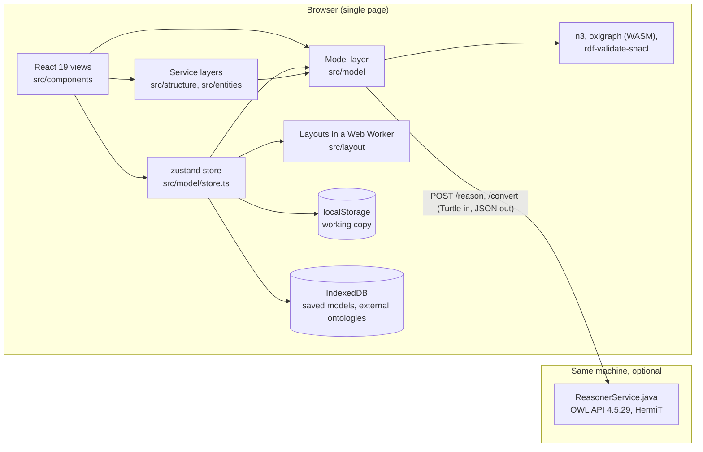

| Part | Where | Size | Role |
| --- | --- | --- | --- |
| Views | `src/components` (37 `.tsx`) | 12,500 lines | Graph, Entities, Structure, Validation, Align, RDF, SPARQL, Vocabulary; side panels and dialogs. |
| Store | `src/model/store.ts` | 1,800 lines | All state and 99 actions: document, undo, selection, jobs, persistence. |
| Model layer | `src/model` (71 files) | 21,100 lines incl. tests | Types, OWL rules, RDF reading and writing, both reasoning paths, validation, alignment, governance, geometry. No UI imports. |
| Structure service | `src/structure` | 4,800 lines incl. tests | Hierarchy questions behind `StructureService`; local and HTTP implementations. |
| Entities service | `src/entities` | 1,500 lines incl. tests | Search, sort, filter behind `EntityQueryService`; local and HTTP implementations. |
| Layouts | `src/layout` | 1,400 lines | Seven layouts over a neutral `LayoutGraph`; run in a worker. |
| HTML export | `src/export` | 1,300 lines | Self-contained viewer page. |
| OWL service | `reasoner/` | 930 lines | One Java file on the JDK's `HttpServer`: `/health`, `/reason`, `/convert` (and, since 2026-10-14, `/compare`, for the round-trip test). |
| Browser checks | `e2e/` (21 scripts) | 5,400 lines | Playwright scripts against the built app; one of them is a UI audit. |

Runtime dependencies are few (`package.json`): `react`, `zustand`, `n3` (Turtle), `oxigraph`
(SPARQL and RDF/XML, JSON-LD parsing, loaded on demand), `rdf-validate-shacl` with
`@zazuko/env` (SHACL Core), `@dagrejs/dagre` (one layout, loaded on demand).

### 1.2 What is sound and should be preserved

- **A model layer without UI imports.** Rules such as "what can relate two terms"
  (`src/model/props.ts`, `relating.ts`, `axioms.ts`, `reconnect.ts`) are pure functions from a
  model to a new model or a refusal with a reason. They are testable and are tested.
- **Two subsystems already written for a backend.** `src/structure/contracts.ts` and
  `src/entities/contracts.ts` define questions asked by IRI of a named revision, answered with
  plain JSON-serialisable data, a page at a time, cancellable. Each has a local implementation,
  an HTTP client (`http.ts`), a test that puts every question through JSON and compares
  (`http.test.ts`), and a test that fails if the service imports the UI or the store
  (`boundaries.test.ts`).
- **Honest reasoning results.** Results name the reasoner, say whether they are complete,
  partial or failed, and are marked stale when the model changes (`src/model/reasoning.ts`,
  `validation.ts`).
- **Separation of picture from meaning.** Positions, styles, layouts and line ends are kept out
  of RDF, and `stable(model)` (`src/model/stable.ts`) gives the same object while only the
  picture changes, so nothing is reasoned again for a drag.
- **A local companion that asks nothing of the network** and binds to `127.0.0.1`.

### 1.3 What limits it

In one sentence: **the whole ontology has to be in the page, in a shape designed for drawing.**
The consequences are itemised in [TECHNICAL_DEBT.md](TECHNICAL_DEBT.md); the ones that shape the
architecture are TD-01 (not an axiom store), TD-03 and TD-18 (identity), TD-05 (views read the
model directly), TD-08 (reasoning on the main thread), TD-10 (the canvas draws everything) and
TD-12 (no versions).

Measured limits on the development machine (`src/model/bench.test.ts`,
`src/structure/bench.test.ts`, run on 2026-10-13; Node 22, 13th-generation Core i9):

| Operation | 650 classes | 2,600 classes | Note |
| --- | --- | --- | --- |
| In-page reasoner | 158 ms | 572 ms | Main thread, after every semantic edit. |
| Export Turtle | 19 ms (252 KB) | 123 ms (1.0 MB) | |
| Import Turtle | 99 ms | 438 ms | |
| Model as JSON | 515 KB | 2.1 MB | `localStorage` holds about 5 MB. |
| Model checks | 23 ms | 131 ms | |

| Structure service | 10,000 classes | 50,000 classes | 200,000 classes |
| --- | --- | --- | --- |
| Build the hierarchy | 28 ms | 116 ms | 646 ms |
| Inferred hierarchy from direct links | 46 ms | 266 ms | 1,322 ms |
| A page of subclasses, a search | under 2 ms | under 6 ms | under 20 ms |

The second table is the important one: the part of the application that was written against a
service interface is two orders of magnitude beyond the part that was not.

## 2. Drivers and constraints

1. **One developer.** Every moving part has to be worth its upkeep. No broker, no service mesh,
   no second language runtime until something cannot be done without it.
2. **Evolve, do not rewrite.** The application works and has 600 tests. Each step must leave it
   working.
3. **OWL correctness before features.** Losing a statement on a round trip is worse than not
   having an editor for it.
4. **Local-first stays.** Opening the app and modelling with no account and no server is the
   product's clearest advantage over the tools it is compared with.
5. **Honest scale.** The target is 10,000 or more classes and hundreds of thousands of axioms
   in daily use, with complete OWL 2 DL reasoning offered where it can finish and not promised
   where it cannot.

## 3. Target architecture (Recommended)

### 3.1 Overview

The browser application keeps its local mode. Every ontology operation goes through a service
interface. Each interface has a local implementation (today's code) and a remote one. A single
Java application, grown from the present reasoner service, implements the remote side.

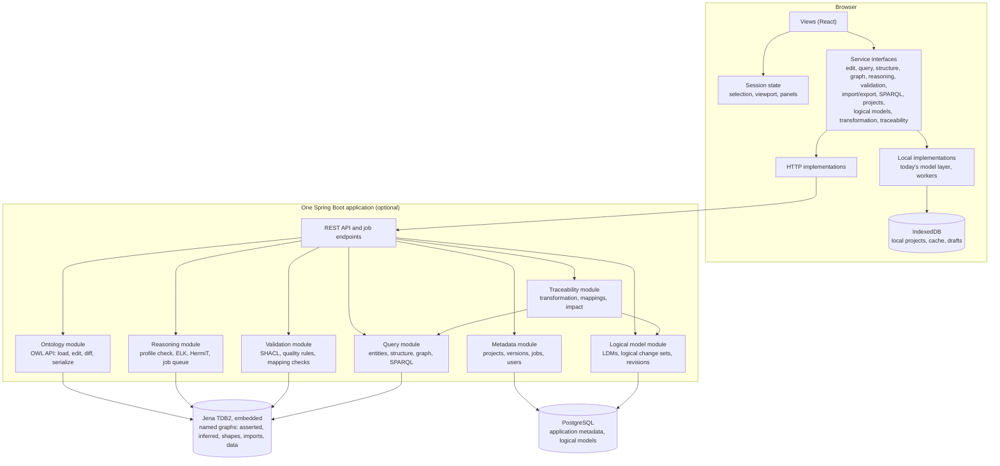

The data-integration modules of §12 (data sources, schema, mapping, virtual graph, and the Ontop
endpoint and external databases they reach) are deferred and left out of this picture; §12.3
draws them.

### 3.2 Three deployment profiles from one codebase

| Profile | What runs | Storage | For | Status |
| --- | --- | --- | --- | --- |
| **Local** | The static web app | IndexedDB | Trying it, small and medium ontologies, offline work. | **Existing** (with `localStorage`; see TD-11) |
| **Local with companion** | The web app and the Java application on the same machine, started with one command | IndexedDB; TDB2 in a local folder once Phase 4 lands | One person with large ontologies or a need for HermiT, ELK and every OWL syntax. | **Partially Implemented** (`pnpm reasoner`: reasoning and conversion only) |
| **Server** | The same Java application behind HTTPS, with PostgreSQL | TDB2 and PostgreSQL on the server; IndexedDB as cache and offline drafts | A team; shared projects, versions, review. | **Future** (Phase 4 storage, Phase 5 accounts) |

The companion and the server are the same artefact with different configuration. That is the
reason for choosing one application over several.

Every capability on the active roadmap has a browser-only form: logical data models, their
transformation from the ontology and their traceability run in the Local profile, and move to
the server for server projects (roadmap LM-5). Connecting to a relational database would be the
one capability with none, since a browser cannot open a database connection and credentials
must not be in it (ADR-014); it belongs to the deferred data-integration track (§12).

### 3.3 Component responsibilities

**Browser**

| Component | Responsibility | Status |
| --- | --- | --- |
| Views | Render, collect input, ask services. Hold no ontology rules. | Existing; TD-05 for the views that still read the model |
| Session state | Selection, viewport, open panels, dialog, theme. Never sent to a server. | Existing inside `store.ts`; split out in Phase 1 (TD-04) |
| Service interfaces | The only way a view reaches ontology content. | Existing for Structure and Entities; Recommended for the rest |
| Local implementations | Today's pure functions, called through the interfaces; reasoner and validation in workers. | Recommended (functions exist) |
| HTTP implementations | One POST or GET per question; refusals as typed errors. | Existing for two services |
| Geometry, layouts, styling | Stay in the browser in every profile: they are about the picture. | Existing |
| LDM workspace and ER diagram | Edit logical models through their services; the diagram is a view of its own over the layouts and geometry, its positions kept apart from the LDM's meaning. | **Existing** (2026-10-17, LM-2) |
| Transformation and impact review | Show proposals with their sources and rationale, collect the user's choices, apply them as logical change sets. | **Existing** (2026-10-17, LM-3, LM-4) |

**Server (one deployable, internal modules with enforced dependencies)**

| Module | Responsibility | Built on |
| --- | --- | --- |
| API | HTTP, authentication, authorisation, request limits, job endpoints. | Spring Web |
| Ontology | Load and save ontologies, apply change sets, compute diffs, serialize in every OWL syntax, imports closure. | OWL API |
| Reasoning | Profile detection, reasoner choice, bounded job execution, materialising results. | OWL API profiles, ELK, HermiT |
| Validation | SHACL validation, quality rules. | Jena SHACL |
| Query | Entities, structure, graph neighbourhoods, text search, SPARQL. | Jena ARQ, TDB2, Jena text index |
| Metadata | Projects, revisions, jobs, users, templates, diagrams. | Spring Data, PostgreSQL |
| Logical model | LDM documents, logical change sets applied atomically, an LDM's line of revisions, paged queries, LDM validation. Knows nothing of OWL. | Spring Data, PostgreSQL (roadmap LM-5) |
| Traceability | Transformation proposals, semantic mappings, stale detection, impact reports and synchronization proposals, as jobs; reads the ontology through the query module, writes only through the logical model module. | The ontology and logical model modules (LM-5) |
| Data source (deferred, §12) | Connection definitions, secrets, connection pools, dialect adapters, the read-only guard. The only module that would open a connection to an external database. | JDBC, a connection pool |
| Schema (deferred, §12) | Discovery jobs, schema snapshots, fingerprints, differences, search over schema objects. | `DatabaseMetaData` with dialect adapters |
| Mapping (deferred, §12) | The R2RML mapping model, coverage, mapping validation, preview, materialisation jobs. | An R2RML layer; see §12 |
| Virtual graph (deferred, §12) | Starts and stops the OBDA engine for a mapping revision, proxies SPARQL to it with limits, collects traces. | Ontop, as a separate process (ADR-016) |

Module boundaries inside the monolith are enforced by a test, as `boundaries.test.ts` does in the
frontend today (ArchUnit or Spring Modulith's verification serves the same purpose in Java).

## 4. API boundaries (Recommended)

### 4.1 The service interfaces

Each is a TypeScript interface under `src/<area>/contracts.ts`, following the two that exist.

| Service | Questions and commands | Local implementation | Status |
| --- | --- | --- | --- |
| `StructureService` | children, branches, paths, summary, search, compare, explain, analyze, members | `src/structure/local.ts` | **Existing** |
| `EntityQueryService` | describe, query, options | `src/entities/local.ts` | **Existing** |
| `OntologyEditService` | `apply(changeSet)`, `validate(changeSet)`, `entity(iri)` | `src/editing/local.ts`, over the rule functions of `axioms.ts`; the document's edits are its steps | **Existing** (2026-10-15) |
| `ReasoningService` | `start(revision, engine)`, `status(job)`, `cancel(job)`, `result(job)` | `src/reasoning/local.ts`: `reasoner.ts` in a worker; HermiT through `reasoning.ts` | **Existing** (2026-10-15) |
| `ValidationService` | `start(revision, scope)`, `status`, `cancel`, `report` | `src/validation/local.ts`: `validation.ts` in a worker | **Existing** (2026-10-15) |
| `GraphService` | `neighbourhood(roots, depth, filters)`, `search(text)` | `subgraph.ts` (`extractSubgraph`, `searchTerms`) | Recommended, Phase 2 |
| `ImportExportService` | `detect`, `read(document)`, `write(model, syntax)` | `src/io/local.ts`, over `rdfFormats.ts`, `rdf.ts` and `rdfxml.ts`; OWL's own syntaxes written by the OWL service | **Existing** (2026-10-16) |
| `SparqlService` | `query(revision, text, graph)` | `sparql.ts` | Recommended, Phase 2 |
| `AlignmentService` | external ontologies, mappings, suggestions | `external.ts`, `alignment.ts`, `matcher.ts` | Recommended, Phase 2 |
| `ProjectService` | versions, save a version, a version's model, diff, restore; list, open and save | `src/projects/local.ts` over `library.ts` | **Existing** for versions (2026-10-16); list, open and save are still `library.ts` called directly |
| `LogicalModelQueryService` | models, summary, entities (searched, paged), describe an element, relationships of an entity, keys, generalizations | `src/logical/local.ts` over the project document (§13.4): the models with their counts, a model, entities, an element described (keys and generalizations among them), an entity's relationships | **Existing** (2026-10-17, LM-1) |
| `LogicalModelEditService` | create, duplicate, delete an LDM; `validate(changeSet)`, `apply(changeSet)` of a logical change set | `src/logical/local.ts`, over the rules of `rules.ts`; each change one step of the document's history | **Existing** (2026-10-17, LM-1) |
| `TransformationService` | propose (job): proposals for a scope of the ontology under a configuration; apply a selection as a logical change set with its mappings | In a worker, over the ontology's statements and the LDM | **Existing** (2026-10-17, LM-3) |
| `TraceabilityService` | mappings of an element or an IRI, coverage, staleness, impact (job), synchronization proposals; mappings made and edited by hand | Over the LDMs' mappings and `changesBetween` | **Existing** (2026-10-17, LM-4) |
| `DataSourceService` | list, create, update, remove, test; never answers with a secret | None: backend only | **Deferred** (§12) |
| `SchemaService` | refresh (job), snapshot, objects (paged search), table detail, relationships, sample rows, difference of two snapshots | A cached snapshot, read-only | **Deferred** (§12) |
| `MappingService` | get, apply a mapping change, coverage, validate (job), import and export R2RML, revisions | Editing and static checks over a cached snapshot | **Deferred** (§12) |
| `RdfGenerationService` | preview a mapping rule on a bounded number of rows; materialise (job) | None: backend only | **Deferred** (§12) |
| `VirtualGraphService` | deploy a mapping revision, status, query, explain | None: backend only | **Deferred** (§12) |

### 4.2 Conventions, taken from the existing contracts

These are what the two existing services already do; the new ones follow them so that a view
cannot tell a local service from a remote one.

- **Entities are named by IRI**, never by an internal id or a label (resolves TD-18).
- **Every question names a revision** (`ontologyId`, `revisionId`). An answer for a revision
  that is no longer current is refused with `stale-revision` (HTTP 409).
- **Plain data only**: no maps, sets, functions or class instances, so that a question and its
  answer are JSON.
- **Lists are paged**; the service may return fewer than asked for.
- **Calls can be given up** (`AbortSignal`), and a refusal is a typed error with a code:
  `stale-revision` 409, `not-found` 404, `invalid` 400, `unsupported` 501.
- **Read and write are separate interfaces.** A query service never changes an ontology.
- **Long work is a job**: start returns an id at once; status reports progress and can be
  polled or streamed (Server-Sent Events); cancel is always available.

### 4.3 The change-set contract

This is the one genuinely new piece of design, and the hinge of the migration. An edit is a
list of axiom additions and removals against a base revision:

```ts
interface ChangeSet {
  ontologyId: string;
  baseRevision: string;
  changes: { op: 'add' | 'remove'; axiom: Axiom }[];
  /** For the history: what the user did, in words. */
  summary: string;
}

type Axiom =
  | { type: 'Declaration'; entity: EntityRef }
  | { type: 'SubClassOf'; sub: ClassExpression; sup: ClassExpression }
  | { type: 'EquivalentClasses'; classes: ClassExpression[] }
  | { type: 'ClassAssertion'; class: ClassExpression; individual: Iri }
  | { type: 'ObjectPropertyAssertion'; property: Iri; source: Iri; target: Iri }
  | { type: 'AnnotationAssertion'; property: Iri; subject: Iri; value: Literal | Iri }
  // … one member for each OWL 2 axiom type, added as editors arrive
  | { type: 'Unmapped'; turtle: string };
```

- The local implementation translates a change set into the model operations that exist today.
- The server implementation translates it into `OWLOntologyChange` objects and applies them in
  one transaction.
- Applying is atomic: every change, or none, and a new revision id on success.
- A change set is also the unit of undo, of history (TD-12) and, later, of synchronisation
  (AR-04).

`Unmapped` carries statements neither side has a typed form for yet, so that nothing is lost
while the typed list grows.

**Status, 2026-10-15 (roadmap task 1.8).** `src/editing/contracts.ts` is this contract, with the
axiom list grown to what the editor states (declarations, class axioms with full class
expressions, assertions, property axioms and characteristics, datatype definitions, annotations,
the ontology's IRI, annotations and imports; and, since 2026-10-17, property chains, keys,
disjoint unions and negative property assertions, while an annotation on an axiom stays the
`owl:Axiom` statement it is), and `Refusal`s with codes (`invalid`, `refused`,
`unsupported`). The local implementation (`src/editing/local.ts`) differs from the sketch above in
one respect, as §5.1's risk asked: an edit made in the editor is applied as the parts of the model
it replaced (a step), and its axioms are worked out at the document boundary when they are asked
for, because working them out costs as much as an export (half a second at 2,600 classes). A
change set made elsewhere is applied to the ontology's statements, read back, and taken only if
the result states exactly what was asked. Undo applies a step backwards. See the README, *Edits
as change sets*.

**Changes to other artifacts.** The contract above is the ontology's. A shape set's edit is a
step of the document's history with no axioms (roadmap SH-1); an LDM's edit is a *logical change
set* of its own contract, with the same guarantees (a base revision, atomic, typed refusals) and
typed operations on LDM elements instead of axioms (§13.5, ADR-023). Neither is ever expressed as
axioms, and no ontology change set touches an LDM. One step of the history may record changes to
several artifacts, and says which (TD-19); each artifact keeps a revision of its own (TD-20).

### 4.4 REST sketch for the remote side

Paths follow the pattern the existing HTTP clients use (`POST {base}/structure/{question}`),
placed under a versioned, project-scoped prefix.

| Method and path | Purpose |
| --- | --- |
| `GET /api/v1/projects`, `POST /api/v1/projects` | List, create. |
| `GET /api/v1/projects/{id}/revisions` | History, newest first, paged. |
| `POST /api/v1/projects/{id}/changes` | Apply a change set; answers the new revision. |
| `GET /api/v1/projects/{id}/diff?from=&to=` | Axioms added and removed between two revisions. |
| `POST /api/v1/projects/{id}/structure/{question}` | `StructureService`, unchanged. |
| `POST /api/v1/projects/{id}/entities/{question}` | `EntityQueryService`, unchanged. |
| `POST /api/v1/projects/{id}/graph/neighbourhood` | `GraphService`. |
| `POST /api/v1/projects/{id}/reasoning/jobs`, `GET …/jobs/{job}`, `DELETE …/jobs/{job}` | Start, follow, cancel. |
| `POST /api/v1/projects/{id}/validation/jobs` … | Same shape. |
| `POST /api/v1/projects/{id}/sparql` | Read-only query against a chosen graph. |
| `GET /api/v1/projects/{id}/export?revision=&syntax=` | Serialize. |
| `POST /api/v1/convert`, `POST /api/v1/reason` | Stateless, as today's `/convert` and `/reason`; kept for the Local profile. |
| `GET /api/v1/projects/{id}/logical-models`, `POST …` | List, create (by hand, by import, by duplicating). |
| `GET /api/v1/projects/{id}/logical-models/{ldm}/revisions` | An LDM's own history, newest first, paged. |
| `POST /api/v1/projects/{id}/logical-models/{ldm}/changes` | Apply a logical change set; answers the LDM's new revision, or 409 on a moved base. |
| `POST /api/v1/projects/{id}/logical-models/{ldm}/query/{question}` | `LogicalModelQueryService`. |
| `POST /api/v1/projects/{id}/logical-models/{ldm}/transformations` | Propose from the ontology, as a job; `…/{job}/apply` with the selection. |
| `GET /api/v1/projects/{id}/logical-models/{ldm}/mappings`; `POST …/impact` (job); `POST …/synchronization` | Traceability, impact report, synchronization proposals. |
| `GET`, `POST /api/v1/data-sources`; `POST …/{source}/test` | (Deferred, §12.) Define and test a connection. A secret is write-only. |
| `POST /api/v1/data-sources/{source}/schema/refresh`; `GET …/schema/snapshots/{snapshot}/objects` | (Deferred.) Discover (a job); browse and search a snapshot, a page at a time. |
| `GET /api/v1/data-sources/{source}/tables/{table}/sample?limit=` | (Deferred.) A bounded sample of rows. |
| `GET`, `POST /api/v1/projects/{id}/mappings/{set}`; `…/revisions`; `…/export?syntax=r2rml` | (Deferred.) Read, change, version and exchange an R2RML mapping set. |
| `POST /api/v1/projects/{id}/mappings/{set}/preview` | (Deferred.) Triples generated from the first rows of one rule, with diagnostics. |
| `POST /api/v1/projects/{id}/mappings/{set}/materialisations` | (Deferred.) Materialise as a job. |
| `POST /api/v1/projects/{id}/virtual-graphs/{graph}/sparql`; `…/explain` | (Deferred.) Query through the ontology; see the SQL it became. |

## 5. Data flow

### 5.1 An edit

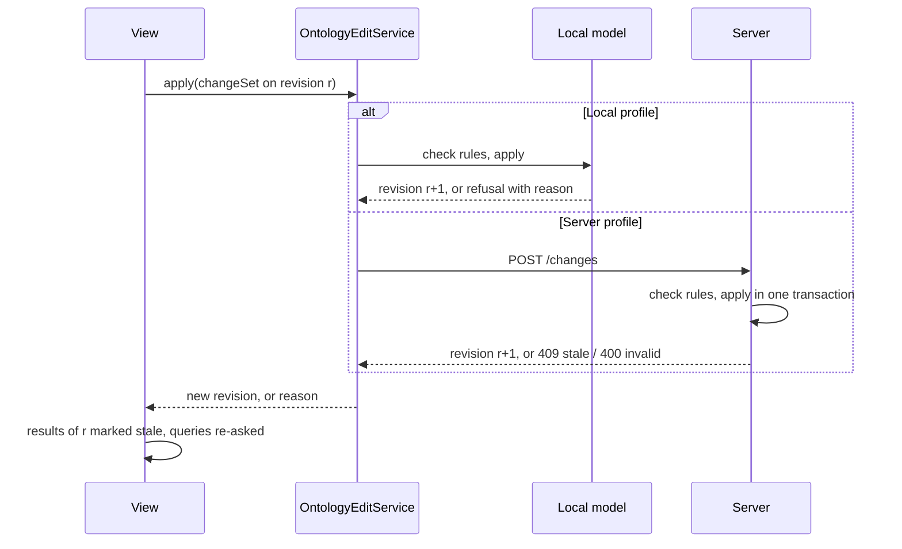

### 5.2 Reasoning

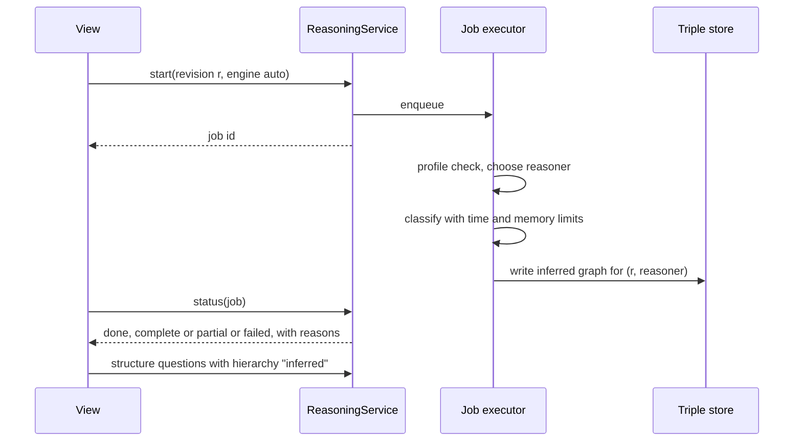

In the Local profile the job executor is a Web Worker for the in-page reasoner, or the companion
for HermiT and ELK; nothing is written to a triple store and the result is held in memory, as
now.

## 6. Technology stack evaluation

The brief proposes a stack. Each choice is weighed here against what the application needs and
what one person can maintain.

### 6.1 Frontend

| Choice | Verdict | Reasons |
| --- | --- | --- |
| TypeScript, React 19, Vite | **Keep** (Existing) | Working, tested, current. |
| zustand | **Keep, split** | Adequate. The problem is one store doing everything (TD-04), not the library. |
| Own SVG canvas | **Keep** (ADR-008) | Routing, label placement, styles, line ends and exports are built on it. A graph library would replace roughly 4,000 lines that work and would not remove the need for subgraph loading. |
| n3, oxigraph, rdf-validate-shacl | **Keep for the Local profile** | They are what makes the app work with no server. |
| A component library | **Do not add** | The UI is consistent and passes its own audit of contrast, text size and pointer-target size (`e2e/ui-audit.mjs`); a library would be a restyle of every view. |
| A diagramming library for the ER diagram | **Do not add** (ADR-008) | The ER diagram of a logical model (LM-2) is an SVG view of its own over the existing layouts, line geometry and culling; one notation needs no library, and a library would not share the canvas's tested routing and export. |

### 6.2 Backend

| Choice | Verdict | For | Against |
| --- | --- | --- | --- |
| **Java with Spring Boot** | **Adopt in Phase 3** | The OWL API, HermiT, ELK and Jena are Java libraries; there is no equivalent elsewhere. Spring Boot gives HTTP, validation, security, scheduling, database migration and testing in one maintained package, replacing 300 hand-written lines of server plumbing. | Start-up time and memory are larger than today's single file. A second language for one developer. |
| Keeping the single-file service | Rejected beyond Phase 2 | No build, starts fast. | No dependency management, no tests, no job model; everything a real backend needs would be written by hand (TD-14). |
| Node.js backend | Rejected | One language. | No OWL API, no DL reasoner; it would still need the JVM beside it. |
| Microservices | Rejected (ADR-003) | Independent scaling of reasoning. | Deployment, versioning and observability cost that one developer cannot carry. A bounded in-process job queue gives the isolation that matters; a reasoner can be moved to its own process later behind the same interface if it ever has to be. |

Baseline: **JDK 21** and the current Spring Boot major line. Jena 5 requires Java 17 and Jena 6
is announced with Java 21 as its minimum; Spring Boot 4 requires Java 17 or later. Choosing 21
now avoids a second migration. The present service states Java 11; this is a requirement change
for users of the companion and must be said in the release notes.

### 6.3 Ontology processing

| Choice | Verdict | For | Against |
| --- | --- | --- | --- |
| **OWL API** | **Adopt as the server's canonical model** (ADR-004). Already in use: 4.5.29. | Complete OWL 2 structural model, every syntax, profile checkers, diff by structural equality, the interface every Java reasoner implements. | A large API. Version 4 and 5 differ; reasoner builds are tied to one or the other (AR-03). |
| **HermiT** | **Keep** (Existing) | Complete for OWL 2 DL; justifications through the explanation library already wired in. | Worst-case behaviour (AR-02). Its last published Maven build dates from 2020, so fixes should not be counted on. |
| **ELK** | **Adopt early** | Polynomial for OWL 2 EL; classifies ontologies of hundreds of thousands of classes in seconds to minutes on ordinary hardware according to its authors' published results. It is already inside `robot.jar`, so offering it in the companion needs no new dependency. | Incomplete outside OWL 2 EL: results must be labelled, as the in-page reasoner's are. |
| In-page rule reasoner | **Keep for the Local profile** (Existing) | Instant, no install, explains each inference from stated facts. | A subset of OWL 2 RL; must never be presented as complete. |
| A general OWL 2 RL engine on the server | Not now | Jena's rule engines exist. | ELK and HermiT cover the need; a third engine is a third set of behaviours to explain. |

### 6.4 Storage

| Choice | Verdict | For | Against |
| --- | --- | --- | --- |
| **Apache Jena TDB2, embedded** | **Adopt in Phase 4** (ADR-006) | Transactional (ACID, serialisable), named graphs, runs inside the application with no separate server, SPARQL 1.1 through ARQ, a SHACL engine and a Lucene text index in the same project. One dependency family for storage, query, validation and search. | Single-writer; no built-in clustering. Jena 3.17 with TDB1 is in today's bundle, so TDB2 is a new dependency, not a reuse. |
| Eclipse RDF4J (Native or LMDB store) | Evaluated, not chosen | Also embeddable; a SHACL engine that validates on commit; RDF4J model classes already arrive with the OWL API. | No decisive advantage for this workload, and a second RDF framework beside Jena's SPARQL and SHACL tooling. Chosen only if the spike in AR-03 finds Jena and the OWL API cannot share a classpath cleanly. |
| A separate triple-store server (Fuseki, GraphDB) | Rejected for now | Scales out; PoolParty's documentation names GraphDB or RDF4J as its store. | Another process to install, secure, back up and upgrade. The embedded store can be exposed as a SPARQL endpoint later without moving the data. |
| **PostgreSQL** | **Adopt with the Server profile only** (ADR-007) | Users, projects, jobs, audit: relational data with real integrity needs. | Not needed until there is more than one user. The companion uses an embedded file database through the same migration scripts, so there is one schema. |
| **IndexedDB** | **Keep and extend** (Existing) | Local projects, cache of fetched ontologies, offline drafts. | Evictable (AR-09). |

### 6.5 AI services

| Choice | Verdict | Reasons |
| --- | --- | --- |
| Python services | **Defer to Phase 5** (ADR-010) | Nothing in Phases 1–4 needs them. A third runtime is the most expensive item on the list for one maintainer. |
| Embedding-based matching | Future | `src/model/matcher.ts` is already a list of `Matcher` functions; an embedding matcher is another entry, and can call a hosted embedding API from the Java application without any Python. |
| LLM-assisted modelling | **Existing in the browser** (2026-10-16); server later | The assistant (README, *The assistant*): provider adapters behind one `ProviderAdapter` interface (`src/ai/providers/`), read-only tools and typed proposals compiled to change sets (`src/ai/tools.ts`, `proposals.ts`), one tool loop (`conversation.ts`). Requests go from the browser, or through the local service's `/ai/forward`, which sets the key and refuses private addresses. On the server the adapters and loop move behind the API, with the key in encrypted per-user storage; tools and proposals keep their contracts. No model is run locally by default. For logical models (roadmap 5.7), the same assistant gains LDM read tools and typed LDM proposals compiled to logical change sets (§13.4): no second architecture. |

## 7. Reasoner orchestration (Recommended)

### 7.1 Choosing a reasoner

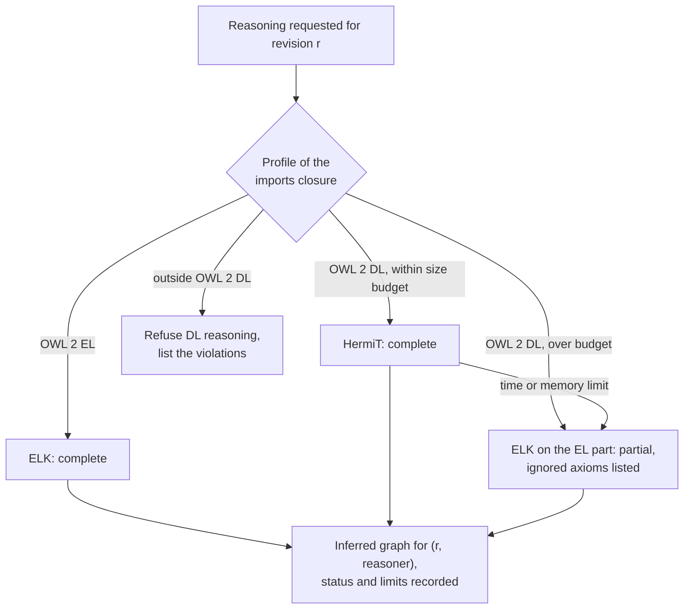

- The profile check uses the OWL API's profile classes (`OWL2DLProfile`, and since 2026-10-17
  `OWL2ELProfile`, in `reasoner/ReasonerService.java`).
- "Auto" is a default, not a constraint: the user can ask for a specific reasoner.
- The size budget is configuration, set from measurement, not a constant in code.

**Status, 2026-10-17 (roadmap task 2.6).** The local service has the first two branches: *auto*
gives ELK for an ontology in OWL 2 EL and HermiT otherwise, and the answer says which and why;
HermiT or ELK can be asked for. ELK's result is complete only where none of its own
incompleteness monitors reports an unsupported feature, and lists what they report. The size
budget and ELK on the EL part of a larger OWL 2 DL ontology are the server's (task 3.3).

### 7.2 Rules that hold for every reasoner

Each of these is how the application behaves today and is carried over unchanged.

1. A result names its reasoner and version, the revision it is of, and whether it is *complete*,
   *partial* (with what was left out) or *failed*.
2. An inconsistent ontology has no inferred hierarchy: none is shown, and the asserted one is
   never put in its place.
3. Inferred statements are never written into the asserted ontology. They are a separate graph,
   exported only on request.
4. A result for an older revision is stale and is shown as such.
5. Justifications come from the reasoner's explanation machinery within a time limit, or the
   finding says none was computed.

### 7.3 Jobs

- One bounded executor for reasoning (default: one job at a time per installation, queue of a
  few) so that two classifications cannot exhaust the heap together (fixes TD-14).
- Each job has a wall-clock limit and is interrupted when it passes it; a job that does not
  respond to interruption is the one case for running reasoners in a child process, which the
  interface allows without changing callers.
- Results are cached by revision and reasoner. Reasoning again without an edit is free.
- **Incremental reasoning is not promised.** ELK supports incremental classification for some
  kinds of change; HermiT does not. The design assumes a full run per revision and treats
  anything faster as an optimisation.

## 8. Scalability and performance

Three different problems, with different answers.

### 8.1 Storage scalability

| Scale | Local profile | With TDB2 |
| --- | --- | --- |
| Up to about 5,000 classes, 50,000 triples | Works today. | Not needed. |
| 10,000–100,000 classes, up to a few million triples | Model in memory is possible (the model accepts 250,000 terms since 2026-10-15, `MAX_TERMS`; it was 50,000), but parsing takes seconds and the working copy must move to IndexedDB (TD-11). | Comfortable. Queries are index lookups; text search through the Lucene index. |
| Tens of millions of triples (instance data) | Not a goal. | Ordinary for TDB2 on one machine with adequate memory and SSD storage. Bulk loading at this size is done with the bulk loader as an offline job, not through the API. |
| Beyond one machine | — | Out of scope. TDB2 does not cluster; that would be the point to move to a server product behind the same query module. |

Design consequences:

- **Do not load, ask.** The Entities and Structure services already work this way. With a
  triple store their server implementations become SPARQL plus a small label index.
- **Cache by revision.** Depths, counts and the hierarchy are computed once per revision and
  kept, as `src/structure` does in memory today.
- **Index what is searched.** Labels, alternative labels, IRIs and definitions go into the text
  index when a revision is committed.
- **Version economically.** Change sets for every revision, snapshots for tagged releases
  (AR-06, [DATA_ARCHITECTURE.md](DATA_ARCHITECTURE.md) §6).

### 8.2 Reasoning scalability

| Fragment | Complexity (taxonomic reasoning) | Reasoner | Realistic expectation |
| --- | --- | --- | --- |
| RDFS and the rules the app implements | Polynomial | In-page | Hundreds of milliseconds at a few thousand classes (measured above); move to a worker. |
| OWL 2 EL | Polynomial | ELK | Large terminologies (hundreds of thousands of classes) classify in seconds to minutes. |
| OWL 2 RL | Polynomial | Rule engines | Not planned as a separate engine. |
| OWL 2 DL | N2EXPTIME-complete in the worst case | HermiT | Unpredictable. Many ontologies of tens of thousands of classes classify in seconds; some small, highly expressive ones do not finish. |

What follows:

- Complete OWL 2 DL reasoning is **offered, bounded and reported**, never assumed.
- The time limit and heap are settings shown to the user with the result, so that "failed after
  60 seconds" is something they can act on.
- **Materialisation is selective.** Store the inferred class hierarchy, unsatisfiable classes,
  inferred types and inferred property assertions (what the service extracts today). Do not
  materialise the full deductive closure.
- **Explanations are on demand**, one entailment at a time, with their own limit.
- Module extraction (the OWL API's locality-based modules, present in the bundle) is a later
  optimisation for explaining or reasoning over the part of an ontology relevant to one class.

### 8.3 Visualization scalability

| Technique | State | Effect |
| --- | --- | --- |
| Subgraph extraction (`extractSubgraph`, default 250 terms, depth up to 6) | **Existing** | The Graph view stays useful on any size of ontology. |
| Paged tables (150 rows at a time, asked of a query service) | **Existing** | Entities page independent of ontology size. |
| On-demand hierarchy expansion (a branch or a page at a time), only the lines in view drawn | **Existing** | Structure Explorer to 200,000 classes. |
| Not drawing the canvas while another view covers it | **Existing** | Other views stay fast with a large model open. |
| Layout in a worker, cancellable | **Existing** | The page stays responsive while arranging. |
| Viewport culling | **Recommended**, Phase 2 | Cost follows what is visible, not what exists (TD-10). |
| Level of detail by zoom | **Partially Implemented** (labels only) | Zoomed-out views stay drawable. |
| Subgraph-first opening above a threshold | **Recommended**, Phase 2 | A 50,000-class ontology opens in Structure and Entities; the graph is asked for by neighbourhood. |
| Server-side neighbourhood queries (`GraphService`) | **Recommended**, Phase 4 | The browser never holds the whole ontology. |
| Canvas 2D or WebGL rendering | **Future**, only if needed | See AR-08. |

A statement of limits: no technique makes a readable picture of 10,000 nodes. The goal is not
to draw large ontologies whole but to make every part of them reachable in a picture of a few
hundred terms.

### 8.4 Concurrent users and large imports

- **Concurrent users** matter from Phase 5. TDB2 allows many readers with one writer; writes are
  short (a change set), so a single writer is adequate for editing teams of tens. Reasoning and
  validation are jobs and do not hold a write transaction.
- **Large tabular imports** (hundreds of thousands of rows) are jobs too: parse and map in a
  stream, validate against the mapping, produce a preview and a change set, apply on
  confirmation. In the Local profile the practical limit is browser memory (tens of thousands
  of rows); beyond that the companion does it.

## 9. Security

Nothing here is needed for the Local profile, which has no server. All of it is needed before
the Server profile is exposed.

| Concern | Measure |
| --- | --- |
| Authentication | Delegated: OpenID Connect through Spring Security. No password storage in the application. |
| Authorisation | Role per project (viewer, commenter, editor, owner), checked in one place in the API module for every project-scoped path. |
| Untrusted RDF/XML and OWL/XML | XML parsers configured to refuse external entities and DTDs. Upload size limit (the current service already caps a body at 64 MB). |
| Imports | The server does not fetch arbitrary URLs on a user's behalf without an allow-list (server-side request forgery). Today's service fetches nothing; keep that as the default. |
| SPARQL | Read-only (no `UPDATE`, no `SERVICE`), per-query time limit and result cap. |
| Cross-origin access | The companion keeps the origin allow-list it has (`--allow-origin`). The server uses same-origin deployment where possible. |
| Secrets | Database and provider credentials from the environment, never in the repository. |
| Auditing | Every change set records who and when (it is the history). |
| AI providers | Off unless configured (AR-10). The key is held in the page's memory, or in the local service's memory behind a 256-bit handle (`/ai/key`), sent only to the endpoint it was given for, never stored on disk or logged; the local service's `/ai/forward` forwards only to the providers' addresses and to public `https` endpoints, connects to the address it checked (no DNS rebinding) with TLS verified for the host's name, follows no redirect, and answers only allowed origins. A key kept between sessions of the service needs the server's encrypted per-user store. |
| Logical models | No secret and no data rows: an LDM holds structure only. On a server, permission on an LDM is permission on its project. |
| External databases | (Deferred.) Credentials, read-only access, user-written SQL and row data: §12.9. |

## 10. Deployment

| Option | How | When |
| --- | --- | --- |
| Static site | `pnpm build`, any static host. | Today. |
| Companion | One command starts the Java application and opens the app; packaged as a runnable jar. | Phase 3. |
| Single container | One image with the Java application serving the built frontend; a volume for TDB2; PostgreSQL beside it with Docker Compose. | Phase 4–5. |
| Managed platform | The same image on any container host with managed PostgreSQL and a persistent disk. | When there are users to justify it. |

Operational needs to plan for from the first server deployment: backup of the TDB2 directory
and the database together (a version is consistent only if both are), health endpoints, and
structured logs. Metrics and tracing can wait.

## 11. Architecture decision records

Short form. Each is revisited when its "revisit if" becomes true.

| Id | Decision | Why | Revisit if |
| --- | --- | --- | --- |
| **ADR-001** | The browser-only Local profile remains a first-class way to run the product. | It is the differentiator, and it keeps the application usable when no server is. | Maintaining two implementations of a service costs more than the profile is worth. |
| **ADR-002** | Every ontology operation goes through a service interface with a local and an HTTP implementation. | The pattern exists, is tested, and is the only incremental path off "everything in the page". | — |
| **ADR-003** | One Spring Boot application with internal modules; no microservices, no message broker. | One developer; one thing to deploy, monitor and upgrade. | A reasoner must be isolated in its own process for stability. |
| **ADR-004** | On the server the OWL API's ontology is the canonical form, persisted as RDF named graphs. The TypeScript `Model` remains the editing view and the offline file format. | Lossless OWL (TD-01) without rewriting the frontend. | — |
| **ADR-005** | Reasoner chosen by OWL profile; results are bounded jobs, labelled complete, partial or failed, stored apart from asserted axioms. | AR-02; continues present behaviour. | — |
| **ADR-006** | Apache Jena TDB2, embedded, for RDF storage and SPARQL. | One dependency family for storage, query, SHACL and text search; no separate server. | The classpath spike fails (then RDF4J), or data outgrows one machine. |
| **ADR-007** | PostgreSQL for application metadata in the Server profile only; the companion uses an embedded database with the same schema; the Local profile uses IndexedDB. | Integrity where there are users; nothing to install where there are none. | — |
| **ADR-008** | Keep the SVG canvas. Add culling, level of detail and subgraph-first loading before considering another renderer. | Preserves working routing, styling and exports; addresses the actual limit (TD-10). | Culling and subgraphs are in place and the Graph view is still the bottleneck. |
| **ADR-009** | Versions are immutable revisions, each a change set on its predecessor; full snapshots for tagged releases. | TD-12, AR-06. | — |
| **ADR-010** | AI features are optional suggestion services behind existing interfaces, deferred to Phase 5, with no Python runtime until one is unavoidable. | Cost of a third runtime; AR-10. | A required capability has no hosted or JVM option. |
| **ADR-011** | JDK 21 and the current Spring Boot major line as the server baseline. | Jena's and Spring's stated minimums; avoids a second migration. | — |
| **ADR-012** | Entities are identified by IRI in every contract; internal ids are private to the local model. | TD-03, TD-18. | — |
| **ADR-020** | No OWL axiom becomes a SHACL constraint, and no shape an axiom, without the user's review. Shapes drawn from the ontology are proposals, each stating what the axiom means, what the shape would check and where they differ, accepted one by one with their origin kept. | An axiom licenses inferences under the open world and no unique names; a shape checks the data a graph holds. `p exactly 1 C` is not `sh:minCount 1 ; sh:maxCount 1`, and a domain or range infers a type rather than requiring a value. The same rule as ADR-017, from the ontology's side. | — |
| **ADR-021** | Shapes are SHACL 1.0 Core (the W3C Recommendation of 2017) first, validated by `rdf-validate-shacl` in the page and Jena SHACL on the server; SHACL-SPARQL on the server only; SHACL 1.2 is built on once it is a Recommendation. | A stable standard with a test suite both engines can be held to. | SHACL 1.2 becomes a Recommendation. |

| **ADR-022** | A logical data model is an artifact of its own: its own metamodel, element identities, revisions, editor and storage, several per project. It is never kept in OWL entity structures, written into the ontology's RDF or exported with it, and the ontology is never kept in it. Only semantic mappings refer to both. | The ontology says what is true of a domain; an LDM says how an application organises its data. Merging them makes one the projection of the other, which is the one-to-one assumption the product must not make. Same principle as the shape sets (ADR-020). | — |
| **ADR-023** | LDM edits are logical change sets: typed operations on LDM elements against an LDM's revision, atomic, with typed refusals. Axiom change sets (§4.3) stay the ontology's. Each artifact has its own revision; an LDM edit never moves the ontology's, nor an ontology edit an LDM's. A history step and, on the server, a change entry say which artifact they change. | Reuses the shape of task 1.8's contract without misusing it: an LDM element is not an axiom. Separate revisions keep reasoning, validation and proposals current across LDM work. | — |
| **ADR-024** | No LDM element or constraint is made from the ontology or a shape set by itself. Transformation produces proposals: structure (entities, attributes, relationships, specializations) offered for the scope chosen; constraints (mandatory, a maximum, a key, a rule) from restrictions, domains, ranges, keys or shapes offered as candidates only, never chosen to begin with, each stating what the axiom means and what the constraint would require. | Open world and no unique names against the closed world of a data store: `some` is not *mandatory*, a domain infers a type and requires nothing, two names may be one individual. The same rule as ADR-017 and ADR-020, for logical models. | — |
| **ADR-025** | Ontology and LDMs are related by explicit semantic mappings, many to many, each with its sources (IRIs and axioms), targets, strategy, rationale, origin version and status. An ontology change marks mappings stale and produces an impact report and proposals; it never changes an LDM by itself, and never an element the user customised without the user accepting it. | Traceability without coupling: each LDM lives on its own schedule, and what the user decided is not undone by a change elsewhere. | — |
| **ADR-026** | The LDM is logical: technology-neutral data types and named domains; no physical data model, database-specific type, index, storage parameter, DDL or deployment in the metamodel or on the roadmap. | The product's scope (PRODUCT_REQUIREMENTS.md §2.8). A physical layer can be added later as an artifact of its own without changing the logical one. | A physical model is put in scope. |
| **ADR-027** | The data-integration track (DI-1 to DI-5, §12) is deferred. Its decisions ADR-013 to ADR-018 stand as the design of record for when it is resumed; ADR-019 holds now for tabular import. | The product's objective is designing logical models from the ontology, not reading or querying existing databases. | The product owner resumes the track. |

ADR-022 to ADR-027 were made on 2026-10-17 with the realignment of the roadmap; §13.13 lists the
questions they leave open. ADR-013 to ADR-019, on data integration, are in §12.11.

## 12. Ontology-to-relational data integration (Deferred)

**Deferred on 2026-10-17** (ADR-027; [DEVELOPMENT_ROADMAP.md](DEVELOPMENT_ROADMAP.md) §11): kept
as the design of record, under its identifiers, and not scheduled. The product's active
direction is §13. Nothing below is changed by the deferral except this paragraph; where it says
"recommended" or names a stage, it means "if the track is resumed".

Nothing in this section exists in the code today. It extends the target architecture with a
third concern beside modelling and managing ontologies: **connecting the conceptual model to
the relational databases where the data is.**

### 12.1 How it fits

Four things are kept apart, and a fifth joins them:

| Plane | What it holds | Who owns it | Where it lives |
| --- | --- | --- | --- |
| **Conceptual** | The ontology: classes, properties, axioms. | The modeller. | Asserted graph (§3, [DATA_ARCHITECTURE.md](DATA_ARCHITECTURE.md) §4). |
| **Constraint** | What data an application accepts: SHACL shape sets, several per ontology, one per application or source. Added 2026-10-15 (the SHACL track, [DEVELOPMENT_ROADMAP.md](DEVELOPMENT_ROADMAP.md) §1.4). | The data steward, the application's owner. | One shapes graph per shape set; in the model locally. |
| **Physical** | A database's schema: tables, columns, types, keys. | The database's owner. The application only reads it. | Schema snapshots (metadata store). |
| **Mapping** | How rows of the physical plane become statements in the terms of the conceptual one. | The data integrator. | Mapping sets, as R2RML. |
| **Data** | The rows themselves, or triples made from them. | The database. | In the source database; optionally a materialised copy. |

The ontology never mentions a table, and a schema snapshot never mentions a class. Only a
mapping refers to both. Shapes name the ontology's classes and properties, since they constrain
the data a mapping makes in its terms, but they are not axioms (ADR-020): SHACL validates the
RDF data graph a mapping presents, never the database itself, and a shape set is chosen for
each validation. That is what lets each change on its own schedule, and it is the
separation R2RML itself is built on.

Two properties of this capability set it apart from everything in sections 1 to 11:

- **It cannot run in a browser alone.** It is the first feature with no Local-profile
  implementation of its core (ADR-014). The mapping *document* can still be edited offline.
- **It reaches into systems the product does not own.** Every design choice below starts from
  read-only access, bounded work and no stored row data.

### 12.2 Schema mapping, materialisation and virtual knowledge graphs

Three different things that are often spoken of as one.

| | Schema mapping | RDF materialisation | Virtual knowledge graph |
| --- | --- | --- | --- |
| What it is | A *description*: which rows become which triples. | *Running* the description and storing the triples. | *Answering a query* by rewriting SPARQL into SQL through the description. Nothing is stored. |
| Where the data is | Nowhere new. | A copy, in a named graph of the triple store. | Only in the source database. |
| Freshness | — | As of the last run. | Live. |
| Query capability | — | All of SPARQL 1.1 over the copy. | Most of SPARQL 1.1, read-only, within the engine's limits. |
| Reasoning | — | Whatever a reasoner can do at that size; SHACL over the copy. | Query rewriting with the OWL 2 QL part of the ontology; the rest of the ontology plays no part. |
| Cost | Authoring. | Storage, run time, staleness, re-runs. | Load on the source database at query time; speed depends on its indexes. |
| Needs | Ontology and schema snapshot. | A mapping and the triple store (Phase 4). | A mapping and an OBDA engine. |
| Delivered in | Stages DI-2 and DI-3. | Stage DI-4. | Stage DI-4. |

The mapping is the asset. Materialisation and virtualisation are two ways of using the same
mapping, and a project may use both: a virtual graph for live questions, a materialised sample
for validation against shapes.

### 12.3 Components

All but one are modules of the one Java application (§3.3). They are separated by what they
may touch:

| Component | May touch | Must not |
| --- | --- | --- |
| **Data source module** | External databases, through JDBC; the secret store. | Be bypassed: no other module opens a connection. |
| **Schema module** | The data source module (to read metadata); the metadata store. | Read rows, except the bounded sample it is asked for. |
| **Mapping module** | Mapping sets, schema snapshots, the ontology's entity list. | Open connections itself; it asks the data source module to run a statement. |
| **RDF generation** (part of the mapping module) | A statement runner from the data source module; the triple store, for materialisation. | Return unbounded results to a browser. |
| **Virtual graph module** | The OBDA engine's process and its configuration. | Expose the engine's endpoint directly; every query passes through the API. |
| **Ontop endpoint** | One external database, read-only; one ontology export; one R2RML file. | Be reachable from outside the host. |

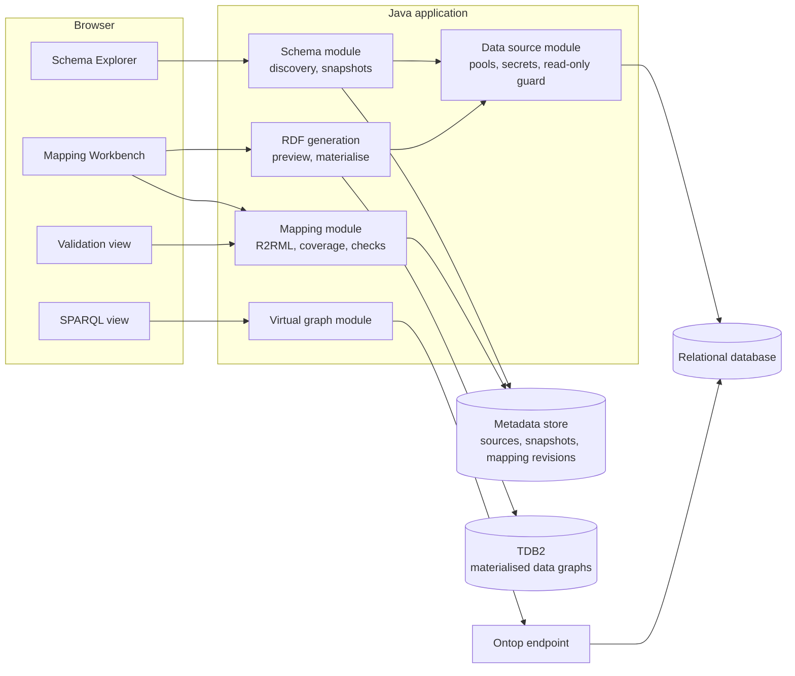

In the browser, three new service areas follow the existing pattern (`contracts.ts`, an HTTP
implementation, a boundary test): data sources, schema, mapping. Mapping logic that needs no
database (the mapping model, IRI templates, static checks against a snapshot, R2RML reading and
writing) is written once in TypeScript without React imports, so that it runs in the page for
offline editing and is mirrored by the server for validation.

### 12.4 Data flows

**Discovering a schema**

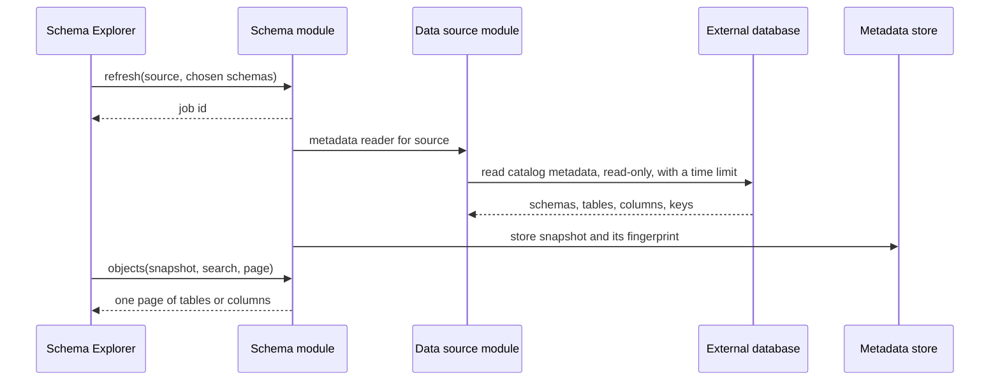

**Previewing a mapping rule**

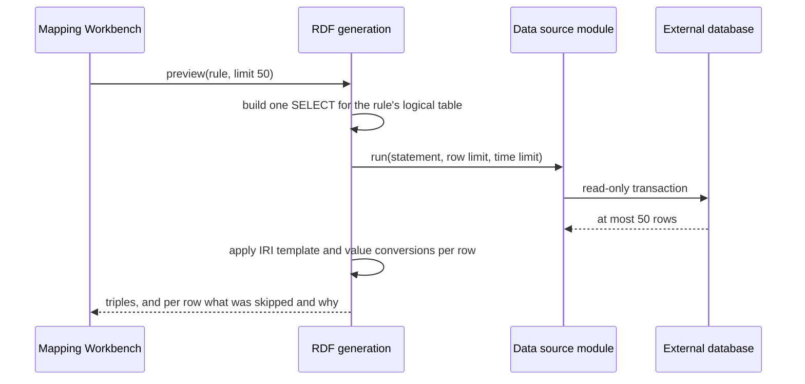

**Querying through the ontology**

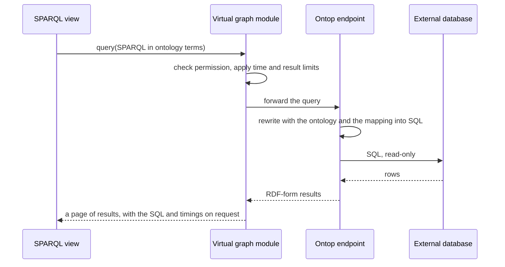

### 12.5 What is reused, and what is new

**Reused.** Each of these exists today and is named with its file.

| Existing component | Reused for |
| --- | --- |
| Entity lists and search (`src/entities/`, `src/components/EntityPicker.tsx`, `TermList.tsx`) | The ontology side of the workbench: classes, object and data properties, with a "not mapped" filter beside the existing ones. |
| Class hierarchy service and its tree model (`src/structure/contracts.ts`, `outline.ts`) | The hierarchy in the ontology explorer; and the same paged, branch-at-a-time tree model for schemas, tables and columns, which can run to hundreds of thousands of lines. |
| Layouts over a neutral graph (`src/layout/`, `LayoutGraph`) and line geometry (`src/model/geometry.ts`) | The diagram of tables and their foreign keys. The layouts take any nodes and edges. |
| Validation results model (`Finding`, `ValidationRun`, `isStale` in `src/model/validation.ts`; the results table in `Validation.tsx`) | Mapping checks as a further category of finding, stale when the mapping, the ontology or the schema fingerprint changes. |
| SHACL over imported data (`DataGraph` with `source: 'imported'` in `validation.ts`) | Validating previewed or materialised triples against the project's shapes, with no new engine. |
| Datatypes and literal checking (`DATATYPES` in `src/model/types.ts`, `validateLiteral` in `literals.ts`) | Checking that a column's values convert to the datatype a property expects. |
| IRIs and prefixes (`src/model/iri.ts`, `prefixes.ts`: `isAbsoluteIri`, `compactIri`, `baseIriOf`) | Validating IRI templates; a default namespace for instance IRIs; showing generated IRIs compactly. |
| Suggestions with accept and reject (`Matcher`, `Suggestion`, `Feature` in `src/model/matcher.ts`; `MappingMeta.status`) | Proposing column-to-property and table-to-class candidates lexically, each accepted or turned down, with a review status. |
| The alignment workbench's two-list form (`Align` in `src/components/Alignment.tsx`) | The non-drag way of making a mapping: choose one on each side, choose how, add. |
| Triples table and SPARQL results (`RdfView.tsx`, `SparqlView.tsx`, `runSparql`) | Showing previewed triples; querying a virtual graph, with CSV download. |
| Governance fields `database`, `schema`, `table`, `column`, `physicalType` and the *technical data asset* kind (`src/model/governance.ts`) | These are free text today. They become links to real schema objects, which gives lineage without a new concept. |
| Browser cache with a "not on this machine" state (`externals` store in `src/model/library.ts`) | Caching schema snapshots and mapping drafts for offline editing. Never credentials, never rows. |
| The service pattern and its error codes (`http.ts`, `boundaries.test.ts`, `stale-revision`) | Every new interface. |
| The mapping core of tabular import (`src/mapping/`: `template.ts`, `values.ts`, `plan.ts`; **Existing** since 2026-10-16, task 2.4) | The same mapping core: IRI templates, column-to-property rules, value conversion, preview with row-level reasons (ADR-019). Its input is a `Table` of named columns, which a database result is as well as a file. |

**Not reusable as it is.** The canvas (`src/components/Canvas.tsx`) draws the ontology's own
`Model` and edits it (TD-05). A schema is not an ontology and must not be forced into that
type. The table diagram reuses layouts and geometry beneath it, in a small read-only view of
its own.

**New.**

| New component | Why nothing existing serves |
| --- | --- |
| Data source module with dialect adapters | The application has never opened a database connection. |
| Secret handling | There have been no secrets. |
| Schema snapshots, fingerprints and their difference | No model of a relational schema exists. |
| Mapping model with R2RML reader and writer | Alignment maps entity to entity; this maps entity to table, column and join. |
| Preview evaluator | Rows into triples, a few at a time, with reasons. |
| Virtual graph module and the OBDA engine | SPARQL-to-SQL rewriting is a research-grade system; it is adopted, not written. |
| Schema Explorer and Mapping Workbench views | New views; built from existing parts as above. |

### 12.6 Technology evaluation

| Choice | Verdict | For | Against |
| --- | --- | --- | --- |
| **JDBC in the backend, with a connection pool per data source** | **Adopt** (ADR-014) | The standard way; every target database has a driver; Spring Boot manages pools. | Each driver is a dependency and an attack surface (§12.9). |
| Database access from the browser | Rejected | — | Impossible without a proxy, and it would put credentials in the page. |
| **`DatabaseMetaData` plus a dialect adapter** | **Adopt** | Tables, columns, primary keys, foreign keys and unique indexes are available through one portable interface. | Dialects differ in what a "schema" is, in identifier case, in type names, in how comments and view definitions are read. Each needs an adapter and its own tests. |
| **PostgreSQL first, alone** | **Adopt** (ADR-015) | The Server profile already uses it, so the driver, the test containers and the expertise are shared. Its catalog is regular. One dialect lets the adapter interface be shaped by a real case before it is generalised. | Enterprise users often ask for SQL Server first. It is second. |
| MySQL and SQL Server | Second and third, in the order users ask | Same interface. | MySQL treats schema and database as one; SQL Server adds its own type names and quoting. Budget a week or two each, mostly tests. |
| **R2RML as the canonical mapping representation** | **Adopt** (ADR-013) | A W3C Recommendation since 2012; RDF, so it is stored and exchanged like everything else here; read by Ontop and other processors. Covers logical tables (a table, a view or a query), subject maps with templates and classes, predicate-object maps with columns, constants, datatypes and languages, and joins to another triples map. | No construct for a condition (it is written as a query), none for value transformation beyond SQL, and relational sources only. |
| RML | Not now | Generalises R2RML to files; would let tabular import and database mapping share one exchange format. | A second, younger family of specifications. Revisit with FR-M7-8. |
| W3C Direct Mapping, or bootstrapping a mapping from the schema | **As an offered draft only** | A fast start: a table becomes a class, a column a property. | It is exactly the one-to-one assumption this product must not make silently. Offered, shown, edited, never applied by itself. |
| **A small preview evaluator of our own** | **Adopt** for preview only | Sub-second answers on fifty rows, with a reason for every row that produced nothing. Small: one logical table, one template, value conversion. | A second implementation of mapping semantics (AR-12). Held to the W3C R2RML test cases for the constructs it supports. |
| **Ontop** as the virtual-graph engine and the materialiser | **Adopt at stage DI-4** (ADR-016) | Open source under Apache 2.0, actively released (5.5.0 in February 2026). Reads R2RML. Supports RDFS and OWL 2 QL ontologies and most of SPARQL 1.1. Its command line can start a SPARQL endpoint, materialise a graph, convert mappings to R2RML and bootstrap a mapping. One engine for virtual and materialised answers means one semantics to explain. | One relational source per instance; several sources need a federation layer in front. Reasoning is OWL 2 QL, not OWL 2 DL. A commercial distribution built on it reports recursive property paths and `SERVICE` as unsupported; to be confirmed for the open-source release in the spike. |
| Ontop **as a separate process**, not as a library | **Adopt** | Ontop's own guide recommends its HTTP endpoint over its Java API, because the API brings many dependencies and constrains the Java version. It also keeps a crash or a memory spike out of the main application. | A second JVM to start, watch and stop. Accepted: ADR-003 already allows a separate process where isolation requires it. |
| RMLMapper as the materialiser | Fallback | A Java processor that executes R2RML; its authors report full coverage of the R2RML test cases. | A second engine beside Ontop; used only if the spike finds Ontop's materialiser unsuitable. |
| Writing a SPARQL-to-SQL translator | Rejected | — | Years of research went into the existing ones. |
| A commercial virtual-graph product | Rejected | Mature. | Licence cost and a second server product; against the constraints in §2. |

### 12.7 Semantic correctness

A database schema and an ontology say different kinds of thing, and the workbench must not
blur them.

**Constraints are not axioms.** A constraint says what the database *will refuse to store*. An
axiom says what *is true of the world* and licenses inferences. Under OWL's open-world reading,
a missing value is unknown, not absent.

| In the database | What it guarantees | What it does not entail in OWL | What the workbench may propose, for the user to accept |
| --- | --- | --- | --- |
| `NOT NULL` column | Every stored row has a value. | An existential restriction. `C SubClassOf p some D` is a claim about the domain, with inferential consequences, and a nullable column licenses nothing about a maximum. | A SHACL `sh:minCount 1` on the shape for the class: a constraint for a constraint. An OWL restriction only if the user asks for one. |
| Primary key | Rows are identified by it. | A key axiom. | The IRI template. `owl:hasKey` only on request. |
| `UNIQUE` | No two rows share the value. | An inverse-functional property. For a column of literals OWL 2 DL has no inverse-functional data property at all; the counterpart is `owl:hasKey`, which applies to named individuals only. | `owl:hasKey`, flagged with what it means for reasoning. |
| Foreign key | A value refers to an existing row elsewhere. | An object property with that domain and range. In OWL, domain and range *infer* types; they do not restrict use. | An object-property mapping between the two class maps. A domain or range only on request, with the consequence stated. |
| Column type | The stored representation. | The range of a property. | A datatype conversion in the mapping; a `sh:datatype` in a shape. |
| Table | A set of rows. | A class. A join table is a relationship; one table may hold several classes, told apart by a column; one class may span tables. | Nothing by default. A draft mapping when asked (§12.6). |
| `NULL` | No value stored. | — | No triple. This is what R2RML specifies, and the preview says so per row. |

**Rule (ADR-017).** The application creates no OWL axiom from a physical constraint on its own.
Constraint-derived statements are offered as *proposals*, by default as SHACL shapes (where a
closed-world check is what is meant), and become part of the ontology only as an explicit,
undoable change with its origin recorded.

**Open and closed worlds, at the point of use.**

- A SPARQL query over a virtual graph is evaluated against the data that is there: "films with
  no director" (`FILTER NOT EXISTS`) lists films with no director *row*. That is a statement
  about the database, not an OWL entailment that those films have no director.
- A virtual graph applies the OWL 2 QL part of the ontology (subclass and subproperty
  hierarchies, domains, ranges, inverses, and existentials on the right-hand side). Everything
  else in the ontology is not used. The result header says which reasoning was applied, as
  reasoner results do today (§7.2).
- A consistency check by HermiT says nothing about the database unless data has been
  materialised and included, and at that point size decides whether it finishes (AR-02).

### 12.8 Scalability

| Concern | Design |
| --- | --- |
| Large schemas (10,000 tables, 200,000 columns) | Discovery is a job, per chosen schema, never a blocking request. Results are stored as a snapshot and browsed from the metadata store, a page at a time, with search on the server. The browser's tree draws a branch at a time, as the Structure Explorer does. |
| Repeated discovery | A snapshot is reused until refreshed. A refresh computes fingerprints first and re-reads only schemas whose fingerprint changed, where the dialect allows it cheaply. |
| Many data sources | A pool per source with a small maximum (a handful of connections), created on first use and closed when idle. No connection is held between requests. |
| Preview | One statement, a row limit, a time limit. Never more than the limit crosses to the browser. |
| Mapping validation | Static checks (against the snapshot and the ontology) run without a connection and can run in the page. Checks that need data are jobs with the same limits as preview. |
| Materialisation | A job that streams rows to the triple store's loader; size and duration are shown before it starts (an estimated row count from the database's statistics). |
| Virtual queries | Time limit, result cap and paging enforced by the virtual graph module, not left to the engine. Performance is the source database's: the trace shows the SQL so that a missing index can be found. |
| Several databases in one query | Not in the first four stages. One virtual graph per source. Later: a relational federation layer in front of the engine, which is the approach Ontop's documentation describes. |

What does not scale and is not promised: complete OWL 2 DL reasoning over materialised
relational data of ordinary enterprise size, and interactive speed on a source database with no
suitable indexes.

### 12.9 Security

This capability adds the product's first secrets and its first outbound connections. The
measures below are requirements of stage DI-1, not later hardening.

| Concern | Measure |
| --- | --- |
| **Credentials never in the browser** | The connection form posts a secret once over HTTPS (or to `127.0.0.1` for the companion). No API answers with one. Nothing secret is written to `localStorage`, IndexedDB, the model file, an R2RML export, a log or an error message. The connection form allows paste and password managers. |
| **Secrets at rest** | In order of preference: a reference to a secret the environment provides (an environment variable, a mounted file, a secret manager); kept in the backend's memory for the session only; stored encrypted with a key that is not in the database. Never in clear text. See [DATA_ARCHITECTURE.md](DATA_ARCHITECTURE.md) §10.6. |
| **No raw connection strings** | A connection is defined by structured fields (dialect, host, port, database, TLS mode, account). The backend builds the JDBC URL and allows only a fixed list of driver properties. Driver URLs accept properties that load classes or read local files; a URL taken from a client is an attack vector. |
| **Read-only, enforced three ways** | The account should have read rights only, and the product says so and tests what it can. Every connection is opened read-only and every statement runs in a read-only transaction. Statements are generated by the application; where a user writes SQL (a query as a logical table, stage DI-3) it must parse as a single `SELECT`. |
| **Bounded work** | Statement time limit, row limit, pool size per source, concurrent jobs per source. A mapping cannot make the product a load generator against a production database (AR-16). |
| **Where the backend may connect** | In the Server profile, hosts are restricted to an allow-list set by an administrator, and only an administrator defines a data source: otherwise the product is a way to probe a private network. |
| **Transport** | TLS to the database, verifying the server's certificate, as the default. |
| **Who may see rows** | Permission per data source, separate from permission on the ontology project. Sample and preview data is shown, never cached in browser storage. Columns marked sensitive in governance metadata can be masked in samples. |
| **The OBDA engine** | Listens on the loopback interface only; receives its database credentials from the backend at start through its environment or a file with restricted permissions, removed on stop; is reachable only through the API, which applies permissions and limits. |
| **Audit** | Who defined or changed a data source, who ran which query or materialisation, with duration and row counts. Never the rows. |

### 12.10 The recommended minimum viable implementation

The smallest thing that is useful and that every later stage builds on, without rework:

| In | Out, for now |
| --- | --- |
| PostgreSQL only. | MySQL, SQL Server. |
| The companion profile, one user, one data source per project. | Accounts, roles on data sources, several sources. |
| A password entered when connecting and held in the backend's memory, or a reference to an environment variable. | Stored secrets. |
| Discovery of chosen schemas into a snapshot with a fingerprint; refresh on request. | Automatic change detection. |
| Schema Explorer: tree, search, table detail with keys, list of related tables; a bounded row sample. | The relationship diagram (useful, not necessary). |
| Mapping: a class to a table or a view, with an optional condition built from column, operator and value; a data property to a column with a datatype; an object property to a foreign key; IRI templates. | SQL queries as logical tables, SQL expressions, value transformations. |
| Preview of fifty rows as triples, with a reason per skipped row. | Materialisation. Virtual graphs. |
| Mapping checks in the Validation view. | Checks that need to scan data. |
| Export as R2RML. | R2RML import (it needs the read-only display of constructs without an editor). |
| The mapping saved with the project and versioned with it. | Independent mapping revisions and lineage. |

This is stages DI-1 and DI-2 with the R2RML export of DI-3 brought forward, because an export
is cheap and is what makes the first release interoperable.

### 12.11 Decisions

| Id | Decision | Why | Revisit if |
| --- | --- | --- | --- |
| **ADR-013** | R2RML is the canonical representation of a mapping. What the workbench cannot edit is kept and shown, not dropped. | A standard that the engines read; the same lossless principle as for OWL (NFR-1). | Non-relational sources become a requirement (then RML). |
| **ADR-014** | External databases are reached only from the backend, through JDBC, with structured connection definitions. Credentials never reach the browser. | The only safe form; §12.9. | — |
| **ADR-015** | PostgreSQL is the first and, at first, the only dialect; others are added behind one adapter interface. | Shared infrastructure with the Server profile; an interface shaped by one real case. | The first users are overwhelmingly on another database. |
| **ADR-016** | Ontop is the engine for virtual graphs and for materialisation, run as a separate process behind the API, adopted at stage DI-4 after a spike. | Maintained, open, standards-based; its own documentation advises the endpoint over the library; isolation. | The spike fails on a target database or on required SPARQL features. |
| **ADR-017** | No OWL axiom is generated from a database constraint without explicit confirmation. Proposals default to SHACL shapes. | §12.7. | — |
| **ADR-018** | Access to external databases is read-only. Writing back is a separate future capability with its own design for transactions, authorisation and integrity. | Risk out of proportion to the first four stages. | A concrete write-back use case is specified. |
| **ADR-019** | One mapping core (IRI templates, column-to-property rules, value conversion, preview with reasons) serves both tabular file import and database mapping. | They are the same problem with different lifecycles; building it once in Phase 2 saves building it twice. | — |

## 13. Ontology-driven logical data modelling

Added on 2026-10-17. LM-1 to LM-4 exist (2026-10-17): the metamodel, its two services, the LDM
workspace and its ER diagram, LDM findings in the Validation view, the reviewed transformation,
and the semantic mappings with traceability, impact and synchronization. LM-5 is still design.
This section is the design behind the roadmap's logical data modelling track, LM-1 to LM-5
([DEVELOPMENT_ROADMAP.md](DEVELOPMENT_ROADMAP.md) §1.3), and the product's active direction:

> OWL ontology → semantic-to-logical transformation → editable logical data model → semantic
> traceability and change impact analysis

### 13.1 Three artifacts, related by mappings

| | Ontology | Shape sets | Logical data model (LDM) |
| --- | --- | --- | --- |
| **Says** | What is true of the domain, and what follows from it | What RDF data an application accepts | How an application organises its data |
| **Kind of statement** | Axioms that license inferences | Constraints a data graph is checked against | Design decisions: entities, attributes, relationships, keys, rules |
| **World** | Open: what is not stated is unknown; no unique names | Closed, over one data graph | Closed: a record has what it holds, and a key identifies |
| **Identity** | IRIs | IRIs of shapes; one shapes graph per set | Element ids within an LDM; an LDM id within the project |
| **How many** | One per project | Several per ontology | Several per ontology |
| **Edited in** | Graph, Entities, Structure, the entity editor | The Shapes view (SH-1) | The LDM workspace and its ER diagram (LM-2) |
| **Changed by** | Axiom change sets (§4.3) | Steps of the history (SH-1) | Logical change sets (§13.5) |
| **Status** | **Existing** | **Existing** | **Existing** (2026-10-17): the artifact and its revisions (LM-1), its workspace and ER diagram (LM-2), derivation (LM-3), mappings, impact and synchronization (LM-4) |

They are related by mappings, never by one being stored in or generated from another:

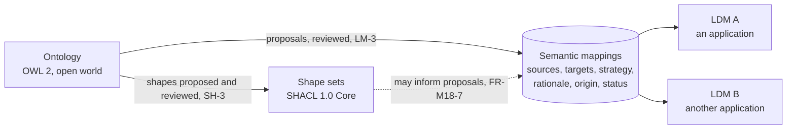

- **Not one-to-one.** One class may become several entities (in one LDM or in several), or
  several classes one entity; one datatype property one attribute in each of several entities;
  an object property a relationship, or an associative entity with attributes of its own; a
  subclass hierarchy one entity per class, or a single entity with a discriminator. And an LDM may
  have entities with no semantic source at all: an audit trail, a staging record, an application
  setting. Such an element is application-specific, not an error.
- **Only mappings refer to both.** An LDM element carries no IRI as its identity, and the
  ontology carries nothing of an LDM. A mapping names ontology entities by IRI and axioms in
  functional syntax, and LDM elements by id. This is the same separation the shape sets keep
  (ADR-020) and the deferred data-integration design keeps (§12.1).
- **Each changes on its own schedule.** An ontology edit does not change an LDM, and an LDM edit
  does not change the ontology or its revision (NFR-17). What an ontology change means for an LDM
  is reported (§13.8) and proposed, never applied by itself (ADR-025).

### 13.2 The workflow

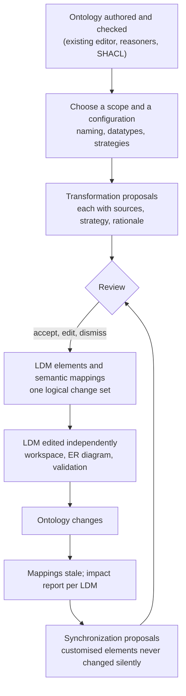

Every arrow into the LDM passes through review. Every step can be undone, and is kept in the
project's versions.

### 13.3 The LDM metamodel

A metamodel of its own, in `src/logical/contracts.ts` (roadmap LM-1): plain, JSON-serialisable
data, as every contract here (§4.2). It has no OWL construct in it and no physical one.

```ts
/** One logical data model: an application's view of its data. Several per project. */
interface LogicalModel {
  id: string;                    // unique in the project, never reused
  name: string;
  description: string;
  purpose: string;               // which application or use it serves
  revision: string;              // moves when this LDM changes, and only then
  domains: LogicalDomain[];      // named, reusable types
  entities: LogicalEntity[];
  relationships: Relationship[];
  generalizations: Generalization[];
  rules: BusinessRule[];
  mappings: SemanticMapping[];   // to the ontology (§13.7); empty for an LDM made by hand
  derivation?: TransformationConfig; // how it was proposed from the ontology, if it was
  diagrams: LogicalDiagram[];    // positions and style: the picture, never the meaning
}

interface LogicalEntity {
  id: string;
  name: string;                  // unique in the LDM
  definition: string;
  abstract?: boolean;            // a supertype with no instances of its own
  attributes: LogicalAttribute[];
  keys: Key[];                   // at most one primary
}

interface LogicalAttribute {
  id: string;
  name: string;                  // unique in its entity, inherited ones included
  definition: string;
  type: LogicalType;
  optional: boolean;             // false: mandatory. True unless the user chose otherwise.
  derived?: boolean;
}

/** Technology-neutral: no database's type names (ADR-026). */
type LogicalType =
  | { base: 'text'; maxLength?: number }
  | { base: 'integer' }
  | { base: 'decimal'; precision?: number; scale?: number }
  | { base: 'boolean' | 'date' | 'time' | 'dateTime' | 'duration' | 'binary' | 'identifier' }
  | { domain: string };          // a LogicalDomain's id

interface LogicalDomain {
  id: string;
  name: string;
  definition: string;
  base: Exclude<LogicalType, { domain: string }>;
  constraints: { minLength?: number; maxLength?: number; pattern?: string; min?: string; max?: string; values?: { code: string; label: string }[] };
}

/** Binary, between two entities (the same one for a recursive relationship). */
interface Relationship {
  id: string;
  name: string;
  definition: string;
  ends: [RelationshipEnd, RelationshipEnd];
  identifying: boolean;          // the child's identity includes the parent's
}

interface RelationshipEnd {
  entity: string;                // the entity at this end
  role: string;                  // how the other end calls it
  min: number;                   // 0: optional; 1 or more: mandatory
  max: number | 'many';
}

interface Key {
  id: string;
  kind: 'primary' | 'candidate';
  name: string;
  members: ({ attribute: string } | { end: { relationship: string; end: 0 | 1 } })[];
}

interface Generalization {
  id: string;
  supertype: string;
  subtypes: string[];
  complete: boolean;             // every instance of the supertype is of a subtype
  exclusive: boolean;            // no instance is of two subtypes
  discriminator?: string;        // an attribute of the supertype
}

interface BusinessRule {
  id: string;
  name: string;
  statement: string;             // in words: always
  kind: 'constraint' | 'derivation';
  appliesTo: ElementRef[];
  expression?: string;           // formal, later (FR-M17-9)
  status: 'proposed' | 'accepted';
}

type ElementRef = { entity: string } | { attribute: string } | { relationship: string } | { key: string } | { generalization: string } | { rule: string } | { domain: string };
```

**Rules the edit service holds** (refused with a reason, as the ontology's rules are): names unique
in their scope; every reference resolves within the LDM; at most one primary key, counting the one
an entity inherits; a key's members
are attributes of the entity, inherited ones included, or ends of identifying relationships of
which the entity is the child; no generalization cycle; a discriminator is an attribute of the
supertype; a relationship end's minimum is not above its maximum. **What validation reports**
without refusing (FR-M17-10): an entity with no primary key of its own or inherited (a warning), a
many-to-many not yet
resolved (information), and, for an imported or older document that slipped past the rules, each
break of them, every finding naming the element it is about. An attribute that repeats an
inherited one is refused rather than reported: the editor does not let it be made.

**What it deliberately lacks.** Tables, columns, physical types, nullability as storage,
indexes, storage parameters, schemas of a database, DDL (ADR-026); and class expressions, IRIs as
identity, inference (ADR-022). Several diagrams per LDM (FR-M17-13) and formal rule expressions
(FR-M17-9) come after LM-2.

### 13.4 Service boundaries

Four interfaces: the first two in `src/logical/`, the transformation and traceability in
`src/traceability/`, following `src/structure` (ADR-002): each a `contracts.ts` of plain data and
a local implementation, kept apart by a boundary test, and tested question by question, command
by command.

| Service | Questions and commands | Reads | Writes | Stage |
| --- | --- | --- | --- | --- |
| `LogicalModelQueryService` | models; summary; entities (searched, paged); describe an element; relationships of an entity; keys; generalizations | LDMs | Nothing | LM-1 |
| `LogicalModelEditService` | create, duplicate, delete an LDM; `validate`, `apply` a `LogicalChangeSet` | LDMs | LDMs only | LM-1 |
| `TransformationService` | `propose(scope, config, target?)` (a job); `apply(proposals, choices)` as one logical change set with its mappings | The ontology, through the existing services and its statements, read-only; the target LDM | Through `LogicalModelEditService` only | **Existing** (2026-10-17, LM-3) |
| `TraceabilityService` | mappings of an element or an IRI; coverage; staleness; `impact(ldm, from?, to?)` (a job); synchronization proposals; mappings made and edited by hand | The ontology now and in versions (`changesBetween`, `ProjectService`); LDMs | Through `LogicalModelEditService` only | **Existing** (2026-10-17, LM-4) |

LDM validation is not a `ValidationService` job. `src/logical/findings.ts` computes the findings
from `model.logicalModels` whenever the Validation view shows them, so there is nothing to start
and nothing that can be stale when an LDM's revision moves. The view presents them as a category
of the results beside `owl`, `shacl` and `quality` — a category of its own, not one of the
`CATEGORIES` the ontology's worker runs — and each finding names its LDM and element, so it
opens where the element is edited.

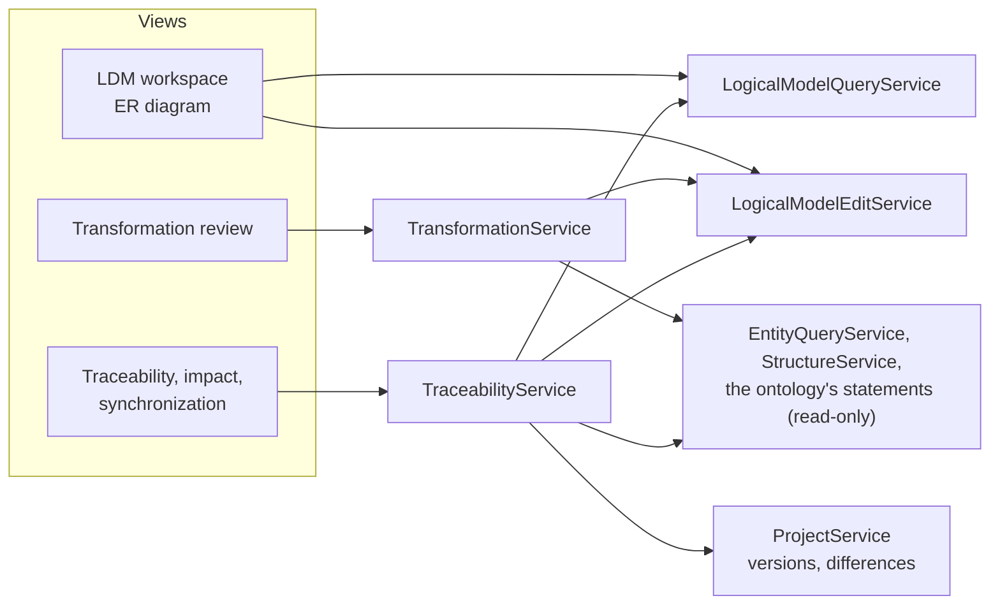

Boundaries enforced by test: the `src/logical` services import nothing of the ontology's model;
transformation and traceability never write the ontology (no import of `OntologyEditService`'s
`apply`); no service imports views or the store (NFR-11). The assistant (`src/ai/`) reaches LDMs
only through these services, as it reaches the ontology through its own (roadmap 5.7).

### 13.5 Changes, revisions, history and versions

**A logical change set** (ADR-023), the counterpart of the ontology's (§4.3):

```ts
interface LogicalChangeSet {
  model: string;                 // the LDM
  baseRevision: string;          // the LDM's revision it was made against
  changes: LogicalChange[];
  summary: string;               // for the history: what the user did, in words
}

type LogicalChange =
  | { op: 'add'; element: LogicalElement }               // the whole element
  | { op: 'remove'; element: LogicalElement }            // the whole element: its inverse is known
  | { op: 'update'; ref: ElementRef; before: Record<string, unknown>; after: Record<string, unknown> };

type LogicalElement =
  | { kind: 'entity'; entity: Omit<LogicalEntity, 'attributes' | 'keys'> }
  | { kind: 'attribute'; entity: string; attribute: LogicalAttribute }
  | { kind: 'key'; entity: string; key: Key }
  | { kind: 'relationship'; relationship: Relationship }
  | { kind: 'generalization'; generalization: Generalization }
  | { kind: 'rule'; rule: BusinessRule }
  | { kind: 'domain'; domain: LogicalDomain }
  | { kind: 'mapping'; mapping: SemanticMapping };
```

The same guarantees as the ontology's: applied atomically or not at all; refused as
`stale-revision` on a moved base; refusals typed (`invalid`, `refused`, `not-found`); its inverse
known, so undo is the inverse applied.

**Revisions per artifact.** The ontology's revision is worked out from the ontology's parts of the
model only; each LDM's from that LDM only. Today the ontology's revision is `revisionOf(stable(model))`,
and `stable()` compares a hand-kept list of the model's fields (`sameMeaning` in
`src/model/stable.ts`): a field left off the list is invisible to it, a field put on it moves the
ontology's revision. LM-1 makes the split explicit (TD-20), so that an LDM edit leaves reasoning
results, validation results, shape proposals and assistant proposals current.

**History.** The document's history undoes a step by putting back the parts of the model it
replaced, whatever they are, so LDM edits are undone and redone with no new mechanism. A step
records which artifacts it changed (`ontology`, `shapes`, `dataGraphs`, `ldm:{id}`), so that the
history can name an LDM change as such (TD-19). Synchronization and transformation never change
the ontology, so a step that changes both does not arise from them.

**Versions** (roadmap 2.3). A version keeps the whole project document, LDMs and their mappings
included, with no change to what a version is. The difference gains a list per LDM: elements
added, removed and changed, and for a change the fields before and after. Restoring a version
restores every artifact, as one step; restoring one LDM alone from a version is an open question
(§13.13). On the server (roadmap LM-5) each LDM has a line of revisions of its own, made of logical
change entries ([DATA_ARCHITECTURE.md](DATA_ARCHITECTURE.md) §11.7).

### 13.6 Transformation: rules and decisions

`TransformationService.propose` reads the ontology as it is written (its statements, structured
class expressions where 2.1 has them) for a **scope** (the whole ontology, a branch under a class,
chosen classes, with or without the entities of loaded imports) under a **configuration** saved
with the LDM:

- **naming**: names from labels as the ontology writes them (the model's own language; choosing
  the label language is left for later), or from local names; letter case and separators;
  singular names; collisions resolved by a suffix and reported;
- **the datatype table**: XSD datatype to logical type, with defaults (`xsd:string` text,
  `xsd:integer` and its subtypes integer, `xsd:decimal` decimal, `xsd:double` and `xsd:float`
  decimal, `xsd:boolean` boolean, `xsd:date` date, `xsd:time` time, `xsd:dateTime` dateTime,
  `xsd:duration` duration, `xsd:anyURI` text, `rdf:langString` text), each changeable;
- **the hierarchy strategy**: a specialization per subclass axiom (default), roll-up into the
  supertype with a discriminator, or roll-down into the subtypes;
- **the object-property strategy**: a relationship (default), or an associative entity for a
  many-to-many;
- **definitions** from `rdfs:comment`, `skos:definition` or neither.

Each proposal is one change it would make, with the axioms it rests on (in functional syntax, and
kept as its mapping's source), the LDM elements it would create or change,
the strategy, the rationale in words, and, where OWL and the LDM differ, what differs. **Structure
for the scope chosen is offered selected; constraints are never selected to begin with**
(ADR-024, NFR-18). The engine is `src/traceability/transform.ts`, pure and run in a worker by
`local.ts`; the review is the *Derive from the ontology…* dialog of the LDM view.

| In the ontology | What it says (open world, no unique names) | What may be proposed | Selected to begin with |
| --- | --- | --- | --- |
| A class in scope | A set of individuals; membership may be inferred | An entity | Yes (structure) |
| `A SubClassOf B`, named classes | Every A is a B | A specialization; or, by the strategy, a roll-up or roll-down | Yes (structure) |
| Disjoint classes; `owl:disjointUnionOf` | No individual in both; B is exactly the disjoint union | *Exclusive* and, for a union, *complete* on the specialization | No |
| A datatype property with domain C and range `xsd:T` | Every value is a T; having a value makes the subject a C (a domain infers a type) | An optional attribute of C's entity, typed by the datatype table | Yes (structure), optional |
| A property with no domain, or a union as domain | Usable by anything | An attribute or relationship on the entity the user chooses; nothing until chosen | — |
| An object property from C to D | Relates individuals; domain and range infer types | A relationship between C's and D's entities, both ends optional | Yes (structure) |
| Functional / inverse functional | At most one value per subject / subject per value, counting individuals that may have several names | The relationship's form: many-to-one / one-to-many, one-to-one with both; stated as the reason | Part of the relationship's proposal, shown as its reason, changeable |
| Neither functional | Any number | Many-to-many: kept, or an associative entity (strategy) | Yes (structure) |
| An inverse pair `P owl:inverseOf Q` | The same relation read both ways | One relationship with both role names | Yes (structure) |
| `C SubClassOf P some D`; `min n`, `exactly n` with n ≥ 1 | Every C has such a value, *known or not*: a C with none recorded is not an inconsistency | *Mandatory* on the attribute or the end at C; for `exactly`, also a maximum | **No**: a candidate constraint, with the difference stated |
| `C SubClassOf P max n` | No C has more than n distinct values | A maximum of n on the end | **No** |
| `C SubClassOf P only D` | Every value of P for a C is a D | The relationship's other end narrowed to D's entity, for C | **No** |
| `C SubClassOf P value v` | Every C has the value v | A business rule in words, or a fixed discriminator value | **No** |
| `owl:hasKey` | Named individuals with equal key values are the same | A candidate key | **No**; the primary key is the user's choice |
| `owl:oneOf`; an enumerated datatype | Exactly these individuals or literals | A domain with enumerated values | **No** |
| Equivalent classes; a defined class | Necessary and sufficient conditions, used to classify | Nothing structural; a rule in words, or a derived or discriminator attribute | **No** |
| Sub-properties, chains, transitivity, reflexivity | Inferences | Nothing; noted in the rationale where they bear on a relationship | — |
| Individuals | Facts about particular things | Not transformed (reference data is Future) | — |
| A shape set chosen as input (FR-M18-7): `sh:minCount 1`, `sh:maxCount`, `sh:in`, `sh:datatype` | What an application's RDF data must have | The same candidate constraints, naming the shape | **No** |

**Non-destructive.** The ontology is never changed. A transformation into an existing LDM
compares each proposal with what the LDM's mappings say was made before: what is already there
as it was made is not proposed again; what the user has changed since (§13.7, *customised*) is
never proposed over; only what is missing, or what the ontology changed and the user did not, is
offered. Applying is one logical change set, with the mappings it implies, undone in one step.

**Proposals, not generation.** The result is a set of decisions to review, with defaults chosen
so that accepting everything as offered gives a faithful but unconstrained structure: every
attribute optional, every end optional, no key, no rule. Constraints are added one by one, by
someone who knows what the application must require.

### 13.7 Semantic mappings and provenance

```ts
interface SemanticMapping {
  id: string;
  sources: { iri: string; axioms: string[] }[];   // ontology entities, and the axioms used, in functional syntax
  targets: ElementRef[];                           // LDM elements
  strategy: string;                                // 'class-to-entity', 'roll-up', 'property-to-associative-entity', 'by-hand', …
  rationale: string;                               // in words
  origin: { ontology: string; revision: string; version?: string }; // the ontology's IRI, its content hash, a named version
  baseline: Record<string, unknown>;               // what this mapping last made of its targets
  status: 'current' | 'stale' | 'broken';          // worked out against the ontology as it is
  made: { by: 'transformation' | 'hand' | 'synchronization' | 'assistant'; at: number; author?: string };
}
```

- **Sources by axiom**, in OWL functional syntax with full IRIs, as SH-3 keeps a shape's origin
  (`cw:fromAxiom`): exact, independent of how the editor draws it, and followed through a change
  of IRI made in the editor.
- **Status.** *Current* while the ontology still states every source axiom; *stale* when one has
  changed (the entity is there, what is said of it is not); *broken* when a source entity or a
  target element is gone. Worked out against the ontology's revision, cached by it, never stored
  as truth.
- **Customised.** A target is customised when it differs from the mapping's `baseline`, the
  content the mapping last produced. This is detected, not declared: the user edits as they
  please, and the product knows which edits were theirs.
- **Many to many.** A mapping has any number of sources and targets; an element any number of
  mappings; an ontology entity mappings in several LDMs. Coverage reports, per LDM, the ontology
  entities in scope with no mapping and the LDM elements with none (application-specific).
- **Provenance.** `origin` says from which ontology revision, and named version where there is
  one, a mapping was last made or synchronized; `made` says how. On the server, `author` is the
  user.

### 13.8 Change impact and synchronization

An **impact report** compares the ontology at each mapping's origin, or at a chosen version, with
the ontology now or another version, using the axiom difference of roadmap task 2.3
(`changesBetween`), restricted to the IRIs and axioms the LDM's mappings reference and to the
transformation's scope. It is worked out per LDM, in a worker.

| Ontology change | Mappings | Impact on the LDM | Synchronization proposal |
| --- | --- | --- | --- |
| A class added in scope | — | Not represented | An entity, as a transformation would propose it |
| A class removed | Broken | Its entity has no semantic source | Remove the entity, or keep it as application-specific |
| A label changed | Current (the IRI is the same) | The name no longer follows the label | Rename, unless the user renamed it |
| A superclass changed | Stale | The specialization no longer matches | Move the subtype |
| A datatype property's range changed | Stale | The attribute's type differs | Change the type, unless customised |
| A property made functional, or no longer | Stale | The relationship's form differs | Change the maximum |
| A restriction added or removed | Stale, or a candidate gone | A candidate constraint appears, or a constraint loses its source | Offer the candidate; flag the constraint, never remove it by itself |
| A property removed | Broken | Its attributes or relationship have no semantic source | Remove them, or keep them |

**Synchronization proposals** are reviewed as transformation proposals are: none selected for a
customised element; a dismissed proposal not offered again until its source changes again;
accepted ones applied as one logical change set, which moves the affected mappings' origin to
the revision they were synchronized with. An ontology change never changes an LDM by itself
(ADR-025).

### 13.9 An LDM's lifecycle

- **Made** by hand, by transformation, by import of the LDM JSON format, or by duplicating
  another (new ids; the copy is independent).
- **Edited** independently, in the workspace and on the diagram; validated as it is edited.
- **Kept** with the project: in the working copy, in My Models, in every version (Local profile);
  as a line of revisions of its own (Server profile, LM-5).
- **Kept in step** with the ontology only by reviewed synchronization; or **detached**, by
  removing its mappings, to live on as a model of its own.
- **Removed**: its mappings go with it; the ontology is untouched.

Several LDMs derived from one ontology each have their own configuration, mappings and impact
reports: two applications may read one domain differently, and both readings are traced to it.

### 13.10 What is reused, and what is new

| Existing component | Reused for |
| --- | --- |
| Layouts over a neutral graph (`src/layout/`, `LayoutGraph`), line geometry (`src/model/geometry.ts`), culling (`src/model/culling.ts`) | The ER diagram, as a view of its own |
| Entity lists, search and pickers (`src/components/Entities.tsx`, `EntityPicker.tsx`) | Entity and attribute lists, and choosing an entity in the workspace |
| Validation findings (`src/model/validation.ts`, `src/validation/`, the Validation view) | LDM findings as one more category, computed from the models themselves rather than run as a job |
| The version difference and its view (`src/projects/difference.ts`, `Versions.tsx`) | LDM differences between versions |
| The axiom difference (`changesBetween` in `src/editing/local.ts`) | Impact reports |
| Proposals reviewed one by one, with origin kept as functional syntax and staleness (`src/model/proposals.ts`, SH-3) | Transformation and synchronization proposals; mapping sources |
| Structured class expressions (`src/editing/axioms.ts`, `src/model/manchester.ts`, 2.1) | Reading restrictions, and showing source axioms in Manchester syntax |
| The assistant (`src/ai/`: tools, proposals, review) | LDM tools and typed LDM proposals (roadmap 5.7) |
| Name making and literal checks (`localName` in `src/model/iri.ts`, `src/model/literals.ts`) | Names from labels; checking a domain's enumerated values and bounds |
| The service pattern (`contracts.ts`, `local.ts`, `boundaries.test.ts`, the JSON round-trip test) | All four new services |

**Not reused.** The ontology's canvas (`src/components/Canvas.tsx`) draws and edits the ontology's
`Model` (TD-05): an LDM is not an ontology and is not forced into that type. The mapping core of
tabular import (`src/mapping/`) turns rows into entities and values, not axioms into structure
(ADR-019). Alignment mappings (`Model.mappings`, `src/model/alignment.ts`) relate ontology
entities to other ontologies' and stay what they are.

**New.** The metamodel and its four services; the LDM workspace and the ER diagram view; the
transformation engine and its configuration; semantic mappings, staleness, impact reports and
synchronization; the LDM JSON format; LDM validation rules.

### 13.11 Scalability

| Concern | Design |
| --- | --- |
| Large LDMs (2,000 entities, 30,000 attributes) | Edits apply to the LDM's parts and work out nothing for the ontology; lists and search over an index built per LDM revision; the diagram culled as the Graph view is (NFR-19). |
| Large ontologies (10,000 classes) | Transformation and impact reports are jobs in a worker, cancellable, keyed by the ontology's and the LDM's revisions. |
| Many LDMs per ontology | Impact restricted, per LDM, to the IRIs and axioms its mappings reference; an index from IRI to mappings, built per revision. |
| Server projects (LM-5) | LDMs queried a page at a time; logical change entries as rows; impact as a job over the server's ontology. |

### 13.12 Out of scope

No physical data model, database-specific data type, table, column, index, storage parameter,
schema generation, SQL DDL or deployment (ADR-026); no data rows, no connection to a database
(the deferred track, §12); no OWL axiom made from an LDM (an LDM informs no ontology by itself);
no second assistant.

### 13.13 Open questions and proposed decisions

Each has a default the roadmap assumes; each could become an ADR of its own when decided.

| Question | Why it matters | Default assumed |
| --- | --- | --- |
| Which ER notation, and more than one? | Users are trained on different ones (IE, Barker, IDEF1X, UML class diagrams). | Information Engineering (crow's foot) only. |
| What language for formal business rules? | A rule in words cannot be checked; a full language is a product of its own. | Words first; a small expression language over attributes later (FR-M17-9). |
| Default strategy for subclass hierarchies? | Specialization keeps the ontology's shape; roll-up is what many applications store. | Specialization, with roll-up and roll-down per hierarchy. |
| Default for an object property that is neither functional nor inverse functional? | Many-to-many is faithful; an associative entity is what a relational design needs. | Many-to-many, with *resolve into an associative entity* offered. |
| Is a standard exchange format for LDMs needed (XMI/UML, a vendor format)? | Interoperability with existing data modelling tools. | The product's own JSON format only, documented; others when asked for. |
| How are LDMs stored on the server: element rows, or documents with change entries? | Query speed against simplicity. | Documents per revision with logical change entries, and an index of mapping sources ([DATA_ARCHITECTURE.md](DATA_ARCHITECTURE.md) §11.7). |
| Are individuals (reference data, code lists) transformed? | Enumerations often live as individuals. | Not in LM-3; enumerations become domains; reference data is Future. |
| Can one LDM be restored from a version on its own? | Undoing a bad LDM session without losing ontology work since. | Not in LM-1: a version restores the whole project. |
| Do entities of imported ontologies enter a transformation's scope? | Modular ontologies spread a domain over files. | Yes, when loaded; mapped by IRI; the importing ontology's revision is the origin. |

## 14. Sources for external facts

Statements about this application are from its source and its own benchmarks, as cited. Version
and requirement facts about third-party software were checked on 2026-10-13 against:

- Apache Jena: Java 17 required from Jena 5; Java 21 announced as the minimum for Jena 6.
  [Jena download page source](https://apache.googlesource.com/jena-site/+/refs/heads/main/source/download/__index.md),
  [Jena change log](https://apache.googlesource.com/jena/+/refs/heads/main/CHANGES.txt).
- Spring Boot 4: at least Java 17.
  [System requirements](https://docs.spring.io/spring-boot/4.0/system-requirements.html).
- ELK 0.6.0: support for OWL API 5.
  [ELK releases](https://github.com/liveontologies/elk-reasoner/releases).
- HermiT: Maven build 1.4.5.519, dated 2020.
  [Maven Central](https://central.sonatype.com/artifact/net.sourceforge.owlapi/org.semanticweb.hermit).
- What `robot.jar` contains (OWL API 4.5.29, HermiT, ELK, JFact, Whelk, Jena 3.17.0 with TDB1,
  no TDB2): read from the file in `reasoner/lib/`.

- Ontop: version 5.5.0 (February 2026), Apache 2.0, R2RML and OWL 2 QL support, the roles of
  its command line, the recommendation of the HTTP endpoint over the Java API, and federation
  of several sources through a federation tool.
  [Ontop guide](https://ontop-vkg.org/guide/),
  [getting started](https://ontop.inf.unibz.it/guide/getting-started.html),
  [endpoint tutorial](https://ontop-vkg.org/tutorial/endpoint/endpoint-cli.html),
  [federation tutorial](https://ontop-vkg.org/tutorial/federation),
  [tutorial paper, 2021](https://www.inf.unibz.it/~calvanese/papers/calv-etal-Patterns-2021.pdf).
  SPARQL features reported unsupported by a commercial distribution:
  [Ontopic Suite documentation](https://docs.ontopic.ai/suite/consume/sparql.html).
- R2RML: W3C Recommendation of 27 September 2012.
  [R2RML](https://www.w3.org/TR/r2rml/).
- RMLMapper and the R2RML test cases:
  [paper, 2024](https://ceur-ws.org/Vol-3718/paper10.pdf).

Not verified here and stated from general knowledge: the complexity classes of the OWL 2
profiles, ELK's published classification times, the capacity of TDB2, Ontop's minimum Java
version and its list of supported databases (PostgreSQL, MySQL and SQL Server are assumed; the
DI-4 spike confirms them). The roadmap measures
the last two before relying on them (the acceptance criteria of Phases 3 and 4).
